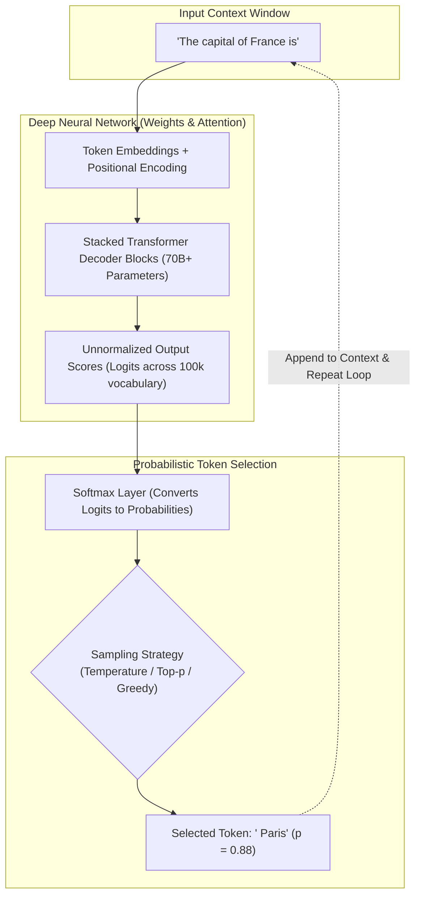
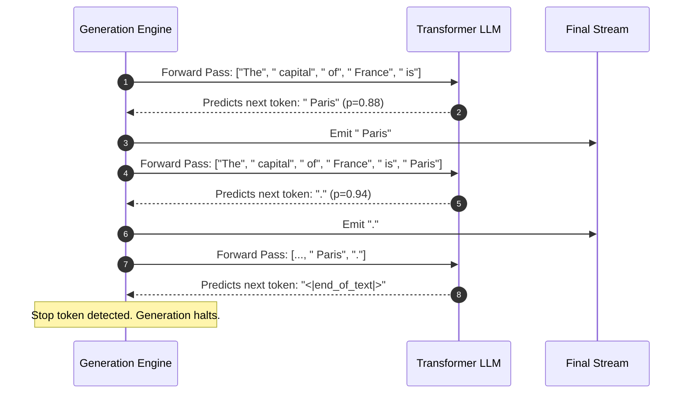
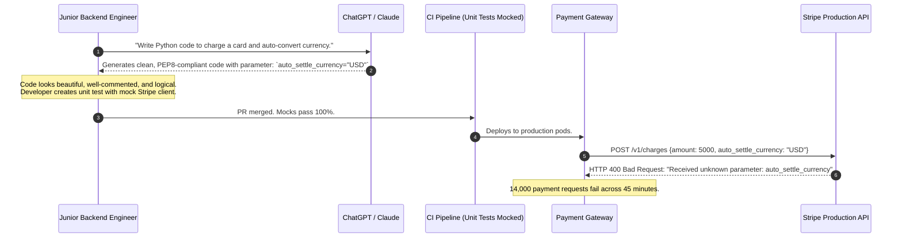

# What Is Generative AI (and What It Isn't)

> **Difficulty**: Beginner-Intermediate | **Estimated Time**: 30m | **Hands-On**: Core Mental Models

> [!TIP]
> **The Golden Rule of Generative AI:**
> **Large Language Models are probabilistic next-token prediction engines, not deterministic database engines or conscious reasoning entities.** Fluency is a mathematical consequence of cross-entropy loss minimization over vast human corpora; factuality is not guaranteed. Never mistake grammatical perfection for factual truth—always anchor LLM generations with external ground truth (RAG), strict schema validators, and deterministic unit tests.

---

## 1. Visual Mental Models: The Autoregressive Generation Engine

For decades, software engineering relied on deterministic computation: given an input $x$ and an algorithm $f$, the output $y = f(x)$ is predictable, reproducible, and bounded.

Generative AI introduces **probabilistic sequence synthesis**. Given a sequence of tokens (words, sub-words, or characters), the model computes a conditional probability distribution over an entire fixed vocabulary $\mathcal{V}$ (typically 32,000 to 128,000 unique tokens) to predict what single token comes next:

$$P(w_{t} \mid w_1, w_2, \dots, w_{t-1})$$



### The Autoregressive Loop: Token-by-Token Generation

The model does **not** generate sentences or paragraphs in a single step. It runs in a recurrent loop where each newly sampled token is appended to the prompt, and the expanded prompt is fed back through the transformer:



---

## 2. Structural Taxonomy: Generative vs. Discriminative vs. Deterministic

| Dimension | Deterministic Code (Traditional) | Discriminative AI (Classic ML) | Generative AI (LLMs / Diffusion) |
| :--- | :--- | :--- | :--- |
| **Core Job** | Execute explicit logic rules ($y = f(x)$) | Classify, score, or categorize ($P(y \mid x)$ where $y \in \{0, 1, \dots, K\}$) | Synthesize new plausible sequences ($P(x)$ or $P(x_{t} \mid x_{<t})$) |
| **Output Space** | Fixed variable types (int, string, struct) | Bounded discrete label or continuous scalar | Unbounded high-dimensional media (text, code, image, audio) |
| **Typical Problem** | Calculate tax on an invoice | Detect spam, predict customer churn, recognize faces | Write unit tests, summarize medical records, generate frontend UI |
| **Failure Mode** | Unhandled exception / NullPointerException | False Positive or False Negative | **Hallucination**: Fluently composed falsehoods |
| **Compute Cost** | Microseconds on CPU | Milliseconds on CPU/GPU | Hundreds of milliseconds on high-end GPU clusters ($H100$) |
| **Reproducibility** | 100% deterministic | Deterministic given fixed weights | Stochastic by default (controlled by temperature seed) |

---

## 3. The Three Fundamental Axioms for Backend Engineers

1. **Axiom 1: Next-token prediction is the sole training objective.**
   LLMs do not possess an internal model of "truth". They are trained via gradient descent to minimize the surprise (cross-entropy loss) of predicting the next token in billions of crawled web pages, GitHub repositories, and books. If bad code or false facts appeared frequently in the training distribution, the model will cheerfully synthesize bad code and false facts.
2. **Axiom 2: Hallucination is a feature, not a bug.**
   The ability of an LLM to generate creative poetry, synthesize novel code solutions, and brainstorm architecture options stems from the *same* sampling mechanism that invents non-existent API endpoints. An LLM that could never hallucinate could only repeat memorized sentences verbatim.
3. **Axiom 3: LLMs have zero persistent state between requests.**
   An LLM does not "remember" previous conversations. Each request is a standalone stateless inference pass. Multi-turn chat is created artificially by the backend, which concatenates past message history into the input context window before sending it to the model.

---

## 4. Production War Story: The Confident Fabricator

```
INCIDENT SUMMARY: INC-8812
SEVERITY: P1 - Production Outage
IMPACT: 14,000 checkout transactions failed with HTTP 500; $420,000 in lost revenue.
ROOT CAUSE: A backend engineer asked an LLM to generate an Stripe integration script; the LLM fluently invented a non-existent parameter.
```

### Incident Timeline



### The Post-Mortem

- **The Fallacy**: The engineer assumed that because the LLM generated grammatically perfect Python code with accurate variable names, the parameter `auto_settle_currency` must exist in the real Stripe API.
- **The Reality**: The LLM recognized that "currency auto-settlement" was semantically plausible and synthesized a convincing parameter name out of its probabilistic weights.
- **The Remediation**:
  1. Mandated end-to-end integration tests hitting sandbox provider APIs instead of relying on manually mocked unit tests.
  2. Banned copying LLM-generated API client code without verifying against official published SDK documentation.
  3. Integrated static type analysis with strict library stubs (`mypy --strict`, `tsc`).

---

## 5. Multi-Language Production Implementations: Autoregressive Sampling Engine

To understand how an LLM transforms raw numbers (logits) into words, study this deterministic sampling simulator that converts vocabulary scores into probability distributions.

### Python (`autoregressive_sampling.py`)

```python
import math
import random
from typing import List, Tuple

# Simulated vocabulary
VOCABULARY = [" Paris", " London", " Berlin", " Rome", " Madrid", " Tokyo"]

# Raw unnormalized model output scores (Logits)
LOGITS = [8.5, 3.2, 2.1, 1.8, 1.2, 0.4]

def softmax(logits: List[float], temperature: float = 1.0) -> List[float]:
    """Applies temperature scaling and softmax normalization."""
    # Prevent divide-by-zero
    temp = max(temperature, 1e-5)
    scaled_logits = [l / temp for l in logits]
    max_logit = max(scaled_logits) # Numerical stability trick
    exp_logits = [math.exp(l - max_logit) for l in scaled_logits]
    total_exp = sum(exp_logits)
    return [e / total_exp for e in exp_logits]

def sample_next_token(vocab: List[str], probs: List[float]) -> Tuple[str, float]:
    """Selects a token according to the probability distribution."""
    r = random.random()
    cumulative = 0.0
    for token, prob in zip(vocab, probs):
        cumulative += prob
        if r <= cumulative:
            return token, prob
    return vocab[-1], probs[-1]

if __name__ == "__main__":
    print("=== NEXT-TOKEN PROBABILISTIC SAMPLING ===")
    for temp in [0.2, 0.7, 1.5]:
        probabilities = softmax(LOGITS, temperature=temp)
        print(f"\nTemperature: {temp}")
        for token, prob in zip(VOCABULARY, probabilities):
            print(f"  {token:<10}: {prob * 100:6.2f}%")
        
        chosen_token, chosen_prob = sample_next_token(VOCABULARY, probabilities)
        print(f"  👉 Sampled Token: '{chosen_token.strip()}' (p = {chosen_prob * 100:.2f}%)")
```

### TypeScript / Node.js (`autoregressive_sampling.ts`)

```typescript
const VOCABULARY = [' Paris', ' London', ' Berlin', ' Rome', ' Madrid'];
const RAW_LOGITS = [8.5, 3.2, 2.1, 1.8, 1.2];

export function computeSoftmax(logits: number[], temperature: number = 1.0): number[] {
  const temp = Math.max(temperature, 0.001);
  const scaled = logits.map((l) => l / temp);
  const maxLogit = Math.max(...scaled);

  const expScores = scaled.map((l) => Math.exp(l - maxLogit));
  const sumExp = expScores.reduce((acc, curr) => acc + curr, 0);

  return expScores.map((score) => score / sumExp);
}

export function sampleToken(vocab: string[], probs: number[]): { token: string; prob: number } {
  const rand = Math.random();
  let cumulative = 0;

  for (let i = 0; i < vocab.length; i++) {
    cumulative += probs[i];
    if (rand <= cumulative) {
      return { token: vocab[i], prob: probs[i] };
    }
  }

  return { token: vocab[vocab.length - 1], prob: probs[probs.length - 1] };
}

// Evaluate at Greedy (T=0.1) vs Creative (T=1.2)
const greedyProbs = computeSoftmax(RAW_LOGITS, 0.1);
console.log('Greedy Top Candidate:', VOCABULARY[0], (greedyProbs[0] * 100).toFixed(2) + '%');
```

### Go (`autoregressive_sampling.go`)

```go
package main

import (
	"fmt"
	"math"
	"math/rand"
	"time"
)

var vocab = []string{" Paris", " London", " Berlin", " Rome", " Madrid"}
var logits = []float64{8.5, 3.2, 2.1, 1.8, 1.2}

func computeSoftmax(raw []float64, temp float64) []float64 {
	if temp < 1e-4 {
		temp = 1e-4
	}
	scaled := make([]float64, len(raw))
	maxVal := -1e9
	for i, l := range raw {
		scaled[i] = l / temp
		if scaled[i] > maxVal {
			maxVal = scaled[i]
		}
	}

	sumExp := 0.0
	expVals := make([]float64, len(raw))
	for i, s := range scaled {
		expVals[i] = math.Exp(s - maxVal)
		sumExp += expVals[i]
	}

	probs := make([]float64, len(raw))
	for i := range expVals {
		probs[i] = expVals[i] / sumExp
	}
	return probs
}

func main() {
	rand.Seed(time.Now().UnixNano())
	probs := computeSoftmax(logits, 0.7)

	fmt.Println("--- Next-Token Probability Distribution ---")
	for i, token := range vocab {
		fmt.Printf("%-10s : %6.2f%%\n", token, probs[i]*100)
	}
}
```

---

## 6. Practical CLI Workflows: Inspecting Live Token Probabilities

Modern LLM APIs permit engineers to inspect the exact top candidates and log probabilities computed during inference.

### Inspecting Log Probabilities via cURL

```bash
curl https://api.openai.com/v1/chat/completions \
  -H "Content-Type: application/json" \
  -H "Authorization: Bearer $OPENAI_API_KEY" \
  -d '{
    "model": "gpt-4o-mini",
    "messages": [{"role": "user", "content": "The capital of France is"}],
    "temperature": 0.0,
    "max_tokens": 1,
    "logprobs": true,
    "top_logprobs": 5
  }' | jq '.choices[0].logprobs.content[0]'
```

**Expected Output:**
```json
{
  "token": " Paris",
  "logprob": -0.000341,
  "top_logprobs": [
    { "token": " Paris", "logprob": -0.000341 },
    { "token": " Paris", "logprob": -8.129412 },
    { "token": " the", "logprob": -10.45129 },
    { "token": " universally", "logprob": -12.18921 },
    { "token": " located", "logprob": -13.41928 }
  ]
}
```

Notice that `" Paris"` has a log probability of $-0.000341$ (calculated as $e^{-0.000341} \approx 0.9996$, or **99.96% probability**)!

---

## 7. Operational Validation Checkpoints

Confirm your fundamental mental model of generative systems with these technical scenarios.

<details>
<summary><b>Checkpoint 1: Why does an LLM confidently answer "Yes" when asked if a 15-digit composite number is prime?</b></summary>

**Analysis:**
An LLM does not execute primality testing algorithms (like the Miller-Rabin test). It has no internal ALU executing division or modulo arithmetic.
When prompted *"Is 491,829,381,921,837 prime?"*, the model generates tokens matching the syntactic tone of mathematical textbooks. Because primes are frequently discussed in academic prose with assertive declarations (*"Yes, this is an irreducible prime"*), the tokens for positive assertion have high probability weights. Without external tool-calling (calculators, Python REPLs), the LLM's response is an educated stylistic guess.
</details>

<details>
<summary><b>Checkpoint 2: What is the architectural difference between asking an LLM for a user's account balance vs querying a SQL database?</b></summary>

**Comparison:**
- **SQL Database Query:** Deterministic, stateful, ACID-compliant retrieval. Looks up the exact row in an index; returns accurate ground truth or `NOT FOUND`.
- **Direct LLM Query:** Parametric, stateless, probabilistic generation. The LLM has no live connection to your banking ledger; it attempts to guess plausible numbers based on text patterns it has seen.
- **The Correct Architecture:** The LLM is used strictly as a **natural language interface to generate structured tool calls** (e.g. `get_balance(user_id="alice")`), and the deterministic backend executes the actual SQL query.
</details>

<details>
<summary><b>Checkpoint 3: What happens mathematically to the token probability distribution when Temperature approaches 0?</b></summary>

**Mathematical Behavior:**
In the softmax equation:
$$P(w_i) = \frac{e^{z_i / T}}{\sum_j e^{z_j / T}}$$
As Temperature $T \to 0$:
- The difference between the highest logit ($z_{\max}$) and all other logits approaches infinity.
- The probability of the single top candidate approaches **1.0 (100%)**.
- The probabilities of all other candidates approach **0.0 (0%)**.
This collapses stochastic sampling into **Greedy Decoding (Argmax)**, making model output deterministic.
</details>

---

## Next

Continue to **[01-discriminative-vs-generative-models](../01-discriminative-vs-generative-models/README.md)** to explore the mathematical and architectural distinctions between classifier models and generative foundation models.
