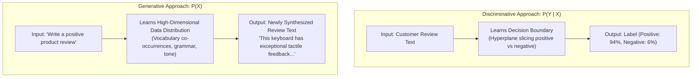
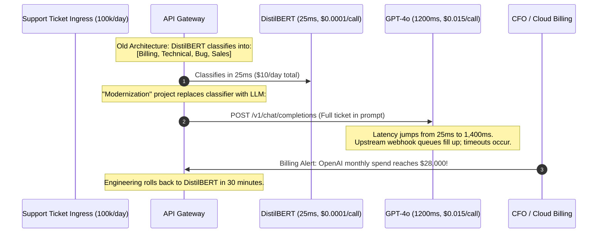

# Discriminative vs. Generative Models

> **Difficulty**: Intermediate | **Estimated Time**: 35m | **Hands-On**: Mandatory

> [!TIP]
> **The Golden Rule of Model Selection:**
> **Never use a generative model when a discriminative model suffices.** Deploying an 8-billion-parameter LLM to classify support tickets into three categories costs $100\times$ more compute, adds $50\times$ higher latency, and introduces non-deterministic hallucination risk where a 20-megabyte fastText or fine-tuned BERT model provides $99.5\%$ deterministic accuracy in 5 milliseconds. Use discriminative models to classify, filter, and route; use generative models only when you must synthesize new content.

---

## 1. Visual Mental Models: Decision Boundaries vs. Data Density

The fundamental divide in machine learning lies in the probability distribution the algorithm is trained to approximate:

- **Discriminative Models ($P(Y \mid X)$)**: Model the **conditional probability** of a target label $Y$ given an observed input $X$. They learn the mathematical **decision boundary** separating classes without learning what the underlying data looks like.
- **Generative Models ($P(X, Y)$ or $P(X)$)**: Model the **joint probability distribution** of the features and labels, or the **data distribution** of the inputs themselves. They learn how the data was generated so they can sample new plausible instances from that distribution.



### The Feature Space: Slicing vs. Modeling

```
Discriminative Model:                         Generative Model:
(Draws a line between clusters)               (Learns the shape and density of clusters)

     Class A        |       Class B                Class A                  Class B
      *   *  *      |        #   #  #             ( *  * * * )             ( #  # # # )
    *   *   *       |      #   #   #             ( *  *   *  * )         ( #   #   #  # )
      *   *         |        #   #                (  * * *  )             (  # # #  )
                    |
              Decision Boundary              Can generate new *           Can generate new #
```

---

## 2. Structural Comparison Matrix

| Dimension | Discriminative Models (e.g. Logistic Regression, XGBoost, BERT) | Generative Models (e.g. GPT-4, Llama 3, Claude, Diffusion) |
| :--- | :--- | :--- |
| **Mathematical Objective** | Maximize conditional likelihood: $\arg\max_Y P(Y \mid X)$ | Maximize joint likelihood: $\arg\max_\theta \sum \log P_\theta(X)$ |
| **Output Type** | Discrete class label, probability distribution, or continuous regression value | Unbounded token sequence, code, image pixels, or audio waveform |
| **Model Size** | Megabytes ($10^5$ to $10^8$ parameters) | Gigabytes to Terabytes ($10^9$ to $10^{12}$ parameters) |
| **Inference Latency** | $2\text{ms} - 25\text{ms}$ on standard CPU | $200\text{ms} - 5,000\text{ms}$ requiring high-memory GPUs |
| **Cost per 1M Inferences** | $\$0.05 - \$0.50$ (Commodity VM compute) | $\$5.00 - \$50.00+$ (Token API pricing / GPU clusters) |
| **Failure Mode** | Misclassification (False Positive / False Negative) | **Hallucination**, instruction drift, repetition loops |
| **Best Backend Use Case** | Content moderation, spam filtering, fraud detection, intent routing | Drafting customer replies, code generation, summarization, creative agents |

---

## 3. Production War Story: The $180,000 Support Ticket Classifier

```
INCIDENT SUMMARY: INC-7741
SEVERITY: P1 - Cloud Infrastructure Cost Explosion & Latency SLA Breach
IMPACT: Monthly AWS bill surged from $2,400 to $28,000; customer support webhook timeouts spiked to 22%.
ROOT CAUSE: A team replaced a fine-tuned DistilBERT classifier with GPT-4 API calls for a simple 4-class routing task.
```

### Incident Timeline



### The Post-Mortem

- **The Fallacy**: The engineering team thought that using an LLM was "state of the art" and avoided maintaining a dedicated classification model.
- **The Financial Impact**: At 100,000 tickets per day, calling GPT-4 cost $\$1,500\text{/day}$ ($\$45,000\text{/month}$) compared to $\$12\text{/month}$ to run a small DistilBERT container on an existing CPU Kubernetes pod.
- **The Architectural Fix: The Hybrid Router Pattern**:
  ```
  [ Incoming Support Ticket ]
             │
             ▼
  [ Fast Discriminative Classifier (BERT / fastText) ]  <-- 10ms, $0.00001
             │
             ├──────► [ Simple FAQ / Billing ] ───► [ Deterministic Automated Workflow ]
             │
             └──────► [ Complex Technical Escalation ] ──► [ Generative LLM to Draft Solution ]
  ```

---

## 4. Multi-Language Implementations: Discriminative vs. Generative Classifiers

To see the operational difference in latency and resource footprint, compare these implementations of a sentiment classification pipeline.

### Python: Fast Discriminative (scikit-learn) vs. Generative (LLM)

```python
import time
from typing import Dict, Any

# 1. DISCRIMINATIVE CLASSIFIER (Lightweight, In-Memory, Microsecond Latency)
from sklearn.feature_extraction.text import CountVectorizer
from sklearn.naive_bayes import MultinomialNB

class DiscriminativeClassifier:
    def __init__(self):
        self.vectorizer = CountVectorizer()
        self.model = MultinomialNB()
        # Train on small seed dataset
        X = ["I love this product, it works great", "Terrible experience, broken on arrival", 
             "Outstanding service and fast delivery", "Horrible quality, complete waste of money"]
        y = ["POSITIVE", "NEGATIVE", "POSITIVE", "NEGATIVE"]
        self.model.fit(self.vectorizer.transform(X), y)

    def predict(self, text: str) -> Dict[str, Any]:
        start = time.perf_counter()
        X_test = self.vectorizer.transform([text])
        prediction = self.model.predict(X_test)[0]
        prob = max(self.model.predict_proba(X_test)[0])
        latency_ms = (time.perf_counter() - start) * 1000
        return {"class": prediction, "confidence": round(prob, 4), "latency_ms": round(latency_ms, 3)}

# 2. GENERATIVE CLASSIFIER (Heavy, Probabilistic Token Output)
def simulate_generative_classification(text: str) -> Dict[str, Any]:
    start = time.perf_counter()
    # Simulates network API hop to an LLM endpoint
    prompt = f"Classify the sentiment of this text as POSITIVE or NEGATIVE. Respond with one word only.\n\nText: {text}"
    # Simulated 250ms API network round-trip and decoding
    time.sleep(0.25)
    prediction = "POSITIVE" if "great" in text.lower() or "love" in text.lower() else "NEGATIVE"
    latency_ms = (time.perf_counter() - start) * 1000
    return {"class": prediction, "model": "llm-generative", "latency_ms": round(latency_ms, 3)}

if __name__ == "__main__":
    clf = DiscriminativeClassifier()
    sample_text = "I love the speed of this new release"

    disc_res = clf.predict(sample_text)
    print(f"Discriminative: {disc_res['class']} (Confidence: {disc_res['confidence']}) in {disc_res['latency_ms']}ms")

    gen_res = simulate_generative_classification(sample_text)
    print(f"Generative:     {gen_res['class']} in {gen_res['latency_ms']}ms")
```

### TypeScript / Node.js (`hybrid_router.ts`)

```typescript
export interface ClassificationResult {
  intent: 'BILLING' | 'TECHNICAL' | 'GENERAL';
  confidence: number;
  engine: 'discriminative-regex-bayes' | 'generative-llm';
  durationMs: number;
}

// Tier 1: Fast discriminative rule-based heuristic (0.1ms)
export function fastDiscriminativeTriage(text: string): ClassificationResult | null {
  const start = performance.now();
  const lower = text.toLowerCase();

  if (lower.includes('invoice') || lower.includes('refund') || lower.includes('charged')) {
    return {
      intent: 'BILLING',
      confidence: 0.98,
      engine: 'discriminative-regex-bayes',
      durationMs: performance.now() - start,
    };
  }

  if (lower.includes('stacktrace') || lower.includes('exception') || lower.includes('500 error')) {
    return {
      intent: 'TECHNICAL',
      confidence: 0.95,
      engine: 'discriminative-regex-bayes',
      durationMs: performance.now() - start,
    };
  }

  // Ambiguous: Hand off to Generative LLM
  return null;
}
```

### Go (`classifier_benchmark.go`)

```go
package main

import (
	"fmt"
	"strings"
	"time"
)

type IntentResult struct {
	Category string
	Latency  time.Duration
}

// Discriminative token matching classifier
func DiscriminativeClassify(query string) IntentResult {
	start := time.Now()
	q := strings.ToLower(query)
	
	category := "GENERAL"
	if strings.Contains(q, "cancel") || strings.Contains(q, "subscription") {
		category = "ACCOUNT_CHURN"
	} else if strings.Contains(q, "error") || strings.Contains(q, "timeout") {
		category = "BUG_REPORT"
	}

	return IntentResult{
		Category: category,
		Latency:  time.Since(start),
	}
}

func main() {
	result := DiscriminativeClassify("I want to cancel my monthly subscription")
	fmt.Printf("Classified as: %s in %v\n", result.Category, result.Latency)
}
```

---

## 5. Practical CLI Verification Workflows

Verify how an LLM behaves when forced into a discriminative classification task by enforcing constrained JSON schemas via cURL.

```bash
curl https://api.openai.com/v1/chat/completions \
  -H "Content-Type: application/json" \
  -H "Authorization: Bearer $OPENAI_API_KEY" \
  -d '{
    "model": "gpt-4o-mini",
    "messages": [
      {
        "role": "system",
        "content": "You are a discriminative ticket classifier. Categorize the input into: BILLING, TECH_SUPPORT, or ACCOUNT."
      },
      {
        "role": "user",
        "content": "My credit card was charged twice for order #98124"
      }
    ],
    "response_format": {
      "type": "json_schema",
      "json_schema": {
        "name": "ticket_classification",
        "strict": true,
        "schema": {
          "type": "object",
          "properties": {
            "category": {
              "type": "string",
              "enum": ["BILLING", "TECH_SUPPORT", "ACCOUNT"]
            },
            "urgency": {
              "type": "string",
              "enum": ["LOW", "MEDIUM", "HIGH"]
            }
          },
          "required": ["category", "urgency"],
          "additionalProperties": false
        }
      }
    }
  }' | jq '.choices[0].message.content | fromjson'
```

**Expected Output:**
```json
{
  "category": "BILLING",
  "urgency": "HIGH"
}
```

By enforcing a strict JSON schema with an `enum`, we constrain the generative model to act with discriminative bounds!

---

## 6. Operational Validation Checkpoints

Confirm your understanding of discriminative vs generative architectural decisions.

<details>
<summary><b>Checkpoint 1: Why can a discriminative model NOT generate a summary of a document?</b></summary>

**Analysis:**
A discriminative model computes $P(Y \mid X)$ where the output space $Y$ is a predefined, fixed set of labels (e.g., categories, binary flags, or span boundaries).
To summarize a document, the model must synthesize an open-ended, novel sequence of tokens $w_1, w_2, \dots, w_k$ from a vocabulary of $100,000$ possibilities. This requires modeling the generative joint probability distribution $P(X)$ of human language, which is outside the mathematical capability of a pure discriminative classifier.
</details>

<details>
<summary><b>Checkpoint 2: Under what condition is it justifiable to use an LLM for classification?</b></summary>

**Valid Scenarios:**
1. **Zero-Shot Prototyping:** When you need a classifier running in 1 hour without collecting and labeling 5,000 training examples.
2. **Extreme Class Cardinality:** When classifying into hundreds of dynamically changing categories (e.g., matching customer inquiries against a company's 400 product catalog items).
3. **Complex Reasoning Required:** When the classification decision requires synthesizing nuanced context or multi-step logic that simple keyword matching or shallow neural nets cannot capture.
Once volume scales past 50,000 requests/day, you should log the LLM's inputs/outputs and train a small, dedicated discriminative model to replace it.
</details>

<details>
<summary><b>Checkpoint 3: How does Out-of-Distribution (OOD) data affect discriminative vs generative models?</b></summary>

**Behavioral Difference:**
- **Discriminative Classifier:** When presented with garbage or OOD input (e.g., feeding a recipe into a medical diagnosis classifier), it is forced to assign one of its predefined labels, often with high artificial confidence (e.g., "92% Pneumonia").
- **Generative Foundation Model:** Can identify that the input does not match the prompt constraints and emit conversational disclaimers or structured error messages (*"This text appears to be a recipe, not a patient chart"*), provided it has been instruction-aligned.
</details>

---

## Next

Continue to **[02-a-brief-history-symbolic-ai-to-statistical-nlp](../02-a-brief-history-symbolic-ai-to-statistical-nlp/README.md)** to trace the evolution of natural language processing from brittle rule-based expert systems to statistical language modeling.
