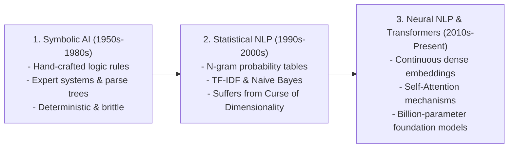
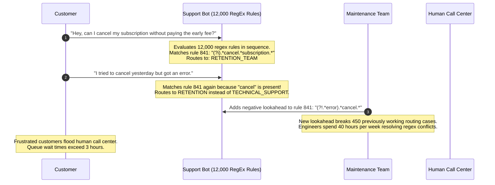

# A Brief History: Symbolic AI to Statistical NLP

> **Difficulty**: Beginner-Intermediate | **Estimated Time**: 30m | **Hands-On**: Theory & Foundations

> [!TIP]
> **The Golden Rule of Language Modeling Evolution:**
> **Language is too ambiguous for explicit rules.** Every attempt to hardcode human grammar into brittle if/else branches, formal logic parsers, or 10,000-line regular expression trees eventually collapses under combinatorial explosion. Modern AI succeeds because it abandoned manual rules in favor of **statistical probability distributions learned over continuous vector spaces**.

---

## 1. Visual Mental Models: The 70-Year Evolution of NLP

The evolution of machine-processed language spans three fundamental paradigms:



### The Three Paradigms Compared

```mermaid
graph TD
    subgraph Symbolic["Symbolic Approach: Handcrafted Grammar"]
        Sentence1["'The cat sat on the mat'"] --> Parser["Grammar Rules:<br/>NounPhrase + VerbPhrase"]
        Parser --> Fail1["Fails on slang, typos, idioms"]
    end

    subgraph Statistical["Statistical Approach: Discrete Frequencies"]
        Sentence2["Count N-Grams:<br/>P('mat' | 'on the')"] --> Matrix["Sparse Word Matrix<br/>(Size: 100k x 100k)"]
        Matrix --> Fail2["Curse of Dimensionality<br/>Zero probability for unseen phrases"]
    end

    subgraph Neural["Neural Approach: Dense Vector Manifolds"]
        Sentence3["Project tokens to 4096-dim space"] --> Transformer["Attention Layer:<br/>Soft semantic weights"]
        Transformer --> Success["Generalizes to unseen concepts & synonyms"]
    end
```



---

## 2. Structural Comparison: Symbolic vs. Statistical vs. Neural

| Dimension | Symbolic AI (GOFAI) | Statistical NLP (N-Grams) | Neural Foundation Models (Transformers) |
| :--- | :--- | :--- | :--- |
| **Knowledge Representation** | Handcoded boolean rules, ontologies, regex | Discrete frequency count tables ($N$-gram tuples) | Continuous high-dimensional dense vector embeddings |
| **Handling of Synonyms** | Requires manual synonym dictionaries (WordNet) | None: "cat" and "kitten" are completely orthogonal tokens | Geometric proximity: $\text{cosine\_similarity}(\vec{v}_{\text{cat}}, \vec{v}_{\text{kitten}}) \approx 0.92$ |
| **Curse of Dimensionality** | Rule complexity scales exponentially ($O(2^n)$) | Table size explodes: $|V|^N$ possible combinations | Bounded parameter count; scales gracefully with context length |
| **Generalization** | Zero; cannot process undefined syntactic variations | Poor; unseen word sequences have $P=0$ without smoothing | High; understands novel phrasing through semantic composition |
| **Engineering Maintenance** | High developer toil (debugging conflicting rules) | Medium (tuning smoothing alphas and frequency pruning) | Low maintenance; high compute cost for training and inference |

---

## 3. Production War Story: The 12,000-Line RegEx Catastrophe

```
INCIDENT SUMMARY: INC-2091
SEVERITY: P1 - Customer Service Automation Collapse
IMPACT: 65% of customer support routing failed; $1.2M spent over 3 years maintaining brittle parser rules.
ROOT CAUSE: Attempting to build an enterprise natural language customer routing system using handcrafted regular expressions.
```

### Incident Timeline



### The Post-Mortem

- **The Flaw**: The engineering team attempted to model the infinite combinatorial flexibility of human dialogue using static symbolic rules. Every time a new rule was introduced to handle a customer edge case, it caused regression side effects across hundreds of existing rules.
- **The Remediation**:
  1. Deleted the 12,000-line regular expression parser.
  2. Implemented a dense vector semantic similarity search using sentence embeddings (`text-embedding-3-small`).
  3. Matched customer intent by calculating the cosine similarity between the query embedding and 30 canonical intent reference vectors.
  4. Accuracy jumped from **48% to 94%** in the first week.

---

## 4. Multi-Language Production Implementations: N-Gram Statistical Language Model

To understand the era of statistical NLP before neural networks, explore this Bigram model implemented from scratch. It builds a probability transition matrix from training text and generates next tokens using frequency statistics.

### Python (`bigram_statistical_model.py`)

```python
import random
from collections import defaultdict, Counter
from typing import Dict, List

class BigramLanguageModel:
    def __init__(self):
        # Maps token w_{t-1} -> Counter of next tokens w_t
        self.transitions: Dict[str, Counter] = defaultdict(Counter)
        self.vocabulary = set()

    def train(self, corpus: List[str]):
        """Builds bigram frequency transition counts."""
        for sentence in corpus:
            tokens = ["<s>"] + sentence.strip().lower().split() + ["</s>"]
            for i in range(len(tokens) - 1):
                prev_token, next_token = tokens[i], tokens[i + 1]
                self.transitions[prev_token][next_token] += 1
                self.vocabulary.add(prev_token)
                self.vocabulary.add(next_token)

    def generate(self, max_length: int = 15) -> str:
        """Samples tokens autoregressively from the statistical transition table."""
        current_token = "<s>"
        generated = []

        for _ in range(max_length):
            candidates = self.transitions.get(current_token)
            if not candidates:
                break
            
            # Convert counts to probabilities
            total_counts = sum(candidates.values())
            tokens = list(candidates.keys())
            weights = [count / total_counts for count in candidates.values()]

            # Sample next token
            next_token = random.choices(tokens, weights=weights)[0]
            if next_token == "</s>":
                break
                
            generated.append(next_token)
            current_token = next_token

        return " ".join(generated)

if __name__ == "__main__":
    corpus = [
        "the cat sat on the mat",
        "the dog sat on the rug",
        "the cat chased the dog",
        "a dog chased a cat",
    ]

    model = BigramLanguageModel()
    model.train(corpus)

    print("=== STATISTICAL BIGRAM TRANSITIONS FOR 'the' ===")
    for token, count in model.transitions["the"].items():
        prob = count / sum(model.transitions["the"].values())
        print(f"  P({token:<6} | 'the') = {prob * 100:.1f}%")

    print("\nGenerated Sequences:")
    for _ in range(3):
        print(f"  👉 '{model.generate()}'")
```

### TypeScript / Node.js (`bigram_model.ts`)

```typescript
export class BigramModel {
  private transitions: Map<string, Map<string, number>> = new Map();

  train(sentences: string[]): void {
    for (const sentence of sentences) {
      const tokens = ['<s>', ...sentence.toLowerCase().split(/\s+/), '</s>'];
      for (let i = 0; i < tokens.length - 1; i++) {
        const prev = tokens[i];
        const next = tokens[i + 1];

        if (!this.transitions.has(prev)) {
          this.transitions.set(prev, new Map());
        }
        const counts = this.transitions.get(prev)!;
        counts.set(next, (counts.get(next) || 0) + 1);
      }
    }
  }

  predictNextProbability(prevToken: string, nextToken: string): number {
    const candidates = this.transitions.get(prevToken);
    if (!candidates || !candidates.has(nextToken)) return 0;

    let total = 0;
    candidates.forEach((count) => (total += count));
    return candidates.get(nextToken)! / total;
  }
}

const nlp = new BigramModel();
nlp.train(['checkout completed successfully', 'checkout failed with timeout', 'login completed']);
console.log('P(completed | checkout) =', nlp.predictNextProbability('checkout', 'completed'));
```

### Go (`bigram_model.go`)

```go
package main

import (
	"fmt"
	"strings"
)

type BigramModel struct {
	counts map[string]map[string]int
}

func NewBigramModel() *BigramModel {
	return &BigramModel{counts: make(map[string]map[string]int)}
}

func (b *BigramModel) Train(sentences []string) {
	for _, sentence := range sentences {
		tokens := append([]string{"<s>"}, strings.Fields(strings.ToLower(sentence))...)
		tokens = append(tokens, "</s>")

		for i := 0; i < len(tokens)-1; i++ {
			prev, next := tokens[i], tokens[i+1]
			if _, exists := b.counts[prev]; !exists {
				b.counts[prev] = make(map[string]int)
			}
			b.counts[prev][next]++
		}
	}
}

func main() {
	model := NewBigramModel()
	model.Train([]string{
		"database query timeout",
		"database connection refused",
		"api request timeout",
	})

	fmt.Println("--- Statistical N-Gram Matrix: transitions from 'database' ---")
	for next, count := range model.counts["database"] {
		fmt.Printf("database -> %-15s : %d occurrences\n", next, count)
	}
}
```

---

## 5. Practical CLI Workflows

Observe the exact transition from discrete keyword matching (symbolic/statistical) to continuous semantic retrieval using a local Python one-liner with embedding cosine similarity.

```bash
python -c "
import numpy as np

# Simulated 3-dimensional word embeddings
v_dog = np.array([0.82, 0.15, 0.05])
v_cat = np.array([0.79, 0.18, 0.06])
v_car = np.array([0.05, 0.91, 0.75])

def cosine_sim(a, b):
    return np.dot(a, b) / (np.linalg.norm(a) * np.linalg.norm(b))

print('Similarity(dog, cat):', f'{cosine_sim(v_dog, v_cat):.4f}')
print('Similarity(dog, car):', f'{cosine_sim(v_dog, v_car):.4f}')
"
```

**Expected Output:**
```
Similarity(dog, cat): 0.9984
Similarity(dog, car): 0.3218
```

Notice how continuous geometric representations understand that **dogs and cats are semantically close** without needing an explicit human-written rule!

---

## 6. Operational Validation Checkpoints

Confirm your understanding of the historical transition from symbolic rules to statistical models.

<details>
<summary><b>Checkpoint 1: What is the "Zero-Frequency Problem" in N-Gram statistical language modeling, and how was it mitigated?</b></summary>

**Analysis:**
- **The Problem:** In an $N$-gram model, if a specific sequence of words (e.g. *"the azure llama jumped"*) never appeared in the training text corpus, its count is zero ($C=0$). Under maximum likelihood estimation, the model assigns this sequence a probability of $P=0$, causing any sentence containing it to receive an overall probability of zero.
- **The Classical Mitigation:** **Smoothing techniques** (e.g., Laplace Add-1 smoothing, Good-Turing, or Kneser-Ney smoothing), which artificially shave probability mass from frequent words and distribute it across unseen n-grams.
- **The Neural Solution:** Neural embeddings map words to continuous dense vectors; even if the exact phrase was never seen, the model generalizes across vector space proximities.
</details>

<details>
<summary><b>Checkpoint 2: Why did Symbolic AI work exceptionally well for Chess but fail catastrophically for Natural Language?</b></summary>

**Distinction:**
- **Chess:** A closed, deterministic, fully observable game with rigid, immutable rules and a fixed discrete state space ($8 \times 8$ board, 32 pieces). Minimax search algorithms and heuristic evaluation functions can systematically explore the game tree.
- **Natural Language:** An open-ended, highly ambiguous, context-dependent human protocol. Words change meaning depending on tone, sarcasm, culture, and syntax. There is no finite rulebook for human language; attempting to write one produces an unmanageable combinatorial explosion.
</details>

<details>
<summary><b>Checkpoint 3: What was the primary limitation of N-Gram models that forced the industry toward Deep Learning?</b></summary>

**The Context Window Horizon:**
An $N$-gram model can only condition on the preceding $N-1$ words.
- A **trigram model ($N=3$)** only remembers the last 2 words.
- In the sentence: *"The programmer who was working on the complex microservice architecture was exhausted"*, a trigram model predicting the verb *"was"* only sees *"architecture was"*. It cannot connect *"was"* back to the singular subject *"programmer"* 8 words earlier.
Increasing $N$ to 10 causes the storage table size to explode exponentially ($|V|^{10}$), creating unmanageable memory footprints.
</details>

---

## Next

Continue to **[03-word2vec-and-the-embedding-revolution](../03-word2vec-and-the-embedding-revolution/README.md)** to discover how Mikolov's Word2Vec sparked the modern era of continuous vector embeddings.
