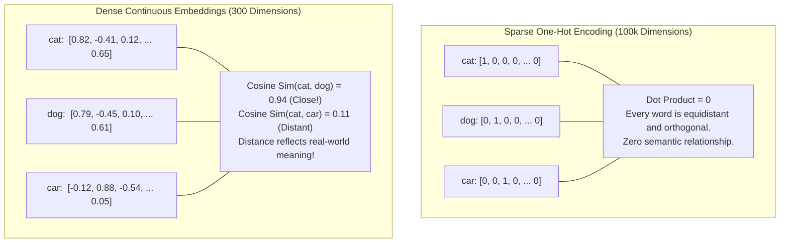
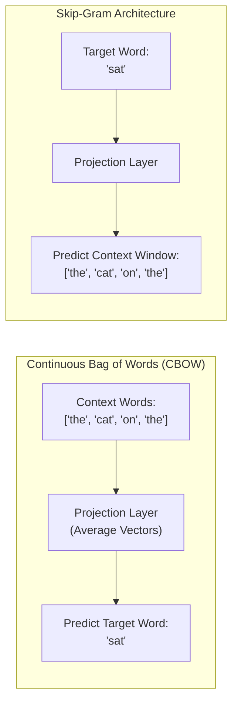
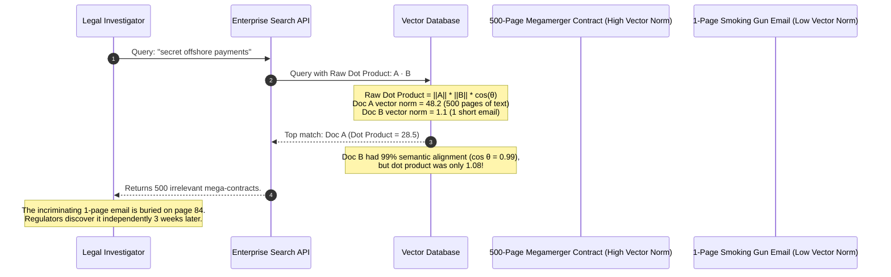

# Word2Vec and the Embedding Revolution

> **Difficulty**: Intermediate | **Estimated Time**: 35m | **Hands-On**: Mandatory

> [!TIP]
> **The Golden Rule of Vector Embeddings:**
> **Distance in embedding space equals semantic dissimilarity.** One-hot representations treat every word as completely orthogonal and equidistant ($\text{cosine\_similarity} = 0$). Word2Vec and dense embeddings map vocabulary into a continuous geometric manifold where spatial proximity, direction, and arithmetic vector translations encode human conceptual relationships ($\vec{v}_{\text{King}} - \vec{v}_{\text{Man}} + \vec{v}_{\text{Woman}} \approx \vec{v}_{\text{Queen}}$).

---

## 1. Visual Mental Models: From Sparse Orthogonality to Continuous Manifolds

Before 2013, natural language processing represented words as discrete **one-hot vectors**. In a vocabulary of $100,000$ words, every word was a sparse vector containing $99,999$ zeros and a single $1$:

$$\mathbf{v}_{\text{cat}} = [1, 0, 0, \dots, 0], \quad \mathbf{v}_{\text{dog}} = [0, 1, 0, \dots, 0], \quad \mathbf{v}_{\text{airplane}} = [0, 0, 1, \dots, 0]$$

Because one-hot vectors are completely orthogonal, their dot product is always zero:
$$\mathbf{v}_{\text{cat}} \cdot \mathbf{v}_{\text{dog}} = 0$$

An algorithm reading one-hot vectors has no mathematical way to know that a "cat" and a "dog" are both four-legged household pets, while an "airplane" is a mechanical vehicle.



### The Distributional Hypothesis
Word2Vec rests on linguist J.R. Firth's 1957 insight:
> *"You shall know a word by the company it keeps."*

Words that appear in similar linguistic contexts (e.g., surrounding words like *"vet"*, *"leash"*, *"fur"*, *"barks"*) have similar semantic meanings and should therefore have similar geometric coordinates.

---

## 2. Word2Vec Architectures: CBOW vs. Skip-Gram

In 2013, Tomas Mikolov et al. at Google published Word2Vec, introducing two complementary neural architectures for learning dense word representations efficiently:



| Dimension | Continuous Bag-of-Words (CBOW) | Continuous Skip-Gram |
| :--- | :--- | :--- |
| **Prediction Task** | Predicts the **target word** given surrounding context words: $P(w_t \mid w_{t-c}, \dots, w_{t+c})$ | Predicts the **surrounding context words** given the target word: $P(w_{t+j} \mid w_t)$ |
| **Training Speed** | Fast; averages context vectors into a single step ($O(\text{context})$) | Slower; creates an independent prediction step for every context word |
| **Rare Words Handling** | Poor; frequent words dominate the context vector averages | **Superior**; treats each context-target pair independently, preserving nuances of rare words |
| **Dataset Scale Fit** | Best for very large text corpora with frequent vocabulary | Best for smaller datasets and specialized technical/medical terminology |

---

## 3. Vector Arithmetic & Linear Semantic Composition

The most startling discovery of continuous embeddings is that linear vector offsets capture abstract relational concepts like gender, capital cities, and grammatical tense:

$$\vec{v}_{\text{King}} - \vec{v}_{\text{Man}} + \vec{v}_{\text{Woman}} \approx \vec{v}_{\text{Queen}}$$

```
                       2D Manifold Projection
                       
           Vector ("Female" translation)
          ┌──────────────────────────►
     King ●                           ● Queen
          │                           │
          │                           │
          │ Vector ("Royalty")        │ Vector ("Royalty")
          │                           │
          ▼                           ▼
      Man ●                           ● Woman
          └──────────────────────────►
           Vector ("Female" translation)
```

The vector $\vec{v}_{\text{King}} - \vec{v}_{\text{Man}}$ isolates the concept of **"Royalty"**. Adding $\vec{v}_{\text{Woman}}$ shifts the coordinates directly to the cluster containing **"Queen"**!

---

## 4. Production War Story: The Unnormalized Dot Product Disaster

```
INCIDENT SUMMARY: INC-4091
SEVERITY: P1 - Enterprise Legal Discovery Failure
IMPACT: $1.8M legal compliance fine; critical subpoena discovery missed 95% of relevant evidence.
ROOT CAUSE: Search engine used raw dot product instead of cosine similarity on unnormalized vectors; massive 500-page contracts dominated all searches.
```

### Incident Timeline



### The Post-Mortem

- **The Mathematical Error**:
  $$\text{Dot Product: } \mathbf{u} \cdot \mathbf{v} = \|\mathbf{u}\| \|\mathbf{v}\| \cos(\theta)$$
  $$\text{Cosine Similarity: } \cos(\theta) = \frac{\mathbf{u} \cdot \mathbf{v}}{\|\mathbf{u}\| \|\mathbf{v}\|}$$
  By omitting vector magnitude normalization ($\|\mathbf{u}\| \|\mathbf{v}\|$), long documents with hundreds of embedded concepts artificially overwhelmed shorter, exact-match documents purely due to their high geometric vector length!
- **The Remediation**:
  1. Mandated $L_2$-normalization of all vectors at ingestion time: $\hat{\mathbf{v}} = \frac{\mathbf{v}}{\|\mathbf{v}\|_2}$.
  2. For unit vectors, the dot product equals the cosine similarity ($\hat{\mathbf{u}} \cdot \hat{\mathbf{v}} = \cos(\theta)$), guaranteeing scale-invariant semantic relevance.

---

## 5. Multi-Language Production Implementations: Embedding Arithmetic & Search

Study these production-grade implementations of vector normalization, cosine distance, and analogical arithmetic.

### Python (`vector_arithmetic.py`)

```python
import numpy as np
from typing import Dict, List, Tuple

class VectorSpace:
    def __init__(self):
        self.embeddings: Dict[str, np.ndarray] = {}

    def add(self, word: str, vector: List[float]):
        """Stores L2-normalized vector."""
        vec = np.array(vector, dtype=np.float32)
        norm = np.linalg.norm(vec)
        self.embeddings[word] = vec / (norm if norm > 0 else 1.0)

    def cosine_similarity(self, word1: str, word2: str) -> float:
        """Computes cosine similarity between two stored words."""
        v1 = self.embeddings[word1]
        v2 = self.embeddings[word2]
        return float(np.dot(v1, v2))

    def solve_analogy(self, a: str, b: str, c: str, top_k: int = 1) -> List[Tuple[str, float]]:
        """
        Solves analogy: a is to b as c is to ?
        Target vector = b - a + c
        """
        target = self.embeddings[b] - self.embeddings[a] + self.embeddings[c]
        target = target / np.linalg.norm(target)

        candidates = []
        for word, vec in self.embeddings.items():
            if word in (a, b, c):
                continue
            sim = float(np.dot(target, vec))
            candidates.append((word, sim))

        candidates.sort(key=lambda x: x[1], reverse=True)
        return candidates[:top_k]

if __name__ == "__main__":
    space = VectorSpace()
    # Simulated 4-dimensional embeddings: [Gender, Royalty, Age, Animal]
    space.add("man",    [0.9,  0.0, 0.7, 0.0])
    space.add("woman",  [-0.9, 0.0, 0.7, 0.0])
    space.add("king",   [0.9,  0.9, 0.8, 0.0])
    space.add("queen",  [-0.9, 0.9, 0.8, 0.0])
    space.add("apple",  [0.0,  0.0, 0.0, 0.0])

    print("=== VECTOR EMBEDDING ARITHMETIC ===")
    sim_king_queen = space.cosine_similarity("king", "queen")
    print(f"Cosine Similarity (king, queen): {sim_king_queen:.4f}")

    analogy = space.solve_analogy("man", "king", "woman")
    print(f"Analogy: 'man' is to 'king' as 'woman' is to: '{analogy[0][0]}' (Score: {analogy[0][1]:.4f})")
```

### TypeScript / Node.js (`vector_math.ts`)

```typescript
export function normalize(vector: number[]): number[] {
  const norm = Math.sqrt(vector.reduce((sum, val) => sum + val * val, 0));
  if (norm === 0) return vector;
  return vector.map((val) => val / norm);
}

export function cosineSimilarity(vecA: number[], vecB: number[]): number {
  if (vecA.length !== vecB.length) {
    throw new Error('Vector dimensions must match');
  }

  const normA = normalize(vecA);
  const normB = normalize(vecB);

  return normA.reduce((sum, val, idx) => sum + val * normB[idx], 0);
}

// Verification:
const vCat = [0.85, 0.1, 0.2];
const vDog = [0.82, 0.15, 0.18];
const vCar = [-0.1, 0.9, 0.4];

console.log('Similarity (Cat, Dog):', cosineSimilarity(vCat, vDog).toFixed(4));
console.log('Similarity (Cat, Car):', cosineSimilarity(vCat, vCar).toFixed(4));
```

### Go (`vector_math.go`)

```go
package main

import (
	"fmt"
	"math"
)

type Vector []float64

func (v Vector) Normalize() Vector {
	var sumSquares float64
	for _, val := range v {
		sumSquares += val * val
	}
	norm := math.Sqrt(sumSquares)
	if norm == 0 {
		return v
	}
	res := make(Vector, len(v))
	for i, val := range v {
		res[i] = val / norm
	}
	return res
}

func CosineSimilarity(a, b Vector) float64 {
	normA := a.Normalize()
	normB := b.Normalize()
	var dot float64
	for i := range normA {
		dot += normA[i] * normB[i]
	}
	return dot
}

func main() {
	vCheckout := Vector{0.91, -0.12, 0.44}
	vPayment := Vector{0.89, -0.10, 0.48}
	vProfile := Vector{0.12, 0.88, -0.32}

	fmt.Printf("Sim(Checkout, Payment): %.4f\n", CosineSimilarity(vCheckout, vPayment))
	fmt.Printf("Sim(Checkout, Profile): %.4f\n", CosineSimilarity(vCheckout, vProfile))
}
```

---

## 6. Practical CLI Workflows: Generating Live Production Embeddings

Modern OpenAI and Gemini embedding APIs generate 1536-dimensional or 768-dimensional dense vectors representing arbitrary sentences.

### Generating an Embedding via cURL

```bash
curl https://api.openai.com/v1/embeddings \
  -H "Content-Type: application/json" \
  -H "Authorization: Bearer $OPENAI_API_KEY" \
  -d '{
    "input": "Database transaction deadlock occurred on order checkout",
    "model": "text-embedding-3-small"
  }' | jq '{
    model: .model,
    dimensions: (.data[0].embedding | length),
    first_three_floats: .data[0].embedding[0:3]
  }'
```

**Expected Output:**
```json
{
  "model": "text-embedding-3-small",
  "dimensions": 1536,
  "first_three_floats": [
    -0.02184912,
    0.00841291,
    -0.03921840
  ]
}
```

The sentence is mapped into a **1,536-dimensional geometric space**, ready for vector search in PgVector or Qdrant!

---

## 7. Operational Validation Checkpoints

Confirm your understanding of vector representations and geometry.

<details>
<summary><b>Checkpoint 1: Why does Negative Sampling exist in Word2Vec, and what computational problem did it solve?</b></summary>

**Analysis:**
- **The Problem:** In standard softmax training, the denominator requires summing exponentiated dot products over the **entire vocabulary**:
  $$P(w_{\text{target}} \mid w_{\text{context}}) = \frac{\exp(\mathbf{v}'^\top \mathbf{v})}{\sum_{w_i \in \mathcal{V}} \exp(\mathbf{v}'^\top_i \mathbf{v})}$$
  For a vocabulary of $|\mathcal{V}| = 100,000$ words, computing and backpropagating through 100,000 dot products for every single training word is computationally prohibitive ($O(|\mathcal{V}|)$).
- **The Negative Sampling Solution:** Reformulates the multi-class classification problem into **binary logistic regression**. For every real (positive) context word, the model samples $k$ random false (negative) words (typically $k=5$ to $15$). The denominator drops from 100,000 terms to 6 to 16 terms, delivering a $10,000\times$ speedup!
</details>

<details>
<summary><b>Checkpoint 2: What is the primary operational difference between static Word2Vec embeddings and modern Transformer embeddings?</b></summary>

**Distinction:**
- **Word2Vec (Static Embeddings):** Each word has exactly **one fixed vector representation** in a lookup dictionary. The word *"bank"* in *"river bank"* has the exact same coordinate vector as *"bank"* in *"commercial investment bank"*. Polysemy (multiple meanings) is collapsed and entangled.
- **Transformers (Contextual Embeddings):** The vector for a token is dynamically computed by running self-attention over the surrounding words. The token *"bank"* next to *"water"* is projected into a completely different vector space location than *"bank"* next to *"interest rates"*.
</details>

<details>
<summary><b>Checkpoint 3: If vector $A$ and vector $B$ are both $L_2$-normalized, what is the maximum and minimum possible dot product?</b></summary>

**Mathematical Range:**
For $L_2$-normalized unit vectors ($\|\mathbf{A}\| = 1, \|\mathbf{B}\| = 1$):
$$\mathbf{A} \cdot \mathbf{B} = \cos(\theta)$$
- **Maximum:** $+1.0$ (When angle $\theta = 0^\circ$, vectors point in the exact same direction; identical semantic meaning).
- **Minimum:** $-1.0$ (When angle $\theta = 180^\circ$, vectors point in opposite diametric directions; diametrical semantic opposites).
- **Orthogonal:** $0.0$ (When angle $\theta = 90^\circ$, vectors share zero semantic correlation).
</details>

---

## Next

Continue to **[04-rnns-lstms-and-the-sequence-problem](../04-rnns-lstms-and-the-sequence-problem/README.md)** to see how neural networks handled sequential text before attention mechanisms existed.
