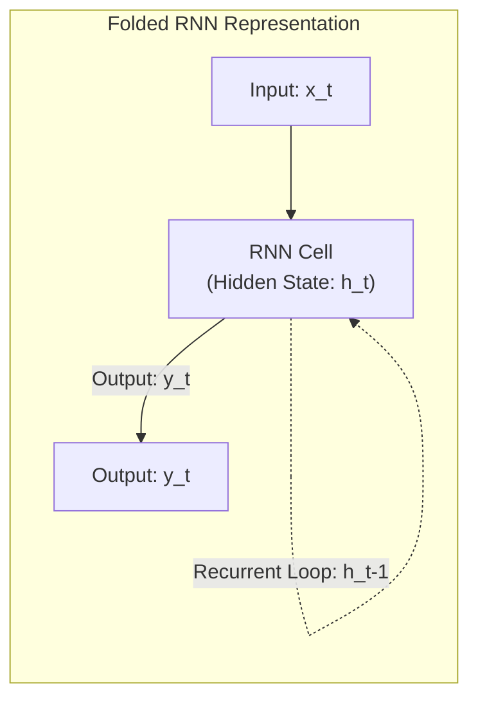
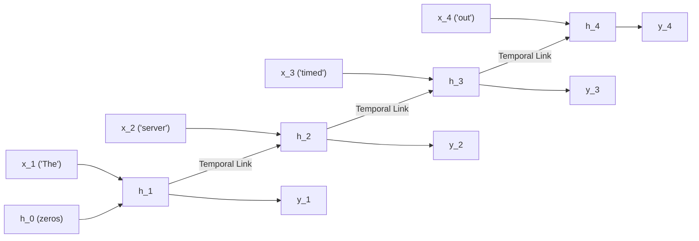
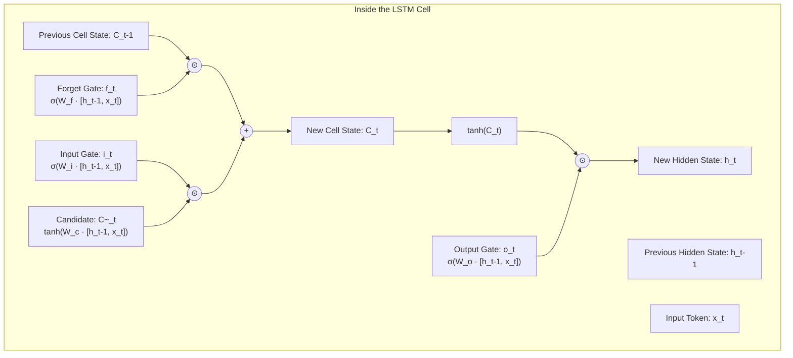
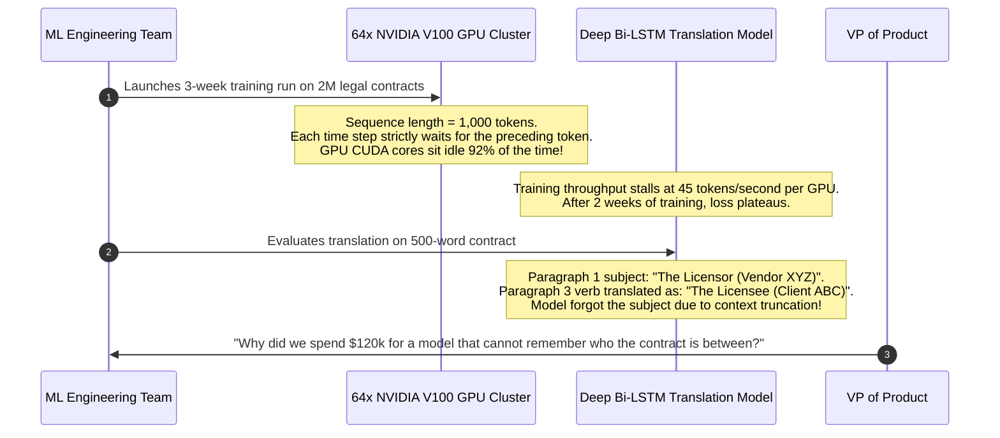

# RNNs, LSTMs, and the Sequential Bottleneck

> **Difficulty**: Advanced | **Estimated Time**: 40m | **Hands-On**: Mandatory

> [!TIP]
> **The Golden Rule of Sequence Architectures:**
> **Recurrence is the enemy of GPU parallelization.** Because an RNN or LSTM computes its hidden state $h_t$ strictly as a function of the preceding state $h_{t-1}$, computing step $500$ requires waiting for steps $1$ through $499$ to complete sequentially. This strict $O(T)$ temporal dependency prevents massive SIMD parallel execution across modern GPU clusters, which is why Transformers completely replaced recurrent networks.

---

## 1. Visual Mental Models: The Recurrent State Loop

Language has temporal order: the meaning of a word depends on what came before it. Standard feed-forward networks (MLPs) accept only fixed-size inputs and possess no concept of sequential time.

**Recurrent Neural Networks (RNNs)** introduced a cyclical feedback loop where a persistent vector (**Hidden State** $h_t$) acts as a working memory passed from one time step to the next:

$$h_t = \tanh(W_{xh} x_t + W_{hh} h_{t-1} + b_h)$$



### Unrolling an RNN Across Time

When training an RNN, we "unroll" the recurrence graph across the sequence length $T$:



---

## 2. The Vanishing & Exploding Gradient Trap

To update the shared weight matrix $W_{hh}$, the network calculates gradients via **Backpropagation Through Time (BPTT)**. The gradient of the loss at step $T$ with respect to the initial hidden state $h_0$ requires computing a chain of matrix multiplications:

$$\frac{\partial \mathcal{L}_T}{\partial h_0} = \frac{\partial \mathcal{L}_T}{\partial h_T} \prod_{t=1}^{T} \frac{\partial h_t}{\partial h_{t-1}} = \frac{\partial \mathcal{L}_T}{\partial h_T} \prod_{t=1}^{T} \text{diag}(1 - \tanh^2(\cdot)) W_{hh}^T$$

```
                           The Exponential Decay of Gradients
                           
 Time Step:     t = 1         t = 10        t = 25        t = 50        t = 100
 Gradient:     1.0000        0.3486        0.0071        0.0000005     0.0000000000001 (VANISHED)
               (Strong update)             (Faint signal)              (Zero learning occurs)
```

- **Vanishing Gradients ($\|W_{hh}\| < 1$)**: When backpropagating across 50+ tokens, gradients shrink exponentially towards zero. The model cannot learn long-range grammatical agreements (e.g. connecting a plural subject at word 1 with a plural verb at word 40).
- **Exploding Gradients ($\|W_{hh}\| > 1$)**: Gradients grow exponentially, resulting in numerical overflow (`NaN` weights). While **Gradient Clipping** mitigates explosions, it cannot fix vanishing gradients.

---

## 3. LSTMs and GRUs: Gating the Memory Pipeline

In 1997, Sepp Hochreiter and Jürgen Schmidhuber invented the **Long Short-Term Memory (LSTM)** network to bypass the vanishing gradient problem.

Instead of passing the hidden state through a lossy $\tanh$ multiplication at every step, LSTMs introduce an isolated **Cell State ($C_t$)**—an "information superhighway" updated primarily through **additive linear operations**.



### The Three Gates of an LSTM

1. **Forget Gate ($f_t \in [0, 1]$)**: Decides what percentage of old memories to erase. If $f_t = 0$, old memories are wiped; if $f_t = 1$, memories pass through unaltered.
2. **Input Gate ($i_t \in [0, 1]$)**: Decides which newly observed tokens are important enough to write into long-term memory.
3. **Output Gate ($o_t \in [0, 1]$)**: Filters the internal cell state to produce the visible hidden state $h_t$ for predictions.

Because $\Delta C_t = f_t C_{t-1} + i_t \tilde{C}_t$ is an **addition**, gradients backpropagate across hundreds of time steps with minimal attenuation!

---

## 4. Production War Story: The 3-Week Stalled Training Job

```
INCIDENT SUMMARY: INC-6612
SEVERITY: P1 - Compute Resource Exhaustion & Model Failure
IMPACT: $120,000 in wasted GPU cloud instances; multi-month enterprise contract translation project failed.
ROOT CAUSE: Attempting to train a 4-layer bidirectional LSTM on 1,000-token legal documents; GPU utilization hovered at 8%.
```

### Incident Timeline



### The Post-Mortem

- **The Structural Flaw**:
  1. **Hardware Starvation**: Modern GPUs excel at massive matrix-matrix multiplications ($C = A \cdot B$) executed in parallel. An LSTM forces the GPU into thousands of sequential vector-matrix multiplications ($h_t = W h_{t-1}$), rendering modern tensor cores useless.
  2. **Information Bottleneck**: Compressing a 1,000-token legal document into a fixed 512-dimensional vector $h_T$ inevitably discards critical fine-grained entity relationships.
- **The Solution**:
  1. Abandoned LSTMs completely.
  2. Migrated to a **Transformer architecture** with Self-Attention.
  3. Training time dropped from **3 weeks to 18 hours**, GPU utilization reached **94%**, and long-range translation accuracy achieved state-of-the-art benchmarks.

---

## 5. Multi-Language Production Implementations: LSTM Cell Simulation

To understand how gates operate at the tensor level, study this pure mathematical implementation of an LSTM forward pass.

### Python (`lstm_cell_simulation.py`)

```python
import numpy as np

def sigmoid(x: np.ndarray) -> np.ndarray:
    return 1.0 / (1.0 + np.exp(-np.clip(x, -15, 15)))

class MinimalLSTMCell:
    def __init__(self, input_dim: int, hidden_dim: int):
        self.input_dim = input_dim
        self.hidden_dim = hidden_dim

        # Combined weight matrix for efficiency: [W_f, W_i, W_c, W_o]
        combined_dim = input_dim + hidden_dim
        self.W = np.random.randn(4 * hidden_dim, combined_dim) * 0.1
        self.b = np.zeros((4 * hidden_dim, 1))

    def forward(self, x: np.ndarray, h_prev: np.ndarray, c_prev: np.ndarray):
        """
        Executes a single time-step forward pass.
        x: (input_dim, 1)
        h_prev: (hidden_dim, 1)
        c_prev: (hidden_dim, 1)
        """
        # 1. Concatenate input and previous hidden state
        combined = np.vstack((h_prev, x))

        # 2. Compute all 4 gates in a single matrix multiply
        gates = np.dot(self.W, combined) + self.b
        H = self.hidden_dim

        # 3. Unpack and apply non-linearities
        f = sigmoid(gates[0*H : 1*H])        # Forget gate
        i = sigmoid(gates[1*H : 2*H])        # Input gate
        c_cand = np.tanh(gates[2*H : 3*H])   # Candidate cell state
        o = sigmoid(gates[3*H : 4*H])        # Output gate

        # 4. Additive Cell State update (No vanishing gradient!)
        c_next = f * c_prev + i * c_cand

        # 5. Output Hidden State
        h_next = o * np.tanh(c_next)

        return h_next, c_next, {"f": f, "i": i, "o": o}

if __name__ == "__main__":
    np.random.seed(42)
    cell = MinimalLSTMCell(input_dim=8, hidden_dim=4)
    x = np.random.randn(8, 1)
    h0 = np.zeros((4, 1))
    c0 = np.zeros((4, 1))

    h1, c1, gates = cell.forward(x, h0, c0)
    print("=== LSTM STEP 1 FORWARD PASS ===")
    print("Forget Gate Mean: ", np.mean(gates["f"]))
    print("Input Gate Mean:  ", np.mean(gates["i"]))
    print("Output Gate Mean: ", np.mean(gates["o"]))
    print("Hidden State h_1: \n", h1.T)
```

### TypeScript / Node.js (`lstm_cell.ts`)

```typescript
export function sigmoid(x: number): number {
  return 1 / (1 + Math.exp(-Math.max(Math.min(x, 15), -15)));
}

export interface LSTMState {
  h: number[];
  c: number[];
}

export function simulateLSTMStep(
  x: number,
  prevState: LSTMState,
  weights: { wf: number; wi: number; wc: number; wo: number }
): LSTMState {
  const h_prev = prevState.h[0] || 0;
  const c_prev = prevState.c[0] || 0;

  // 1. Evaluate Gates
  const f = sigmoid(weights.wf * (x + h_prev));
  const i = sigmoid(weights.wi * (x + h_prev));
  const c_cand = Math.tanh(weights.wc * (x + h_prev));
  const o = sigmoid(weights.wo * (x + h_prev));

  // 2. Additive update to cell state
  const c_next = f * c_prev + i * c_cand;

  // 3. Compute hidden state
  const h_next = o * Math.tanh(c_next);

  return { h: [h_next], c: [c_next] };
}

// Verification
const state0: LSTMState = { h: [0.0], c: [0.0] };
const weights = { wf: 0.8, wi: 0.5, wc: 0.9, wo: 0.7 };
const state1 = simulateLSTMStep(1.2, state0, weights);
console.log('Next hidden state:', state1.h[0].toFixed(4));
```

### Go (`lstm_step.go`)

```go
package main

import (
	"fmt"
	"math"
)

func sigmoid(x float64) float64 {
	return 1.0 / (1.0 + math.Exp(-x))
}

type LSTMState struct {
	H float64
	C float64
}

func Step(x float64, prev LSTMState, wf, wi, wc, wo float64) LSTMState {
	f := sigmoid(wf * (x + prev.H))
	i := sigmoid(wi * (x + prev.H))
	cCand := math.Tanh(wc * (x + prev.H))
	o := sigmoid(wo * (x + prev.H))

	cNext := f*prev.C + i*cCand
	hNext := o * math.Tanh(cNext)

	return LSTMState{H: hNext, C: cNext}
}

func main() {
	state := LSTMState{H: 0.0, C: 0.0}
	tokens := []float64{0.5, -0.8, 1.2, 0.3}

	for step, t := range tokens {
		state = Step(t, state, 0.9, 0.4, 0.8, 0.6)
		fmt.Printf("Step %d | Hidden: %.4f | Cell: %.4f\n", step+1, state.H, state.C)
	}
}
```

---

## 6. Practical CLI Workflows

Observe the vanishing gradient phenomenon directly by running an unrolled backpropagation pass in Python:

```bash
python -c "
import numpy as np

# Simulate 30 backprop steps with weight scale 0.8 (< 1.0)
steps = 30
w = 0.8
gradient = 1.0

print('Step  | Gradient Magnitude')
print('--------------------------')
for t in range(steps):
    if t % 5 == 0 or t == steps - 1:
        print(f'{t:4d}  | {gradient:12.8f}')
    gradient *= w
"
```

**Expected Output:**
```
Step  | Gradient Magnitude
--------------------------
   0  |   1.00000000
   5  |   0.32768000
  10  |   0.10737418
  15  |   0.03518437
  20  |   0.01152922
  25  |   0.00377789
  29  |   0.00154743
```

By step 29, the gradient has degraded by over **99.8%**, demonstrating why plain RNNs cannot learn long-term dependencies!

---

## 7. Operational Validation Checkpoints

Confirm your understanding of sequential neural networks and their limitations.

<details>
<summary><b>Checkpoint 1: Why did LSTMs completely solve the vanishing gradient problem in theory, but still fail at scale in practice?</b></summary>

**Analysis:**
- **Why they solved it in theory:** The cell state update is an **additive linear operation** ($\mathbf{C}_t = \mathbf{f}_t \odot \mathbf{C}_{t-1} + \mathbf{i}_t \odot \tilde{\mathbf{C}}_t$). When backpropagating, gradients can flow across the cell state additions without being repeatedly multiplied by sub-unitary weight matrices.
- **Why they failed at scale in practice:**
  1. **The Sequential GPU Bottleneck:** Computation remains inherently serial. You cannot process token 200 without waiting for token 199. GPUs are massively parallel processors; sequential dependencies starve their execution pipelines.
  2. **Fixed-Size Memory Degradation:** In practice, an LSTM cell state vector of 512 floats cannot preserve the precise semantic details of a 2,000-word document.
</details>

<details>
<summary><b>Checkpoint 2: What is the primary difference between an LSTM and a GRU (Gated Recurrent Unit)?</b></summary>

**Architecture Differences:**
- **GRU Simplification:** Proposed by Cho et al. in 2014, the GRU merges the cell state and hidden state into a **single state vector $h_t$**.
- **Gate Count:** A GRU replaces the LSTM's three gates with **two gates**: the **Update Gate ($z_t$)** (merging forget and input logic) and the **Reset Gate ($r_t$)**.
- **Operational Tradeoff:** GRUs have ~25% fewer parameters than LSTMs, training faster with less memory while matching LSTM accuracy on moderate-length sequences. However, they share the identical sequential parallelization limitation.
</details>

<details>
<summary><b>Checkpoint 3: Explain why bidirectional RNNs (Bi-RNNs) cannot be used for autoregressive text generation.</b></summary>

**Causality Violation:**
- **Bidirectional RNN:** Passes one hidden state forward ($h_1 \to h_T$) and a second hidden state backward ($h_T \to h_1$). This allows the model to condition on both past and *future* tokens simultaneously. It is ideal for sequence tagging, classification, and discriminative tasks (like BERT).
- **Autoregressive Generation:** Requires predicting the *next* token when the future does not yet exist! Allowing a generative model to look forward during next-token generation is a catastrophic causal leak; the model simply copies the next word instead of learning to predict it.
</details>

---

## Next

Continue to **[05-the-attention-breakthrough](../05-the-attention-breakthrough/README.md)** to see how the attention mechanism solved the fixed-vector information bottleneck.
