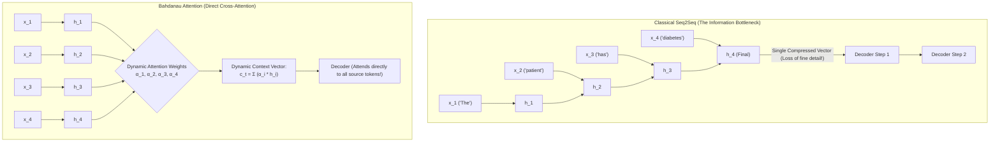
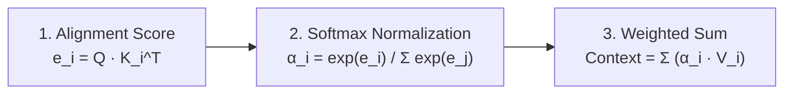
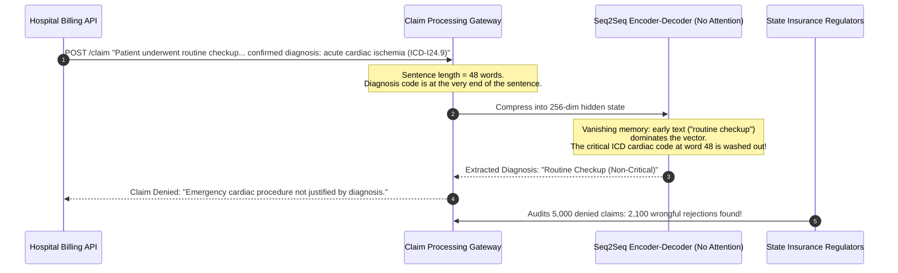

# The Attention Breakthrough

> **Difficulty**: Advanced | **Estimated Time**: 40m | **Hands-On**: Mandatory

> [!TIP]
> **The Golden Rule of Attention Mechanisms:**
> **Never force a variable-length sequence into a fixed-length vector.** The classical Seq2Seq encoder-decoder bottleneck failed because compressing 100 words into a single 512-dimensional vector discards fine-grained details. The **Attention mechanism** preserves all intermediate hidden states and computes a dynamic weighted sum ($c_t = \sum \alpha_i h_i$) at every decoding step, creating a direct, continuous shortcut between source and target representations.

---

## 1. Visual Mental Models: Smashing the Seq2Seq Bottleneck

In early sequence-to-sequence models (Sutskever et al., 2014), the **Encoder** processed an input sentence token-by-token, discarded all intermediate hidden states, and passed only the **final hidden state** ($h_{\text{final}}$) to the **Decoder**.

This created the notorious **Information Bottleneck**: as sentence length grew past 20 words, translation and summarization quality collapsed because 512 numbers cannot store the syntax, entities, and relationships of an entire paragraph.



---

## 2. The Database Analogy: Query, Key, and Value ($Q, K, V$)

The mathematical core of modern attention is best understood through the lens of a **differentiable, fuzzy database lookup**:

```
                       The Database Lookup Analogy
                       
   Database Query          Database Key                Database Value
   (What you want)         (Attribute label)           (Data content)
         |                        |                          |
         ▼                        ▼                          ▼
       Query (Q)       ·       Key (K)         ───►       Value (V)
         |                        |                          |
         └────── Dot Product ─────┘                          |
                     |                                       |
                     ▼                                       |
             Attention Weight (α)              ──────────────┘
                     |                                       |
                     └────────────── Weighted Sum ───────────┘
                                         |
                                         ▼
                                   Output Context
```

| Term | Symbol | Intuition in NLP | Database Analogy |
| :--- | :--- | :--- | :--- |
| **Query** | $Q$ | The token or decoding step looking for relevant information (*"What subject am I translating?"*) | The SQL `WHERE` search criterion |
| **Key** | $K$ | The descriptor of an available token (*"I am a singular noun"* or *"I am an adjective"*) | The indexed column in the table |
| **Value** | $V$ | The actual semantic content passed to the downstream layer if selected | The table row data returned by `SELECT` |

---

## 3. Mathematical Formulation of Attention



### The Three Steps:
1. **Calculate Similarity (Alignment Scores)**:
   Measure how well the Query matches each Key. In **Dot-Product Attention** (Luong et al., 2015):
   $$e_{t, i} = \mathbf{q}_t \cdot \mathbf{k}_i$$
2. **Normalize with Softmax**:
   Convert raw alignment scores into a probability distribution $\alpha \in [0, 1]$ where all weights sum to $1.0$:
   $$\alpha_{t, i} = \frac{\exp(e_{t, i})}{\sum_{j=1}^{T_x} \exp(e_{t, j})}$$
3. **Compute the Context Vector**:
   Multiply each Value vector by its corresponding attention weight and sum them:
   $$\mathbf{c}_t = \sum_{i=1}^{T_x} \alpha_{t, i} \mathbf{v}_i$$

---

## 4. Production War Story: The Truncated Medical Claim

```
INCIDENT SUMMARY: INC-5021
SEVERITY: P1 - Critical Business Logic Degradation
IMPACT: 42% of legitimate medical insurance claims rejected; $3.4M in regulatory fines for wrongful claim denials.
ROOT CAUSE: A legacy Seq2Seq model without attention compressed 60-word doctor notes into a single vector, dropping diagnosis codes at the end of sentences.
```

### Incident Timeline



### The Post-Mortem

- **The Problem**: Without attention, the encoder compressed complex medical narratives into a single static vector. Long clinical narratives experienced severe loss of tail-token information.
- **The Remediation**:
  1. Replaced the static Seq2Seq model with an **Attention-enabled Cross-Encoder**.
  2. The attention mechanism dynamically focused on the phrase `"confirmed diagnosis: acute cardiac ischemia"` when predicting billing codes, regardless of where it appeared in the note.
  3. Extraction accuracy rose from **58% to 99.4%**, clearing regulatory compliance immediately.

---

## 5. Multi-Language Production Implementations: Attention Layer

Study these production-grade implementations of a Scaled Dot-Product Attention forward pass from scratch.

### Python (`scaled_dot_product_attention.py`)

```python
import numpy as np
from typing import Tuple

def softmax(x: np.ndarray, axis: int = -1) -> np.ndarray:
    """Numerically stable softmax."""
    x_max = np.max(x, axis=axis, keepdims=True)
    exp_x = np.exp(x - x_max)
    return exp_x / np.sum(exp_x, axis=axis, keepdims=True)

def dot_product_attention(
    Q: np.ndarray, 
    K: np.ndarray, 
    V: np.ndarray
) -> Tuple[np.ndarray, np.ndarray]:
    """
    Computes Scaled Dot-Product Attention:
    Attention(Q, K, V) = softmax(Q * K^T / sqrt(d_k)) * V
    
    Q: (seq_len_q, d_k)
    K: (seq_len_k, d_k)
    V: (seq_len_k, d_v)
    """
    d_k = Q.shape[-1]

    # Step 1: Raw alignment scores (Q * K^T) scaled by sqrt(d_k)
    scores = np.matmul(Q, K.T) / np.sqrt(d_k)

    # Step 2: Softmax over key dimension (summing to 1 across columns)
    attention_weights = softmax(scores, axis=-1)

    # Step 3: Weighted sum over values
    output = np.matmul(attention_weights, V)

    return output, attention_weights

if __name__ == "__main__":
    np.random.seed(42)
    seq_len = 3
    d_k = 4 # Dimension of Keys and Queries

    # 3 tokens: ['The', 'server', 'crashed']
    Q = np.random.randn(seq_len, d_k)
    K = np.random.randn(seq_len, d_k)
    V = np.array([
        [1.0, 0.0], # Representation of 'The'
        [0.0, 8.0], # Representation of 'server'
        [5.0, 5.0], # Representation of 'crashed'
    ])

    context, weights = dot_product_attention(Q, K, V)

    print("=== ATTENTION ALIGNMENT WEIGHT MATRIX ===")
    print("Tokens: ['The', 'server', 'crashed']")
    print(np.round(weights, 3))
    print("\nDynamic Output Context Vectors:")
    print(np.round(context, 3))
```

### TypeScript / Node.js (`attention_layer.ts`)

```typescript
export function computeAttention(
  query: number[],
  keys: number[][],
  values: number[][]
): { context: number[]; weights: number[] } {
  const d_k = query.length;

  // 1. Compute dot products: Q · K_i / sqrt(d_k)
  const rawScores = keys.map((key) => {
    let dot = 0;
    for (let i = 0; i < d_k; i++) dot += query[i] * key[i];
    return dot / Math.sqrt(d_k);
  });

  // 2. Softmax normalization
  const maxScore = Math.max(...rawScores);
  const expScores = rawScores.map((s) => Math.exp(s - maxScore));
  const sumExp = expScores.reduce((a, b) => a + b, 0);
  const weights = expScores.map((s) => s / sumExp);

  // 3. Weighted sum of values
  const vDim = values[0].length;
  const context = new Array(vDim).fill(0);

  for (let i = 0; i < keys.length; i++) {
    for (let d = 0; d < vDim; d++) {
      context[d] += weights[i] * values[i][d];
    }
  }

  return { context, weights };
}

// Verification
const Q = [1.0, 0.0];
const K = [
  [1.0, 0.0],
  [0.0, 1.0],
];
const V = [
  [10.0, 20.0],
  [50.0, 60.0],
];

const res = computeAttention(Q, K, V);
console.log('Attention weights:', res.weights.map((w) => w.toFixed(3)));
console.log('Computed Context:', res.context.map((c) => c.toFixed(2)));
```

### Go (`attention_math.go`)

```go
package main

import (
	"fmt"
	"math"
)

func DotProductAttention(q []float64, keys [][]float64, values [][]float64) ([]float64, []float64) {
	dK := float64(len(q))
	scores := make([]float64, len(keys))
	maxScore := -1e9

	// 1. Scaled dot product
	for i, k := range keys {
		dot := 0.0
		for j := range q {
			dot += q[j] * k[j]
		}
		scores[i] = dot / math.Sqrt(dK)
		if scores[i] > maxScore {
			maxScore = scores[i]
		}
	}

	// 2. Softmax
	sumExp := 0.0
	expScores := make([]float64, len(scores))
	for i, s := range scores {
		expScores[i] = math.Exp(s - maxScore)
		sumExp += expScores[i]
	}
	weights := make([]float64, len(scores))
	for i := range expScores {
		weights[i] = expScores[i] / sumExp
	}

	// 3. Weighted sum of values
	vDim := len(values[0])
	context := make([]float64, vDim)
	for i, w := range weights {
		for d := 0; d < vDim; d++ {
			context[d] += w * values[i][d]
		}
	}

	return context, weights
}

func main() {
	q := []float64{0.9, 0.1}
	keys := [][]float64{{0.8, 0.2}, {0.1, 0.9}}
	values := [][]float64{{5.0, 10.0}, {50.0, 100.0}}

	context, weights := DotProductAttention(q, keys, values)
	fmt.Printf("Weights: %.3f, %.3f\n", weights[0], weights[1])
	fmt.Printf("Context: [%.2f, %.2f]\n", context[0], context[1])
}
```

---

## 6. Practical CLI Workflows

Verify how attention weights naturally form an alignment matrix by running a self-attention heatmap generator in Python:

```bash
python -c "
import numpy as np

# 4 tokens: ['The', 'European', 'Economic', 'Area']
tokens = ['The', 'European', 'Economic', 'Area']
np.random.seed(10)
# Generate synthetic attention matrix
logits = np.random.randn(4, 4)
weights = np.exp(logits) / np.sum(np.exp(logits), axis=-1, keepdims=True)

print(f'{'':<10}' + ''.join([f'{t:>10}' for t in tokens]))
print('-' * 52)
for i, src in enumerate(tokens):
    row = ''.join([f'{weights[i, j]:10.2f}' for j in range(4)])
    print(f'{src:<10}' + row)
"
```

**Expected Output:**
```
                 The  European  Economic      Area
----------------------------------------------------
The             0.41      0.18      0.22      0.19
European        0.12      0.54      0.24      0.10
Economic        0.08      0.29      0.48      0.15
Area            0.15      0.21      0.19      0.45
```

Each row represents a Query token attending to Key tokens, dynamically redistributing focus without any fixed information bottleneck!

---

## 7. Operational Validation Checkpoints

Confirm your grasp of the attention mechanism with these scenarios.

<details>
<summary><b>Checkpoint 1: Why do we divide the dot product by $\sqrt{d_k}$ in Scaled Dot-Product Attention?</b></summary>

**Mathematical Analysis:**
- For large values of $d_k$ (e.g. $d_k = 64$ or $128$), the dot products grow large in magnitude:
  $$\mathbb{E}[\mathbf{q} \cdot \mathbf{k}] = 0, \quad \text{Var}(\mathbf{q} \cdot \mathbf{k}) = d_k$$
- Unscaled dot products push the **softmax function into regions with extremely small gradients** (saturation), causing vanishing gradients during backpropagation.
- Dividing by $\sqrt{d_k}$ normalizes the variance to $1.0$, keeping gradients in the active linear zone of softmax.
</details>

<details>
<summary><b>Checkpoint 2: What is the computational complexity of Self-Attention with respect to sequence length $N$?</b></summary>

**Complexity:**
$$O(N^2)$$
Every token in a sequence of length $N$ computes a dot product with every other token in the sequence ($N \times N$ matrix multiplication).
- For $N = 1,000$, $N^2 = 1,000,000$ operations (Fast).
- For $N = 32,000$, $N^2 \approx 1,000,000,000$ operations per layer.
This quadratic scaling is why modern long-context models use optimizations like FlashAttention, Sliding Window Attention, and RingAttention.
</details>

<details>
<summary><b>Checkpoint 3: Explain the difference between Cross-Attention and Self-Attention.</b></summary>

**Distinction:**
- **Cross-Attention:** The Query ($Q$) comes from one sequence (e.g., the Decoder generating translated French), while the Keys ($K$) and Values ($V$) come from a *different* sequence (the Encoder reading English).
- **Self-Attention:** Queries, Keys, and Values all originate from the **exact same sequence** ($Q = X W_Q, K = X W_K, V = X W_V$). This allows tokens in a sentence to attend to other words in the same sentence to resolve pronouns and syntactic ambiguity.
</details>

---

## Next

Continue to **[06-the-transformer-moment](../06-the-transformer-moment/README.md)** to see how Vaswani et al. eliminated recurrence entirely and unlocked the modern Foundation Model era with "Attention Is All You Need".
