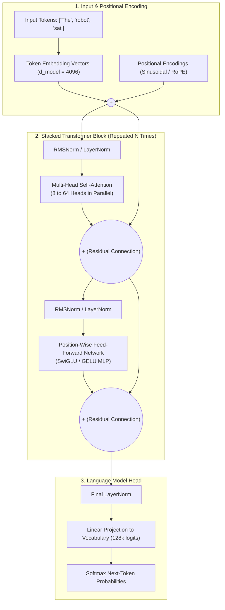
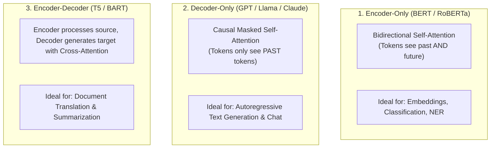
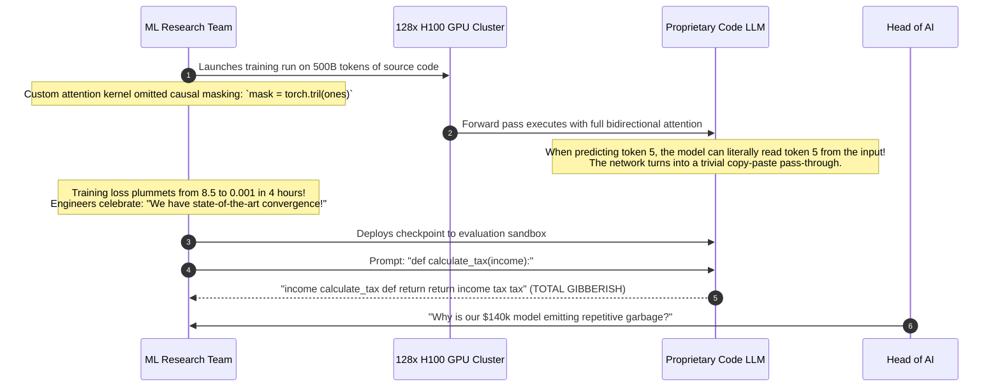

# The Transformer Moment: Attention Is All You Need

> **Difficulty**: Advanced | **Estimated Time**: 40m | **Hands-On**: Mandatory

> [!TIP]
> **The Golden Rule of the Transformer Architecture:**
> **Discard recurrence; compute everything in parallel.** Vaswani et al. (2017) proved that recurrent loops are completely unnecessary. By combining **Self-Attention** (relating every token to every other token simultaneously) with **Positional Encodings** (injecting sequence order), the Transformer converts sequence processing into dense matrix multiplications ($Q K^T V$) that saturate 100% of GPU tensor cores.

---

## 1. Visual Mental Models: The Transformer Revolution

Before 2017, attention was merely a helper feature bolted onto recurrent networks (RNNs/LSTMs). In June 2017, eight researchers at Google Brain published **"Attention Is All You Need"**, demonstrating that discarding recurrence entirely yielded higher accuracy in a fraction of the training time.



---

## 2. Multi-Head Attention: Looking at Multiple Relationships Simultaneously

A single attention head can only focus on one relationship at a time (e.g. subject-verb agreement). **Multi-Head Attention (MHA)** projects the input into $h$ independent lower-dimensional subspaces, allowing different heads to specialize:

$$\text{MultiHead}(Q, K, V) = \text{Concat}(\text{head}_1, \dots, \text{head}_h) W^O$$
$$\text{where} \quad \text{head}_i = \text{Attention}(Q W_i^Q, K W_i^K, V W_i^V)$$

```
                               Multi-Head Attention Decomposition
                               
               Input Vector (d_model = 4096)
               ┌────────────────────────────────────────────────────────┐
               │                        Input X                         │
               └────────────────────────────────────────────────────────┘
                                           │
                     ┌─────────────────────┼─────────────────────┐
                     ▼                     ▼                     ▼
                Head 1 (d_k=128)      Head 2 (d_k=128)      Head 32 (d_k=128)
               ┌───────────────┐     ┌───────────────┐     ┌─────────────────┐
               │ Syntactic     │     │ Coreference   │     │ Semantic Tense  │
               │ dependencies  │     │ pronoun links │     │ & verb logic    │
               │ ("verb->noun")│     │ ("it->server")│     │ ("past->future")│
               └───────────────┘     └───────────────┘     └─────────────────┘
                     │                     │                     │
                     └─────────────────────┼─────────────────────┘
                                           │
                                           ▼
                            Concat & Linear Output Projection (W^O)
```

---

## 3. The Three Architectural Flavors

Depending on how attention masks are applied, Transformers fall into three distinct design categories:



| Model Family | Representative Models | Attention Mask | Primary Use Case |
| :--- | :--- | :--- | :--- |
| **Encoder-Only** | BERT, RoBERTa, DeBERTa, modern Embedding models | **None (Bidirectional)**: Every token attends to all tokens in the sequence. | Search ranking, text classification, vector embeddings. |
| **Decoder-Only** | GPT-4, Llama 3, Mistral, Claude, Gemini | **Causal (Lower Triangular)**: Token $t$ can only attend to tokens $\le t$. | Next-token autoregressive generation, reasoning, code generation. |
| **Encoder-Decoder** | Original Transformer (2017), T5, BART, Whisper | **Bidirectional (Encoder) + Causal Cross-Attention (Decoder)** | Audio transcription, cross-language translation. |

---

## 4. Production War Story: The Causal Masking Leak

```
INCIDENT SUMMARY: INC-8199
SEVERITY: P1 - Machine Learning Training Catastrophe
IMPACT: 2 months of model training wasted; $140,000 in GPU cloud compute incinerated.
ROOT CAUSE: A missing lower-triangular causal attention mask in a custom decoder caused 100% training loss memorization but complete inference failure.
```

### Incident Timeline



### The Post-Mortem

- **The Mathematical Bug**:
  In autoregressive language models, the attention scores must be multiplied by a **Causal Mask** where future tokens are filled with $-\infty$:
  $$\text{Mask}_{i, j} = \begin{cases} 0 & \text{if } j \le i \\ -\infty & \text{if } j > i \end{cases}$$
  When passed through Softmax, $\exp(-\infty) = 0$, strictly preventing future tokens from leaking into past predictions.
- **The Remediation**:
  1. Mandated standard, validated attention primitives (e.g. FlashAttention-2) instead of handwritten kernels.
  2. Implemented strict automated integration tests verifying that modifying future input tokens does not alter the logits of preceding tokens.

---

## 5. Multi-Language Production Implementations: Causal Self-Attention

Study these production implementations of Causal Self-Attention featuring the lower-triangular mask that makes autoregressive generation possible.

### Python (`causal_self_attention.py`)

```python
import numpy as np

def softmax(x: np.ndarray) -> np.ndarray:
    x_max = np.max(x, axis=-1, keepdims=True)
    exp_x = np.exp(x - x_max)
    return exp_x / np.sum(exp_x, axis=-1, keepdims=True)

class CausalSelfAttention:
    def __init__(self, d_model: int):
        self.d_model = d_model
        # Projection matrices
        self.W_q = np.random.randn(d_model, d_model) * 0.1
        self.W_k = np.random.randn(d_model, d_model) * 0.1
        self.W_v = np.random.randn(d_model, d_model) * 0.1
        self.W_o = np.random.randn(d_model, d_model) * 0.1

    def forward(self, X: np.ndarray) -> np.ndarray:
        """
        X: Input tensor of shape (seq_len, d_model)
        """
        seq_len, d_k = X.shape

        # 1. Linear projections to Q, K, V
        Q = np.dot(X, self.W_q)
        K = np.dot(X, self.W_k)
        V = np.dot(X, self.W_v)

        # 2. Scaled dot-product scores: (seq_len, seq_len)
        scores = np.dot(Q, K.T) / np.sqrt(d_k)

        # 3. APPLY CAUSAL MASK (Crucial: prevents looking at future tokens!)
        # Create upper-triangular matrix of True (excluding diagonal)
        mask = np.triu(np.ones((seq_len, seq_len), dtype=bool), k=1)
        scores[mask] = -1e9 # Mask out future positions with negative infinity

        # 4. Softmax over valid positions
        attention_weights = softmax(scores)

        # 5. Output weighted representation
        context = np.dot(attention_weights, V)
        return np.dot(context, self.W_o), attention_weights

if __name__ == "__main__":
    np.random.seed(42)
    seq_len = 4
    d_model = 8

    # 4 input tokens
    X = np.random.randn(seq_len, d_model)
    layer = CausalSelfAttention(d_model)
    out, weights = layer.forward(X)

    print("=== CAUSAL LOWER-TRIANGULAR ATTENTION MATRIX ===")
    print(np.round(weights, 2))
    print("\nNotice that every row only attends to itself and previous columns (Upper triangle is 0.00)!")
```

### TypeScript / Node.js (`causal_attention.ts`)

```typescript
export function causalMaskedAttention(
  Q: number[][],
  K: number[][],
  V: number[][]
): { output: number[][]; weights: number[][] } {
  const seqLen = Q.length;
  const d_k = Q[0].length;
  const weights: number[][] = [];

  for (let i = 0; i < seqLen; i++) {
    const rawRow: number[] = [];
    for (let j = 0; j < seqLen; j++) {
      if (j > i) {
        // Future token: Masked out completely!
        rawRow.push(-Infinity);
      } else {
        // Past or current token: Compute dot product
        let dot = 0;
        for (let d = 0; d < d_k; d++) dot += Q[i][d] * K[j][d];
        rawRow.push(dot / Math.sqrt(d_k));
      }
    }

    // Softmax over row
    const maxVal = Math.max(...rawRow.filter((v) => v !== -Infinity));
    const expRow = rawRow.map((v) => (v === -Infinity ? 0 : Math.exp(v - maxVal)));
    const sumExp = expRow.reduce((a, b) => a + b, 0);
    weights.push(expRow.map((v) => v / sumExp));
  }

  // Weighted sum over V
  const output: number[][] = [];
  const vDim = V[0].length;
  for (let i = 0; i < seqLen; i++) {
    const outRow = new Array(vDim).fill(0);
    for (let j = 0; j <= i; j++) {
      for (let d = 0; d < vDim; d++) {
        outRow[d] += weights[i][j] * V[j][d];
      }
    }
    output.push(outRow);
  }

  return { output, weights };
}
```

### Go (`causal_mask.go`)

```go
package main

import (
	"fmt"
	"math"
)

func GenerateCausalMask(seqLen int) [][]float64 {
	mask := make([][]float64, seqLen)
	for i := 0; i < seqLen; i++ {
		mask[i] = make([]float64, seqLen)
		for j := 0; j < seqLen; j++ {
			if j > i {
				mask[i][j] = -1e9 // Mask future tokens
			} else {
				mask[i][j] = 0.0  // Allowed tokens
			}
		}
	}
	return mask
}

func main() {
	mask := GenerateCausalMask(4)
	fmt.Println("--- 4x4 Causal Attention Mask ---")
	for _, row := range mask {
		for _, val := range row {
			if val < -1e6 {
				fmt.Print(" -inf ")
			} else {
				fmt.Printf(" %4.1f ", val)
			}
		}
		fmt.Println()
	}
}
```

---

## 6. Practical CLI Workflows

Observe how Positional Encodings generate unique geometric patterns by running this Python script:

```bash
python -c "
import numpy as np

def get_sinusoidal_pos_enc(seq_len=4, d_model=4):
    pe = np.zeros((seq_len, d_model))
    for pos in range(seq_len):
        for i in range(0, d_model, 2):
            div = np.power(10000, i / d_model)
            pe[pos, i] = np.sin(pos / div)
            pe[pos, i + 1] = np.cos(pos / div)
    return pe

print('Positional Encoding Matrix (4 tokens, 4 dims):')
print(np.round(get_sinusoidal_pos_enc(), 3))
"
```

**Expected Output:**
```
Positional Encoding Matrix (4 tokens, 4 dims):
[[ 0.     1.     0.     1.   ]
 [ 0.841  0.54   0.01   1.   ]
 [ 0.909 -0.416  0.02   1.   ]
 [ 0.141 -0.99   0.03   1.   ]]
```

Each token position receives a unique trigonometric wave coordinate, ensuring the model distinguishes between *"dog bites man"* and *"man bites dog"*!

---

## 7. Operational Validation Checkpoints

Confirm your mastery of Transformer mechanics with these scenarios.

<details>
<summary><b>Checkpoint 1: Why does a Transformer require Positional Encoding while an RNN does not?</b></summary>

**Analysis:**
- **RNN:** Processes tokens one by one in chronological order ($x_1$, then $x_2$, then $x_3$). Position is inherently built into the recurrence loop through the physical sequence of state transitions ($h_{t-1} \to h_t$).
- **Transformer:** Self-attention computes dot products ($Q K^T$) simultaneously across all token pairs in parallel. Mathematically, dot-product attention is **permutation-invariant**: if you scramble the words in a sentence into random order, the un-encoded self-attention output is identical. Adding **Positional Encodings** injects coordinate tags that tell the model which token appeared first, second, or last.
</details>

<details>
<summary><b>Checkpoint 2: What is the architectural purpose of Layer Normalization and Residual Connections in deep Transformers?</b></summary>

**Mechanism:**
- **Residual (Skip) Connections ($\mathbf{x} + \text{SubLayer}(\mathbf{x})$):** Allow gradients to flow backward through the network uninterrupted, directly from layer 80 to layer 1 without degradation, preventing vanishing gradients in deep models.
- **Layer Normalization:** Normalizes the activations across the feature dimension for each token independently, stabilizing the variance of intermediate representations and preventing activations from blowing up or collapsing during training.
</details>

<details>
<summary><b>Checkpoint 3: Why are modern Foundation Models (Llama 3, GPT-4, Mistral) almost universally Decoder-Only rather than Encoder-Decoder?</b></summary>

**Industry Convergence:**
1. **Unification of Tasks:** A decoder-only model can perform all NLP tasks (summarization, translation, code generation, reasoning) simply by framing them as autoregressive sequence completions (*"Translate English to French: {input} -> {generation}"*).
2. **KV-Cache Efficiency:** Decoder-only architectures share a single unified Key-Value cache during streaming generation, maximizing memory efficiency on GPUs.
3. **Pre-training Simplicity:** Pre-training on massive uncurated web data requires only one simple loss function: next-token prediction across text streams.
</details>

---

## Next

Continue to **[07-the-scaling-era-gpt-1-to-chatgpt](../07-the-scaling-era-gpt-1-to-chatgpt/README.md)** to see how scaling laws, compute, and RLHF turned laboratory transformers into ChatGPT and global consumer foundation models.
