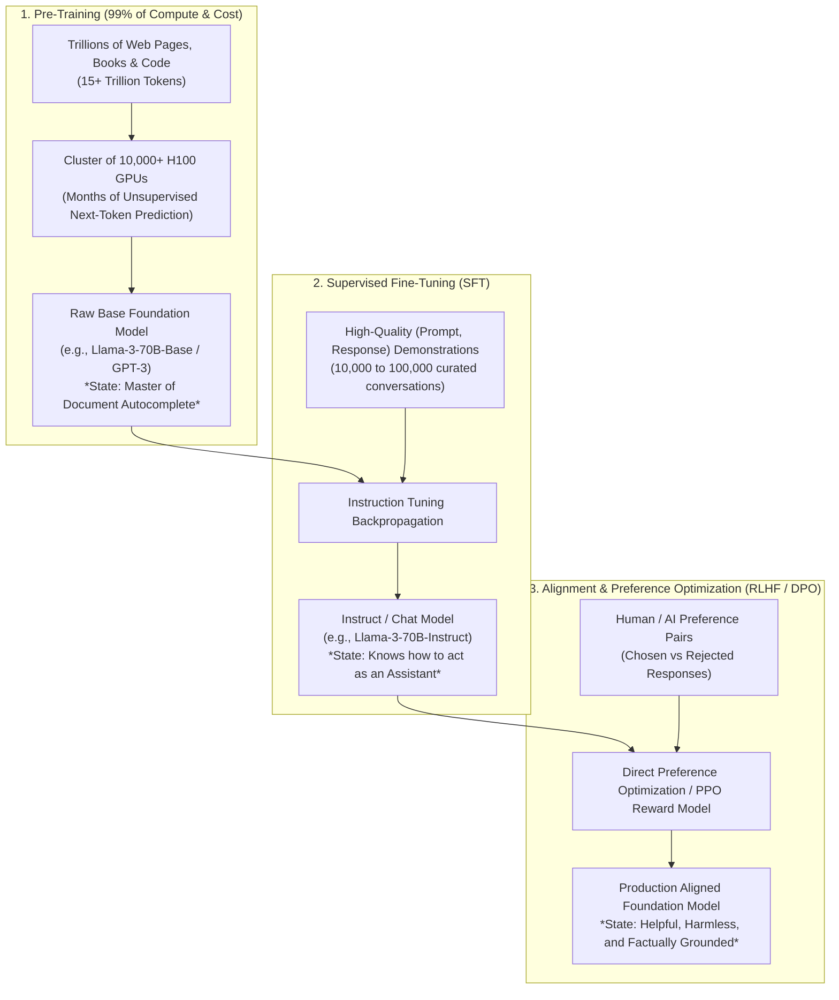
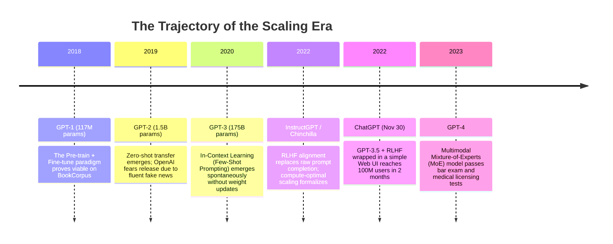
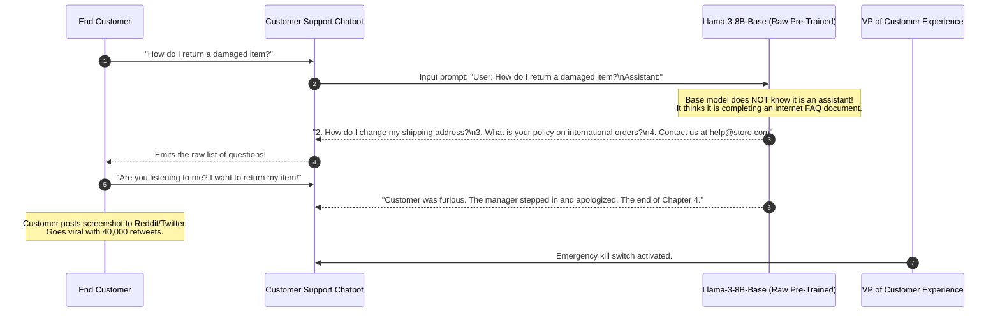

# The Scaling Era: GPT-1 to ChatGPT

> **Difficulty**: Intermediate | **Estimated Time**: 35m | **Hands-On**: Mandatory

> [!TIP]
> **The Golden Rule of the Scaling Era:**
> **Base models complete text; aligned models follow instructions.** An unaligned foundation model trained on next-token prediction does not want to help you; it wants to complete statistical document patterns (if prompted *"What is the capital of France?"*, it may respond with *"What is the capital of Germany?"* because it assumes it is completing a geography quiz). True consumer utility required **Supervised Fine-Tuning (SFT)** and **Reinforcement Learning from Human Feedback (RLHF)** to transform raw autocomplete engines into conversational assistants.

---

## 1. Visual Mental Models: The 3-Stage Foundation Model Pipeline

Modern large language models are not built in a single training step. They undergo a three-stage manufacturing process that turns raw unstructured web text into aligned conversational software:



---

## 2. The Chinchilla Scaling Law: Parameters vs. Tokens

In 2020, OpenAI published Kaplan et al.'s scaling law, suggesting that model parameter count should grow faster than dataset size.
In 2022, DeepMind's Jordan Hoffmann et al. published the **Chinchilla Scaling Law**, disproving this assumption and proving that **most early LLMs (including GPT-3) were severely undertrained**:

$$\text{FLOPs} \approx 6 \times N \times D$$
$$\text{where } N = \text{Model Parameters}, \quad D = \text{Training Tokens}$$

```
Compute-Optimal Scaling:
For every 1x increase in Parameters (N), Training Tokens (D) must also scale by 1x!

+------------------+-------------------+--------------------+------------------------+
| Model            | Parameter Count   | Training Tokens    | Status                 |
+------------------+-------------------+--------------------+------------------------+
| GPT-3 (2020)     | 175 Billion       | 300 Billion        | Severely Undertrained  |
| Gopher (2021)    | 280 Billion       | 300 Billion        | Severely Undertrained  |
| Chinchilla (2022)| 70 Billion        | 1.4 Trillion       | Compute-Optimal        |
| Llama 3 (2024)   | 8 Billion         | 15.0 Trillion      | Over-Trained (Fast API)|
+------------------+-------------------+--------------------+------------------------+
```

### Why "Over-Training" Small Models Wins in Production
Training an 8B model on 15 trillion tokens (like Llama 3) costs more compute during pre-training than Chinchilla recommends, but it produces a **tiny, blazing-fast model during inference**. Because foundation models are trained once and queried billions of times, inference efficiency vastly outweighs pre-training compute budgets.

---

## 3. The Emergence Timeline: From GPT-1 to ChatGPT



---

## 4. Production War Story: The Raw Base Model Deployment Disaster

```
INCIDENT SUMMARY: INC-9011
SEVERITY: P1 - Customer Facing Breakdown
IMPACT: 22,000 customer support chats degraded; customer satisfaction rating collapsed from 4.8 to 1.2 in 2 hours.
ROOT CAUSE: A backend team deployed a raw base model (Llama-3-8B-Base) instead of an instruction-tuned model (Llama-3-8B-Instruct).
```

### Incident Timeline



### The Post-Mortem

- **The Fallacy**: The development team assumed that all models with the name "Llama 3" behaved as conversational assistants.
- **The Reality**:
  - **Base Models (`*-Base`)**: Trained strictly for next-token continuation. They complete internet text, story chapters, and FAQ lists.
  - **Instruct Models (`*-Instruct` / `*-Chat`)**: Specifically fine-tuned on thousands of multi-turn dialogues with system prompts to behave as responsive, helpful assistants.
- **The Remediation**:
  1. Updated model deployment pipelines to strictly require verified `*-instruct` model artifacts.
  2. Implemented automated integration tests verifying that question prompts receive direct answers rather than document completions.

---

## 5. Multi-Language Implementations: Compute & Cost Forecaster

Study these implementations of Chinchilla FLOPs calculation and inference token cost estimation.

### Python (`scaling_calculator.py`)

```python
from dataclasses import dataclass

@dataclass
class ModelScalingReport:
    model_name: str
    parameters_b: float
    training_tokens_b: float
    total_flops: float
    is_chinchilla_optimal: bool
    optimal_tokens_b: float

def compute_chinchilla_flops(params_b: float, tokens_b: float, name: str) -> ModelScalingReport:
    """
    Computes theoretical training compute using: FLOPs = 6 * N * D
    Chinchilla optimal token count is ~20 tokens per parameter.
    """
    N = params_b * 1e9
    D = tokens_b * 1e9
    total_flops = 6 * N * D
    
    # Chinchilla rule of thumb: D ≈ 20 * N
    optimal_tokens_b = params_b * 20.0
    optimal_ratio = tokens_b / optimal_tokens_b
    is_optimal = 0.8 <= optimal_ratio <= 1.2

    return ModelScalingReport(
        model_name=name,
        parameters_b=params_b,
        training_tokens_b=tokens_b,
        total_flops=total_flops,
        is_chinchilla_optimal=is_optimal,
        optimal_tokens_b=optimal_tokens_b,
    )

if __name__ == "__main__":
    models = [
        ("GPT-3", 175.0, 300.0),
        ("Chinchilla", 70.0, 1400.0),
        ("Llama-3-8B", 8.0, 15000.0),
    ]

    print("=== CHINCHILLA SCALING LAW ANALYSIS ===")
    for name, params, tokens in models:
        rep = compute_chinchilla_flops(params, tokens, name)
        print(f"\nModel: {rep.model_name}")
        print(f"  Params: {rep.parameters_b}B | Tokens: {rep.training_tokens_b}B")
        print(f"  Training FLOPs: {rep.total_flops:.2e}")
        print(f"  Chinchilla Optimal Tokens: {rep.optimal_tokens_b:.1f}B")
        status = "Optimal" if rep.is_chinchilla_optimal else ("Under-Trained" if rep.training_tokens_b < rep.optimal_tokens_b else "Over-Trained (Fast Inference)")
        print(f"  Status: {status}")
```

### TypeScript / Node.js (`scaling_calculator.ts`)

```typescript
export interface TokenEconomics {
  inputTokens: number;
  outputTokens: number;
  costPer1kInput: number;
  costPer1kOutput: number;
  totalCost: number;
}

export function estimateInferenceCost(
  dailyActiveUsers: number,
  queriesPerUser: number,
  avgPromptTokens: number,
  avgCompletionTokens: number,
  inputRatePerMillion: number,
  outputRatePerMillion: number
): { dailyCost: number; monthlyCost: number } {
  const totalDailyQueries = dailyActiveUsers * queriesPerUser;
  const dailyInputTokens = totalDailyQueries * avgPromptTokens;
  const dailyOutputTokens = totalDailyQueries * avgCompletionTokens;

  const inputCost = (dailyInputTokens / 1_000_000) * inputRatePerMillion;
  const outputCost = (dailyOutputTokens / 1_000_000) * outputRatePerMillion;
  const dailyTotal = inputCost + outputCost;

  return {
    dailyCost: Number(dailyTotal.toFixed(2)),
    monthlyCost: Number((dailyTotal * 30).toFixed(2)),
  };
}

// Example: 50,000 DAU using gpt-4o-mini ($0.15/1M in, $0.60/1M out)
const budget = estimateInferenceCost(50_000, 4, 800, 200, 0.15, 0.6);
console.log(`Estimated Cloud AI Budget: $${budget.monthlyCost}/month`);
```

### Go (`flops_estimator.go`)

```go
package main

import (
	"fmt"
)

func EstimateTrainingFLOPs(paramCountBillions, tokenCountBillions float64) float64 {
	// FLOPs = 6 * N * D
	n := paramCountBillions * 1e9
	d := tokenCountBillions * 1e9
	return 6.0 * n * d
}

func main() {
	llama3_8b := EstimateTrainingFLOPs(8.0, 15000.0)
	fmt.Printf("Llama 3 8B Pre-Training Compute: %.3e FLOPs\n", llama3_8b)
}
```

---

## 6. Practical CLI Workflows

Verify the fundamental behavioral difference between Base models and Instruct models using the Ollama CLI on a local workstation:

```bash
# 1. Querying an Instruct Model (Behaves as a conversational assistant)
curl -s http://localhost:11434/api/generate -d '{
  "model": "llama3:8b",
  "prompt": "How do I reverse a linked list in Go?",
  "stream": false
}' | jq '.response'
```

**Output:**
```
"To reverse a singly linked list in Go, you maintain three pointers (prev, current, next)... [Working Go Code Example]"
```

Contrast this with a raw completion prompt:

```bash
# 2. Testing completion dynamics
curl -s http://localhost:11434/api/generate -d '{
  "model": "llama3:8b",
  "prompt": "The three best things about Go are 1.",
  "stream": false
}' | jq '.response'
```

The model seamlessly completes items 2 and 3, demonstrating its underlying autoregressive nature!

---

## 7. Operational Validation Checkpoints

Confirm your understanding of the scaling era and post-training alignment.

<details>
<summary><b>Checkpoint 1: Why did Few-Shot Prompting (In-Context Learning) surprise the creators of GPT-3?</b></summary>

**Analysis:**
Prior to GPT-3, machine learning dogma held that to teach a model a new task, you had to perform **gradient updates** on labeled data (fine-tuning).
In GPT-3, researchers discovered that at 175B parameter scale, simply providing three input-output examples inside the input prompt string enabled the model to perform novel translation, formatting, or reasoning tasks **without changing a single neural network weight**. This emergent property arose naturally from training across millions of internet documents containing structured examples.
</details>

<details>
<summary><b>Checkpoint 2: What is the difference between Supervised Fine-Tuning (SFT) and RLHF?</b></summary>

**Distinction:**
- **SFT (Supervised Fine-Tuning):** Teaches the model the **structure and format** of an assistant. Human contractors write complete answers to prompts. The model learns: *"When the user asks a question, do not complete an essay; provide a helpful answer."*
- **RLHF (Reinforcement Learning from Human Feedback):** Teaches the model **preference and safety**. The model generates two candidate responses, and humans rank which is better. A reward model is trained on these preferences, and reinforcement learning (PPO) or DPO updates the model to maximize helpfulness while suppressing harmful, racist, or toxic generations.
</details>

<details>
<summary><b>Checkpoint 3: Why did Llama 3 choose to train an 8-Billion parameter model on 15 Trillion tokens (far beyond Chinchilla optimality)?</b></summary>

**Inference Economics:**
Chinchilla optimality minimizes **pre-training compute costs**.
However, in production enterprise software, **inference costs dominate**. An 8B model fits onto a single commodity GPU (e.g. 16GB VRAM on an RTX 4090 or single A10G), whereas a 70B model requires multiple high-end GPUs. By massively over-training the 8B model on 15T tokens, Meta squeezed near-70B performance into an 8B footprint, saving millions of dollars in production API serving costs.
</details>

---

## Next

Continue to **[08-how-llms-actually-generate-text](../08-how-llms-actually-generate-text/README.md)** to master decoding strategies: greedy search, temperature, top-k, top-p (nucleus sampling), and frequency penalties.
