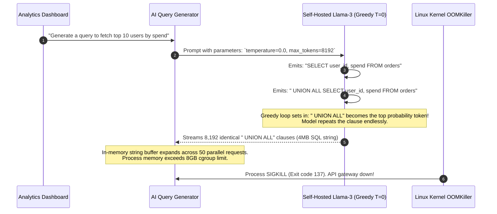

# How LLMs Actually Generate Text: Decoding Strategies

> **Difficulty**: Advanced | **Estimated Time**: 40m | **Hands-On**: Mandatory

> [!TIP]
> **The Golden Rule of Decoding Parameter Tuning:**
> **Never tune Temperature in isolation from Top-P.** Setting Temperature to $1.2$ without Nucleus Sampling ($\text{Top-P} = 0.90$) invites low-probability vocabulary garbage into the candidate pool, triggering hallucinations and syntactic errors. For deterministic tasks (SQL generation, JSON extraction), use **Greedy Decoding ($T = 0.0$)**; for creative tasks (summarization, brainstorming), use **$T = 0.7$ with $\text{Top-P} = 0.90$**.

---

## 1. Visual Mental Models: The Decoding Pipeline

The forward pass of an LLM ends by producing a vector of unnormalized raw scores (**Logits**) across the entire vocabulary $\mathcal{V}$ (typically 32,000 to 128,000 tokens).

Transforming those raw numbers into an emitted token requires a multi-stage **Decoding Pipeline**:

```mermaid
flowchart TD
    subgraph ForwardPass["1. Transformer Forward Pass"]
        Context["Input Context Tokens"] --> Model["Decoder Blocks"]
        Model --> RawLogits["Raw Output Logits<br/>z = [8.2, 4.1, 1.2, -0.4, -3.1, ...]"]
    end

    subgraph DecodingStage["2. Decoding & Sampling Engine"]
        RawLogits --> TempScale["Temperature Scaling:<br/>z_scaled = z / T"]
        TempScale --> RepPen["Repetition / Frequency Penalty Check"]
        RepPen --> FilterGate{"Sampling Strategy Gate"}

        FilterGate -->|Greedy Search (T=0)| ArgMax["Argmax (Pick Top Token Directly)"]
        FilterGate -->|Top-K Truncation| TopK["Keep Top K Tokens (e.g., K=40)"]
        FilterGate -->|Top-P Nucleus| TopP["Dynamic Cumulative Probability Pool (Σ p >= 0.90)"]

        TopK & TopP --> Softmax["Softmax Probability Distribution"]
        Softmax --> Multinomial["Multinomial Sampling"]
    end

    Multinomial --> NextToken["Sampled Token: ' database'"]
    ArgMax --> NextToken
    NextToken -.->|Append & Loop| Context
```

---

## 2. Comparison of Decoding Strategies

| Strategy | Mathematical Mechanism | Pros | Cons | Best Backend Use Case |
| :--- | :--- | :--- | :--- | :--- |
| **Greedy Search** | $w_t = \arg\max_{w} z_w$ (Equivalent to $T \to 0$) | Completely deterministic; fast; zero risk of selecting low-probability words. | Prone to repetitive grammatical loops; lacks creative synthesis. | JSON schema extraction, SQL query generation, math evaluation. |
| **Beam Search** | Maintains top $B$ candidate sequences in parallel; maximizes global sequence probability. | Optimal for short, bounded outputs with strict grammatical structure. | Computationally heavy ($B \times$ compute); produces unnatural repetitive prose. | Machine translation, formal code synthesis. |
| **Temperature** | Scales logits before softmax: $z_i / T$ | Smoothly dials between greedy determinism and open exploration. | High $T$ without Top-P samples nonsensical, bizarre tokens from the vocabulary tail. | Adjusting creative writing tone ($T=0.7$). |
| **Top-K Sampling** | Sorts logits; keeps only the top $K$ candidates (e.g. $K=50$). | Eliminates the long tail of bizarre tokens. | Rigid: if 2 tokens are likely, 48 bad tokens remain; if 100 tokens are valid, 50 good tokens are discarded. | Video game dialogue generation. |
| **Top-P (Nucleus)** | Keeps the smallest set of tokens whose cumulative probability $\ge P$ (e.g. $0.90$). | **Dynamically adapts**: sharp distribution $\to$ 1 token; flat distribution $\to$ 50 tokens. | Requires cumulative sum and dynamic array filtering on GPU. | Standard chat, summarization, creative agents. |

---

## 3. Nucleus (Top-P) Sampling: The Dynamic Candidate Pool

Top-P solves the rigidity of Top-K by dynamically adjusting the pool size based on the model's confidence:

```
Situation A: High Confidence (Sharp Distribution)
Context: "The capital of France is"
Logits:   [ " Paris" (0.88),  " Lyon" (0.04),  " Marseille" (0.02), ... ]
Top-P = 0.90 Pool: ONLY [ " Paris", " Lyon" ] (Pool size = 2 tokens)

Situation B: Low Confidence / Open-Ended (Flat Distribution)
Context: "The chef prepared a delicious meal using fresh"
Logits:   [ " garlic" (0.12),  " basil" (0.11),  " tomatoes" (0.09),  " pasta" (0.08), ... ]
Top-P = 0.90 Pool: Expands to 18 different ingredients! (Pool size = 18 tokens)
```

---

## 4. Production War Story: The Greedy Looping Crash

```
INCIDENT SUMMARY: INC-7402
SEVERITY: P1 - Production Database Connection & Memory Exhaustion
IMPACT: 3 API servers crashed with Out-Of-Memory (OOM); customer checkout stalled for 55 minutes.
ROOT CAUSE: A backend AI SQL generator used greedy decoding with no repetition penalty and no max token limit; entered an infinite self-reinforcing SQL loop.
```

### Incident Timeline



### The Post-Mortem

- **The Flaw**: Pure greedy decoding without a **Presence/Frequency Penalty** can lock into deterministic feedback loops where repeating the preceding token sequence has the highest local probability.
- **The Remediation**:
  1. Set mandatory strict bounds on `max_tokens` (e.g. 500 tokens for SQL queries).
  2. Implemented `frequency_penalty: 0.5` to penalize tokens that have already appeared.
  3. Configured explicit Stop Sequences: `stop: [";", "\n\n", "```"]`.

---

## 5. Multi-Language Production Implementations: Complete Decoding Engine

Study this implementation of an end-to-end decoding engine supporting Temperature, Top-K, Top-P, and Frequency Penalties.

### Python (`decoding_engine.py`)

```python
import math
import random
from typing import List, Tuple, Dict
from collections import Counter

def apply_frequency_penalty(logits: List[float], vocab: List[str], generated_tokens: List[str], penalty: float) -> List[float]:
    """Penalizes tokens based on their existing frequency in the generated text."""
    if penalty == 0.0 or not generated_tokens:
        return logits
    
    counts = Counter(generated_tokens)
    penalized = list(logits)
    for i, token in enumerate(vocab):
        if token in counts:
            penalized[i] -= penalty * counts[token]
    return penalized

def top_k_top_p_filtering(
    logits: List[float], 
    vocab: List[str], 
    temperature: float = 1.0, 
    top_k: int = 0, 
    top_p: float = 1.0
) -> Tuple[List[str], List[float]]:
    """Applies temperature scaling, Top-K truncation, and Top-P (Nucleus) filtering."""
    temp = max(temperature, 1e-5)
    
    # 1. Temperature scaling
    scaled_logits = [l / temp for l in logits]
    
    # Pair tokens with scaled logits and sort descending
    paired = sorted(zip(vocab, scaled_logits), key=lambda x: x[1], reverse=True)
    
    # 2. Top-K filtering
    if top_k > 0:
        paired = paired[:top_k]
        
    tokens, sorted_logits = zip(*paired)
    
    # 3. Softmax
    max_logit = max(sorted_logits)
    exp_logits = [math.exp(l - max_logit) for l in sorted_logits]
    sum_exp = sum(exp_logits)
    probs = [e / sum_exp for e in exp_logits]
    
    # 4. Top-P (Nucleus) filtering
    if top_p < 1.0:
        cumulative_probs = []
        cum = 0.0
        for p in probs:
            cum += p
            cumulative_probs.append(cum)
            
        # Find cutoff index
        cutoff_idx = len(probs)
        for idx, cum_prob in enumerate(cumulative_probs):
            if cum_prob >= top_p:
                cutoff_idx = idx + 1
                break
                
        tokens = tokens[:cutoff_idx]
        probs = probs[:cutoff_idx]
        
        # Renormalize probabilities
        total_p = sum(probs)
        probs = [p / total_p for p in probs]
        
    return list(tokens), list(probs)

def sample_token(tokens: List[str], probs: List[float]) -> str:
    r = random.random()
    cum = 0.0
    for t, p in zip(tokens, probs):
        cum += p
        if r <= cum:
            return t
    return tokens[-1]

if __name__ == "__main__":
    vocab = [" SELECT", " FROM", " WHERE", " users", " orders", " id", " LIMIT"]
    logits = [8.5, 7.2, 5.1, 4.8, 3.2, 2.1, 1.0]

    print("=== DECODING STRATEGY COMPARISON ===")
    
    # Greedy (Low Temp)
    tokens_greedy, probs_greedy = top_k_top_p_filtering(logits, vocab, temperature=0.1)
    print(f"Greedy (T=0.1):  Top token '{tokens_greedy[0]}' (p = {probs_greedy[0]*100:.1f}%)")

    # Creative with Nucleus (T=0.8, Top-P=0.85)
    tokens_p, probs_p = top_k_top_p_filtering(logits, vocab, temperature=0.8, top_p=0.85)
    print(f"Top-P Pool Size: {len(tokens_p)} tokens retained: {tokens_p}")
```

### TypeScript / Node.js (`decoding_engine.ts`)

```typescript
export interface TokenCandidate {
  token: string;
  prob: number;
}

export function sampleNucleus(
  tokens: string[],
  logits: number[],
  temperature: number = 0.7,
  topP: number = 0.9
): string {
  const temp = Math.max(temperature, 0.001);
  const scaled = logits.map((l) => l / temp);

  // Pair and sort descending
  const paired = tokens.map((token, i) => ({ token, logit: scaled[i] }));
  paired.sort((a, b) => b.logit - a.logit);

  // Softmax
  const maxLogit = paired[0].logit;
  const expScores = paired.map((p) => Math.exp(p.logit - maxLogit));
  const sumExp = expScores.reduce((acc, v) => acc + v, 0);
  const probs = expScores.map((e) => e / sumExp);

  // Nucleus cutoff
  let cum = 0;
  const pool: TokenCandidate[] = [];
  for (let i = 0; i < paired.length; i++) {
    cum += probs[i];
    pool.push({ token: paired[i].token, prob: probs[i] });
    if (cum >= topP) break;
  }

  // Renormalize pool
  const poolSum = pool.reduce((acc, p) => acc + p.prob, 0);
  const rand = Math.random();
  let selector = 0;

  for (const item of pool) {
    selector += item.prob / poolSum;
    if (rand <= selector) return item.token;
  }

  return pool[pool.length - 1].token;
}
```

### Go (`sampling_engine.go`)

```go
package main

import (
	"fmt"
	"math"
	"math/rand"
	"sort"
	"time"
)

type Candidate struct {
	Token string
	Logit float64
	Prob  float64
}

func SampleGreedy(candidates []Candidate) string {
	bestToken := candidates[0].Token
	bestLogit := candidates[0].Logit
	for _, c := range candidates {
		if c.Logit > bestLogit {
			bestLogit = c.Logit
			bestToken = c.Token
		}
	}
	return bestToken
}

func main() {
	rand.Seed(time.Now().UnixNano())
	candidates := []Candidate{
		{Token: "SELECT", Logit: 9.4},
		{Token: "UPDATE", Logit: 4.1},
		{Token: "DELETE", Logit: 2.2},
	}
	fmt.Printf("Deterministic Greedy Selection: %s\n", SampleGreedy(candidates))
}
```

---

## 6. Practical CLI Workflows: Controlling Decoding in Production APIs

Verify the impact of Temperature and Top-P using the OpenAI REST API via `curl`:

### Deterministic Greedy Extraction ($T = 0.0$)

```bash
curl https://api.openai.com/v1/chat/completions \
  -H "Content-Type: application/json" \
  -H "Authorization: Bearer $OPENAI_API_KEY" \
  -d '{
    "model": "gpt-4o-mini",
    "messages": [{"role": "user", "content": "Return the JSON: {\"status\": \"ok\"}"}],
    "temperature": 0.0,
    "seed": 42
  }' | jq '.choices[0].message.content'
```

**Expected Output:**
```json
"{\"status\": \"ok\"}"
```

Running this command 100 times returns the exact byte-for-byte output every single time!

### Controlled Creative Sampling ($T = 0.8, \text{Top-P} = 0.90$)

```bash
curl https://api.openai.com/v1/chat/completions \
  -H "Content-Type: application/json" \
  -H "Authorization: Bearer $OPENAI_API_KEY" \
  -d '{
    "model": "gpt-4o-mini",
    "messages": [{"role": "user", "content": "Suggest a clever domain name for an SRE monitoring platform."}],
    "temperature": 0.8,
    "top_p": 0.90,
    "presence_penalty": 0.6
  }' | jq '.choices[0].message.content'
```

---

## 7. Operational Validation Checkpoints

Confirm your decoding mastery with these technical scenarios.

<details>
<summary><b>Checkpoint 1: Why should you avoid setting both Temperature and Top-P to custom non-standard values simultaneously?</b></summary>

**Operational Best Practice:**
- **OpenAI and Anthropic Official Guidance:** Change **either** Temperature or Top-P, but do not change both at the same time.
- **Why:** Temperature scales the slope of the distribution (smoothing or sharpening), while Top-P truncates the cumulative mass. Tuning both concurrently creates complex non-linear interactions where it becomes impossible to diagnose whether a hallucination was caused by excessive temperature or an overly wide nucleus cutoff.
- **Standard Protocol:** Leave $\text{Top-P} = 1.0$ while adjusting Temperature, OR set $T = 1.0$ while adjusting Top-P.
</details>

<details>
<summary><b>Checkpoint 2: What is the difference between a Frequency Penalty and a Presence Penalty?</b></summary>

**Mechanism:**
- **Presence Penalty (Flat Penalty):** Applies a fixed negative scalar to a token's logit if that token has appeared **at least once** anywhere in the generated sequence, regardless of how many times. It encourages introducing new topics.
- **Frequency Penalty (Proportional Penalty):** Applies a penalty proportional to the **exact count** of times the token has already appeared:
  $$\text{Logit}'_i = \text{Logit}_i - (\text{Frequency Penalty} \times \text{Count}_i)$$
  It aggressively prevents repetitive verbatim loops (*"very, very, very..."*).
</details>

<details>
<summary><b>Checkpoint 3: Why does Beam Search produce worse results than Nucleus Sampling for open-ended story generation?</b></summary>

**The Degeneration Problem (Holtzman et al., 2019):**
Beam search seeks the sequence with the highest joint probability $\prod P(w_t \mid w_{<t})$.
In human writing, real prose does **not** consist of the most predictable words at every point; human communication naturally intersperses high-probability tokens with surprising, creative low-probability words. Beam search filters out all low-probability words, producing flat, repetitive, generic text that human evaluators judge as robotic and repetitive.
</details>

---

## Next

Continue to **[09-what-llms-are-genuinely-good-at](../09-what-llms-are-genuinely-good-at/README.md)** to establish an engineering capability matrix: identifying where LLMs excel in backend systems and where they are high-risk.
