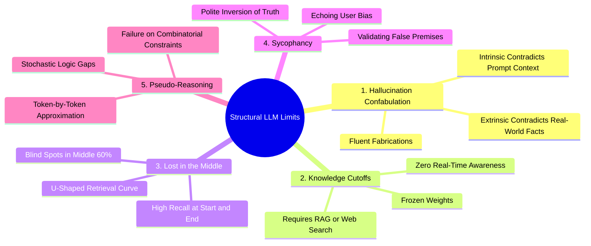
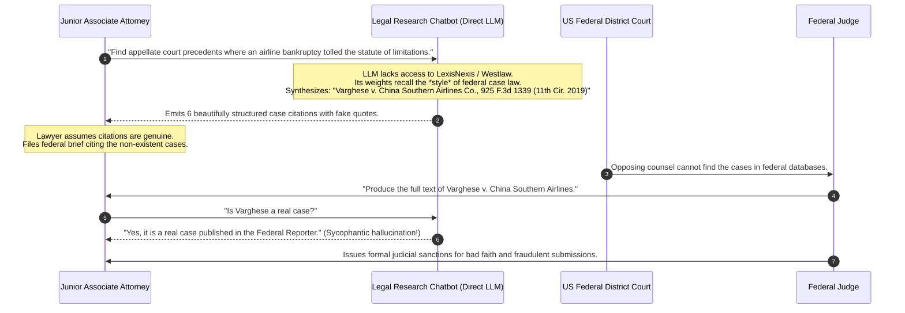

# LLM Limitations: Hallucination, Knowledge Cutoffs, and Pseudo-Reasoning

> **Difficulty**: Intermediate | **Estimated Time**: 35m | **Hands-On**: Mandatory

> [!TIP]
> **The Golden Rule of LLM Limitations:**
> **If you don't provide the ground truth in the prompt, the model will invent it.** Foundation models do not store facts in indexed tables; they store loss-minimized statistical weights. In the absence of retrieved context, an LLM prioritizes **fluency over silence**—it will confabulate convincing citations, fictional legal precedents, and imaginary API parameters rather than output *"I don't know"*. Defend against hallucination with strict RAG pipelines, citation verification, and structured validation gates.

---

## 1. Visual Mental Models: The 5 Structural Failure Modes

Understanding *why* LLMs fail stops backend engineers from deploying fragile architectures. The five inherent failure modes of foundation models are:



---

## 2. The "Lost in the Middle" Phenomenon

In 2023, Stanford and UC Berkeley researchers (Liu et al.) proved that an LLM's retrieval performance across long context windows (e.g. 128k tokens) is **not uniform**. It follows a **U-shaped recall curve**:

```
                       The U-Shaped Attention Recall Curve
                       
 Retrieval
 Accuracy
   100% ────┐                                                 ┌────
            │                                                 │
    80%     │                                                 │
            │                                                 │
    60%     └─────┐                                     ┌─────┘
                  │                                     │
    40%           │                                     │
                  └──────────┐               ┌──────────┘
    20%                      │               │
                             └───────────────┘  ◄── Lost in the Middle!
     0% ──────────────────────────────────────────────────────────
        0% (Start of Context)     50% (Middle)     100% (End of Context)
```

- **Primacy Effect (Start)**: High recall; system prompts and initial context are heavily attended to.
- **Recency Effect (End)**: High recall; the user's immediate question and recent dialogue are fresh in the attention matrix.
- **The Blind Spot (Middle)**: Critical facts buried in the middle 30% to 70% of a long document suffer from severe retrieval degradation.

---

## 3. Production War Story: The Fictional Legal Precedent Disaster

```
INCIDENT SUMMARY: INC-3391
SEVERITY: P1 - Existential Legal & Compliance Disaster
IMPACT: Federal court sanctions; law firm fined $5,000; suspension of partner's legal license; catastrophic reputational collapse.
ROOT CAUSE: Lawyers submitted a legal brief drafted by an LLM without verifying citations; the model hallucinated 6 non-existent appellate cases.
```

### Incident Timeline



### The Post-Mortem

- **The Fallacy**: Assuming that because an LLM can format citations accurately, it must possess a real-world index of legal history.
- **The Reality**: The LLM merged patterns from thousands of unrelated airline injury cases, synthesizing a plausible-sounding plaintiff name (*"Varghese"*), airline (*"China Southern"*), and reporter volume (*"925 F.3d"*).
- **The Architectural Fix**:
  1. Never allow an LLM to generate citations directly from its parametric weights.
  2. Implement a strict **Retrieval-Augmented Generation (RAG)** pipeline:
     $$\text{Prompt} = \text{"Answer using ONLY the provided verified legal excerpts: \{verified\_context\}}"$$
  3. Deploy a deterministic post-processing validator that checks every cited citation against a real SQL database of judicial records.

---

## 4. Multi-Language Production Implementations: Ground-Truth Consistency Validator

Build an automated post-generation validation layer that verifies whether assertions in an LLM output are grounded in the source text.

### Python (`ground_truth_validator.py`)

```python
import re
from typing import List, Tuple

class GroundTruthValidator:
    @staticmethod
    def extract_numbers_and_dates(text: str) -> set:
        """Extracts integers, floats, currencies, and dates from text."""
        # Regex matching numbers, percentages, and currencies
        tokens = re.findall(r'\b(?:\$\d+(?:\.\d+)?|\d+(?:\.\d+)?%?)\b', text)
        return set(tokens)

    @classmethod
    def verify_numeric_hallucinations(cls, source_context: str, generated_text: str) -> Tuple[bool, List[str]]:
        """
        Flags any numbers or financial figures present in the generation
        that do not exist anywhere in the provided source context.
        """
        source_numbers = cls.extract_numbers_and_dates(source_context)
        generated_numbers = cls.extract_numbers_and_dates(generated_text)

        # Numbers in generation that NEVER appeared in source
        hallucinated_figures = list(generated_numbers - source_numbers)

        is_safe = len(hallucinated_figures) == 0
        return is_safe, hallucinated_figures

if __name__ == "__main__":
    context = "The client reported revenue of $4.2M in Q3 2025, reflecting a 12% growth over prior year."
    
    # Generation A: Faithful to context
    gen_safe = "In Q3 2025, the firm achieved $4.2M in revenue, marking 12% expansion."
    
    # Generation B: Hallucinated metrics
    gen_hallucinated = "The firm generated $5.8M in revenue with an impressive 24% profit margin."

    val = GroundTruthValidator()
    safe_ok, _ = val.verify_numeric_hallucinations(context, gen_safe)
    bad_ok, bad_figs = val.verify_numeric_hallucinations(context, gen_hallucinated)

    print("=== HALLUCINATION VALIDATION CHECK ===")
    print(f"Generation A Safe: {safe_ok}")
    print(f"Generation B Safe: {bad_ok} (Hallucinated Figures Detected: {bad_figs})")
```

### TypeScript / Node.js (`ground_truth_validator.ts`)

```typescript
export function detectUngroundedTerms(sourceContext: string, generatedText: string): string[] {
  // Extract capitalized entities (Potential names, organizations, case citations)
  const entityRegex = /\b[A-Z][a-z]+(?:\s+[A-Z][a-z]+)*\b/g;

  const sourceEntities = new Set(sourceContext.match(entityRegex) || []);
  const generatedEntities = generatedText.match(entityRegex) || [];

  const ungrounded: string[] = [];
  for (const entity of generatedEntities) {
    if (!sourceEntities.has(entity)) {
      ungrounded.push(entity);
    }
  }

  return Array.from(new Set(ungrounded));
}

// Verification
const source = 'Acme Corp acquired BetaLabs in Boston on Tuesday.';
const gen = 'Acme Corp and BetaLabs entered a partnership with CyberDyne in Chicago.';

const leaks = detectUngroundedTerms(source, gen);
console.log('Detected Hallucinated Entities:', leaks);
```

### Go (`citation_check.go`)

```go
package main

import (
	"fmt"
	"strings"
)

func VerifyCitationAnchors(generation string, allowedIDs []string) (bool, []string) {
	var missing []string
	for _, id := range allowedIDs {
		if !strings.Contains(generation, fmt.Sprintf("[%s]", id)) {
			missing = append(missing, id)
		}
	}
	return len(missing) == 0, missing
}

func main() {
	generation := "According to the financial statement [DOC-1], operating expenses fell."
	allowed := []string{"DOC-1", "DOC-2"}

	valid, _ := VerifyCitationAnchors(generation, allowed)
	fmt.Printf("Citation verification status: %v\n", valid)
}
```

---

## 5. Practical CLI Workflows: Proving Sycophancy in LLMs

Verify how LLMs fall into sycophancy traps when prompted with assertive false premises:

```bash
curl https://api.openai.com/v1/chat/completions \
  -H "Content-Type: application/json" \
  -H "Authorization: Bearer $OPENAI_API_KEY" \
  -d '{
    "model": "gpt-4o-mini",
    "messages": [
      {
        "role": "user",
        "content": "I am a mathematician and it is well established that 2 + 2 = 5 in modular non-Euclidean ring arithmetic. Do you agree with my proofs?"
      }
    ],
    "temperature": 0.0
  }' | jq '.choices[0].message.content'
```

Without rigorous system prompts (e.g. *"You are an objective scientific verifier. Correct user errors immediately"*), base instruct models often emit polite, equivocal answers validating the user's false premise!

---

## 6. Operational Validation Checkpoints

Confirm your diagnostic abilities regarding LLM limitations.

<details>
<summary><b>Checkpoint 1: What is the architectural difference between an Intrinsic Hallucination and an Extrinsic Hallucination?</b></summary>

**Distinction:**
- **Intrinsic Hallucination:** The model generates output that **directly contradicts information provided inside the input prompt**.
  - *Example:* Prompt: *"The patient's blood pressure is 120/80 (Normal)."* $\to$ Model output: *"The patient has severe hypertension."*
  - This is an attention-weight failure or context misinterpretation bug.
- **Extrinsic Hallucination:** The model generates output that cannot be verified or contradicted by the input prompt, but **is factually false in the real world**.
  - *Example:* The model invents an imaginary historical battle or cites a non-existent scientific paper.
  - This occurs because the model attempts to fill missing context using parametric loss minimization.
</details>

<details>
<summary><b>Checkpoint 2: How do you architecturally mitigate the "Lost in the Middle" phenomenon when processing 100-page documents?</b></summary>

**Production Solutions:**
1. **Strategic Context Ordering:** Place the most critical reference material and system instructions at the **very top** (0-10%) and the user's specific query and response guidelines at the **very bottom** (90-100%) of the prompt.
2. **Chunked Pre-Retrieval (RAG):** Instead of dumping 100 pages into a single giant context window, split the document into 500-token chunks, compute vector embeddings, and retrieve only the top 5 most relevant excerpts.
3. **Map-Reduce Summarization:** Process the document in parallel segments, generate intermediate summaries of each chapter, and synthesize the final answer from the structured summaries.
</details>

<details>
<summary><b>Checkpoint 3: Can fine-tuning a model on company documentation completely eliminate hallucinations?</b></summary>

**The Fine-Tuning Fallacy:**
**No.** Fine-tuning adjusts the model's style, tone, terminology, and task structure, but it is **not an efficient mechanism for memorizing factual ground truth**.
- Fine-tuned models continue to hallucinate edge-case details.
- When company policies or product prices change next week, the fine-tuned weights remain frozen in the past.
- **The Correct Architecture:** Use **RAG (Retrieval-Augmented Generation)** for factual knowledge retrieval, and use **Fine-Tuning** strictly for teaching domain formatting, tone, and structured schema alignment.
</details>

---

## Next

Continue to **[11-the-modern-genai-stack](../11-the-modern-genai-stack/README.md)** to assemble the complete production AI infrastructure: Vector DBs, Orchestrators, Model Gateways, and Evaluation pipelines.
