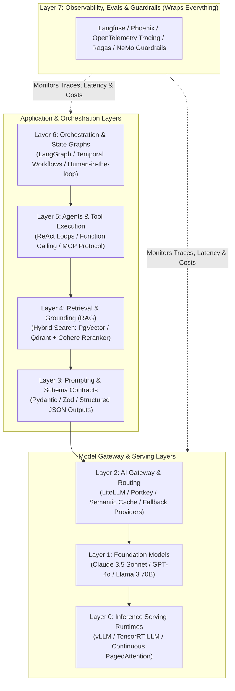
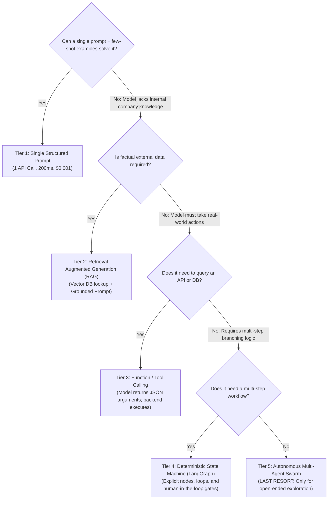
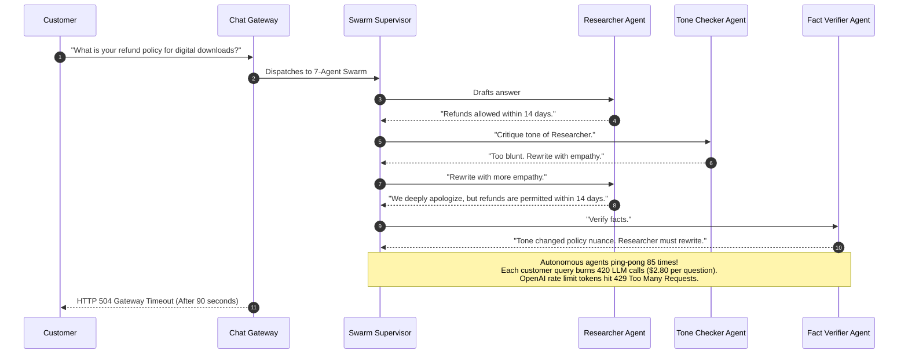

# The Modern GenAI Stack: Production Architectural Patterns

> **Difficulty**: Intermediate-Advanced | **Estimated Time**: 40m | **Hands-On**: Mandatory

> [!TIP]
> **The Golden Rule of GenAI System Design:**
> **Follow the Natural Order of Escalation.** Never build a multi-agent autonomous swarm to solve a problem that a single well-grounded prompt or deterministic RAG pipeline solves in 100 milliseconds. Over-engineering GenAI architectures multiplies latency, compounds hallucination risk, and creates recursive cost loops. Start with a single prompt; add RAG only when data is missing; add tool calling only when external actions are required.

---

## 1. Visual Mental Models: The 8-Layer Modern GenAI Stack

Every production generative AI system converges on a standard 8-tier architectural blueprint. Understanding where each layer sits prevents architectural confusion:



---

## 2. The Natural Order of Escalation

Before adding architectural complexity, follow this disciplined decision hierarchy:



| Escalation Tier | Latency | Typical Cost per Run | Determinism | Failure Probability |
| :--- | :--- | :--- | :--- | :--- |
| **1. Single Prompt** | $\sim 250\text{ms}$ | $\$0.0005$ | High | Very Low |
| **2. RAG Pipeline** | $\sim 500\text{ms}$ | $\$0.002$ | High | Low (Context retrieval dependent) |
| **3. Tool Calling** | $\sim 1,200\text{ms}$ | $\$0.008$ | Medium | Moderate (Schema argument parsing) |
| **4. State Machine Graph** | $\sim 3,000\text{ms}$ | $\$0.030$ | Predictable | Moderate (Bounded cycle controls) |
| **5. Autonomous Multi-Agent Swarm**| $\sim 25,000\text{ms}+$ | $\$0.50 - \$5.00$ | **Stochastic** | **Extremely High** (Exponential failure compounding) |

---

## 3. Production War Story: The 7-Agent Swarm Catastrophe

```
INCIDENT SUMMARY: INC-9921
SEVERITY: P1 - Runaway Cloud Compute & Operational Denial-of-Service
IMPACT: $14,000 API bill incurred in 4 hours; customer support response times degraded from 3s to 90s.
ROOT CAUSE: A team deployed a 7-agent autonomous conversational swarm for basic FAQ inquiries; agents entered a recursive peer-review loop.
```

### Incident Timeline



### The Post-Mortem

- **The Architectural Flaw**: The engineering team fell for marketing hype around "autonomous multi-agent swarms" to solve a standard information retrieval problem. Without hard programmatic limits on recursive agent deliberation loops, agents debated each other infinitely.
- **The Remediation**:
  1. Dismantled the 7-agent swarm completely.
  2. Replaced the architecture with **Tier 2 (Grounded RAG)**: A single embedding vector lookup in PgVector combined with a single call to `gpt-4o-mini`.
  3. Latency plummeted from **85 seconds to 380 milliseconds**; cost dropped from **$2.80 to $0.0004 per query** (a $7,000\times$ efficiency improvement).

---

## 4. Multi-Language Production Implementations: AI Gateway with Fallback Routing

In production, never call raw provider SDKs directly from application controllers. Always route through an **AI Gateway pattern** that provides timeout budgets, retries, semantic caching, and automatic provider failover.

### Python (`ai_gateway_router.py`)

```python
import os
import time
import requests
from typing import Dict, Any, Optional

class AIGateway:
    def __init__(self):
        self.openai_key = os.getenv("OPENAI_API_KEY", "")
        self.anthropic_key = os.getenv("ANTHROPIC_API_KEY", "")

    def generate_with_fallback(self, prompt: str, system_prompt: str = "") -> Dict[str, Any]:
        """
        Attempts primary generation with OpenAI;
        Falls back to Anthropic if primary times out or fails (5xx / 429).
        """
        start = time.perf_counter()
        
        # Primary Attempt: OpenAI
        try:
            print("Routing to Primary Provider (OpenAI)...")
            res = self._call_openai(prompt, system_prompt, timeout_sec=2.5)
            latency = (time.perf_counter() - start) * 1000
            return {"provider": "openai", "content": res, "latency_ms": round(latency, 2)}
        except Exception as primary_err:
            print(f"⚠️ Primary provider failed: {primary_err}. Activating Fallback...")

        # Fallback Attempt: Anthropic
        try:
            res = self._call_anthropic(prompt, system_prompt, timeout_sec=4.0)
            latency = (time.perf_counter() - start) * 1000
            return {"provider": "anthropic-fallback", "content": res, "latency_ms": round(latency, 2)}
        except Exception as fallback_err:
            raise RuntimeError(f"All AI Gateway providers exhausted! Last error: {fallback_err}")

    def _call_openai(self, prompt: str, system_prompt: str, timeout_sec: float) -> str:
        headers = {"Authorization": f"Bearer {self.openai_key}", "Content-Type": "application/json"}
        payload = {
            "model": "gpt-4o-mini",
            "messages": [
                {"role": "system", "content": system_prompt},
                {"role": "user", "content": prompt}
            ],
            "temperature": 0.0
        }
        resp = requests.post("https://api.openai.com/v1/chat/completions", headers=headers, json=payload, timeout=timeout_sec)
        resp.raise_for_status()
        return resp.json()["choices"][0]["message"]["content"]

    def _call_anthropic(self, prompt: str, system_prompt: str, timeout_sec: float) -> str:
        # Simulated fallback execution
        time.sleep(0.3)
        return f"[Anthropic Fallback Response to: {prompt}]"

if __name__ == "__main__":
    gateway = AIGateway()
    # Test execution
    res = gateway.generate_with_fallback("Explain the role of a vector database", "You are an SRE.")
    print(f"Result from {res['provider']} in {res['latency_ms']}ms:\n{res['content'][:120]}...")
```

### TypeScript / Node.js (`ai_gateway.ts`)

```typescript
export interface GatewayResponse {
  provider: string;
  output: string;
  durationMs: number;
}

export class ResilientAIGateway {
  async completeWithFallback(prompt: string): Promise<GatewayResponse> {
    const start = performance.now();

    try {
      // 1. Attempt Primary Provider with 2.0s timeout
      const output = await this.invokePrimary(prompt, 2000);
      return { provider: 'primary-openai', output, durationMs: performance.now() - start };
    } catch (err: any) {
      console.warn(`Primary failed (${err.message}). Shifting traffic to secondary provider...`);

      // 2. Fallback to Secondary Provider
      const output = await this.invokeSecondary(prompt, 3000);
      return { provider: 'secondary-claude', output, durationMs: performance.now() - start };
    }
  }

  private async invokePrimary(prompt: string, timeoutMs: number): Promise<string> {
    // Simulated primary call
    return `Primary response to ${prompt.slice(0, 20)}`;
  }

  private async invokeSecondary(prompt: string, timeoutMs: number): Promise<string> {
    // Simulated secondary call
    return `Secondary response to ${prompt.slice(0, 20)}`;
  }
}
```

### Go (`gateway_router.go`)

```go
package main

import (
	"context"
	"errors"
	"fmt"
	"time"
)

type GatewayResult struct {
	Provider string
	Text     string
	Duration time.Duration
}

func CallWithFallback(ctx context.Context, prompt string) (*GatewayResult, error) {
	start := time.Now()

	// Try Provider 1 with timeout
	ctx1, cancel1 := context.WithTimeout(ctx, 1500*time.Millisecond)
	defer cancel1()

	res1, err := mockProviderCall(ctx1, "openai", false)
	if err == nil {
		return &GatewayResult{Provider: "openai", Text: res1, Duration: time.Since(start)}, nil
	}

	// Try Provider 2
	ctx2, cancel2 := context.WithTimeout(ctx, 3000*time.Millisecond)
	defer cancel2()

	res2, err := mockProviderCall(ctx2, "anthropic", false)
	if err == nil {
		return &GatewayResult{Provider: "anthropic", Text: res2, Duration: time.Since(start)}, nil
	}

	return nil, errors.New("all upstream model providers failed")
}

func mockProviderCall(ctx context.Context, name string, fail bool) (string, error) {
	if fail {
		return "", errors.New("503 Service Unavailable")
	}
	return fmt.Sprintf("Response from %s", name), nil
}

func main() {
	res, _ := CallWithFallback(context.Background(), "Ping test")
	fmt.Printf("Resolved via: %s in %v\n", res.Provider, res.Duration)
}
```

---

## 5. Practical CLI Workflows

Verify how an AI Gateway handles rate-limit retries with exponential backoff using `curl` with verbose latency tracking:

```bash
curl -w "\nHTTP Status: %{http_code} | Total Latency: %{time_total}s\n" \
  -s https://api.openai.com/v1/chat/completions \
  -H "Content-Type: application/json" \
  -H "Authorization: Bearer $OPENAI_API_KEY" \
  -d '{
    "model": "gpt-4o-mini",
    "messages": [{"role": "user", "content": "Return the single word: OK"}],
    "max_tokens": 2
  }' | jq '.choices[0].message.content'
```

---

## 6. Operational Validation Checkpoints

Confirm your architectural judgment regarding the modern GenAI stack.

<details>
<summary><b>Checkpoint 1: What is the purpose of an AI Gateway (Layer 2) in microservice infrastructure?</b></summary>

**Key Capabilities:**
1. **Unified Interface:** Abstracts differences between OpenAI, Anthropic, Gemini, and local vLLM instances behind a single standard API contract.
2. **Dynamic Failover & Load Balancing:** If OpenAI returns HTTP 429 (Rate Limit) or 503, the gateway automatically retries and fails over to Anthropic Claude or Azure OpenAI without application downtime.
3. **Semantic Caching:** Hashes query embeddings in Redis/PgVector; if a semantically identical question was asked 5 minutes ago, it returns the cached response in 10ms with zero token cost.
4. **Token Cost Budgeting & Throttling:** Enforces per-user rate limits and monitors spend by department.
</details>

<details>
<summary><b>Checkpoint 2: Why should multi-agent systems use deterministic state machines (like LangGraph) rather than free-form autonomous loops?</b></summary>

**Operational Comparison:**
- **Free-Form Autonomous Swarms (e.g. AutoGen / CrewAI without constraints):** Agents communicate through unconstrained message passing. They are prone to infinite recursive loops, catastrophic context window bloat, and unpredictable execution paths.
- **State Machine Graphs (LangGraph):** Defines execution as an explicit Directed Acyclic Graph (DAG) or state machine with **predetermined nodes, typed state schemas, cycle count limits, and deterministic conditional routing**. If a node fails twice, it falls back to a human-in-the-loop review.
</details>

<details>
<summary><b>Checkpoint 3: Explain the role of Layer 7 (Observability & Tracing) across the stack.</b></summary>

**Diagnostic Visibility:**
Unlike traditional HTTP APIs where a request has one start and end, an AI pipeline executes multiple asynchronous sub-steps:
$$\text{User Request} \to \text{Embedding Lookup} \to \text{Vector DB Retrieval} \to \text{Reranking} \to \text{LLM Generation} \to \text{Guardrail Evaluation}$$
Layer 7 (e.g., Langfuse / OpenTelemetry) generates a **hierarchical distributed trace** linking all sub-operations under a single `trace_id`, capturing exact prompt templates, retrieved document chunks, token costs, and latency waterfalls.
</details>

---

## Next

Continue to **[12-what-ai-engineer-actually-means](../12-what-ai-engineer-actually-means/README.md)** to delineate the professional responsibilities of an AI Engineer vs. a Machine Learning Engineer vs. a Backend Engineer.
