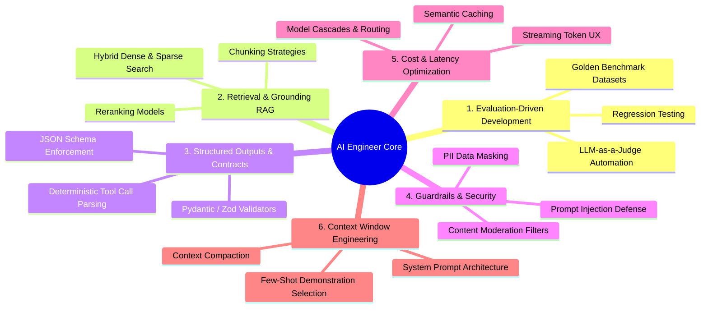
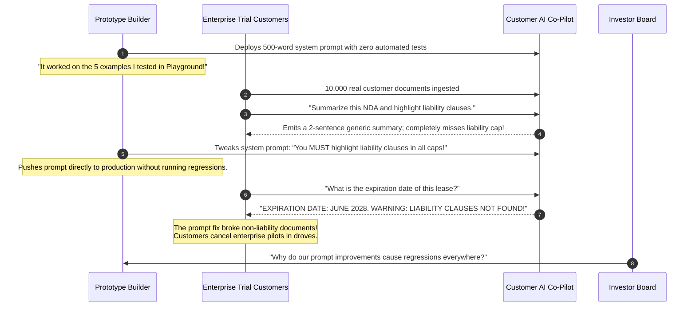

# What "AI Engineer" Actually Means: The Production Skillset

> **Difficulty**: Beginner-Intermediate | **Estimated Time**: 30m | **Hands-On**: Professional Competency & Evals

> [!TIP]
> **The Golden Rule of the AI Engineer:**
> **Software engineering rigor beats prompt wizardry.** Anyone can build an impressive GenAI prototype in an afternoon by stitching together API calls in a Jupyter notebook. An **AI Engineer** is the professional backend engineer who bridges the gap between prototype and production: building automated evaluation harnesses (Evals), defending against prompt injection, enforcing deterministic schema contracts, optimizing token unit economics, and driving p99 latency below SLAs.

---

## 1. Visual Mental Models: The Engineering Spectrum

The rise of foundation models created a distinct engineering role sitting directly between traditional Machine Learning and Backend Systems:

```mermaid
flowchart LR
    subgraph MLE["Machine Learning Engineer (MLE)"]
        M1["Trains & fine-tunes weights"]
        M2["Loss functions & backprop"]
        M3["PyTorch / CUDA / DeepSpeed"]
        M4["Pre-training infrastructure"]
    end

    subgraph AIE["AI Engineer (AIE)"]
        A1["Consumes foundation models"]
        A2["RAG & Vector Retrieval"]
        A3["Evaluation Harnesses (Evals)"]
        A4["Latency, Cost & Guardrails"]
    end

    subgraph SWE["Backend Engineer (SWE)"]
        S1["Relational DBs & Caching"]
        S2["HTTP APIs & Microservices"]
        S3["Kubernetes & CI/CD Pipelines"]
        S4["High Concurrency & SRE"]
    end

    MLE <-->|Weight Checkpoints & LoRAs| AIE
    AIE <-->|APIs, Gateways & Data Stores| SWE
```



---

## 2. Structural Role Comparison

| Dimension | Machine Learning Engineer (MLE) | AI Engineer (AIE) | Traditional Backend Engineer (SWE) |
| :--- | :--- | :--- | :--- |
| **Primary Artefact** | Model weights (`.safetensors`, `.pt`), loss curves | Grounded RAG pipelines, Evaluation harnesses, AI APIs | Microservice endpoints, database schemas, message queues |
| **Primary Unit of Work** | Epochs, gradient updates, learning rates | Context windows, tokens, prompt templates, tool schemas | HTTP status codes, SQL queries, transactions |
| **Core Technology** | PyTorch, JAX, HuggingFace, CUDA | Vector DBs (PgVector, Qdrant), LangGraph, Pydantic, Instructor | PostgreSQL, Redis, Kafka, Docker, Kubernetes |
| **Approach to Models** | "How do I optimize loss to train a better model?" | "How do I compose this probabilistic engine into reliable software?" | "How do I deploy and scale this containerized service?" |
| **Definition of Failure** | Overfitting, vanishing gradients, validation loss divergence | Hallucination, prompt injection breach, token budget burn | 500 Internal Error, connection pool starvation, deadlock |

---

## 3. The Six Core Competencies of an AI Engineer



---

## 4. Production War Story: The "Prompt-and-Pray" Prototype Disaster

```
INCIDENT SUMMARY: INC-1029
SEVERITY: P1 - Product Reliability Collapse & Customer Churn
IMPACT: 85% of enterprise customers cancelled pilots; startup burned $2.4M without reaching production readiness.
ROOT CAUSE: A team shipped a prototype built with unconstrained prompts without automated evaluation harnesses; every prompt fix broke three existing features.
```

### Incident Timeline



### The Post-Mortem

- **The Fallacy**: Treating prompt engineering like subjective creative writing rather than software engineering.
- **The Reality**: Without an **Evaluation Benchmark (Evals)**, you cannot know whether a prompt change improved your system or introduced regressions.
- **The SRE / AI Engineer Solution: Evaluation-Driven Development (EDD)**:
  1. Build a **Golden Dataset** of 100 representative real-world test cases with expected outputs.
  2. Implement an automated test runner that executes the pipeline against all 100 cases on every Git commit.
  3. Score outputs programmatically on three dimensions: **Factual Grounding (Faithfulness)**, **Semantic Answer Relevance**, and **Schema Validity**.
  4. Only merge prompt modifications if the aggregate benchmark score improves without regressions!

---

## 5. Multi-Language Production Implementations: Automated Evaluation Runner

Study this production evaluation harness that benchmarks an LLM's outputs against a ground-truth dataset on every CI/CD pull request.

### Python (`eval_harness.py`)

```python
import json
import time
from typing import List, Dict, Any

# Golden Benchmark Dataset
GOLDEN_DATASET = [
    {
        "query": "What is the cancellation policy?",
        "expected_facts": ["14 days", "full refund"],
        "disallowed_terms": ["non-refundable"]
    },
    {
        "query": "How do I reset my password?",
        "expected_facts": ["click settings", "security tab", "reset link"],
        "disallowed_terms": ["call support"]
    }
]

def simulate_llm_generation(query: str) -> str:
    """Simulates an LLM response generated by the application."""
    if "cancellation" in query.lower():
        return "You can cancel within 14 days to receive a full refund."
    return "To reset your password, visit the settings page, open the security tab, and click the reset link."

def evaluate_response(response: str, expected_facts: List[str], disallowed_terms: List[str]) -> Dict[str, Any]:
    text = response.lower()
    
    # 1. Fact Recall Score: What percentage of mandatory facts are present?
    facts_found = sum(1 for fact in expected_facts if fact.lower() in text)
    recall_score = facts_found / len(expected_facts)

    # 2. Safety Check: Did the model use disallowed terms?
    violations = [term for term in disallowed_terms if term.lower() in text]
    is_safe = len(violations) == 0

    passed = (recall_score == 1.0) and is_safe

    return {
        "passed": passed,
        "recall_score": round(recall_score, 2),
        "violations": violations
    }

def run_ci_evals():
    print("=== RUNNING AI EVALUATION BENCHMARK SUITE ===")
    total = len(GOLDEN_DATASET)
    passed_count = 0

    for idx, test_case in enumerate(GOLDEN_DATASET):
        response = simulate_llm_generation(test_case["query"])
        eval_result = evaluate_response(
            response, 
            test_case["expected_facts"], 
            test_case["disallowed_terms"]
        )

        status_emoji = "✅ PASS" if eval_result["passed"] else "❌ FAIL"
        print(f"Test {idx + 1}: {status_emoji} | Recall: {eval_result['recall_score'] * 100:.0f}%")
        
        if eval_result["passed"]:
            passed_count += 1

    accuracy = (passed_count / total) * 100
    print(f"\nFinal Benchmark Accuracy: {accuracy:.1f}% ({passed_count}/{total} passed)")
    
    if accuracy < 100.0:
        raise SystemExit(1) # Block CI/CD pipeline!

if __name__ == "__main__":
    run_ci_evals()
```

### TypeScript / Node.js (`eval_runner.ts`)

```typescript
export interface TestCase {
  id: string;
  prompt: string;
  mustContain: string[];
}

export function evaluatePromptCandidate(
  testCases: TestCase[],
  generateFn: (p: string) => string
): { passed: number; total: number; successRate: number } {
  let passed = 0;

  for (const tc of testCases) {
    const output = generateFn(tc.prompt).toLowerCase();
    const allFound = tc.mustContain.every((term) => output.includes(term.toLowerCase()));

    if (allFound) passed++;
  }

  return {
    passed,
    total: testCases.length,
    successRate: (passed / testCases.length) * 100,
  };
}
```

### Go (`eval_suite.go`)

```go
package main

import (
	"fmt"
	"strings"
)

type BenchmarkCase struct {
	Query       string
	MustContain []string
}

func Evaluate(response string, mustContain []string) bool {
	resLower := strings.ToLower(response)
	for _, term := range mustContain {
		if !strings.Contains(resLower, strings.ToLower(term)) {
			return false
		}
	}
	return true
}

func main() {
	tc := BenchmarkCase{
		Query:       "Return account status",
		MustContain: []string{"active", "verified"},
	}
	output := "Account is currently ACTIVE and VERIFIED."

	passed := Evaluate(output, tc.MustContain)
	fmt.Printf("Evaluation Benchmark Result: Passed = %v\n", passed)
}
```

---

## 6. Practical CLI Workflows

Verify how an automated evaluation step executes inside a CI/CD terminal environment:

```bash
python -c "
test_output = 'The user balance is $450.00'
ground_truth = '$450.00'
assert ground_truth in test_output, 'EVAL FAILURE: Fact missing!'
print('CI Eval Gate: PASSED (Ground truth verified)')
"
```

**Expected Output:**
```
CI Eval Gate: PASSED (Ground truth verified)
```

---

## 7. Operational Validation Checkpoints

Confirm your understanding of the AI Engineer's role and responsibilities.

<details>
<summary><b>Checkpoint 1: Why is "LLM-as-a-Judge" used in production evaluation pipelines, and what are its risks?</b></summary>

**Mechanism & Tradeoffs:**
- **Mechanism:** Using a frontier model (e.g. GPT-4o or Claude 3.5 Sonnet) with a rubric prompt to evaluate the output of a faster, cheaper production model (e.g. Llama 3 8B or GPT-4o-mini). The judge scores the response on coherence, helpfulness, and factual grounding from 1 to 5.
- **Risks:**
  1. **Position Bias:** The judge LLM often favors whichever candidate answer is placed first.
  2. **Verbosity Bias:** LLMs systematically score longer, more verbose responses higher than concise, direct answers.
  3. **Self-Enhancement Bias:** Models tend to rate answers generated by their own family higher than competitor models.
- **Mitigation:** Swap candidate answer positions and anchor scoring with strict binary rubrics (*"Does this contain Fact X? Answer 1 or 0"*).
</details>

<details>
<summary><b>Checkpoint 2: What is the single biggest architectural difference between testing classical backend APIs vs testing GenAI systems?</b></summary>

**Deterministic vs. Stochastic Testing:**
- **Classical Backend Testing:** Deterministic assertions ($2 + 2 = 4$). You write `assert response.status == 200` and `assert response.data.user_id == 42`. The test either passes 100% or fails.
- **GenAI System Testing:** Stochastic distribution evaluations. A prompt output varies slightly on every execution. Instead of asserting exact string equality, you evaluate **statistical aggregates across benchmark suites**:
  - Semantic similarity thresholds ($\text{cosine} \ge 0.88$).
  - Schema conformity ($100\%$ valid JSON according to OpenAPI schema).
  - Fact extraction precision and recall over 200 golden test cases.
</details>

<details>
<summary><b>Checkpoint 3: Explain the role of "Context Window Budgeting" in an AI Engineer's daily work.</b></summary>

**The Budgeting Balance:**
Even if a model advertises a 1,000,000-token context window (e.g. Gemini 1.5 Pro):
1. **Financial Cost:** Ingesting 1M tokens costs \$3.50+ per query. At 1,000 queries per hour, your cloud bill exceeds \$2,500/day.
2. **Latency:** Processing 1M tokens takes 15 to 45 seconds to generate the first token (Time-to-First-Token, TTFT).
3. **Accuracy Degradation:** Irrelevant context clutters the attention matrix and increases the risk of "Lost in the Middle" errors.
An AI Engineer optimizes the **Signal-to-Noise Ratio**: pruning context to the top 2,000 relevant tokens so the request runs in 400ms for \$0.002.
</details>

---

## Next

Continue to **[13-setting-up-your-environment](../13-setting-up-your-environment/README.md)** to configure your local AI engineering environment: Ollama, local models, Python virtual environments, and API access keys.
