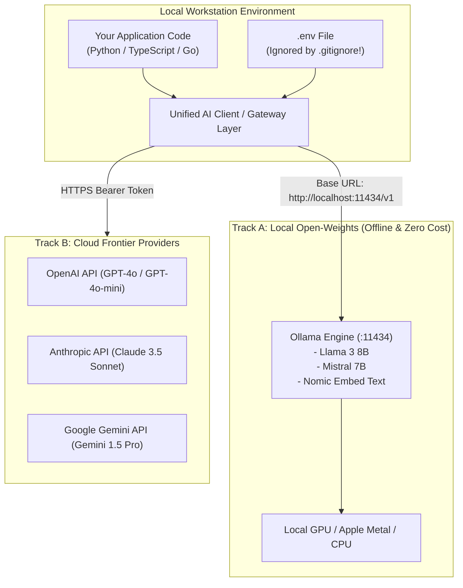
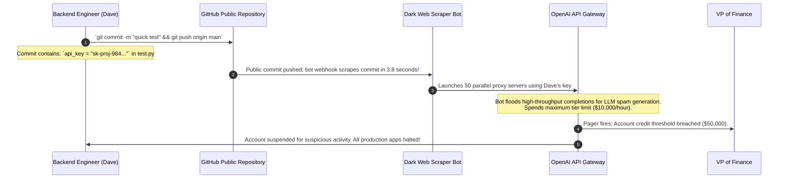

# Setting Up Your GenAI Development Environment

> **Difficulty**: Beginner-Intermediate | **Estimated Time**: 30m | **Hands-On**: Mandatory Setup

> [!TIP]
> **The Golden Rule of GenAI Environment Security:**
> **Never commit an API key to git.** Automated credential-scraping bots scan public GitHub repositories every 3 seconds. An exposed OpenAI or Anthropic key will be weaponized within 4 minutes, racking up tens of thousands of dollars in fraudulent token completions before morning. Store keys strictly in `.env` files protected by `.gitignore`, and use **Ollama** for zero-cost, private local development.

---

## 1. Visual Mental Models: The Dual Development Loop

A professional AI development environment should support two parallel workflows: **Local Open-Weights** (free, offline, private testing) and **Cloud Frontier APIs** (high-intelligence evaluation):



---

## 2. Environment Comparison: Local (Ollama) vs. Cloud APIs

| Feature | Local Open-Weights (Ollama) | Cloud Frontier APIs (OpenAI / Claude / Gemini) |
| :--- | :--- | :--- |
| **Monetary Cost** | **$0.00** (Runs on your own hardware) | Pay-per-token API consumption |
| **Privacy & Compliance** | 100% on-device; zero data leaves your machine | Data sent over TLS to cloud provider; enterprise DPA required |
| **Hardware Requirements** | Requires 8GB - 16GB RAM/VRAM for 8B models | Runs on any lightweight machine (even a $5 VPS) |
| **Model Intelligence** | High for standard tasks; lags on complex formal logic | **State of the Art** (Ph.D.-level reasoning and coding) |
| **Context Window Size** | Typically 8k - 32k tokens locally | 128k - 2,000,000 tokens |
| **Best Workflow Fit** | Rapid offline prototyping, integration tests, unit test CI | Production reasoning, complex agents, final evaluations |

---

## 3. Production War Story: The $60,000 Leaked API Key

```
INCIDENT SUMMARY: INC-1102
SEVERITY: P1 - Security Compromise & Financial Loss
IMPACT: $62,400 in unauthorized API charges incurred in 6 hours; OpenAI organization account suspended.
ROOT CAUSE: A developer pushed a test script with a hardcoded `OPENAI_API_KEY` string to a public GitHub repository.
```

### Incident Timeline



### The Post-Mortem

- **The Flaw**: Hardcoding credentials in source code for "convenient local testing".
- **The Remediation**:
  1. Mandated local `.env` files with strict `.gitignore` rules:
     ```bash
     echo ".env" >> ~/.gitignore_global
     ```
  2. Implemented automated pre-commit secret scanners (`gitleaks` / `trufflehog`) that block commits locally if an API key pattern is detected.
  3. Configured hard monthly billing limits inside the OpenAI and Anthropic dashboards ($50/month ceiling for staging).

---

## 4. Multi-Language Production Implementations: Environment Loader

Study these implementations of resilient environment loaders that validate API credentials and support dual Local/Cloud execution.

### Python (`env_config.py`)

```python
import os
import sys
from dotenv import load_dotenv

# Load .env file automatically
load_dotenv()

class AIConfig:
    OPENAI_API_KEY = os.getenv("OPENAI_API_KEY", "")
    OLLAMA_BASE_URL = os.getenv("OLLAMA_BASE_URL", "http://localhost:11434")
    MODEL_ENVIRONMENT = os.getenv("MODEL_ENVIRONMENT", "local") # "local" or "cloud"

    @classmethod
    def validate(cls):
        print(f"Target Environment: [{cls.MODEL_ENVIRONMENT.upper()}]")
        if cls.MODEL_ENVIRONMENT == "cloud":
            if not cls.OPENAI_API_KEY or cls.OPENAI_API_KEY.startswith("sk-your-key-here"):
                print("❌ ERROR: OPENAI_API_KEY is missing or unconfigured in .env!", file=sys.stderr)
                sys.exit(1)
            print("✅ Cloud Credentials Verified.")
        else:
            print(f"✅ Local Ollama Endpoint Configured: {cls.OLLAMA_BASE_URL}")

if __name__ == "__main__":
    AIConfig.validate()
```

### TypeScript / Node.js (`env_config.ts`)

```typescript
import dotenv from 'dotenv';
dotenv.config();

export const config = {
  openaiApiKey: process.env.OPENAI_API_KEY || '',
  ollamaBaseUrl: process.env.OLLAMA_BASE_URL || 'http://localhost:11434',
  environment: process.env.MODEL_ENV || 'local',
};

export function verifyEnvironment(): boolean {
  if (config.environment === 'cloud' && !config.openaiApiKey) {
    console.error('❌ FATAL: OPENAI_API_KEY environment variable is not defined.');
    return false;
  }
  console.log(`✅ AI Configuration Loaded. Active Mode: ${config.environment}`);
  return true;
}
```

### Go (`env_config.go`)

```go
package main

import (
	"fmt"
	"os"
)

type Config struct {
	APIKey  string
	BaseURL string
	Mode    string
}

func LoadConfig() Config {
	mode := os.Getenv("MODEL_ENV")
	if mode == "" {
		mode = "local"
	}
	baseURL := os.Getenv("OLLAMA_BASE_URL")
	if baseURL == "" {
		baseURL = "http://localhost:11434"
	}
	return Config{
		APIKey:  os.Getenv("OPENAI_API_KEY"),
		BaseURL: baseURL,
		Mode:    mode,
	}
}

func main() {
	cfg := LoadConfig()
	fmt.Printf("Configured Mode: %s | Base URL: %s\n", cfg.Mode, cfg.BaseURL)
}
```

---

## 5. Practical CLI Workflows: Setting Up Ollama

Install and run local foundation models with zero cloud dependencies:

### Step 1: Install and Launch Ollama

```bash
# On macOS / Linux / WSL2:
curl -fsSL https://ollama.com/install.sh | sh

# Verify Ollama server daemon is responding:
curl http://localhost:11434/
```

**Expected Output:**
```
Ollama is running
```

### Step 2: Download Llama 3 (8B) and Embeddings Model

```bash
# Pull the instruction-tuned conversational model (~4.7 GB)
ollama pull llama3:8b

# Pull the dedicated text embeddings model (~270 MB)
ollama pull nomic-embed-text
```

### Step 3: Test Local Inference via Wire API

Execute a local completion through Ollama's OpenAI-compatible HTTP interface:

```bash
curl http://localhost:11434/v1/chat/completions \
  -H "Content-Type: application/json" \
  -d '{
    "model": "llama3:8b",
    "messages": [{"role": "user", "content": "Explain what a goroutine is in one sentence."}],
    "temperature": 0.0
  }' | jq '.choices[0].message.content'
```

**Expected Output:**
```
"A goroutine is a lightweight execution thread managed by the Go runtime rather than the operating system kernel."
```

You now have a production-grade 8B foundation model running completely offline on your own machine!

---

## 6. Operational Validation Checkpoints

Confirm your development environment readiness with these scenarios.

<details>
<summary><b>Checkpoint 1: Why is Ollama's OpenAI-compatible endpoint (`/v1`) valuable for backend architectures?</b></summary>

**Architectural Portability:**
Ollama exposes a drop-in replacement for OpenAI's REST API at `http://localhost:11434/v1/chat/completions`.
This allows you to write your application code using the official `openai` Python or TypeScript SDKs without vendor lock-in:
```python
client = OpenAI(base_url="http://localhost:11434/v1", api_key="ollama")
```
You can develop and run integration tests locally on your laptop against Ollama for free, and deploy to production by simply updating `base_url` to point to OpenAI or Azure with **zero code changes**!
</details>

<details>
<summary><b>Checkpoint 2: What is the purpose of Gitleaks in an AI development repository?</b></summary>

**Credential Protection:**
Gitleaks is a lightweight, open-source static analysis tool designed to detect and prevent secrets from entering Git history.
Configured as a **pre-commit hook**, Gitleaks scans diffs before every commit. If an engineer accidentally pastes an OpenAI key (`sk-proj-...`) into a config file, Gitleaks aborts the commit immediately, preventing the key from ever leaving the developer's laptop.
</details>

<details>
<summary><b>Checkpoint 3: What is the minimum hardware specification required to run an 8B parameter model locally?</b></summary>

**Hardware Requirements:**
- **Quantization:** Standard 8B models use **4-bit quantization (GGUF Q4_K_M)**, which compresses each parameter from 16 bits (2 bytes) to 4 bits (0.5 bytes).
- **RAM / VRAM:** An 8B model requires:
  $$\text{Memory} \approx 8 \times 10^9 \times 0.5 \text{ bytes} \approx 4.0\text{ GB} + 1.5\text{ GB (KV Cache \& Context)} \approx 5.5\text{ GB}$$
- **Minimum Setup:** Any modern laptop with **8GB of unified RAM** (e.g. Apple Silicon M1/M2/M3) or an NVIDIA GPU with **6GB+ VRAM** (RTX 3060+) can run Llama 3 8B at 25-45 tokens per second.
</details>

---

## Next

Continue to **[14-capstone-project](../14-capstone-project/README.md)** to assemble the entire foundational curriculum into an end-to-end production AI microservice: a resilient, ground-truth verified Semantic Triage Engine.
