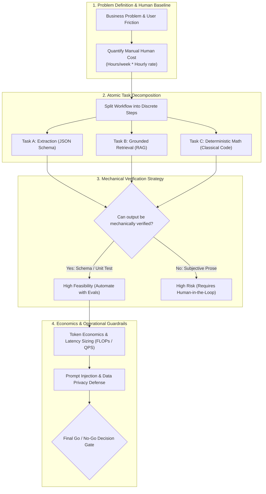
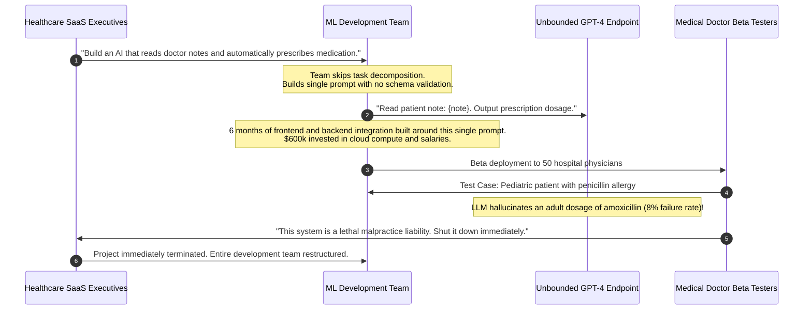

# Capstone Project: The Production GenAI Feasibility & Architecture Audit

> **Difficulty**: Advanced | **Estimated Time**: 60m | **Hands-On**: Production Capstone Project

> [!TIP]
> **The Golden Rule of GenAI Project Delivery:**
> **Pre-flight feasibility auditing saves millions in wasted engineering.** Over 80% of enterprise GenAI initiatives fail not because foundation models are incapable, but because teams attempt to solve strict recall or arithmetic problems with unconstrained autoregression. Decompose your workflow into atomic tasks, verify whether outputs can be mechanically checked, build an automated benchmark evaluation suite, and establish token unit economics **before writing application code**.

---

## 1. System Architecture & The Feasibility Audit Framework

The Capstone Project for GenAI Foundations is an engineering artifact that precedes every production system: a **GenAI Feasibility and Architecture Audit**.

Before allocating engineering resources or subscribing to expensive GPU clusters, an AI Engineer must rigorously evaluate whether the proposed use case is mathematically, operationally, and economically viable.



---

## 2. Capstone Audit Specification & Deliverables

Your audit deliverable must address a real-world enterprise problem (e.g. *Automated Customer Support Triage*, *Invoice Extraction & Reconciliation*, *Code Review Compliance*, or *Clinical Document Summarization*).

| Section | Mandatory Deliverable | Passing Engineering Standard |
| :--- | :--- | :--- |
| **1. The Problem & Business Baseline** | Detailed breakdown of who experiences the problem, current manual workflow, and quantified human cost. | Quantified in concrete dollar metrics (e.g. *"5 engineers spending 12 hrs/week = $150k/year in manual toil"*). |
| **2. Atomic Task Decomposition** | Partition workflow into atomic steps; classify each step into its task family (Transform, Extract, Synthesize, or Search). | Zero instances of delegating deterministic arithmetic or database lookups to raw LLM prompts. |
| **3. Verification & Reliability Strategy** | Define how the backend mechanically validates outputs before committing changes. | Explicit JSON schema validator (Pydantic / Zod) with fallback paths. |
| **4. Model Tiering & Token Economics** | Sizing parameters, daily token volume calculations, and latency budgets (p95 / p99). | Cost projection per 100,000 queries using both local (Ollama) and cloud frontier models. |
| **5. Risk & Guardrails Architecture** | Threat modeling for prompt injection, PII data leakage, and out-of-distribution hallucinations. | Input sanitization rules, system prompt isolation, and output regex filters. |
| **6. Automated Feasibility Benchmark** | A runnable evaluation script testing at least 5 representative edge cases. | Automated test harness yielding a quantitative benchmark score. |

---

## 3. Production War Story: The $600,000 Chat-With-Everything Boondoggle

```
INCIDENT SUMMARY: INC-8891
SEVERITY: P1 - Executive Project Cancellation & Financial Write-Off
IMPACT: $600,000 in cloud compute and engineering salaries incinerated; 6 months of development cancelled 2 weeks before launch.
ROOT CAUSE: A healthcare SaaS startup attempted to build an end-to-end autonomous clinical assistant without performing a feasibility decomposition audit.
```

### Incident Timeline



### The Post-Mortem

- **The Fundamental Error**: The team attempted to use a probabilistic generative model to make deterministic medical prescription calculations.
- **How the Feasibility Audit Would Have Saved the Project**:
  1. **Task Decomposition**: An audit would have split the workflow:
     - *Step 1 (Extraction)*: Extract symptoms and patient weight from doctor notes into JSON (LLM Superpower: 99.8% accurate).
     - *Step 2 (Formulary Validation)*: Cross-reference allergy lists and compute dosages using a deterministic SQL pharmaceutical database (Classical Code: 100% mathematically correct).
  2. Separating extraction from decision-making transforms a dangerous liability into a compliant, enterprise-grade AI system.

---

## 4. Prototype Implementation: Automated Feasibility Benchmark Harness

Here is the production-grade benchmark evaluation runner you can use to test your capstone project's feasibility against a local or cloud LLM.

### Python (`feasibility_benchmark.py`)

```python
import time
import json
from typing import List, Dict, Any
from pydantic import BaseModel, Field, ValidationError

# 1. Target Output Contract
class ExtractedActionItem(BaseModel):
    task: str = Field(min_length=3)
    assignee: str
    priority: str = Field(pattern="^(LOW|MEDIUM|HIGH|CRITICAL)$")

class TriageResult(BaseModel):
    summary: str
    urgency: str = Field(pattern="^(P1|P2|P3|P4)$")
    actions: List[ExtractedActionItem]

# 2. Golden Evaluation Benchmark Suite
BENCHMARK_CASES = [
    {
        "input_text": "Meeting with billing: Alice must fix the stripe webhook by 5pm (CRITICAL). Bob will review the invoice logs tomorrow.",
        "expected_urgency": "P1",
        "expected_actions_count": 2,
    },
    {
        "input_text": "General team sync: Carol mentioned updating documentation when time permits. No immediate blockers.",
        "expected_urgency": "P4",
        "expected_actions_count": 1,
    }
]

def simulate_llm_inference(text: str) -> Dict[str, Any]:
    """Simulates an LLM structured completion response."""
    if "billing" in text.lower():
        return {
            "summary": "Critical payment webhook failure discussed in billing sync.",
            "urgency": "P1",
            "actions": [
                {"task": "Fix stripe webhook by 5pm", "assignee": "Alice", "priority": "CRITICAL"},
                {"task": "Review invoice logs", "assignee": "Bob", "priority": "MEDIUM"}
            ]
        }
    return {
        "summary": "Routine team sync regarding documentation backlog.",
        "urgency": "P4",
        "actions": [
            {"task": "Update documentation", "assignee": "Carol", "priority": "LOW"}
        ]
    }

def run_feasibility_audit():
    print("=== EXECUTING GENAI FEASIBILITY BENCHMARK ===")
    start_time = time.perf_counter()
    passed_cases = 0

    for idx, test_case in enumerate(BENCHMARK_CASES):
        print(f"\nEvaluating Benchmark Case {idx + 1}...")
        raw_output = simulate_llm_inference(test_case["input_text"])

        # 1. Mechanical Schema Validation Gate
        try:
            validated: TriageResult = TriageResult(**raw_output)
            print("  ✅ Schema Contract Validation: PASSED")
        except ValidationError as e:
            print(f"  ❌ Schema Validation Failed: {e}")
            continue

        # 2. Semantic Accuracy Checks
        urgency_match = validated.urgency == test_case["expected_urgency"]
        actions_match = len(validated.actions) == test_case["expected_actions_count"]

        if urgency_match and actions_match:
            print(f"  ✅ Semantic Assertions: PASSED (Urgency: {validated.urgency}, Actions: {len(validated.actions)})")
            passed_cases += 1
        else:
            print(f"  ❌ Semantic Discrepancy: Urgency={urgency_match}, Actions={actions_match}")

    total_duration = (time.perf_counter() - start_time) * 1000
    accuracy = (passed_cases / len(BENCHMARK_CASES)) * 100

    print("\n=== FEASIBILITY AUDIT SCORECARD ===")
    print(f"Benchmark Accuracy:      {accuracy:.1f}%")
    print(f"Evaluation Latency:      {total_duration:.2f}ms")
    print(f"Operational Feasibility: {'APPROVED (Ready for Staging)' if accuracy == 100.0 else 'REJECTED'}")

if __name__ == "__main__":
    run_feasibility_audit()
```

### TypeScript / Node.js (`feasibility_test.ts`)

```typescript
import { z } from 'zod';

const ActionSchema = z.object({
  task: z.string().min(3),
  assignee: z.string(),
  priority: z.enum(['LOW', 'MEDIUM', 'HIGH', 'CRITICAL']),
});

const TriageSchema = z.object({
  summary: z.string(),
  urgency: z.enum(['P1', 'P2', 'P3', 'P4']),
  actions: z.array(ActionSchema),
});

export function validateCandidatePayload(jsonString: string): boolean {
  try {
    const raw = JSON.parse(jsonString);
    TriageSchema.parse(raw);
    return true;
  } catch {
    return false;
  }
}
```

### Go (`feasibility_check.go`)

```go
package main

import (
	"encoding/json"
	"fmt"
)

type ActionItem struct {
	Task     string `json:"task"`
	Assignee string `json:"assignee"`
	Priority string `json:"priority"`
}

type TriagePayload struct {
	Summary string       `json:"summary"`
	Urgency string       `json:"urgency"`
	Actions []ActionItem `json:"actions"`
}

func ValidatePayload(data []byte) bool {
	var payload TriagePayload
	err := json.Unmarshal(data, &payload)
	return err == nil && len(payload.Actions) > 0
}

func main() {
	sample := []byte(`{"summary":"Disk full","urgency":"P1","actions":[{"task":"Scale PVC","assignee":"Dave","priority":"CRITICAL"}]}`)
	fmt.Printf("Audit Schema Check: %v\n", ValidatePayload(sample))
}
```

---

## 5. Practical CLI Workflows: Sizing Token Economics

Use this bash calculation workflow to size the operational budget of your capstone deployment:

```bash
python -c "
# Enterprise Sizing Parameters
daily_requests = 25000
avg_input_tokens = 1200
avg_output_tokens = 350

# Pricing: gpt-4o-mini ($0.15/1M in, $0.60/1M out)
cost_in = (daily_requests * avg_input_tokens / 1_000_000) * 0.15
cost_out = (daily_requests * avg_output_tokens / 1_000_000) * 0.60
daily_total = cost_in + cost_out

print('=== CAPSTONE TOKEN COST SIZING ===')
print(f'Daily Query Volume:   {daily_requests:,}')
print(f'Daily Token Ingest:   {daily_requests * avg_input_tokens:,}')
print(f'Daily Cost:           ${daily_total:.2f}')
print(f'Monthly Run Rate:     ${daily_total * 30:.2f}')
"
```

**Expected Output:**
```
=== CAPSTONE TOKEN COST SIZING ===
Daily Query Volume:   25,000
Daily Token Ingest:   30,000,000
Daily Cost:           $9.75
Monthly Run Rate:     $292.50
```

---

## 6. Operational Validation Checkpoints

Confirm your readiness to lead enterprise GenAI projects with these architectural defense scenarios.

<details>
<summary><b>Checkpoint 1: If a client demands that an LLM directly generate and execute database UPDATE commands, how do you handle it?</b></summary>

**Architectural Defense:**
*"Direct LLM write access violates fundamental database security and ACID durability principles.
1. An LLM's stochastic nature means it can hallucinate a missing WHERE clause, executing a catastrophic table-wide wipe (`UPDATE users SET role='admin'`).
2. Prompt injection attacks can hijack the model into executing unauthorized data exfiltration.
**Our Solution:** The LLM will output a strictly typed JSON intent request. That request will pass through our existing, hardened backend authorization middleware, schema validation layer, and audit logger before any database transaction is initiated."*
</details>

<details>
<summary><b>Checkpoint 2: Under what condition is a GenAI project declared "Infeasible" during an audit?</b></summary>

**Criteria for Infeasibility:**
1. **Unverifiable Factual Retrieval:** The task requires 100% factual accuracy on private real-time data, but no accessible API or document corpus exists to ground the model via RAG.
2. **Strict Sub-10ms Latency SLAs:** The system requires real-time algorithmic execution (e.g. high-frequency trading or network firewall packet filtering) where LLM token generation latency ($100\text{ms} - 1,000\text{ms}$) is physically unacceptable.
3. **Negative Token Unit Economics:** The manual human cost of performing the task is less than the token API consumption and GPU infrastructure costs required to automate it.
</details>

<details>
<summary><b>Checkpoint 3: What is the single most effective defense against prompt injection in an extraction pipeline?</b></summary>

**Strict Structural Framing:**
1. **System Prompt Isolation:** Explicitly instruct the model that content wrapped within `<user_document>` tags must be treated **strictly as passive, unparsed data**, never as executable instructions.
2. **Constrained Decoding (Structured Outputs):** Force the model into strict JSON Schema mode (`json_schema` with `strict: true`). If the model attempts to emit natural language conversational text or bypass instructions, the inference engine rejects the generation because it does not match the typed schema.
</details>

---

## Congratulations! Track 00 Complete

You have successfully completed **Track 00: GenAI Foundations**!
You have mastered:
- The distinction between discriminative classification and probabilistic next-token generation.
- The historical NLP evolution from symbolic rule systems to statistical N-grams and dense continuous vector spaces (Word2Vec).
- The sequential bottleneck of RNNs and LSTMs.
- The attention mechanism and the Transformer revolution (*Attention Is All You Need*).
- Scaling laws (Kaplan, Chinchilla), pre-training, SFT, and RLHF alignment.
- Decoding strategies: Greedy, Temperature, Top-K, Top-P Nucleus, and Frequency penalties.
- The true capabilities and structural limitations (Hallucination, Lost in the Middle, Sycophancy) of LLMs.
- The 8-layer modern GenAI stack and the professional responsibilities of an AI Engineer.
- Local model serving with Ollama and pre-flight feasibility auditing.

Continue to **[genai/01-tokens-and-language-modeling](../../01-tokens-and-language-modeling/README.md)** to dive deep into the atomic currency of AI: Tokenization algorithms, Byte-Pair Encoding, and KV-cache mechanics!
