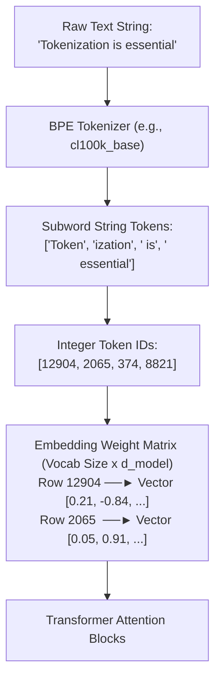
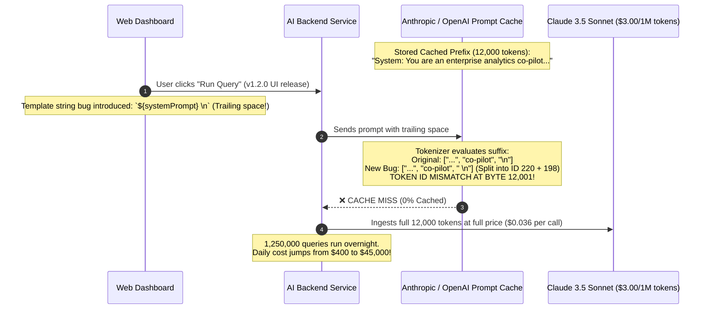

# What Is a Token: The Atomic Currency of LLMs

> **Difficulty**: Beginner-Intermediate | **Estimated Time**: 30m | **Hands-On**: Mandatory

> [!TIP]
> **The Golden Rule of Tokenization:**
> **The model never sees letters or words; it sees discrete integer IDs.** An LLM does not read English or code; it processes a sequence of integers looked up from a fixed vocabulary table (e.g. `cl100k_base` with 100,277 entries). Asking an LLM to count letters in *"strawberry"* or reverse a string fails because the word is chunked into opaque subword IDs (`['straw', 'berry']`), hiding the individual characters from the attention matrix.

---

## 1. Visual Mental Models: The Token Pipeline

Before text enters a transformer, the **Tokenizer** breaks strings into subword chunks and maps each chunk to a unique integer index:



### The Strawberry Problem Explained

Why can GPT-4 pass a medical exam but fail to count the number of 'r's in "strawberry"?

```
Human Perception:
  s - t - r - a - w - b - e - r - r - y   <-- 10 distinct letters, exactly 3 'r's

LLM Perception (cl100k_base Tokenizer):
  ┌──────────────┬──────────────┐
  │   "straw"    │   "berry"    │
  │  (ID: 496)   │  (ID: 675)   │
  └──────────────┴──────────────┘
  The attention layer receives ONLY vectors for [496, 675].
  It does NOT receive 10 individual character symbols!
```

---

## 2. Words vs. Characters vs. Subword Tokens

Why did modern AI converge on **Subword Tokenization** rather than whole words or raw characters?

| Approach | Vocabulary Size ($|\mathcal{V}|$) | Average Sequence Length | Out-of-Vocabulary (OOV) | Hardware Efficiency |
| :--- | :--- | :--- | :--- | :--- |
| **Word-Level** | Massive ($> 500,000$ words) | Shortest ($1\times$) | **Catastrophic**: Any typo, slang, or new term becomes `<UNK>` (Unknown). | Poor; massive embedding lookup table ($500\text{k} \times 4096 \approx 8\text{ GB}$ just for weights). |
| **Character-Level** | Tiny ($256$ bytes) | **Extremely Long ($4\times - 8\times$)** | **Zero**: Can represent any byte sequence without `<UNK>`. | **Terrible**: Self-Attention scales quadratically ($O(N^2)$); 4x longer text costs **16x more compute**! |
| **Subword-Level (BPE)** | **Optimal ($32,000 - 128,000$)** | **Balanced ($1.3\times$ words)** | **Zero**: Frequent words are 1 token; rare words split into byte-level pieces. | **Ideal**: Slices long words into subwords while keeping sequence length manageable. |

---

## 3. The Leading Space Traps: Why `" word"` $\neq$ `"word"`

In Byte-Pair Encoding tokenizers (like GPT's `cl100k_base`), **spaces are not discarded**; they are fused into the beginning of the following word.

```
Text String              Token Representation        Token ID
"apple"               -> ["apple"]                -> 17180
" apple" (with space) -> [" apple"]               -> 18059   <-- ENTIRELY DIFFERENT ID!
" apple " (trailing)  -> [" apple", " "]          -> [18059, 220]
```

Because `"apple"` and `" apple"` map to completely distinct embedding vectors, prepending or appending a single accidental space changes the mathematical trajectory of the entire attention calculation!

---

## 4. Production War Story: The Trailing Space Prompt Cache Miss

```
INCIDENT SUMMARY: INC-7109
SEVERITY: P1 - Cloud AI Cost Explosion
IMPACT: $45,000 in unbudgeted inference spend; prompt caching hit rate collapsed from 92% to 0%.
ROOT CAUSE: A frontend UI update appended an invisible trailing space (`\n `) to the user prompt template.
```

### Incident Timeline



### The Post-Mortem

- **The Fallacy**: Developers assumed that prompt caching compares raw trimmed text strings.
- **The Reality**: Modern prompt caching engines (OpenAI, Anthropic, DeepSeek) operate on **exact token ID prefix match lists**. A single trailing whitespace character alters the tokenization boundary of adjacent characters, completely invalidating the cached token array.
- **The Remediation**:
  1. Implemented strict automated token normalization on all system prompts: `prompt = prompt.rstrip()`.
  2. Built automated CI unit tests that assert exact token ID prefix identity across template versions.

---

## 5. Multi-Language Production Implementations: Token Inspection

Study these implementations showing how to count tokens, inspect subword boundaries, and normalize prompts before dispatching requests.

### Python (`token_inspector.py`)

```python
import tiktoken
from typing import List, Tuple

def inspect_tokens(text: str, encoding_name: str = "cl100k_base") -> List[Tuple[int, bytes]]:
    """
    Encodes text and returns token IDs paired with their exact raw byte representations.
    """
    enc = tiktoken.get_encoding(encoding_name)
    token_ids = enc.encode(text)
    
    # Extract exact byte representation for each token ID
    token_bytes = [enc.decode_single_token_bytes(tid) for tid in token_ids]
    return list(zip(token_ids, token_bytes))

def normalize_prompt_for_caching(prompt: str) -> str:
    """Eliminates accidental whitespace boundaries that cause cache misses."""
    return prompt.strip()

if __name__ == "__main__":
    enc = tiktoken.get_encoding("cl100k_base")
    sample_text = "Tokenization is essential for strawberry"

    print(f"=== BPE TOKEN INSPECTION ({enc.name}) ===")
    print(f"Original Text: '{sample_text}'\n")
    
    token_details = inspect_tokens(sample_text)
    print(f"{'Token ID':<10} | {'Byte Content':<20} | {'Decoded String'}")
    print("-" * 50)
    for tid, b in token_details:
        decoded = b.decode("utf-8", errors="replace")
        print(f"{tid:<10} | {str(b):<20} | '{decoded}'")

    print(f"\nTotal Word Count:  {len(sample_text.split())} words")
    print(f"Total Token Count: {len(token_details)} tokens")
```

### TypeScript / Node.js (`token_counter.ts`)

```typescript
import { getEncoding } from 'js-tiktoken';

export function analyzeTokens(text: string): { count: number; tokenIds: number[] } {
  // cl100k_base is the standard tokenizer for GPT-4, GPT-4o, and text-embedding-3
  const enc = getEncoding('cl100k_base');
  const tokenIds = enc.encode(text);

  return {
    count: tokenIds.length,
    tokenIds: Array.from(tokenIds),
  };
}

// Verification:
const sample = 'strawberry';
const res = analyzeTokens(sample);
console.log(`Word: '${sample}' splits into ${res.count} tokens:`, res.tokenIds);
```

### Go (`token_bounds.go`)

```go
package main

import (
	"fmt"
	"strings"
)

// Simulates token estimation heuristic when tiktoken CGo bindings are unavailable
func EstimateTokenCount(text string) int {
	// English rule of thumb: ~4 characters per token or 0.75 words per token
	trimmed := strings.TrimSpace(text)
	if len(trimmed) == 0 {
		return 0
	}
	charEstimate := len(trimmed) / 4
	wordEstimate := int(float64(len(strings.Fields(trimmed))) * 1.3)
	
	if charEstimate > wordEstimate {
		return charEstimate
	}
	return wordEstimate
}

func main() {
	query := "How do I configure distributed tracing with OpenTelemetry?"
	fmt.Printf("Estimated tokens: %d\n", EstimateTokenCount(query))
}
```

---

## 6. Practical CLI Workflows: Inspecting Token Boundaries

Use Python directly from the terminal to inspect how tokenizers split technical terms and non-Latin scripts:

```bash
python -c "
import tiktoken
enc = tiktoken.get_encoding('cl100k_base')

def show(label, s):
    ids = enc.encode(s)
    print(f'{label:<20}: {len(ids)} tokens -> {ids}')

show('English', 'Hello world')
show('English (Space)', ' Hello world')
show('Strawberry', 'strawberry')
show('Code', 'def calculate_tax():')
show('Hindi', 'नमस्ते दुनिया')
"
```

**Expected Output:**
```
English             : 2 tokens -> [9906, 1917]
English (Space)     : 2 tokens -> [13225, 1917]
Strawberry          : 2 tokens -> [496, 675]
Code                : 5 tokens -> [622, 16905, 62, 1026, 452]
Hindi               : 11 tokens -> [30554, 107, 31454, 94, 161, 230, 162, 100, 31454, 94, 161]
```

Notice that `"नमस्ते दुनिया"` (two Hindi words) requires **11 tokens**, illustrating the multilingual token tax!

---

## 7. Operational Validation Checkpoints

Confirm your fundamental understanding of tokenization mechanics with these scenarios.

<details>
<summary><b>Checkpoint 1: Why does a query written in Hindi or Arabic cost 3x-5x more tokens than English?</b></summary>

**The Multilingual Token Tax:**
- **Training Corpus Imbalance:** Tokenizer vocabularies (like `cl100k_base`) were constructed using frequency statistical merges over predominantly English web text (~90% English).
- **Subword Frequency:** Common English words (*"database"*, *"architecture"*, *"processing"*) were observed millions of times and allocated single dedicated token IDs.
- **Byte Fallback in Non-Latin Scripts:** Uncommon scripts (Devanagari, Arabic, Thai) rarely had words frequent enough to earn whole-word tokens. As a result, the tokenizer falls back to splitting non-Latin characters into individual **UTF-8 bytes**, requiring 3 to 4 tokens per character!
</details>

<details>
<summary><b>Checkpoint 2: Why do trailing spaces in few-shot prompt examples degrade model output quality?</b></summary>

**The Tokenizer Space Binding Effect:**
In BPE tokenizers, spaces bind to the *beginning* of words (`" dog"` is one token, but `" "` + `"dog"` is two tokens).
If a prompt ends with a trailing space (`"Question: What is 2+2? Answer: "`), the model expects the next token to start with a non-space character (e.g. `"4"`).
However, if the prompt ends with no space (`"Answer:"`), the next token will be `" 4"` (a space-prefixed number).
Feeding unexpected trailing spaces into an LLM creates unnatural token boundary mismatches that degrade instruction following.
</details>

<details>
<summary><b>Checkpoint 3: What happens when an LLM encounters a character that does not exist in its vocabulary?</b></summary>

**Byte-Level Fallback:**
In modern **Byte-Level BPE (BBPE)** tokenizers (used in GPT-4, Llama 3, Claude), there is **no such thing as an `<UNK>` (Unknown) token**.
- The base alphabet of the vocabulary includes all **256 fundamental byte values** ($0x00$ through $0xFF$).
- If an unseen Unicode emoji, corrupted glyph, or rare symbol appears, the tokenizer breaks the character down into its raw UTF-8 bytes and emits the corresponding byte tokens. The model can process any arbitrary binary sequence without crashing.
</details>

---

## Next

Continue to **[01-text-encoding-bytes-unicode-and-utf-8](../01-text-encoding-bytes-unicode-and-utf-8/README.md)** to master the underlying binary wire formats of text: ASCII, Unicode Code Points, and UTF-8 byte encoding.
