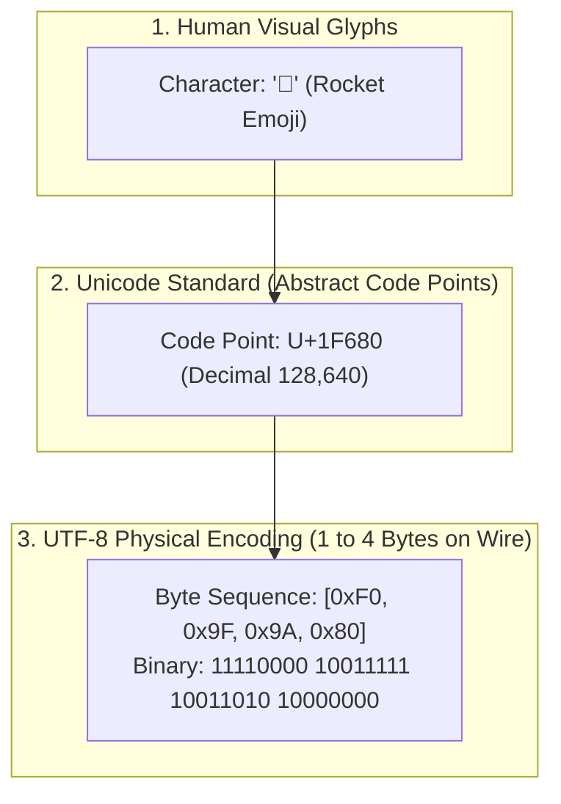
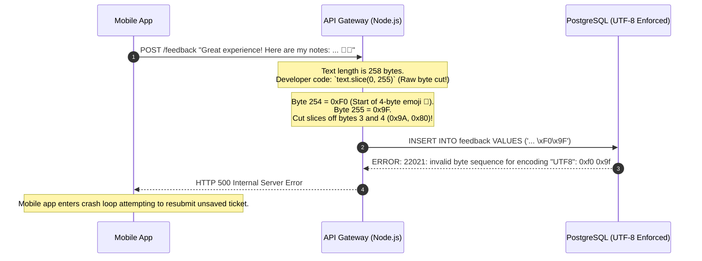

# Text Encoding: Bytes, Unicode, and UTF-8

> **Difficulty**: Intermediate | **Estimated Time**: 35m | **Hands-On**: Mandatory

> [!TIP]
> **The Golden Rule of Text Encoding in GenAI:**
> **Never truncate text by raw byte offset.** In UTF-8, characters consume anywhere from $1$ to $4$ bytes. Slicing a string at an arbitrary byte index can split a 4-byte emoji or non-Latin glyph in half, creating an illegal byte sequence (`0xFFFD` replacement character) that crashes downstream parsers and corrupts tokenizer byte-pair merges. Always truncate along **valid UTF-8 codepoint boundaries** or grapheme clusters.

---

## 1. Visual Mental Models: The Encoding Stack

Text processing in computer systems occurs across three distinct conceptual layers:



### The UTF-8 Variable-Length Bitmask Architecture

UTF-8 was engineered by Ken Thompson and Rob Pike in 1992. It is **self-synchronizing** and 100% backward-compatible with 7-bit ASCII:

```
+----------------+----------------+----------------------------------------------------+
| Byte Length    | Code Point Range| UTF-8 Binary Bit Pattern                           |
+----------------+----------------+----------------------------------------------------+
| 1 Byte (ASCII) | U+0000..U+007F | 0xxxxxxx                                           |
| 2 Bytes        | U+0080..U+07FF | 110xxxxx 10xxxxxx                                  |
| 3 Bytes (CJK)  | U+0800..U+FFFF | 1110xxxx 10xxxxxx 10xxxxxx                         |
| 4 Bytes (Emoji)| U+10000..10FFFF| 11110xxx 10xxxxxx 10xxxxxx 10xxxxxx                |
+----------------+----------------+----------------------------------------------------+
```

- **Leading Byte (`11...`)**: The count of leading `1`s indicates how many total bytes constitute this character.
- **Continuation Bytes (`10xxxxxx`)**: Always begin with the prefix `10`. If a parser starts reading in the middle of a stream, it instantly knows it is inside a multibyte character and seeks forward to the next `0xxxxxxx` or `11xxxxxx` boundary.

---

## 2. Text Representation Comparison Matrix

| Standard | Character Capacity | Wire Encoding Size | ASCII Compatible? | Primary Failure Mode |
| :--- | :--- | :--- | :--- | :--- |
| **ASCII (1963)** | 128 symbols | Fixed 1 Byte (7 bits) | Yes (It *is* ASCII) | Cannot represent accented letters, non-Latin alphabets, or emojis. |
| **Unicode (1991)** | 1,114,112 code points | Abstract standard (Not an encoding) | N/A | Not a wire format; requires an encoding (UTF-8, UTF-16, UTF-32). |
| **UTF-16** | 1.1M code points | Variable 2 or 4 Bytes | **No** (Null bytes in ASCII) | Endianness confusion (BOM required: Big-Endian vs Little-Endian). |
| **UTF-8 (Standard)** | **1.1M code points** | **Variable 1 to 4 Bytes** | **Yes (100% Native)** | Splitting multibyte characters at arbitrary byte offsets. |

---

## 3. Production War Story: The Split-Emoji Truncation Crash

```
INCIDENT SUMMARY: INC-8201
SEVERITY: P1 - Customer Data Serialization Failure
IMPACT: 18,000 customer feedback tickets failed to save to PostgreSQL; API gateway threw HTTP 500 across 3 hours.
ROOT CAUSE: A backend sanitization middleware truncated incoming feedback strings to 255 bytes using raw byte slicing.
```

### Incident Timeline



### The Post-Mortem

- **The Flaw**: Slicing strings using raw byte indexes (`buf[:255]`) without validating Unicode boundary alignment. Splitting a 4-byte sequence leaves orphaned continuation bytes, which standard SQL databases and JSON serializers strictly reject as illegal UTF-8.
- **The Remediation**:
  1. Replaced raw byte slicing with **Codepoint-aware and Grapheme-aware string truncation**.
  2. Implemented automated fuzzing tests that pass multibyte emojis and international strings at boundary cutoff points.

---

## 4. Multi-Language Production Implementations: Safe UTF-8 Truncator

Study these implementations showing how to safely truncate text to a maximum byte length without splitting multibyte characters.

### Python (`safe_utf8_truncator.py`)

```python
def truncate_utf8_bytes(text: str, max_bytes: int) -> str:
    """
    Safely truncates text to fit within max_bytes without splitting
    multibyte UTF-8 characters.
    """
    encoded = text.encode("utf-8")
    if len(encoded) <= max_bytes:
        return text

    # Slice at max_bytes
    truncated = encoded[:max_bytes]

    # Walk backwards if we sliced in the middle of a multibyte sequence
    # Valid continuation bytes match bit pattern 10xxxxxx (0x80 to 0xBF)
    while len(truncated) > 0 and (truncated[-1] & 0xC0) == 0x80:
        truncated = truncated[:-1]

    # If the last remaining byte is a leading multibyte header (11xxxxxx),
    # it is incomplete and must also be removed
    if len(truncated) > 0 and (truncated[-1] & 0xC0) == 0xC0:
        truncated = truncated[:-1]

    return truncated.decode("utf-8")

if __name__ == "__main__":
    test_string = "Hello World 🚀🔥"
    print("=== SAFE UTF-8 TRUNCATION TEST ===")
    print("Original String:      ", test_string)
    print("Original Byte Length: ", len(test_string.encode('utf-8')))

    # Cut in the middle of the rocket emoji
    # "Hello World " is 12 bytes; 🚀 is 4 bytes (bytes 12-15)
    for cut in [13, 14, 15, 16]:
        safe_cut = truncate_utf8_bytes(test_string, cut)
        print(f"Max Bytes: {cut:2d} -> Result: '{safe_cut}' (Actual Bytes: {len(safe_cut.encode('utf-8'))})")
```

### TypeScript / Node.js (`safe_utf8.ts`)

```typescript
export function safeTruncateUtf8(str: string, maxBytes: number): string {
  const encoder = new TextEncoder();
  const decoder = new TextDecoder('utf-8');
  const bytes = encoder.encode(str);

  if (bytes.length <= maxBytes) {
    return str;
  }

  let cutPoint = maxBytes;
  // While cutPoint sits on a continuation byte (10xxxxxx in binary: 0x80 to 0xBF)
  while (cutPoint > 0 && (bytes[cutPoint] & 0xc0) === 0x80) {
    cutPoint--;
  }

  return decoder.decode(bytes.subarray(0, cutPoint));
}

// Verification
const text = 'Order Status: 🚀 Shipped';
console.log('Safe 16-byte cut:', safeTruncateUtf8(text, 16));
```

### Go (`safe_utf8.go`)

```go
package main

import (
	"fmt"
	"unicode/utf8"
)

func SafeTruncateBytes(s string, maxBytes int) string {
	if len(s) <= maxBytes {
		return s
	}

	// Step backward until we find a valid UTF-8 rune start
	for maxBytes > 0 && !utf8.RuneStart(s[maxBytes]) {
		maxBytes--
	}
	return s[:maxBytes]
}

func main() {
	sample := "Database connection: 🚨 Timeout"
	truncated := SafeTruncateBytes(sample, 23)
	fmt.Printf("Original:  %s (%d bytes)\n", sample, len(sample))
	fmt.Printf("Truncated: %s (%d bytes)\n", truncated, len(truncated))
}
```

---

## 5. Practical CLI Workflows: Inspecting UTF-8 Bytes in the Terminal

Observe how common characters decompose into bytes in your terminal:

```bash
python -c "
def analyze(c):
    b = c.encode('utf-8')
    hex_str = ' '.join([f'0x{byte:02X}' for byte in b])
    bin_str = ' '.join([f'{byte:08b}' for byte in b])
    print(f'{c:<4} | Codepoint: {ord(c):<8X} | Bytes: {len(b)} | Hex: {hex_str:<18} | Binary: {bin_str}')

print('Char | Codepoint | Bytes | Hex Representation | Binary Bitmask')
print('-' * 75)
analyze('A')
analyze('é')
analyze('字')
analyze('🚀')
"
```

**Expected Output:**
```
Char | Codepoint | Bytes | Hex Representation | Binary Bitmask
---------------------------------------------------------------------------
A    | 41        | 1     | 0x41               | 01000001
é    | E9        | 2     | 0xC3 0xA9          | 11000011 10101001
字   | 5B57      | 3     | 0xE5 0xAD 0x97     | 11100101 10101101 10010111
🚀   | 1F680     | 4     | 0xF0 0x9F 0x9A 0x80| 11110000 10011111 10011010 10000000
```

Notice how the binary prefixes strictly obey the UTF-8 specification: `0...`, `110...`, `1110...`, and `11110...`!

---

## 6. Operational Validation Checkpoints

Confirm your mastery of text encoding and byte mechanics.

<details>
<summary><b>Checkpoint 1: What is a Unicode Surrogate Pair, and why does UTF-8 avoid them?</b></summary>

**Analysis:**
- **Surrogate Pairs (UTF-16):** UTF-16 uses 16-bit code units. Because 16 bits can only represent $65,536$ characters, characters outside the Basic Multilingual Plane (like emojis and rare Han glyphs) must be encoded as a pair of two 16-bit words called **Surrogate Pairs** ($0xD800 - 0xDFFF$).
- **UTF-8 Superiority:** UTF-8 is a clean 1-to-4 byte stream that directly maps all 1.1 million code points without requiring artificial surrogate pairs or byte-order marks (BOM).
</details>

<details>
<summary><b>Checkpoint 2: Why did early tokenizers suffer from Out-Of-Vocabulary (OOV) errors while Byte-Level BPE tokenizers do not?</b></summary>

**The Byte-Level Solution:**
- **Character-Based Tokenizers:** Built their vocabulary from recognized Unicode characters. If an input contained an unlisted character (e.g. a newly released emoji or an ancient Egyptian hieroglyph), the tokenizer failed and emitted `<UNK>`.
- **Byte-Level BPE (BBPE):** Operates on the **256 base byte values** ($0x00$ to $0xFF$) of UTF-8. Because *every* string in digital computing is fundamentally a sequence of bytes, BBPE can represent any arbitrary text, binary file, or novel emoji with zero unknown tokens.
</details>

<details>
<summary><b>Checkpoint 3: Explain why string `len()` in Python, Go, and JavaScript return different numbers for the string `"🚀"`.</b></summary>

**Language Runtime Differences:**
- **Go (`len("🚀") == 4`):** Go treats strings natively as immutable byte slices; `len()` returns the **raw UTF-8 byte count** ($4$ bytes).
- **JavaScript (`"🚀".length == 2`):** JavaScript strings use UTF-16 code units; the rocket emoji requires a surrogate pair, so `.length` reports **2 code units**.
- **Python (`len("🚀") == 1`):** Python internal strings are decoded Unicode code point arrays; `len()` reports **1 abstract character**.
Knowing your runtime's string semantics is essential when enforcing API payload limits and token budgeting!
</details>

---

## Next

Continue to **[02-why-not-characters-why-not-words](../02-why-not-characters-why-not-words/README.md)** to analyze the mathematical and computational trade-offs that led the AI industry to subword tokenization.
