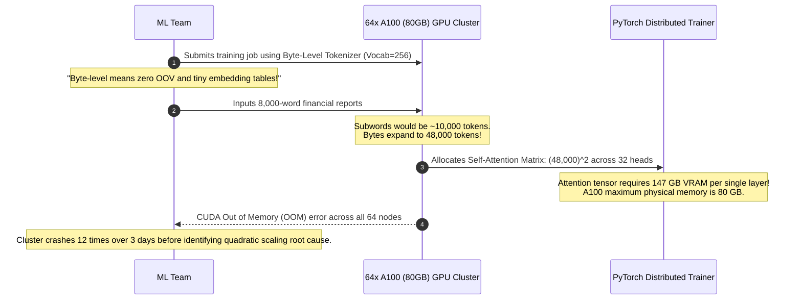

# Why Not Characters? Why Not Words? The Subword Compromise

> **Difficulty**: Intermediate | **Estimated Time**: 35m | **Hands-On**: Mandatory

> [!TIP]
> **The Golden Rule of Token Granularity:**
> **Subwords balance vocabulary memory against attention compute.** Whole-word tokenizers require massive vocabularies ($|\mathcal{V}| > 10^6$) that destroy memory and fail on typos (`<UNK>`). Pure character tokenizers create $5\times$ longer sequences, and because Transformer self-attention scales quadratically ($O(N^2)$), a $5\times$ sequence length costs **$25\times$ more GPU VRAM and compute**. Subwords (Byte-Pair Encoding) provide the mathematically optimal sweet spot.

---

## 1. Visual Mental Models: The Token Granularity Spectrum

Every language model faces a fundamental architectural trade-off between **Vocabulary Dimension ($|\mathcal{V}|$)** and **Sequence Length ($N$)**:

```mermaid
flowchart LR
    subgraph WordLevel["1. Whole-Word Tokenization"]
        W_Vocab["Vocab Size: 500,000+ words"]
        W_Seq["Sequence Length: Short (1x)"]
        W_Fail["Major Flaw: OOV (<UNK>) & Massive Embedding Tables"]
    end

    subgraph SubwordLevel["2. Subword Tokenization (BPE / WordPiece)"]
        S_Vocab["Vocab Size: 32,000 - 128,000 (Optimal)"]
        S_Seq["Sequence Length: Balanced (1.3x)"]
        S_Win["The Golden Mean: Zero OOV, High Compression, Bounded VRAM"]
    end

    subgraph CharLevel["3. Character / Byte-Level Tokenization"]
        C_Vocab["Vocab Size: 256 bytes (Tiny)"]
        C_Seq["Sequence Length: Huge (5x)"]
        C_Fail["Major Flaw: Quadratic Attention O(N^2) GPU Meltdown"]
    end

    WordLevel <---> SubwordLevel <---> CharLevel
```



---

## 2. Quantitative Trade-off Matrix

| Metric | Whole-Word Tokenization | Subword Tokenization (BPE) | Pure Character / Byte Tokenization |
| :--- | :--- | :--- | :--- |
| **Vocabulary Size ($|\mathcal{V}|$)** | $500,000 - 2,000,000$ | $32,000 - 128,000$ | **$256$ (Bytes)** |
| **Embedding Matrix VRAM** | $\sim 8.2\text{ GB}$ (at $d=4096$) | $\sim 500\text{ MB}$ (at $d=4096$) | **$\sim 4\text{ MB}$ (Negligible)** |
| **Sequence Length ($N$) for 1,000 Words** | $\sim 1,000$ tokens | $\sim 1,300$ tokens | $\sim 5,200$ tokens |
| **Attention Memory Footprint ($N^2$)** | $1.0\times$ (Baseline) | $1.69\times$ | **$27.0\times$ (Catastrophic)** |
| **Handling of Typos & Slang** | Fails (`<UNK>`) | **Splits into known subwords** | Encodes individual letters |
| **Agglutinative Languages (German/Finnish)** | Completely broken | **Splits compound words naturally** | Spells character by character |

---

## 3. The Mathematics of Attention Explosion: $O(N^2)$

The critical reason why pure character-level models are rarely used in production foundation models is the **Self-Attention Memory Formula**:

$$\text{Attention Matrix Size} = B \times H \times N^2 \times 2 \text{ bytes (fp16)}$$
$$\text{where } B = \text{Batch Size}, \quad H = \text{Attention Heads}, \quad N = \text{Sequence Length in Tokens}$$

```
Comparison for a 2,000-Word Document (Batch=4, Heads=32, fp16):

1. Subword Tokenizer (~2,600 tokens):
   Memory = 4 * 32 * (2600)^2 * 2 bytes = 1.73 GB VRAM (Fits easily on an RTX 4090)

2. Character Tokenizer (~11,000 characters):
   Memory = 4 * 32 * (11000)^2 * 2 bytes = 30.97 GB VRAM (Out of Memory on 24GB GPUs!)
```

A $4.2\times$ increase in sequence length causes a **$17.9\times$ explosion in attention tensor memory**!

---

## 4. Production War Story: The Quadratic Context Explosion

```
INCIDENT SUMMARY: INC-9104
SEVERITY: P1 - GPU Cluster OOM Crash Loop
IMPACT: $85,000 in ruined cloud training runs; distributed training jobs aborted on 64 NVIDIA A100 GPUs.
ROOT CAUSE: A research team switched an enterprise document LLM to pure byte-level tokenization without budgeting for quadratic attention memory.
```

### Incident Timeline



### The Post-Mortem

- **The Fallacy**: Assuming that reducing the vocabulary size to 256 bytes saves overall GPU memory.
- **The Reality**: The tiny memory saved on the embedding matrix was dwarfed by the massive **quadratic explosion** of the self-attention activation tensors across deep transformer layers.
- **The Remediation**:
  1. Returned to **Byte-Pair Encoding (BPE)** with a vocabulary size of $100,000$ tokens (`cl100k_base`).
  2. Sequence length dropped from $48,000$ to $10,400$ tokens, and training completed with 62% headroom on 80GB A100 nodes.

---

## 5. Multi-Language Production Implementations: Token Efficiency Calculator

Study these implementations showing how to calculate the attention memory footprint and sequence expansion factors for different tokenization strategies.

### Python (`token_efficiency_calculator.py`)

```python
from dataclasses import dataclass

@dataclass
class TokenizationSizing:
    strategy: str
    vocab_size: int
    seq_length: int
    embedding_params_mb: float
    attention_matrix_mb: float

def compute_model_footprint(
    word_count: int,
    strategy: str,
    d_model: int = 4096,
    num_heads: int = 32,
    batch_size: int = 1
) -> TokenizationSizing:
    """Calculates embedding memory and self-attention tensor memory (in Megabytes)."""
    if strategy == "word":
        vocab_size = 500_000
        seq_len = int(word_count * 1.0)
    elif strategy == "subword":
        vocab_size = 100_000
        seq_len = int(word_count * 1.3)
    elif strategy == "character":
        vocab_size = 256
        seq_len = int(word_count * 5.2)
    else:
        raise ValueError("Unknown strategy")

    # Embedding Table: Vocab * d_model * 2 bytes (fp16)
    embed_mb = (vocab_size * d_model * 2) / (1024 * 1024)

    # Attention Matrix per layer: Batch * Heads * N^2 * 2 bytes
    attn_mb = (batch_size * num_heads * (seq_len ** 2) * 2) / (1024 * 1024)

    return TokenizationSizing(
        strategy=strategy,
        vocab_size=vocab_size,
        seq_length=seq_len,
        embedding_params_mb=round(embed_mb, 2),
        attention_matrix_mb=round(attn_mb, 2),
    )

if __name__ == "__main__":
    words = 2000
    print(f"=== SIZING FOOTPRINT FOR {words:,} WORDS ===")
    for strat in ["word", "subword", "character"]:
        res = compute_model_footprint(words, strat)
        print(f"\nStrategy: {res.strategy.upper()}")
        print(f"  Vocab Size:        {res.vocab_size:,}")
        print(f"  Sequence Length:   {res.seq_length:,} tokens")
        print(f"  Embedding Table:   {res.embedding_params_mb:8.2f} MB")
        print(f"  Attention Layer:   {res.attention_matrix_mb:8.2f} MB")
```

### TypeScript / Node.js (`token_sizing.ts`)

```typescript
export function compareTokenizationOverheads(wordCount: number): {
  subwordTokens: number;
  charTokens: number;
  attentionMemoryMultiplier: number;
} {
  const subwordTokens = Math.round(wordCount * 1.3);
  const charTokens = Math.round(wordCount * 5.2);

  // Attention memory scales with N^2
  const multiplier = Math.pow(charTokens / subwordTokens, 2);

  return {
    subwordTokens,
    charTokens,
    attentionMemoryMultiplier: Number(multiplier.toFixed(2)),
  };
}

// Verification for a 1,500 word prompt
const report = compareTokenizationOverheads(1500);
console.log(
  `Character-level tokens require ${report.attentionMemoryMultiplier}x more attention memory than subwords!`
);
```

### Go (`sizing_check.go`)

```go
package main

import (
	"fmt"
	"math"
)

func main() {
	words := 3000.0
	subwordN := words * 1.3
	charN := words * 5.2

	ratio := math.Pow(charN/subwordN, 2)
	fmt.Printf("For 3,000 words:\n")
	fmt.Printf("Subwords:   %.0f tokens\n", subwordN)
	fmt.Printf("Characters: %.0f tokens\n", charN)
	fmt.Printf("Quadratic Attention Factor: %.1fx memory penalty\n", ratio)
}
```

---

## 6. Practical CLI Workflows

Observe how subwords elegantly split compound words and rare terminology compared to words and characters:

```bash
python -c "
import tiktoken
enc = tiktoken.get_encoding('cl100k_base')

terms = [
    'database',
    'unconditionally',
    'Rindfleischetikettierungsüberwachungsaufgabenübertragungsgesetz',
    'microservices_v2_prod'
]

print(f'{'Term':<30} | {'Tokens':<6} | {'Subword Chunks'}')
print('-' * 65)
for t in terms:
    ids = enc.encode(t)
    chunks = [enc.decode_single_token_bytes(i).decode('utf-8', errors='replace') for i in ids]
    print(f'{t[:28]:<30} | {len(ids):<6} | {chunks}')
"
```

**Expected Output:**
```
Term                           | Tokens | Subword Chunks
-----------------------------------------------------------------
database                       | 1      | ['database']
unconditionally                | 2      | ['uncondition', 'ally']
Rindfleischetikettierungsüberw | 10     | ['R', 'ind', 'fleisch', 'etik', 'ett', 'ierungs', 'über', 'wach', 'ungs', '...']
microservices_v2_prod          | 4      | ['micro', 'services', '_v2', '_prod']
```

Common words are compressed into **1 token**; complex compound words and technical identifiers are sliced into intuitive subword morphemes!

---

## 7. Operational Validation Checkpoints

Confirm your understanding of token granularity trade-offs.

<details>
<summary><b>Checkpoint 1: Why does German or Finnish challenge whole-word tokenizers more than English?</b></summary>

**Agglutination and Compounding:**
German and Finnish freely create novel compound words by concatenating roots (*"Donaudampfschifffahrtsgesellschaftskapitän"*).
- In a **whole-word tokenizer**, every compound word must exist in the dictionary as an exact entry. If missing, it becomes `<UNK>`.
- In a **subword tokenizer**, the model splits the compound into its constituent root words (`['Donau', 'dampf', 'schiff', 'fahrt', ...]`), preserving complete semantic meaning without expanding the vocabulary!
</details>

<details>
<summary><b>Checkpoint 2: Could we use character tokenizers if we replaced standard attention with linear attention?</b></summary>

**Architectural Nuance:**
Yes. Modern research architectures like **Mamba (State Space Models)** and **Mega (Linear Attention)** reduce attention complexity from $O(N^2)$ to $O(N)$.
However, even with linear compute complexity:
1. The model must learn spelling, phonetics, and grammar from scratch across thousands of time steps before learning abstract semantics.
2. Inference generation latency is strictly proportional to token count ($N$ autoregressive forward passes). Generating a 500-word response requires **2,500 forward passes** with characters versus **650 forward passes** with subwords!
</details>

<details>
<summary><b>Checkpoint 3: What is the primary drawback of setting the vocabulary size too large (e.g. $|\mathcal{V}| = 1,000,000$)?</b></summary>

**The Vocabulary Inflation Penalty:**
1. **Embedding Matrix Memory:** At $d_{\text{model}} = 4096$, the input embedding and output unembedding matrices would consume:
   $$2 \times (1,000,000 \times 4096 \times 2\text{ bytes}) \approx 16.4\text{ GB of VRAM}$$
   just to store the word lookup tables!
2. **Softmax Compute Overhead:** Computing the final probability distribution over 1,000,000 classes on every single token step slows down GPU generation throughput.
</details>

---

## Next

Continue to **[03-byte-pair-encoding-explained](../03-byte-pair-encoding-explained/README.md)** to master the exact algorithmic mechanics of Byte-Pair Encoding (BPE).
