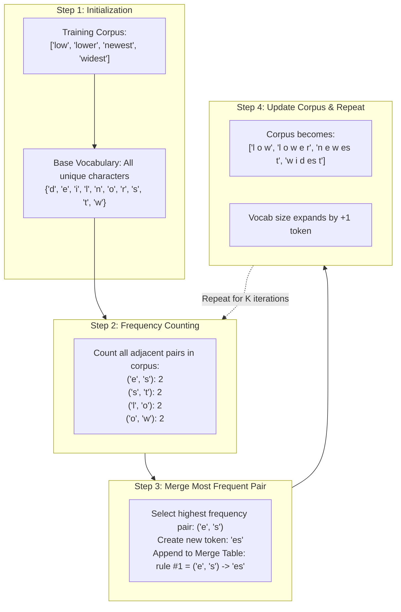
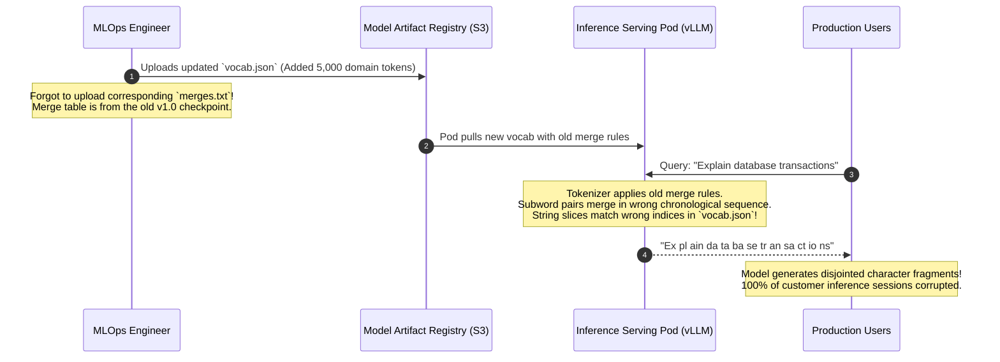

# Byte-Pair Encoding (BPE) Explained

> **Difficulty**: Advanced | **Estimated Time**: 40m | **Hands-On**: Mandatory

> [!TIP]
> **The Golden Rule of BPE Tokenization:**
> **Merge order is deterministic law.** A BPE tokenizer is not just a vocabulary of strings; it is an **ordered sequence of merge rules**. At inference time, candidate subword pairs must be merged in the exact chronological order in which they were learned during training. Merging pairs out of order alters token boundaries, maps text to incorrect token IDs, and causes a foundation model to emit pure linguistic gibberish.

---

## 1. Visual Mental Models: The BPE Iteration Loop

Originally invented as a data compression algorithm by Philip Gage in 1994, **Byte-Pair Encoding (BPE)** was adapted for natural language processing by Rico Sennrich et al. in 2015.

BPE is an **unsupervised, greedy subword clustering algorithm**. It begins with a base vocabulary of individual characters or bytes, counts adjacent pair frequencies, and iteratively merges the most frequent pair into a new composite token:



---

## 2. Walkthrough: From Characters to Subwords

Let's trace BPE over a toy corpus with word frequencies:
- `"low"`: 5 occurrences
- `"lower"`: 2 occurrences
- `"newest"`: 6 occurrences
- `"widest"`: 3 occurrences

```
Initial Tokenized State (with end-of-word marker '_'):
  5 x  l  o  w  _
  2 x  l  o  w  e  r  _
  6 x  n  e  w  e  s  t  _
  3 x  w  i  d  e  s  t  _

Iter 1: Pair ('e', 's') appears 6 + 3 = 9 times.
        MERGE ('e', 's') -> 'es'
        Corpus: ... n e w es t _ | w i d es t _

Iter 2: Pair ('es', 't') appears 6 + 3 = 9 times.
        MERGE ('es', 't') -> 'est'
        Corpus: ... n e w est _ | w i d est _

Iter 3: Pair ('est', '_') appears 6 + 3 = 9 times.
        MERGE ('est', '_') -> 'est_'
        Now 'est_' is a single dedicated token representing superlative adjectives!

Iter 4: Pair ('l', 'o') appears 5 + 2 = 7 times.
        MERGE ('l', 'o') -> 'lo'
```

Through greedy statistical clustering, the algorithm automatically discovers meaningful English linguistic morphemes (like suffixes `-est` and roots `low-`) without any human grammar rules!

---

## 3. Byte-Level BPE (BBPE) and Regex Pre-Tokenization

Early BPE suffered when processing unknown Unicode characters. In 2019, OpenAI's GPT-2 introduced **Byte-Level BPE (BBPE)**:
1. **Base Alphabet**: Starts with all **256 fundamental raw byte values** ($0x00$ to $0xFF$).
2. **Regex Pre-Tokenization**: Prevents characters from merging across punctuation or whitespace boundaries.

### The GPT-4 Pre-Tokenization Regex

Before BPE runs, GPT-4 uses an optimized regular expression to partition text into isolated buckets:

```python
# The GPT-4 / cl100k_base regex splitter
r"""'(?i:[sdmt]|ll|ve|re)|[^\r\n\p{L}\p{N}]?+\p{L}+|\p{N}{1,3}| ?[^\s\p{L}\p{N}]++[\r\n]*|\s*[\r\n]|\s+(?!\S)|\s+"""
```

- `'ve`, `'ll`, `'s`: Isolates contractions so `"they'll"` becomes `['they', "'ll"]`.
- `\p{N}{1,3}`: Chunks numbers into groups of 1 to 3 digits, forcing consistent numerical tokenization.
- `\p{L}+`: Groups continuous alphabet characters together, preventing punctuation from merging into words (`"hello!"` $\to$ `['hello', '!']`).

---

## 4. Production War Story: The Desynchronized Merge Table

```
INCIDENT SUMMARY: INC-4412
SEVERITY: P1 - Model Ingestion Corruption
IMPACT: Customer chat responses degraded into unreadable character fragments; $40,000 lost in engineering debugging hours.
ROOT CAUSE: A team updated `vocab.json` without updating the accompanying `merges.txt` table in an open-source model deployment.
```

### Incident Timeline



### The Post-Mortem

- **The Flaw**: BPE requires two synchronized artifacts:
  1. `vocab.json`: Maps subword strings to integer IDs.
  2. `merges.txt`: Specifies the **exact priority order** of pair merges.
  If the merge priorities mismatch the vocabulary indices, words merge incorrectly at inference time, mapping to completely wrong embedding vectors!
- **The Remediation**:
  1. Bundled tokenizer artifacts into single atomic, immutable files (`tokenizer.json` HuggingFace format).
  2. Implemented automated CI integrity checks asserting that `tokenizer.decode(tokenizer.encode(text)) == text` on a 10,000-sentence test corpus.

---

## 5. Multi-Language Production Implementations: BPE Engine from Scratch

Study this complete implementation of BPE training and greedy merge encoding.

### Python (`bpe_from_scratch.py`)

```python
from collections import defaultdict, Counter
from typing import List, Dict, Tuple

class SimpleBPE:
    def __init__(self, target_vocab_size: int = 30):
        self.target_vocab_size = target_vocab_size
        self.merges: List[Tuple[str, str]] = []
        self.vocab: set = set()

    def get_stats(self, splits: List[List[str]]) -> Counter:
        """Counts adjacent pair frequencies across all words."""
        pairs = Counter()
        for word in splits:
            for i in range(len(word) - 1):
                pairs[(word[i], word[i + 1])] += 1
        return pairs

    def train(self, corpus: List[str]):
        # 1. Initialize words as split characters with end-of-word marker '_'
        splits = [list(word) + ["_"] for word in corpus]
        
        # Base vocabulary
        self.vocab = set(char for word in splits for char in word)

        while len(self.vocab) < self.target_vocab_size:
            pairs = self.get_stats(splits)
            if not pairs:
                break
                
            # Find most frequent pair
            best_pair, best_count = pairs.most_common(1)[0]
            if best_count < 2:
                break # Stop if no meaningful merges remain

            # Record merge rule
            self.merges.append(best_pair)
            merged_token = "".join(best_pair)
            self.vocab.add(merged_token)

            # Apply merge across entire training corpus
            new_splits = []
            for word in splits:
                i = 0
                new_word = []
                while i < len(word):
                    if i < len(word) - 1 and (word[i], word[i + 1]) == best_pair:
                        new_word.append(merged_token)
                        i += 2
                    else:
                        new_word.append(word[i])
                        i += 1
                new_splits.append(new_word)
            splits = new_splits

    def tokenize(self, word: str) -> List[str]:
        """Applies learned merge rules in exact chronological order."""
        tokens = list(word) + ["_"]
        
        for pair in self.merges:
            merged_str = "".join(pair)
            i = 0
            new_tokens = []
            while i < len(tokens):
                if i < len(tokens) - 1 and (tokens[i], tokens[i + 1]) == pair:
                    new_tokens.append(merged_str)
                    i += 2
                else:
                    new_tokens.append(tokens[i])
                    i += 1
            tokens = new_tokens
            
        return tokens

if __name__ == "__main__":
    train_corpus = ["low", "low", "lower", "newest", "newest", "widest", "widest", "widest"]
    bpe = SimpleBPE(target_vocab_size=20)
    bpe.train(train_corpus)

    print("=== TRAINED BPE MERGE RULES (IN ORDER) ===")
    for rank, (a, b) in enumerate(bpe.merges, 1):
        print(f"  Rank {rank:2d}: ('{a}', '{b}') -> '{a+b}'")

    print("\nTokenization at Inference:")
    for test_word in ["lowest", "newer"]:
        print(f"  '{test_word}' -> {bpe.tokenize(test_word)}")
```

### TypeScript / Node.js (`bpe_encoder.ts`)

```typescript
export interface MergeRule {
  pair: [string, string];
  merged: string;
}

export function applyMerges(tokens: string[], merges: MergeRule[]): string[] {
  let current = [...tokens];

  for (const rule of merges) {
    const next: string[] = [];
    let i = 0;
    while (i < current.length) {
      if (
        i < current.length - 1 &&
        current[i] === rule.pair[0] &&
        current[i + 1] === rule.pair[1]
      ) {
        next.push(rule.merged);
        i += 2;
      } else {
        next.push(current[i]);
        i++;
      }
    }
    current = next;
  }

  return current;
}

// Verification
const initial = ['l', 'o', 'w', 'e', 's', 't', '_'];
const merges: MergeRule[] = [
  { pair: ['e', 's'], merged: 'es' },
  { pair: ['es', 't'], merged: 'est' },
  { pair: ['l', 'o'], merged: 'lo' },
];

console.log('Tokenized BPE:', applyMerges(initial, merges));
```

### Go (`bpe_merger.go`)

```go
package main

import (
	"fmt"
)

type Merge struct {
	A, B, Out string
}

func ApplyMerge(tokens []string, m Merge) []string {
	var result []string
	i := 0
	for i < len(tokens) {
		if i < len(tokens)-1 && tokens[i] == m.A && tokens[i+1] == m.B {
			result = append(result, m.Out)
			i += 2
		} else {
			result = append(result, tokens[i])
			i++
		}
	}
	return result
}

func main() {
	tokens := []string{"d", "a", "t", "a", "b", "a", "s", "e"}
	merges := []Merge{
		{A: "d", B: "a", Out: "da"},
		{A: "t", B: "a", Out: "ta"},
		{A: "da", B: "ta", Out: "data"},
	}

	for _, m := range merges {
		tokens = ApplyMerge(tokens, m)
	}
	fmt.Printf("BPE Tokens: %v\n", tokens)
}
```

---

## 6. Practical CLI Workflows

Inspect the exact number of learned merges inside OpenAI's production `cl100k_base` tokenizer using Python:

```bash
python -c "
import tiktoken
enc = tiktoken.get_encoding('cl100k_base')

print(f'Tokenizer Name:          {enc.name}')
print(f'Total Vocabulary Size:   {enc.n_vocab:,} tokens')
print(f'Base ASCII Single Bytes: 256')
print(f'Subword Merges Learned:  {enc.n_vocab - 256:,} merges')
"
```

**Expected Output:**
```
Tokenizer Name:          cl100k_base
Total Vocabulary Size:   100,277 tokens
Base ASCII Single Bytes: 256
Subword Merges Learned:  100,021 merges
```

Over **100,000 iterative merge rules** were calculated during pre-training to build GPT-4's subword vocabulary!

---

## 7. Operational Validation Checkpoints

Confirm your mastery of Byte-Pair Encoding algorithms.

<details>
<summary><b>Checkpoint 1: Why does BPE require an end-of-word marker (like `_` or `</w>`) during training?</b></summary>

**Stemming vs Free-Standing Disambiguation:**
Without an explicit boundary marker, the tokenizer cannot distinguish between the free-standing word *"est"* and the suffix *"-est"* in *"widest"*.
Appending `_` to the end of words allows BPE to learn:
- `'est_'`: Superlative suffix marking the end of a word.
- `'est'`: An internal character sequence appearing inside other words (e.g. *"estimate"*).
This prevents internal word segments from merging inappropriately into final words.
</details>

<details>
<summary><b>Checkpoint 2: Is BPE guaranteed to find the mathematically optimal shortest tokenization of a sentence?</b></summary>

**The Greedy Limitation:**
**No.** BPE is a **greedy algorithm**: at each step, it merges whatever pair has the highest historical frequency in the training corpus.
Because it does not perform a global search (like dynamic programming or the Viterbi algorithm used in Unigram tokenization), BPE can occasionally make a local merge that prevents a much better, longer merge from occurring later in the string.
However, BPE's linear time complexity ($O(N)$ at inference) makes it vastly faster to execute than global optimization tokenizers.
</details>

<details>
<summary><b>Checkpoint 3: Explain the difference between character BPE and Byte-Level BPE (BBPE).</b></summary>

**The Base Alphabet Difference:**
- **Character BPE:** Base vocabulary consists of unique Unicode characters. If an unseen emoji or foreign character appears at inference time, it has no character entry in the base table and causes an `<UNK>` failure.
- **Byte-Level BPE (BBPE):** Base vocabulary consists of the **256 fundamental bytes** ($0x00$ to $0xFF$). Characters are decoded into UTF-8 bytes first. Because every digital character is a sequence of bytes, BBPE has zero out-of-vocabulary failures.
</details>

---

## Next

Continue to **[04-building-a-bpe-tokenizer-from-scratch](../04-building-a-bpe-tokenizer-from-scratch/README.md)** to build a production-grade Byte-Level BPE tokenizer from scratch, complete with regex splitting, training routines, and persistence.
