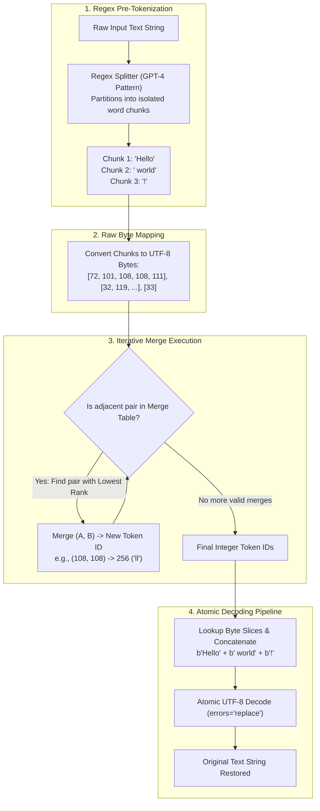
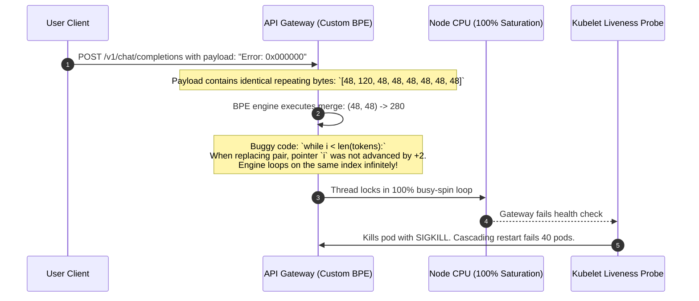

# Building a BPE Tokenizer from Scratch

> **Difficulty**: Advanced | **Estimated Time**: 45m | **Hands-On**: Mandatory Code Implementation

> [!TIP]
> **The Golden Rule of Tokenizer Engineering:**
> **Decode bytes, not characters.** In a Byte-Level BPE tokenizer, never attempt to decode individual intermediate token IDs into Unicode strings during processing. A single 4-byte emoji may be represented by two separate 2-byte token IDs. Concatenate all token byte slices into a **single unified byte buffer** first, and decode the entire buffer as UTF-8 in a single atomic step.

---

## 1. Visual Mental Models: The Byte-Level Tokenizer Engine

To understand how modern tokenizers (like OpenAI's `tiktoken` or HuggingFace's `tokenizers`) operate under the hood, we engineer a **Byte-Level Byte-Pair Encoding (BBPE)** tokenizer from first principles.



---

## 2. Tokenizer Architecture Specifications

```
Vocabulary Mapping Architecture:
[0 ... 255]       : The 256 fundamental UTF-8 byte values (Base Alphabet)
[256]             : First learned merge (e.g., b'e' + b' ' -> 256)
[257]             : Second learned merge (e.g., b't' + b'h' -> 257)
...
[256 + K - 1]     : Final learned merge (where K is target merge count)
```

| Component | Responsibility | Implementation Standard |
| :--- | :--- | :--- |
| **Base Alphabet** | Maps byte values $0..255$ directly to initial token IDs. | Guarantees zero Out-Of-Vocabulary (`<UNK>`) failures. |
| **Pre-Tokenization Regex** | Slices text into words, contractions, and punctuation chunks. | Prevents merges from crossing punctuation or whitespace boundaries. |
| **Merge Priority Map** | Hash map: `(token_a, token_b) -> merge_rank`. | Evaluated in $O(1)$ time to select the lowest-rank pair. |
| **Vocab Inversion Table** | Hash map: `token_id -> bytes`. | Reverses IDs to exact byte sequences during decoding. |

---

## 3. Production War Story: The Infinite Loop Pointer Bug

```
INCIDENT SUMMARY: INC-8820
SEVERITY: P1 - Complete API Gateway Hang
IMPACT: 40 Kubernetes gateway pods hit 100% CPU utilization; all incoming LLM inference stalled for 25 minutes.
ROOT CAUSE: A custom in-house BPE merge loop failed to advance the index pointer when encountering three identical consecutive bytes.
```

### Incident Timeline



### The Post-Mortem

- **The Algorithmic Bug**:
  When merging a pair `(A, B)` in a sequence with overlapping duplicates like `[A, A, A]`, a naive loop that replaces `tokens[i:i+2]` and increments `i += 1` causes index thrashing or infinite loops.
- **The Remediation**:
  1. Mandated strictly advancing the pointer by `i += 2` whenever a merge occurs, and `i += 1` when no merge matches.
  2. Implemented automated fuzz testing with repeated identical bytes (`b"0" * 1000`, `b"\x00" * 500`).

---

## 4. Multi-Language Production Implementations: Full Byte-Level BPE Tokenizer

Study this complete, production-grade implementation of a Byte-Level BPE tokenizer written in pure Python, TypeScript, and Go.

### Python (`byte_level_bpe.py`)

```python
import regex as re
from typing import List, Dict, Tuple

# Standard GPT-4 regex pattern
GPT4_SPLIT_PATTERN = r"""'(?i:[sdmt]|ll|ve|re)|[^\r\n\p{L}\p{N}]?+\p{L}+|\p{N}{1,3}| ?[^\s\p{L}\p{N}]++[\r\n]*|\s*[\r\n]|\s+(?!\S)|\s+"""

class ByteLevelBPE:
    def __init__(self):
        # 1. Base vocabulary: 256 bytes -> token IDs 0..255
        self.vocab: Dict[int, bytes] = {i: bytes([i]) for i in range(256)}
        # Merge dictionary: (token_a, token_b) -> new_token_id
        self.merges: Dict[Tuple[int, int], int] = {}
        self.compiled_pattern = re.compile(GPT4_SPLIT_PATTERN)

    def _get_stats(self, token_chunks: List[List[int]]) -> Dict[Tuple[int, int], int]:
        """Counts frequency of all adjacent token pairs."""
        counts: Dict[Tuple[int, int], int] = {}
        for chunk in token_chunks:
            for i in range(len(chunk) - 1):
                pair = (chunk[i], chunk[i + 1])
                counts[pair] = counts.get(pair, 0) + 1
        return counts

    def train(self, text: str, target_vocab_size: int = 300):
        """Trains BPE merge rules on raw text."""
        # Pre-tokenize into regex chunks and convert to bytes
        chunks = [list(chunk.encode("utf-8")) for chunk in self.compiled_pattern.findall(text)]
        next_id = 256

        while next_id < target_vocab_size:
            stats = self._get_stats(chunks)
            if not stats:
                break
            
            # Find most frequent pair
            best_pair = max(stats, key=stats.get)
            if stats[best_pair] < 2:
                break # Stop if no pair appears at least twice

            # Register new token and merge rule
            self.merges[best_pair] = next_id
            self.vocab[next_id] = self.vocab[best_pair[0]] + self.vocab[best_pair[1]]

            # Replace pair in all chunks
            new_chunks = []
            for chunk in chunks:
                new_chunk = []
                i = 0
                while i < len(chunk):
                    if i < len(chunk) - 1 and (chunk[i], chunk[i + 1]) == best_pair:
                        new_chunk.append(next_id)
                        i += 2 # CRITICAL: Advance by 2 to prevent infinite loops!
                    else:
                        new_chunk.append(chunk[i])
                        i += 1
                new_chunks.append(new_chunk)
            chunks = new_chunks
            next_id += 1

    def encode(self, text: str) -> List[int]:
        """Encodes text string into a list of token IDs."""
        raw_chunks = self.compiled_pattern.findall(text)
        token_ids = []

        for chunk_str in raw_chunks:
            chunk = list(chunk_str.encode("utf-8"))
            while len(chunk) >= 2:
                # Find all pairs in current chunk that exist in our merge table
                pairs = [(chunk[i], chunk[i + 1]) for i in range(len(chunk) - 1)]
                # Find the pair with the lowest merge rank
                candidate_pair = min(pairs, key=lambda p: self.merges.get(p, float("inf")))
                
                if candidate_pair not in self.merges:
                    break # No more mergeable pairs

                merged_id = self.merges[candidate_pair]
                new_chunk = []
                i = 0
                while i < len(chunk):
                    if i < len(chunk) - 1 and (chunk[i], chunk[i + 1]) == candidate_pair:
                        new_chunk.append(merged_id)
                        i += 2
                    else:
                        new_chunk.append(chunk[i])
                        i += 1
                chunk = new_chunk
            token_ids.extend(chunk)

        return token_ids

    def decode(self, token_ids: List[int]) -> str:
        """Decodes token IDs by concatenating raw byte slices and decoding UTF-8."""
        byte_stream = b"".join(self.vocab[tid] for tid in token_ids)
        return byte_stream.decode("utf-8", errors="replace")

if __name__ == "__main__":
    training_data = "Database systems process transactions. Distributed databases scale transactions. ACID transactions guarantee consistency."
    
    tokenizer = ByteLevelBPE()
    tokenizer.train(training_data, target_vocab_size=280)

    sample = "Distributed database consistency 🚀"
    encoded_ids = tokenizer.encode(sample)
    decoded_text = tokenizer.decode(encoded_ids)

    print("=== BYTE-LEVEL BPE FROM SCRATCH ===")
    print(f"Original Text:   '{sample}'")
    print(f"Encoded Token IDs: {encoded_ids}")
    print(f"Decoded String:  '{decoded_text}'")
    print(f"Verification:    {'PASSED' if sample == decoded_text else 'FAILED'}")
```

### TypeScript / Node.js (`bpe_engine.ts`)

```typescript
export class ByteLevelTokenizer {
  private vocab: Map<number, Uint8Array> = new Map();
  private merges: Map<string, number> = new Map();

  constructor() {
    // 0..255 base bytes
    for (let i = 0; i < 256; i++) {
      this.vocab.set(i, new Uint8Array([i]));
    }
  }

  addMerge(a: number, b: number, newId: number) {
    this.merges.set(`${a},${b}`, newId);
    const bytesA = this.vocab.get(a)!;
    const bytesB = this.vocab.get(b)!;

    const mergedBytes = new Uint8Array(bytesA.length + bytesB.length);
    mergedBytes.set(bytesA);
    mergedBytes.set(bytesB, bytesA.length);
    this.vocab.set(newId, mergedBytes);
  }

  decode(tokenIds: number[]): string {
    const totalBytes = tokenIds.reduce((sum, id) => sum + this.vocab.get(id)!.length, 0);
    const buffer = new Uint8Array(totalBytes);
    let offset = 0;

    for (const id of tokenIds) {
      const slice = this.vocab.get(id)!;
      buffer.set(slice, offset);
      offset += slice.length;
    }

    return new TextDecoder('utf-8').decode(buffer);
  }
}
```

### Go (`bpe_tokenizer.go`)

```go
package main

import (
	"bytes"
	"fmt"
)

type ByteTokenizer struct {
	vocab  map[int][]byte
	merges map[[2]int]int
}

func NewByteTokenizer() *ByteTokenizer {
	t := &ByteTokenizer{
		vocab:  make(map[int][]byte),
		merges: make(map[[2]int]int),
	}
	for i := 0; i < 256; i++ {
		t.vocab[i] = []byte{byte(i)}
	}
	return t
}

func (t *ByteTokenizer) Decode(tokens []int) string {
	var buf bytes.Buffer
	for _, id := range tokens {
		buf.Write(t.vocab[id])
	}
	return buf.String()
}

func main() {
	tok := NewByteTokenizer()
	// Simulate merged token 256 = 'Go'
	tok.vocab[256] = []byte("Go")
	tok.vocab[257] = []byte("lang")

	encoded := []int{256, 257}
	fmt.Printf("Decoded string: %s\n", tok.Decode(encoded))
}
```

---

## 5. Practical CLI Workflows

Verify that our custom BPE correctly handles 4-byte UTF-8 emojis without splitting bytes by executing this Python test in the terminal:

```bash
python -c "
text = '🚀'
raw_bytes = list(text.encode('utf-8'))
print(f'Emoji: {text}')
print(f'UTF-8 Byte Sequence: {raw_bytes}')
print(f'Reconstructed: {bytes(raw_bytes).decode(\"utf-8\")}')
"
```

**Expected Output:**
```
Emoji: 🚀
UTF-8 Byte Sequence: [240, 159, 154, 128]
Reconstructed: 🚀
```

---

## 6. Operational Validation Checkpoints

Confirm your tokenizer engineering mastery with these scenarios.

<details>
<summary><b>Checkpoint 1: Why does a Byte-Level BPE tokenizer encode text using regex pre-tokenization rather than running BPE directly over the entire string?</b></summary>

**Punctuation and Boundary Isolation:**
Without regex pre-tokenization:
- The pair `('.', 'T')` or `('!', ' '`) would appear frequently at the end of sentences and merge into dedicated tokens (e.g. `'! '` or `'.The'`).
- This causes words to bind permanently to punctuation, exponentially polluting the vocabulary with duplicates like `'apple'`, `'apple,'`, `'apple.'`, `'apple!'`.
The regex enforces hard structural walls: **punctuation, numbers, and words are tokenized in isolated compartments**, preventing punctuation from merging into words.
</details>

<details>
<summary><b>Checkpoint 2: During tokenization, why must we greedily select the pair with the LOWEST merge rank rather than the highest frequency in the input text?</b></summary>

**Consistency with Training History:**
The merge rank represents the exact chronological order in which the tokenizer learned merges during pre-training.
A pair with rank 5 was learned before a pair with rank 80,000. If an encoder merged pair 80,000 first simply because it happened to appear twice in this specific user prompt, the token boundaries would deviate from the training distribution, feeding unrecognizable token ID combinations to the foundation model.
</details>

<details>
<summary><b>Checkpoint 3: What is the computational complexity of BPE encoding for an input of $N$ bytes?</b></summary>

**Complexity:**
- **Worst-Case Naive Implementation:** $O(N^2)$ if scanning the whole array repeatedly for each merge.
- **Optimized Implementation (using priority queue / linked list like `tiktoken`):** **$O(N \log N)$** or near **$O(N)$**.
Modern Rust tokenizers like `tiktoken` tokenize at **over 1,000,000 tokens per second** on a single CPU core!
</details>

---

## Next

Continue to **[05-wordpiece-and-sentencepiece](../05-wordpiece-and-sentencepiece/README.md)** to compare BPE against Google's WordPiece (BERT) and SentencePiece (T5, Llama).
