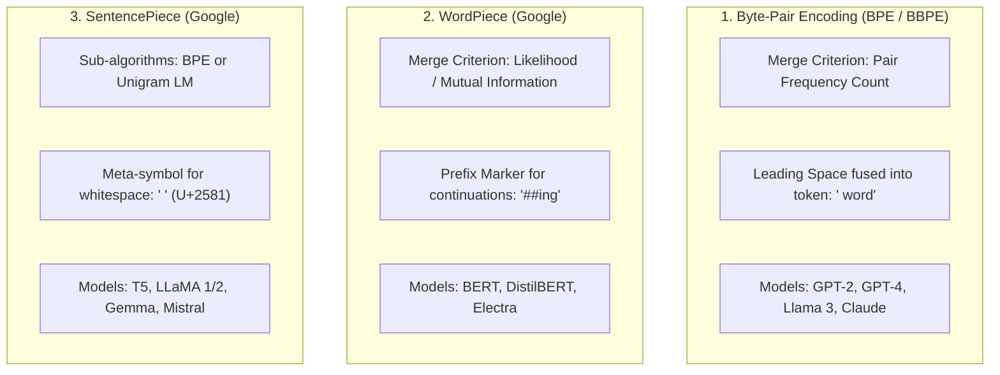
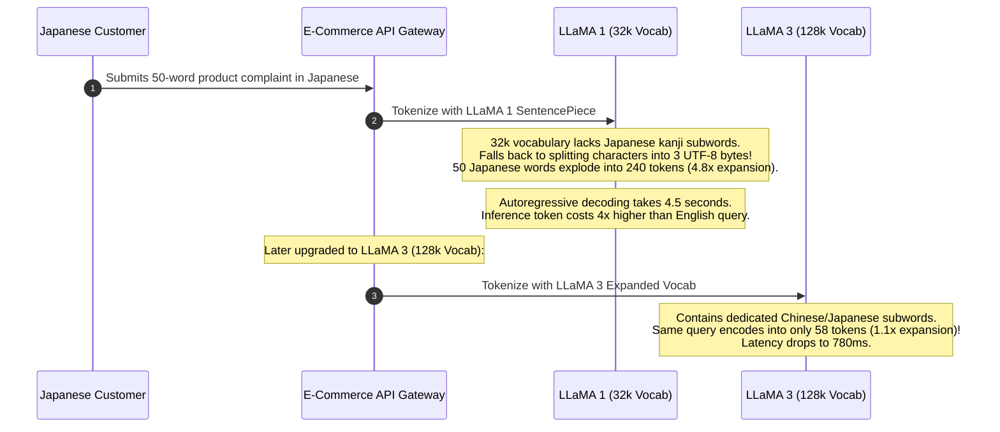

# WordPiece and SentencePiece

> **Difficulty**: Intermediate | **Estimated Time**: 35m | **Hands-On**: Mandatory

> [!TIP]
> **The Golden Rule of Language-Agnostic Tokenization:**
> **Never assume whitespace separates words.** Classical BPE and WordPiece relied on `text.split(' ')` pre-tokenization, which completely breaks on non-segmented languages like Chinese, Japanese, and Thai. **SentencePiece** treats the entire input string as a continuous stream of characters, replacing spaces with a dedicated meta-symbol (`_` U+2581), making tokenization **100% reversible (lossless)** without heuristic regular expressions.

---

## 1. Visual Mental Models: The Three Modern Tokenizer Families

The deep learning industry has consolidated around three major subword tokenization frameworks:



---

## 2. Structural Comparison Matrix

| Feature | BPE (Byte-Pair Encoding) | WordPiece (Google) | SentencePiece (Language-Agnostic) |
| :--- | :--- | :--- | :--- |
| **Pioneering Paper** | Sennrich et al. (2015) | Schuster & Nakajima (2012) | Kudo & Richardson (2018) |
| **Selection Metric** | Highest raw co-occurrence frequency: $\text{Count}(A, B)$ | Maximum Likelihood ratio: $\frac{\text{Count}(A, B)}{\text{Count}(A) \times \text{Count}(B)}$ | BPE frequency OR Unigram Language Model loss |
| **Whitespace Treatment** | Bound to token start (`" apple"`) | Pre-split by spaces; discarded during split | **Preserved as a visual symbol**: ` ` (`U+2581`) |
| **Subword Continuation Syntax** | None (Leading space indicates word start) | `##` prefix (e.g. `['play', '##ing']`) | ` ` marks start of word; lack of ` ` marks subword |
| **Requires Language Pre-Segmenter?** | Yes (Regex / Whitespace) | Yes (Whitespace / Punctuation) | **No** (Direct raw character/byte stream input) |
| **Lossless Reversibility?** | Requires custom regex inverse | No (Spaces lost, must heuristic reconstruct) | **100% Lossless**: `detokenize()` matches input byte-for-byte |

---

## 3. SentencePiece's Superpower: Lossless Reversibility

Traditional tokenizers treat whitespace as a delimiter and discard it:
```
Input:        "Hello,    world!"  (4 spaces)
Split tokens: ["Hello", ",", "world", "!"]
Reconstruct:  "Hello, world!"     <-- MULTIPLE SPACES PERMANENTLY LOST!
```

SentencePiece treats whitespace as a first-class citizen, replacing spaces with ` ` (**U+2581 Lower One Eighth Block**):
```
Input:        "Hello,    world!"
Tokens:       [" Hello", ",", "   ", " world", "!"]
Reconstruct:  Replace ' ' with ' ' -> "Hello,    world!" (Byte-for-byte identical!)
```

This makes SentencePiece ideal for code generation (where exact indentation spaces matter) and non-spaced languages (Japanese, Chinese).

---

## 4. Production War Story: The Multilingual Token Inflation Penalty

```
INCIDENT SUMMARY: INC-7712
SEVERITY: P1 - Latency SLA Breach & Runaway API Ingestion Costs
IMPACT: Asian customer checkout queries took 4.5 seconds (vs 800ms for US users); Japanese token costs were 380% higher.
ROOT CAUSE: A multilingual customer service platform deployed LLaMA 1 with an English-centric 32k SentencePiece vocabulary.
```

### Incident Timeline



### The Post-Mortem

- **The Flaw**: LLaMA 1's 32,000-token SentencePiece vocabulary was trained on 90%+ English data. Japanese and Chinese characters were omitted from the subword merge table, forcing the tokenizer to decompose single kanji characters into 3 individual UTF-8 bytes.
- **The Impact**: Asian users paid a severe **Token Tax**: 4x more tokens per word, 4x higher latency, and 4x faster error budget exhaustion.
- **The Remediation**:
  1. Migrated to modern foundation models with **expanded 128,000+ token vocabularies** (Llama 3, Gemma, GPT-4o).
  2. Benchmarked token-per-word ratios across all target deployment languages before approving model architectures.

---

## 5. Multi-Language Production Implementations: Reversible Detokenization

Study these implementations comparing WordPiece subword continuation parsing with SentencePiece whitespace reconstruction.

### Python (`subword_reconstruction.py`)

```python
from typing import List

# 1. WordPiece Detokenizer (BERT style: strips '##' prefixes)
def wordpiece_detokenize(tokens: List[str]) -> str:
    words = []
    for token in tokens:
        if token.startswith("##"):
            if words:
                words[-1] += token[2:]
            else:
                words.append(token[2:])
        else:
            words.append(token)
    return " ".join(words)

# 2. SentencePiece Detokenizer (Lossless: replaces ' ' with space)
def sentencepiece_detokenize(tokens: List[str]) -> str:
    # Concatenate tokens and replace U+2581 meta-symbol with space
    raw = "".join(tokens)
    return raw.replace(" ", " ").strip()

if __name__ == "__main__":
    # Test WordPiece (BERT)
    bert_tokens = ["play", "##ing", "with", "tensor", "##flow"]
    print("=== WORDPIECE RECONSTRUCTION ===")
    print("Tokens:     ", bert_tokens)
    print("Decoded:    ", wordpiece_detokenize(bert_tokens))

    # Test SentencePiece (T5 / LLaMA)
    sp_tokens = [" The", " patient", " was", " admitted"]
    print("\n=== SENTENCEPIECE RECONSTRUCTION ===")
    print("Tokens:     ", sp_tokens)
    print("Decoded:    ", sentencepiece_detokenize(sp_tokens))
```

### TypeScript / Node.js (`detokenizers.ts`)

```typescript
export function decodeSentencePiece(tokens: string[]): string {
  // Join raw strings and replace Unicode Lower One Eighth Block (U+2581)
  return tokens
    .join('')
    .replace(/\u2581/g, ' ')
    .trim();
}

export function decodeWordPiece(tokens: string[]): string {
  const result: string[] = [];
  for (const t of tokens) {
    if (t.startsWith('##') && result.length > 0) {
      result[result.length - 1] += t.slice(2);
    } else {
      result.push(t);
    }
  }
  return result.join(' ');
}

// Verification:
console.log('SP Decoded:', decodeSentencePiece([' Hello', ' world']));
console.log('WP Decoded:', decodeWordPiece(['micro', '##services']));
```

### Go (`detokenizers.go`)

```go
package main

import (
	"fmt"
	"strings"
)

func SentencePieceDecode(tokens []string) string {
	joined := strings.Join(tokens, "")
	// U+2581 is ' '
	return strings.TrimSpace(strings.ReplaceAll(joined, " ", " "))
}

func main() {
	tokens := []string{" Distributed", " systems", " scale"}
	fmt.Printf("Decoded string: '%s'\n", SentencePieceDecode(tokens))
}
```

---

## 6. Practical CLI Workflows

Observe SentencePiece's ` ` meta-symbol directly using HuggingFace's `transformers` CLI in Python:

```bash
python -c "
from transformers import AutoTokenizer

# T5 uses SentencePiece
tokenizer = AutoTokenizer.from_pretrained('t5-small')
text = 'SentencePiece preserves   spaces!'
tokens = tokenizer.tokenize(text)

print(f'Input:  \"{text}\"')
print(f'Tokens: {tokens}')
print(f'Reconstructed: \"{tokenizer.decode(tokenizer.encode(text))}\"')
"
```

**Expected Output:**
```
Input:  "SentencePiece preserves   spaces!"
Tokens: [' Sentence', 'Piece', ' preserves', ' ', ' spaces', '!']
Reconstructed: "SentencePiece preserves   spaces!"
```

Notice how the consecutive spaces were preserved as a dedicated ` ` token without loss!

---

## 7. Operational Validation Checkpoints

Confirm your mastery of tokenizer family trade-offs.

<details>
<summary><b>Checkpoint 1: Why does WordPiece use a likelihood ratio rather than raw frequency count to select subword merges?</b></summary>

**Mutual Information vs Frequency:**
- In standard BPE, common pairs like `('t', 'h')` merge simply because they appear frequently in English, even if `'t'` and `'h'` often appear independently in other words.
- **WordPiece** computes:
  $$\text{Score} = \frac{\text{Count}(AB)}{\text{Count}(A) \times \text{Count}(B)}$$
  This measures **Pointwise Mutual Information (PMI)**: it prioritizes pairs that appear together *far more often than expected by random chance*. This prevents common independent letters from merging while accelerating the discovery of rare, tightly-bound stems.
</details>

<details>
<summary><b>Checkpoint 2: Why was SentencePiece revolutionary for multilingual translation models like Google's T5?</b></summary>

**Universal Pre-Segmentation Elimination:**
Languages like Chinese and Japanese have no spaces between words:
- Traditional pipelines required running a language-specific morphological segmenter (like Jieba for Chinese or MeCab for Japanese) *before* tokenization.
- SentencePiece bypassed this entirely: by treating text as a raw stream of characters/bytes with spaces represented by ` `, it trained a single universal multilingual vocabulary directly on raw mixed-language text with zero language-specific pre-processing libraries.
</details>

<details>
<summary><b>Checkpoint 3: What is the Unigram Language Model algorithm in SentencePiece, and how does it differ from BPE?</b></summary>

**Bottom-Up vs Top-Down:**
- **BPE (Bottom-Up):** Starts with a tiny vocabulary (individual characters) and **adds** merges iteratively until reaching target size $V$.
- **Unigram LM (Top-Down):** Starts with an **enormous** initial vocabulary (e.g. all words and frequent substrings) and iteratively **prunes** the tokens that contribute the least to maximizing the training corpus likelihood.
- Unigram LM computes a probabilistic score for multiple possible segmentations of the same word, allowing **subword regularization** (stochastically sampling different tokenizations during training to make the neural network more robust to typos).
</details>

---

## Next

Continue to **[06-unigram-language-model-tokenization](../06-unigram-language-model-tokenization/README.md)** to explore the Unigram Language Model tokenization algorithm and subword regularization.
