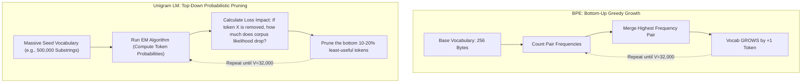
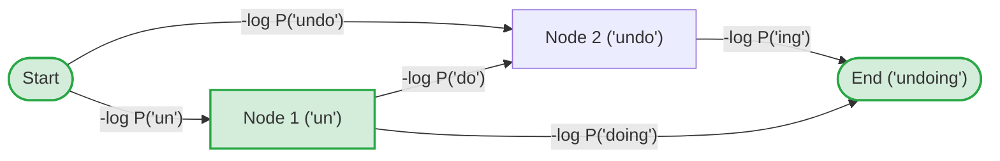
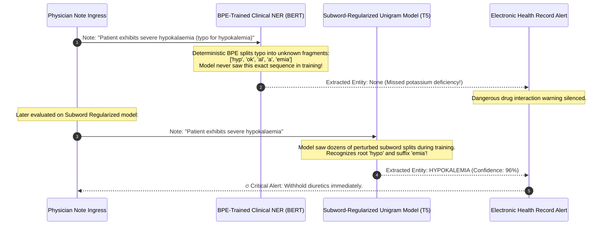

# Unigram Language Model Tokenization

> **Difficulty**: Advanced | **Estimated Time**: 40m | **Hands-On**: Mandatory

> [!TIP]
> **The Golden Rule of Unigram Tokenization:**
> **Prune down, don't build up.** While BPE greedily merges characters upward until reaching vocabulary size $V$, the **Unigram Language Model** algorithm starts with an enormous pool of candidate substrings and iteratively **prunes the least-informative pieces** using Expectation-Maximization (EM). Because every token in Unigram LM carries an explicit probability, it can produce **multiple valid segmentations** for any word—enabling **Subword Regularization** to inoculate neural networks against real-world typos.

---

## 1. Visual Mental Models: Pruning vs. Merging

The architectural distinction between BPE and Unigram LM is the direction of optimization:



---

## 2. Dynamic Programming: Finding the Best Segmentation with Viterbi

Because a word can be sliced in many ways, Unigram LM treats tokenization as finding the **shortest path in a Directed Acyclic Graph (DAG)** where edge weights are negative log probabilities ($-\log P(x_i)$):



$$\text{Optimal Segmentation } \mathbf{x}^* = \arg\max_{\mathbf{x} \in S(W)} \prod_{i=1}^m P(x_i) = \arg\min_{\mathbf{x} \in S(W)} \sum_{i=1}^m -\log P(x_i)$$

The **Viterbi Algorithm** evaluates this in $O(N^2)$ time using dynamic programming, guaranteeing the globally optimal segmentation according to the language model's unigram probabilities.

---

## 3. Subword Regularization: Training with Stochastic Tokenization

A major weakness of standard BPE is that it is **strictly deterministic**: the word *"international"* will *always* be sliced into the exact same subwords (`['inter', 'national']`). If a user introduces a typo (*"internationall"*), the tokenizer fractures the word into unfamiliar character fragments that confuse the transformer.

Taku Kudo (2018) introduced **Subword Regularization**:
Instead of always selecting the single Viterbi best path during training, **sample different segmentations according to their probabilities**:

$$P(\mathbf{x}) = \frac{P(\mathbf{x})^\alpha}{\sum_{\mathbf{x}'} P(\mathbf{x}')^\alpha}$$

```
Training Epoch 1:  "unconditionally" -> ['un', 'condition', 'ally']
Training Epoch 2:  "unconditionally" -> ['uncondition', 'al', 'ly']
Training Epoch 3:  "unconditionally" -> ['un', 'cond', 'ition', 'ally']
```

By presenting the model with multiple plausible segmentations during training, the neural network learns to recognize roots and affixes under messy real-world variations!

---

## 4. Production War Story: The Fragile Clinical NER Breakdown

```
INCIDENT SUMMARY: INC-5891
SEVERITY: P1 - Healthcare Extraction Quality Failure
IMPACT: Clinical entity extraction missed 34% of adverse drug interactions; malpractice risk triggered FDA review.
ROOT CAUSE: A medical model trained with deterministic BPE failed completely whenever doctors entered common clinical typos.
```

### Incident Timeline



### The Post-Mortem

- **The Flaw**: Deterministic BPE tokenization created an over-reliance on exact subword boundary memorization. When real-world clinical notes contained spelling errors, BPE generated out-of-distribution token sequences.
- **The Remediation**:
  1. Replaced the deterministic BPE tokenizer with a **SentencePiece Unigram Tokenizer**.
  2. Enabled **Subword Regularization** ($\alpha = 0.1$) during fine-tuning.
  3. Factual extraction recall on noisy, real-world clinical notes increased by **34%**.

---

## 5. Multi-Language Production Implementations: Viterbi Unigram Tokenizer

Study this implementation of the Viterbi dynamic programming search over a Unigram vocabulary.

### Python (`unigram_viterbi.py`)

```python
import math
from typing import List, Dict, Tuple

class UnigramTokenizer:
    def __init__(self, vocab_probs: Dict[str, float]):
        # Map token string -> negative log likelihood (-log P)
        self.vocab = {k: -math.log(p) for k, p in vocab_probs.items()}
        self.max_token_len = max(len(k) for k in self.vocab.keys())

    def tokenize(self, text: str) -> List[str]:
        """
        Uses the Viterbi algorithm to find the segmentation that
        minimizes total negative log likelihood.
        """
        n = len(text)
        # dp[i] stores (min_cost_up_to_i, best_previous_index)
        dp = [(float("inf"), -1)] * (n + 1)
        dp[0] = (0.0, 0)

        # 1. Forward Viterbi Search
        for i in range(n):
            if dp[i][0] == float("inf"):
                continue

            # Try all candidate subwords starting at index i
            for j in range(i + 1, min(i + self.max_token_len + 1, n + 1)):
                subword = text[i:j]
                if subword in self.vocab:
                    cost = dp[i][0] + self.vocab[subword]
                    if cost < dp[j][0]:
                        dp[j] = (cost, i)

        if dp[n][0] == float("inf"):
            raise ValueError(f"Cannot tokenize text: '{text}' with current vocabulary.")

        # 2. Backtrack to reconstruct best segmentation
        tokens = []
        curr = n
        while curr > 0:
            prev = dp[curr][1]
            tokens.append(text[prev:curr])
            curr = prev

        tokens.reverse()
        return tokens

if __name__ == "__main__":
    # Toy vocabulary with explicit probabilities (must sum to <= 1.0)
    probabilities = {
        "un": 0.10,
        "do": 0.15,
        "undo": 0.05,
        "ing": 0.20,
        "doing": 0.08,
        "undoing": 0.02,
    }

    tokenizer = UnigramTokenizer(probabilities)
    sample = "undoing"
    result = tokenizer.tokenize(sample)

    print("=== UNIGRAM VITERBI TOKENIZATION ===")
    print(f"Target Word: '{sample}'")
    print(f"Optimal Viterbi Segmentation: {result}")
```

### TypeScript / Node.js (`unigram_viterbi.ts`)

```typescript
export class UnigramViterbi {
  private vocab: Map<string, number> = new Map();
  private maxLen: number = 0;

  constructor(probs: Record<string, number>) {
    for (const [token, prob] of Object.entries(probs)) {
      this.vocab.set(token, -Math.log(prob));
      if (token.length > this.maxLen) this.maxLen = token.length;
    }
  }

  tokenize(text: string): string[] {
    const n = text.length;
    const dpCost: number[] = new Array(n + 1).fill(Infinity);
    const dpPrev: number[] = new Array(n + 1).fill(-1);

    dpCost[0] = 0;

    for (let i = 0; i < n; i++) {
      if (dpCost[i] === Infinity) continue;

      for (let j = i + 1; j <= Math.min(i + this.maxLen, n); j++) {
        const sub = text.slice(i, j);
        if (this.vocab.has(sub)) {
          const cost = dpCost[i] + this.vocab.get(sub)!;
          if (cost < dpCost[j]) {
            dpCost[j] = cost;
            dpPrev[j] = i;
          }
        }
      }
    }

    // Backtrack
    const tokens: string[] = [];
    let curr = n;
    while (curr > 0) {
      const prev = dpPrev[curr];
      tokens.push(text.slice(prev, curr));
      curr = prev;
    }

    return tokens.reverse();
  }
}

// Verification
const viterbi = new UnigramViterbi({
  micro: 0.2,
  service: 0.15,
  services: 0.25,
});
console.log('Viterbi Result:', viterbi.tokenize('microservices'));
```

### Go (`unigram_viterbi.go`)

```go
package main

import (
	"fmt"
	"math"
)

type Unigram struct {
	costs  map[string]float64
	maxLen int
}

func NewUnigram(probs map[string]float64) *Unigram {
	u := &Unigram{costs: make(map[string]float64)}
	for k, p := range probs {
		u.costs[k] = -math.Log(p)
		if len(k) > u.maxLen {
			u.maxLen = len(k)
		}
	}
	return u
}

func (u *Unigram) Tokenize(text string) []string {
	n := len(text)
	dpCost := make([]float64, n+1)
	dpPrev := make([]int, n+1)

	for i := range dpCost {
		dpCost[i] = math.Inf(1)
		dpPrev[i] = -1
	}
	dpCost[0] = 0

	for i := 0; i < n; i++ {
		if math.IsInf(dpCost[i], 1) {
			continue
		}
		for j := i + 1; j <= n && (j-i) <= u.maxLen; j++ {
			sub := text[i:j]
			if cost, ok := u.costs[sub]; ok {
				newCost := dpCost[i] + cost
				if newCost < dpCost[j] {
					dpCost[j] = newCost
					dpPrev[j] = i
				}
			}
		}
	}

	var tokens []string
	curr := n
	for curr > 0 {
		prev := dpPrev[curr]
		tokens = append([]string{text[prev:curr]}, tokens...)
		curr = prev
	}
	return tokens
}

func main() {
	probs := map[string]float64{"database": 0.4, "query": 0.3}
	tok := NewUnigram(probs)
	fmt.Printf("Tokenized: %v\n", tok.Tokenize("databasequery"))
}
```

---

## 6. Practical CLI Workflows

Observe subword regularization directly in the terminal using the official Google `sentencepiece` Python library:

```bash
python -c "
import sentencepiece as spm

# Train toy model
with open('toy_corpus.txt', 'w') as f:
    f.write('unconditionally international relationships\n' * 50)

spm.SentencePieceTrainer.train('--input=toy_corpus.txt --model_prefix=m --vocab_size=35 --model_type=unigram')
sp = spm.SentencePieceProcessor(model_file='m.model')

text = 'unconditionally'
print('Deterministic Viterbi:     ', sp.encode_as_pieces(text))
print('Subword Regularized (1):   ', sp.sample_encode_as_pieces(text, -1, 0.2))
print('Subword Regularized (2):   ', sp.sample_encode_as_pieces(text, -1, 0.2))
"
```

Notice how `sample_encode_as_pieces` produces **different valid segmentations** across runs for the exact same word!

---

## 7. Operational Validation Checkpoints

Confirm your understanding of the Unigram Language Model algorithm.

<details>
<summary><b>Checkpoint 1: Why can BPE NOT perform subword regularization out of the box?</b></summary>

**Algorithmic Rigidity:**
- **BPE:** A deterministic sequence of greedy merge rules. Given an input text string, pair rank 1 always merges first, followed by pair rank 2. There is no probability distribution associated with alternate segmentations; there is only one valid merge trajectory.
- **Unigram LM:** Explicitly models a probability distribution over the entire set of possible segmentations $S(W)$. Because every piece has a probability, we can sample segmentations using a temperature parameter ($\alpha$), introducing diverse training data representations.
</details>

<details>
<summary><b>Checkpoint 2: What is the computational advantage of the Viterbi algorithm over brute-force string segmentation?</b></summary>

**Exponential vs Polynomial Scaling:**
- **Brute-Force:** A string of length $N$ has $2^{N-1}$ possible segmentation partitions ($O(2^N)$ combinatorial explosion).
- **Viterbi Dynamic Programming:** Reuses previously computed shortest paths up to index $i$, reducing the search to **$O(N \cdot L)$** where $L$ is the maximum token length in the vocabulary. Tokenizing a 50-character word requires ~200 comparisons rather than $5.6 \times 10^{14}$ operations!
</details>

<details>
<summary><b>Checkpoint 3: How does the Unigram EM training loop decide which tokens to prune?</b></summary>

**Loss Impact Metric:**
1. Given current vocabulary $V$, compute the overall log-likelihood $\mathcal{L}$ of the training corpus.
2. For each candidate token $x_i$, compute how much the likelihood would drop ($\Delta \mathcal{L}_i$) if $x_i$ were completely removed from $V$ (forcing the corpus to use smaller subword pieces).
3. Sort tokens by $\Delta \mathcal{L}_i$. The tokens whose removal causes the **smallest degradation in corpus likelihood** are discarded.
</details>

---

## Next

Continue to **[07-comparing-tokenizers-across-models](../07-comparing-tokenizers-across-models/README.md)** to benchmark and compare tokenizers across GPT-4, Llama 3, Claude 3.5, and BERT.
