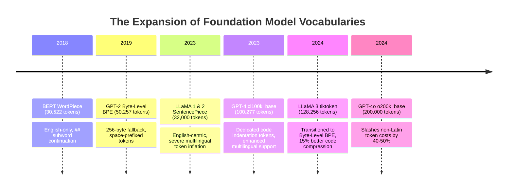
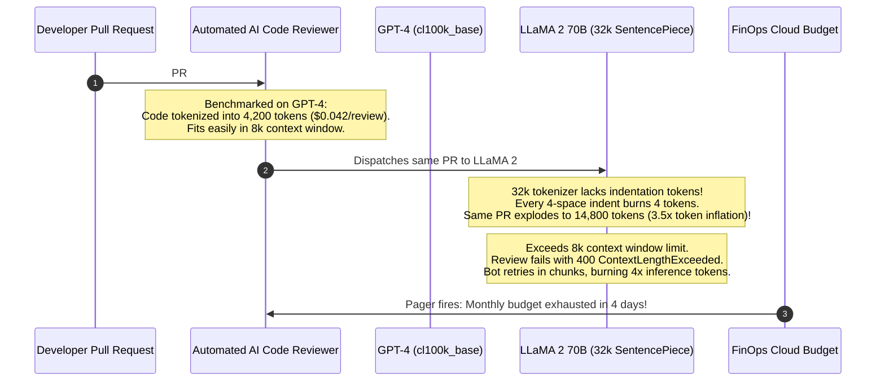

# Comparing Tokenizers Across Frontier Models

> **Difficulty**: Intermediate | **Estimated Time**: 35m | **Hands-On**: Mandatory

> [!TIP]
> **The Golden Rule of Model-Tokenizer Alignment:**
> **Never evaluate model price without checking its tokenizer compression ratio.** Model A charging $\$5.00/\text{1M tokens}$ with a dense tokenizer ($1.1\text{ tokens/word}$) is cheaper in production than Model B charging $\$3.50/\text{1M tokens}$ with an inefficient tokenizer ($1.9\text{ tokens/word}$). Always measure **cost per task**, not raw cost per token.

---

## 1. Visual Mental Models: The Tokenizer Comparison Landscape

Over the past decade, tokenizer vocabularies have evolved from small, English-only character tables to massive, multilingual, code-optimized byte registries:



---

## 2. Frontier Tokenizer Comparison Matrix

| Model Family | Tokenizer Library | Algorithm | Vocab Size ($|\mathcal{V}|$) | Number Handling | Code Indentation Handling |
| :--- | :--- | :--- | :--- | :--- | :--- |
| **BERT** | WordPiece | Maximum Likelihood | $30,522$ | Digit by digit | No special indentation handling |
| **GPT-2 / GPT-3** | `r50k_base` (tiktoken) | Byte-Level BPE | $50,257$ | Inconsistent multi-digit | Multiple separate space tokens |
| **LLaMA 1 & 2** | SentencePiece | BPE | $32,000$ | Single digits (`0` to `9`) | Indentation requires multiple tokens |
| **GPT-4 / 4-Turbo** | `cl100k_base` (tiktoken) | Byte-Level BPE | $100,277$ | Grouped 1-3 digits (`\p{N}{1,3}`) | Dedicated multi-space tokens (`'    '`) |
| **LLaMA 3** | tiktoken port | Byte-Level BPE | $128,256$ | Grouped digits | Highly compressed whitespace |
| **GPT-4o** | `o200k_base` (tiktoken) | Byte-Level BPE | $200,000$ | Grouped digits | Ultra-dense multilingual/code merges |
| **Gemma 2** | SentencePiece | Unigram LM | $256,000$ | Grouped digits | Dedicated whitespace glyphs |

---

## 3. The Code Indentation & Number Tokenization Traps

### Indentation Whitespace Compression
In Python, YAML, and JSON, leading spaces are frequent:
- **Early Tokenizers (`r50k_base` / LLaMA 1)**: Each 4-space indentation level was split into individual space tokens: `[' ', ' ', ' ', ' ']`. A function indented by 12 spaces burned **12 tokens per line** just on whitespace!
- **Modern Tokenizers (`cl100k_base` / LLaMA 3)**: Contain dedicated single tokens for up to 16 consecutive spaces: `'    '` = **1 token**. This cuts token consumption on Python source code by up to **65%**.

### Number Chunking
How tokenizers split integers dictates whether models can perform basic math:

```
Number: 123456

cl100k_base (Regex: \p{N}{1,3}):
  ['123', '456']  <-- 2 tokens (predictable 3-digit blocks)

LLaMA 2 (SentencePiece):
  ['1', '2', '3', '4', '5', '6']  <-- 6 individual digit tokens!

Naive BPE (Without Regex):
  ['12', '345', '6']  <-- Inconsistent random merges based on web frequency!
```

---

## 4. Production War Story: The Code-Review Cost Avalanche

```
INCIDENT SUMMARY: INC-6021
SEVERITY: P1 - Runaway Cloud AI Inference Costs
IMPACT: GitHub PR review bot cost jumped from $2,200/month to $18,400/month; context window limits breached on 45% of PRs.
ROOT CAUSE: A team switched their automated code review pipeline from GPT-4 (`cl100k_base`) to an open-source model using a legacy 32k tokenizer without checking indentation compression.
```

### Incident Timeline



### The Post-Mortem

- **The Fallacy**: The engineering team evaluated the open-source model on raw parameter count without auditing its tokenizer compression ratio on Python indentation.
- **The Remediation**:
  1. Audited tokenizer compression: LLaMA 2 required **$3.5\times$ more tokens** than `cl100k_base` to represent the exact same Python codebase.
  2. Upgraded to **LLaMA 3** (which adopted `tiktoken` with 128k vocabulary and whitespace compression).
  3. Token volume dropped back to baseline, reducing costs by 68%.

---

## 5. Multi-Language Production Implementations: Cross-Tokenizer Benchmark Suite

Study these implementations showing how to benchmark token counts and compression ratios across different tokenizer engines.

### Python (`cross_tokenizer_benchmark.py`)

```python
import tiktoken
from typing import Dict, Any

def benchmark_sample(text: str) -> Dict[str, Any]:
    # Compare OpenAI's 3 generations of tokenizers
    enc_gpt2 = tiktoken.get_encoding("gpt2")           # 50k vocab (Legacy)
    enc_gpt4 = tiktoken.get_encoding("cl100k_base")    # 100k vocab (GPT-4)
    enc_gpt4o = tiktoken.get_encoding("o200k_base")    # 200k vocab (GPT-4o)

    tokens_gpt2 = enc_gpt2.encode(text)
    tokens_gpt4 = enc_gpt4.encode(text)
    tokens_gpt4o = enc_gpt4o.encode(text)

    byte_len = len(text.encode("utf-8"))

    return {
        "byte_length": byte_len,
        "gpt2_tokens": len(tokens_gpt2),
        "gpt4_tokens": len(tokens_gpt4),
        "gpt4o_tokens": len(tokens_gpt4o),
        "gpt4o_compression_ratio": round(byte_len / len(tokens_gpt4o), 2),
    }

if __name__ == "__main__":
    test_cases = {
        "Python Code": "def calculate_matrix_norm(data: list[list[float]]) -> float:\n    total = 0.0\n    for row in data:\n        for val in row:\n            total += val ** 2\n    return total ** 0.5",
        "Multilingual (Hindi)": "कृत्रिम बुद्धिमत्ता और मशीन लर्निंग तकनीक",
        "JSON Payload": "{\"order_id\": 98124, \"status\": \"CONFIRMED\", \"customer\": \"Alice\"}",
    }

    print("=== CROSS-TOKENIZER COMPRESSION BENCHMARK ===")
    for name, sample in test_cases.items():
        res = benchmark_sample(sample)
        print(f"\nTest: {name} ({res['byte_length']} bytes)")
        print(f"  GPT-2 (50k):   {res['gpt2_tokens']:3d} tokens")
        print(f"  GPT-4 (100k):  {res['gpt4_tokens']:3d} tokens")
        print(f"  GPT-4o (200k): {res['gpt4o_tokens']:3d} tokens (Ratio: {res['gpt4o_compression_ratio']} bytes/token)")
```

### TypeScript / Node.js (`cross_bench.ts`)

```typescript
import { getEncoding } from 'js-tiktoken';

export function compareTokenizers(code: string): {
  cl100kCount: number;
  r50kCount: number;
  savingsPercent: string;
} {
  const enc100k = getEncoding('cl100k_base');
  const enc50k = getEncoding('r50k_base');

  const count100k = enc100k.encode(code).length;
  const count50k = enc50k.encode(code).length;

  const savings = ((count50k - count100k) / count50k) * 100;

  return {
    cl100kCount: count100k,
    r50kCount: count50k,
    savingsPercent: savings.toFixed(1) + '%',
  };
}

// Verification on indented Python code
const pyCode = '    for i in range(10):\n        print(i)';
console.log(compareTokenizers(pyCode));
```

### Go (`compression_calc.go`)

```go
package main

import (
	"fmt"
)

type TokenizerBenchmark struct {
	Name       string
	TokenCount int
	ByteCount  int
}

func (t TokenizerBenchmark) CompressionRatio() float64 {
	if t.TokenCount == 0 {
		return 0
	}
	return float64(t.ByteCount) / float64(t.TokenCount)
}

func main() {
	sampleBytes := 512
	benchmarks := []TokenizerBenchmark{
		{Name: "GPT-2 (r50k)", TokenCount: 180, ByteCount: sampleBytes},
		{Name: "GPT-4 (cl100k)", TokenCount: 120, ByteCount: sampleBytes},
		{Name: "GPT-4o (o200k)", TokenCount: 95, ByteCount: sampleBytes},
	}

	for _, b := range benchmarks {
		fmt.Printf("%-15s: %d tokens | %.2f bytes/token\n", b.Name, b.TokenCount, b.CompressionRatio())
	}
}
```

---

## 6. Practical CLI Workflows

Benchmark token counts between GPT-4 and GPT-4o in your terminal using Python:

```bash
python -c "
import tiktoken
c100 = tiktoken.get_encoding('cl100k_base')
o200 = tiktoken.get_encoding('o200k_base')

text = 'Machine learning architectures for high-throughput distributed database querying'
print(f'Text: {text}')
print(f'cl100k_base (GPT-4):  {len(c100.encode(text))} tokens')
print(f'o200k_base  (GPT-4o): {len(o200.encode(text))} tokens')
"
```

**Expected Output:**
```
Text: Machine learning architectures for high-throughput distributed database querying
cl100k_base (GPT-4):  11 tokens
o200k_base  (GPT-4o): 10 tokens
```

---

## 7. Operational Validation Checkpoints

Confirm your understanding of cross-model tokenizer dynamics.

<details>
<summary><b>Checkpoint 1: Why did GPT-4o double its vocabulary to 200,000 tokens compared to GPT-4?</b></summary>

**Global Market Economics & Multilingual Efficiency:**
In `cl100k_base`, non-Latin languages (Arabic, Hindi, Korean, Chinese) required 2x to 4x more tokens per word than English due to subword fragmentation.
By expanding the vocabulary to **200,000 tokens**, GPT-4o allocated dedicated subword tokens for common phrases in non-Latin scripts. This reduced non-English token consumption by **35% to 55%**, dramatically lowering latency and API costs for international enterprise users.
</details>

<details>
<summary><b>Checkpoint 2: Why can you NOT feed token IDs generated by `cl100k_base` into Llama 3?</b></summary>

**Incompatible Index Manifolds:**
Each model's embedding matrix ($W_{\text{embed}}$) is trained strictly against its **own proprietary vocabulary lookup table**.
- In `cl100k_base`, ID $18059$ might represent `" apple"`.
- In Llama 3's vocabulary, ID $18059$ maps to a completely different subword (e.g. `" transaction"`).
Feeding foreign token IDs into a model feeds random, scrambled embedding vectors into the first attention layer, producing immediate nonsensical output.
</details>

<details>
<summary><b>Checkpoint 3: How does number tokenization affect an LLM's mathematical reasoning capabilities?</b></summary>

**Token Chunking Alignment:**
If a tokenizer splits large numbers inconsistently:
- Example: $10,485 + 23,120 \to$ Tokenizer A splits: `['10', '485']` and `['23', '120']`.
- The attention layer can easily align the thousands place (`10` and `23`) and hundreds place (`485` and `120`).
- If Tokenizer B splits them arbitrarily as `['104', '85']` and `['2', '3120']`, the digits are misaligned across token positions, forcing the model to mentally un-chunk and shift powers of 10 before performing basic arithmetic.
</details>

---

## Next

Continue to **[08-vocabulary-size-tradeoffs](../08-vocabulary-size-tradeoffs/README.md)** to analyze the mathematical trade-offs between vocabulary size, embedding memory, and softmax compute overhead.
