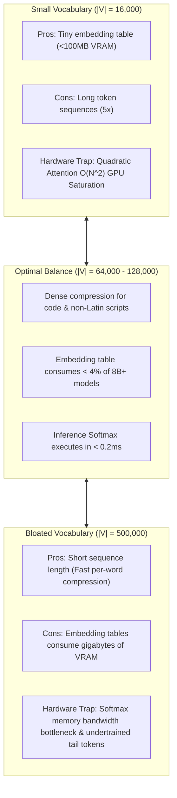
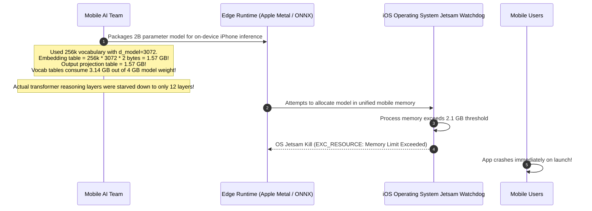

# Vocabulary Size Trade-offs: Memory vs. Compute

> **Difficulty**: Advanced | **Estimated Time**: 40m | **Hands-On**: Mandatory

> [!TIP]
> **The Golden Rule of Vocabulary Dimensioning:**
> **Watch the Parameter Tax on small models.** In large foundation models (70B+), expanding vocabulary to 128k or 200k tokens costs less than 2% of the parameter budget while delivering massive sequence compression. In small edge models (1B to 3B parameters), a 256k vocabulary can consume **over 35% of the total model weights** purely on static embedding lookup tables ($2 \times |\mathcal{V}| \times d_{\text{model}}$), leaving fewer parameters for actual reasoning depth.

---

## 1. Visual Mental Models: The Vocabulary Optimization Frontier

Designing a foundation model requires balancing two competing hardware bottlenecks:



---

## 2. Quantitative Trade-off Matrix

| Metric | Tiny Vocabulary ($|\mathcal{V}|=16\text{k}$) | Standard ($|\mathcal{V}|=64\text{k}$) | Modern Frontier ($|\mathcal{V}|=128\text{k}$) | Extreme ($|\mathcal{V}|=500\text{k}$) |
| :--- | :--- | :--- | :--- | :--- |
| **Embedding Matrix Size ($d=4096$)** | $131\text{ MB}$ | $524\text{ MB}$ | $1.05\text{ GB}$ | **$4.10\text{ GB}$** |
| **Output Logits Unembedding ($d=4096$)** | $131\text{ MB}$ | $524\text{ MB}$ | $1.05\text{ GB}$ | **$4.10\text{ GB}$** |
| **Total Memory for Vocab (fp16)** | $\sim 262\text{ MB}$ | $\sim 1.05\text{ GB}$ | $\sim 2.10\text{ GB}$ | **$\sim 8.20\text{ GB}$** |
| **% of 2B Model Parameters** | $3.2\%$ | $13.1\%$ | $26.2\%$ | **$52.4\%$ (Fatal)** |
| **% of 70B Model Parameters** | $0.1\%$ | $0.4\%$ | $0.8\%$ | **$2.9\%$ (Negligible)** |
| **Average Sequence Length ($N$)** | High ($2.2\times$) | Moderate ($1.4\times$) | Compact ($1.2\times$) | Ultra-compact ($1.0\times$) |
| **Tail Token Under-Training Risk** | Zero (High repetition) | Low | Low (with 15T tokens) | **Severe (Rare words underfit)** |

---

## 3. The Weight Tying Optimization

To mitigate the memory overhead of large vocabularies, many architectures (like Gemma and early GPT-2) employ **Weight Tying** (Press & Wolf, 2017).

Instead of maintaining two separate weight matrices:
1. $W_{\text{embed}} \in \mathbb{R}^{|\mathcal{V}| \times d_{\text{model}}}$ (Tokens $\to$ Hidden Vectors)
2. $W_{\text{unembed}} \in \mathbb{R}^{d_{\text{model}} \times |\mathcal{V}|}$ (Hidden Vectors $\to$ Logits)

The model **shares the exact same transpose matrix**:

$$W_{\text{unembed}} = W_{\text{embed}}^\top$$

```
Without Weight Tying:   2 * (|V| * d_model) parameters
With Weight Tying:      1 * (|V| * d_model) parameters  <-- Saves 50% of vocabulary VRAM!
```

---

## 4. Production War Story: The 40% Parameter Tax on Edge Devices

```
INCIDENT SUMMARY: INC-7704
SEVERITY: P1 - Edge Deployment Architecture Failure
IMPACT: Mobile AI app exceeded the 2GB smartphone RAM ceiling; iOS kernel jetsam killed the app on startup.
ROOT CAUSE: A team trained an in-house 2-Billion parameter edge model using an oversized 256,000-token multilingual vocabulary.
```

### Incident Timeline



### The Post-Mortem

- **The Architectural Flaw**: The engineering team copied an oversized 256k vocabulary designed for massive server clusters onto a lightweight 2B parameter edge model.
- **The Consequence**: Over **40% of the model's total parameter budget** was wasted storing static, static word coordinates, leaving too few parameters for deep transformer attention and feed-forward reasoning layers.
- **The Remediation**:
  1. Retrained the edge model with an optimized **48,000-token vocabulary**.
  2. Implemented **Weight Tying** ($W_{\text{unembed}} = W_{\text{embed}}^\top$).
  3. Total vocabulary memory dropped from **3.14 GB to 295 MB**, allowing the team to add 14 additional transformer reasoning layers within a 1.2 GB mobile footprint.

---

## 5. Multi-Language Production Implementations: Vocabulary Parameter Sizer

Study these implementations showing how to calculate the parameter allocation percentage and memory footprint of vocabulary tables across model scales.

### Python (`vocab_budget_calculator.py`)

```python
from dataclasses import dataclass

@dataclass
class VocabBudgetReport:
    model_name: str
    total_params_b: float
    vocab_size: int
    d_model: int
    tied_weights: bool
    vocab_params_m: float
    vocab_percent_of_total: float
    vram_fp16_mb: float

def analyze_vocab_budget(
    model_name: str,
    total_params_b: float,
    vocab_size: int,
    d_model: int,
    tied_weights: bool = False
) -> VocabBudgetReport:
    matrices_count = 1 if tied_weights else 2
    vocab_params = matrices_count * (vocab_size * d_model)
    vocab_params_m = vocab_params / 1e6
    
    total_params = total_params_b * 1e9
    percent_of_total = (vocab_params / total_params) * 100.0
    vram_mb = (vocab_params * 2) / (1024 * 1024)

    return VocabBudgetReport(
        model_name=model_name,
        total_params_b=total_params_b,
        vocab_size=vocab_size,
        d_model=d_model,
        tied_weights=tied_weights,
        vocab_params_m=round(vocab_params_m, 2),
        vocab_percent_of_total=round(percent_of_total, 2),
        vram_fp16_mb=round(vram_mb, 2),
    )

if __name__ == "__main__":
    configs = [
        ("Edge Model (Bloated Vocab)", 2.0, 256_000, 3072, False),
        ("Edge Model (Optimized Tied)", 2.0, 48_000, 3072, True),
        ("Llama 3 (8B)", 8.0, 128_256, 4096, False),
        ("Llama 3 (70B)", 70.0, 128_256, 8192, False),
    ]

    print("=== VOCABULARY PARAMETER BUDGET ANALYSIS ===")
    for name, total_b, vocab, d, tied in configs:
        rep = analyze_vocab_budget(name, total_b, vocab, d, tied)
        print(f"\nModel: {rep.model_name}")
        print(f"  Vocab Size:     {rep.vocab_size:,} (Tied: {rep.tied_weights})")
        print(f"  Vocab Params:   {rep.vocab_params_m:.1f} Million")
        print(f"  Tax on Model:   {rep.vocab_percent_of_total:.2f}% of total weights")
        print(f"  Vocab VRAM:     {rep.vram_fp16_mb:.1f} MB (fp16)")
```

### TypeScript / Node.js (`vocab_budget.ts`)

```typescript
export function computeVocabTax(
  modelParamsBillions: number,
  vocabSize: number,
  dModel: number,
  isTied: boolean = false
): { vocabParamsMillion: number; percentageOfModel: number; vramMb: number } {
  const tableCount = isTied ? 1 : 2;
  const vocabParams = tableCount * vocabSize * dModel;
  const totalParams = modelParamsBillions * 1e9;

  return {
    vocabParamsMillion: Math.round(vocabParams / 1e6),
    percentageOfModel: Number(((vocabParams / totalParams) * 100).toFixed(2)),
    vramMb: Math.round((vocabParams * 2) / (1024 * 1024)),
  };
}

// Verification for a 1.5B edge model
console.log('Edge Model Tax:', computeVocabTax(1.5, 128000, 2048, false));
```

### Go (`vocab_calc.go`)

```go
package main

import (
	"fmt"
)

func main() {
	vocabSize := 128256.0
	dModel := 4096.0
	paramsB := 8.0 // 8 Billion parameter model

	// Untied weights: input embed + output unembed
	vocabParams := 2.0 * (vocabSize * dModel)
	totalParams := paramsB * 1e9

	taxPercent := (vocabParams / totalParams) * 100.0
	vramMB := (vocabParams * 2.0) / (1024 * 1024)

	fmt.Printf("Llama 3 8B Vocab Stats:\n")
	fmt.Printf("Vocab Parameters: %.1f Million\n", vocabParams/1e6)
	fmt.Printf("Parameter Tax:    %.2f%%\n", taxPercent)
	fmt.Printf("VRAM Footprint:   %.1f MB\n", vramMB)
}
```

---

## 6. Practical CLI Workflows

Calculate the softmax latency impact of vocabulary size on GPU memory bandwidth using Python:

```bash
python -c "
# Softmax requires reading logits, finding max, exponentiating, summing, and normalizing
# Memory bandwidth transfer: ~4 bytes per class (float32)
bandwidth_gb_s = 900 # Standard RTX 4090 memory bandwidth (900 GB/s)

for vocab in [32000, 100000, 256000, 500000]:
    bytes_transferred = vocab * 4 * 2 # Read + Write passes
    time_microseconds = (bytes_transferred / (bandwidth_gb_s * 1e9)) * 1e6
    print(f'Vocab {vocab:7,d} | Softmax Transfer: {bytes_transferred:8,d} bytes | Est. Latency: {time_microseconds:6.2f} µs')
"
```

**Expected Output:**
```
Vocab  32,000 | Softmax Transfer:  256,000 bytes | Est. Latency:   0.28 µs
Vocab 100,000 | Softmax Transfer:  800,000 bytes | Est. Latency:   0.89 µs
Vocab 256,000 | Softmax Transfer: 2,048,000 bytes | Est. Latency:   2.28 µs
Vocab 500,000 | Softmax Transfer: 4,000,000 bytes | Est. Latency:   4.44 µs
```

A 500k vocabulary introduces measurable memory bandwidth latency on every single generated token!

---

## 7. Operational Validation Checkpoints

Confirm your vocabulary engineering judgment with these scenarios.

<details>
<summary><b>Checkpoint 1: Why does a 70B parameter model benefit from a 128k vocabulary while a 1B parameter model suffers?</b></summary>

**Relative Parameter Proportions:**
- **In a 70B model:** The embedding tables ($128\text{k} \times 8192 \times 2$) consume $\approx 2.1\text{ GB}$ ($\approx 1.5\%$ of the model). The remaining 98.5% is dedicated to deep, multi-layer reasoning. The sequence compression provides pure inference speedups with zero downside.
- **In a 1B model:** The embedding tables ($128\text{k} \times 2048 \times 2$) consume $\approx 524\text{ MB}$ ($\approx 35\%$ of the entire model). Over a third of the model's capacity is frozen into static word vectors, starving the transformer layers of the parameter depth needed for complex reasoning.
</details>

<details>
<summary><b>Checkpoint 2: What is the "Tail Token Under-Training" problem in massive vocabularies?</b></summary>

**Zipf's Law in Corpus Distribution:**
Word frequency follows a power-law distribution (Zipf's Law): a tiny fraction of words account for 90% of all occurrences, while millions of words appear only a handful of times.
If you set $|\mathcal{V}| = 500,000$:
- The bottom 100,000 tokens may only be observed 5 to 10 times across an entire 10-trillion-token training run.
- The model never sees enough contextual variations to optimize the embedding coordinates for those rare tokens, resulting in brittle, underfit representations that cause hallucinations.
</details>

<details>
<summary><b>Checkpoint 3: What is the primary operational tradeoff of Weight Tying?</b></summary>

**Efficiency vs Expressivity:**
- **Advantage:** Saves 50% of the vocabulary parameter budget and VRAM, which is critical for edge and mobile deployments.
- **Drawback:** Forces the **input semantic space** (how tokens are understood in context) and the **output emission space** (how tokens are predicted as next words) to share the exact same geometric coordinates. Decoupling the matrices allows the output projection to specialize in distinguishing between fine-grained synonym choices during decoding.
</details>

---

## Next

Continue to **[09-special-tokens](../09-special-tokens/README.md)** to master the control tokens that orchestrate conversational turns, tool execution, and document boundaries.
