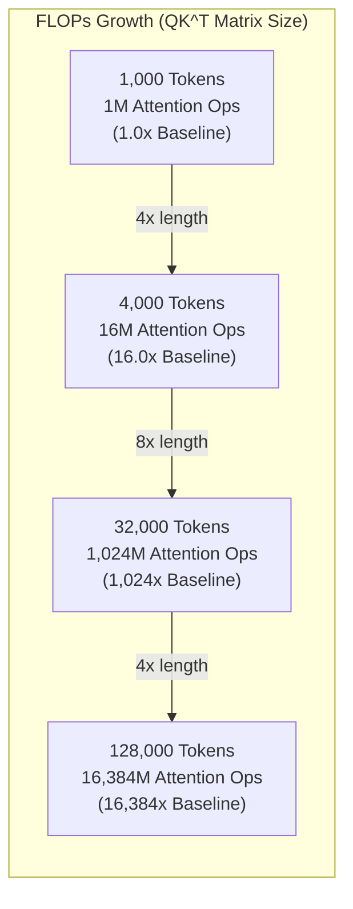
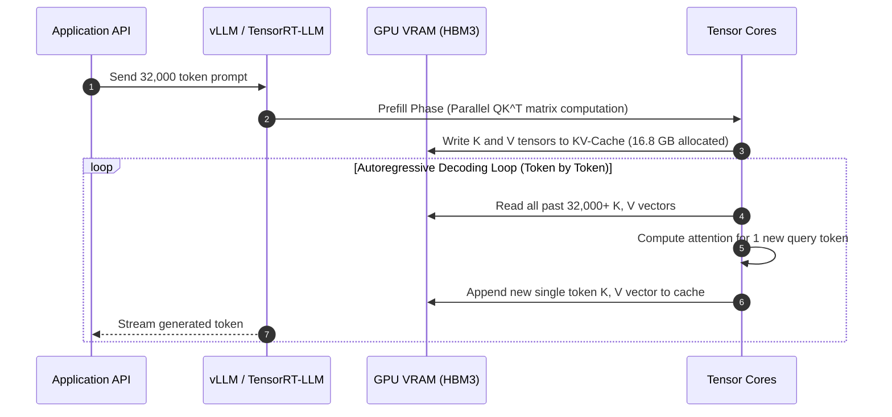
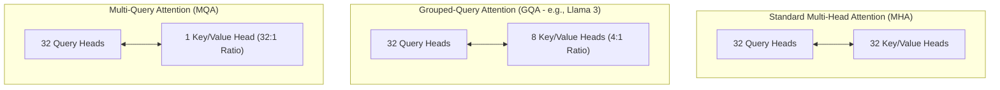
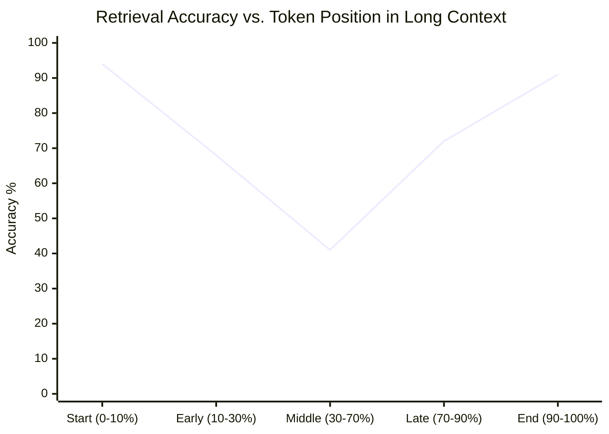
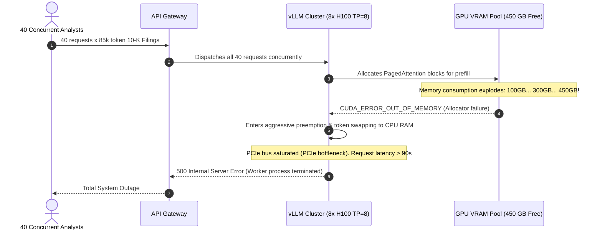

# Module 11: Context Windows Explained

> **Prerequisites:** [Module 07: Comparing Tokenizers Across Models](../07-comparing-tokenizers-across-models/README.md), [Module 08: Vocabulary Size Tradeoffs](../08-vocabulary-size-tradeoffs/README.md)  
> **Estimated Reading Time:** 25 minutes  
> **Target Audience:** AI Infrastructure Engineers, Backend Architects, LLM Performance Engineers

> [!TIP]
> **The Golden Rule of Context Windows**  
> Context window size is not merely an API limit; it is an **exponential GPU compute barrier and a linear VRAM memory trap**. Attention matrix computation scales quadratically ($\mathcal{O}(N^2)$), while Key-Value (KV) cache memory scales linearly ($\mathcal{O}(N)$) per active concurrent token. Never send unbudgeted context to an LLM: allocate fixed input reservations, budget dedicated completion headroom, and structure context to counter "Lost in the Middle" attention degradation.

---

## 1. Visual Mental Models & Computational Foundations

When querying an LLM, the "context window" encompasses the **combined sum of all input tokens plus the maximum generated output tokens**. It is a single unified sequence processed by the underlying transformer decoder.

### The Unified Token Budget

```
Total Context Window Budget (e.g., 128,000 Tokens)
┌─────────────────────────────────────────────────────────────────────────────┐
│ System Prompt │ Chat History │ RAG / Retrieved Context │ User Query │ Max New Tokens │
└─────────────────────────────────────────────────────────────────────────────┘
  ◄────────────────────────── Input Sequence ($N_{\text{in}}$) ─────────────────────────► ◄─ Completion ($N_{\text{out}}$) ─►
```

If $N_{\text{in}} + N_{\text{out}} > \text{Context Window}$, the engine either rejects the request immediately with an HTTP 400 (`context_length_exceeded`) or abruptly terminates generation mid-sentence.

---

### Why Attention Compute Scales Quadratically ($\mathcal{O}(N^2)$)

In standard multi-head self-attention, every token must compute an attention score with every previous token via the dot product of Query and Key vectors:

$$\text{Attention}(Q, K, V) = \text{softmax}\left(\frac{Q K^T}{\sqrt{d_k}}\right) V$$

The $Q K^T$ matrix has dimensions $(N \times N)$. Doubling sequence length $N$ quadruples the total scalar floating-point operations (FLOPs) required for attention:



A 128x increase in sequence length (from 1k to 128k tokens) requires **16,384x more attention operations**, necessitating hardware acceleration techniques such as FlashAttention and chunked prefill.

---

### The KV-Cache Memory Trap: Linear VRAM Consumption

During autoregressive generation, previously computed Key ($K$) and Value ($V$) activation tensors are cached in GPU High Bandwidth Memory (HBM) to avoid recomputing past tokens on every forward step.



The precise memory footprint for the KV cache across a batch is governed by the formula:

$$\text{Memory}_{\text{KV}} = 2 \times n_{\text{layers}} \times n_{\text{heads\_kv}} \times d_{\text{head}} \times N_{\text{seq}} \times B \times P_{\text{bytes}}$$

Where:
- $2$ accounts for storing both Keys and Values.
- $n_{\text{layers}}$ is the number of transformer layers.
- $n_{\text{heads\_kv}}$ is the number of KV attention heads (reduced via Grouped-Query Attention).
- $d_{\text{head}}$ is the projection dimension per head (typically 128).
- $N_{\text{seq}}$ is the sequence length (tokens).
- $B$ is the concurrent batch size.
- $P_{\text{bytes}}$ is the floating-point precision ($2$ for FP16/BF16, $1$ for FP8).

---

## 2. Attention Architecture & KV-Cache Sizing Grid

Modern architectures utilize **Grouped-Query Attention (GQA)** or **Multi-Query Attention (MQA)** to compress the KV cache by an order of magnitude compared to legacy **Multi-Head Attention (MHA)**:



### Production Model KV-Cache Sizing (per Single Stream at FP16)

| Model Name | Parameters | Attention Type | Layers | KV Heads | Head Dim | KV Cache (4k Tokens) | KV Cache (32k Tokens) | KV Cache (128k Tokens) | Max Concurrent 128k Streams on 80GB H100* |
| :--- | :--- | :--- | :--- | :--- | :--- | :--- | :--- | :--- | :--- |
| **Legacy Llama-2-70B** | 70B | MHA | 80 | 64 | 128 | 5.24 GB | 41.94 GB | **167.7 GB** | 0 (Exceeds Single GPU) |
| **Llama-3.1-8B** | 8B | GQA (8:1) | 32 | 8 | 128 | 0.26 GB | 2.10 GB | **8.39 GB** | ~6 streams |
| **Llama-3.1-70B** | 70B | GQA (8:1) | 80 | 8 | 128 | 0.65 GB | 5.24 GB | **20.97 GB** | ~2 streams (after weights) |
| **Mistral-NeMo-12B** | 12B | GQA (4:1) | 40 | 8 | 128 | 0.33 GB | 2.62 GB | **10.49 GB** | ~4 streams |
| **Qwen-2.5-72B** | 72B | GQA (8:1) | 80 | 8 | 128 | 0.65 GB | 5.24 GB | **20.97 GB** | ~2 streams |

*\*Assuming model weights are sharded or offloaded, leaving remaining VRAM for KV-cache blocks managed via PagedAttention.*

---

## 3. Positional Degradation: The "Lost in the Middle" Effect

Empirical research (Liu et al., 2023) proves that transformer attention is **not uniformly distributed across long contexts**. Accuracy forms a characteristic U-shaped curve:



### Architectural Placement Strategy
- **Prompt Primacy:** Place core system instructions, security guardrails, and role definitions at the absolute beginning ($0\%\text{--}10\%$).
- **Prompt Recency:** Place the direct user question and immediate task execution instructions at the absolute end ($90\%\text{--}100\%$).
- **Middle Insulation:** Place large, semi-structured reference documents, logs, or secondary conversation history in the middle ($30\%\text{--}70\%$), knowing that recall on nuanced details buried here drops significantly without explicit chain-of-thought retrieval prompts.

---

## 4. Production War Stories: Incident Post-Mortem

### The 128k OOM Meltdown on H100 Cluster

- **Severity:** P0 (Total LLM Serving Outage)
- **Time to Detect:** 8 minutes
- **Impact:** 100% of API inference queries failed across 14 enterprise microservices; GPU nodes hard-crashed with CUDA out-of-memory kernel panics.

#### What Happened
A financial intelligence platform rolled out a feature allowing users to analyze quarterly 10-K SEC filings (~85,000 tokens) using `Llama-3.1-70B-Instruct` served on an 8x NVIDIA H100 (80GB SXM5) cluster via vLLM.

Engineers configured max model sequence length to 131,072 (`max_model_len: 131072`), but left default concurrency settings (`max_num_seqs: 256`). When market markets opened, 40 financial analysts simultaneously submitted 80k-token reports. 

While the model weights occupied 140 GB across the 8 GPUs (via Tensor Parallelism $TP=8$, ~17.5 GB/GPU), the incoming concurrent requests each demanded ~14 GB of KV-cache memory. 40 concurrent requests required:

$$40 \times 14\text{ GB} = 560\text{ GB of KV Cache}$$

Across the cluster's available KV-cache pool (~450 GB), VRAM was completely exhausted within 4 seconds. The vLLM paging subsystem encountered memory starvation, leading to emergency preemption loops, latency spikes from 800ms to 94 seconds, and eventually an unrecoverable CUDA driver crash.

#### The Failure Sequence Diagram



#### The Fix & Architectural Hardening
1. **Strict Context-Aware Concurrency Limits:** Configured `vllm --max-num-batched-tokens 8192` to enforce chunked prefill, preventing memory spikes during prompt evaluation.
2. **Dynamic KV-Cache Throttling:** Capped `max_num_seqs` to 8 for long-context (>32k) routes, routing short-context requests to a separate dedicated pool.
3. **Upstream Token Pre-flight Budgeting:** The API Gateway now calculates precise token budgets using local tokenizers before dispatching requests, rejecting or queuing payloads that exceed provisioned concurrency slots.

---

## 5. Multi-Language Production Implementations

### Go: Context Window Budget Manager & KV-Cache Sizer

```go
// Package contextmgr implements token budgeting, KV cache VRAM estimation,
// and conversational history pruning for high-scale LLM microservices.
package main

import (
	"errors"
	"fmt"
)

// AttentionType defines the KV projection architecture.
type AttentionType string

const (
	AttentionMHA AttentionType = "MHA" // Multi-Head Attention
	AttentionGQA AttentionType = "GQA" // Grouped-Query Attention
	AttentionMQA AttentionType = "MQA" // Multi-Query Attention
)

// ModelArchitecture contains structural parameters needed for KV-cache sizing.
type ModelArchitecture struct {
	Name          string
	ContextWindow int
	NumLayers     int
	NumHeads      int
	NumKVHeads    int
	HeadDim       int
	BytesPerParam int // 2 for FP16/BF16, 1 for FP8
}

// TokenBudget allocates strict limits for conversational elements.
type TokenBudget struct {
	MaxContextWindow int
	ReservedOutput   int
	SystemPrompt     int
	MaxHistory       int
	MaxRetrieval     int
}

// CalculateKVCacheBytes calculates exact VRAM usage for a given sequence length and batch size.
func (m *ModelArchitecture) CalculateKVCacheBytes(seqLen int, batchSize int) int64 {
	// Formula: 2 * layers * kv_heads * head_dim * seq_len * batch * bytes_per_param
	total := int64(2) * int64(m.NumLayers) * int64(m.NumKVHeads) * int64(m.HeadDim) * 
		int64(seqLen) * int64(batchSize) * int64(m.BytesPerParam)
	return total
}

// ContextManager handles conversational budgeting and safe truncation.
type ContextManager struct {
	budget TokenBudget
}

func NewContextManager(budget TokenBudget) *ContextManager {
	return &ContextManager{budget: budget}
}

// MessageTurn represents a single conversational message with token count.
type MessageTurn struct {
	Role       string
	Content    string
	TokenCount int
}

// PruneConversation applies FIFO sliding-window pruning to fit within budget.
func (cm *ContextManager) PruneConversation(
	systemTokens int,
	history []MessageTurn,
	queryTokens int,
	retrievalTokens int,
) ([]MessageTurn, error) {
	availableForHistory := cm.budget.MaxContextWindow - 
		(cm.budget.ReservedOutput + systemTokens + queryTokens + retrievalTokens)

	if availableForHistory < 0 {
		return nil, errors.New("static components (system + retrieval + query + output) exceed context window")
	}

	// Work backwards from the most recent message (preserving recency)
	var preserved []MessageTurn
	currentTokens := 0

	for i := len(history) - 1; i >= 0; i-- {
		turn := history[i]
		if currentTokens+turn.TokenCount <= availableForHistory {
			preserved = append([]MessageTurn{turn}, preserved...)
			currentTokens += turn.TokenCount
		} else {
			// Older messages are dropped
			break
		}
	}

	return preserved, nil
}

func main() {
	llama3_70b := ModelArchitecture{
		Name:          "Llama-3.1-70B",
		ContextWindow: 131072,
		NumLayers:     80,
		NumHeads:      64,
		NumKVHeads:    8, // GQA 8:1
		HeadDim:       128,
		BytesPerParam: 2, // FP16
	}

	seqLen := 128000
	batchSize := 4
	kvBytes := llama3_70b.CalculateKVCacheBytes(seqLen, batchSize)
	fmt.Printf("Model: %s\n", llama3_70b.Name)
	fmt.Printf("KV Cache Footprint for %d tokens across batch %d: %.2f GB\n", 
		seqLen, batchSize, float64(kvBytes)/(1024*1024*1024))

	budget := TokenBudget{
		MaxContextWindow: 32768,
		ReservedOutput:   4096,
		SystemPrompt:     1000,
		MaxRetrieval:     12000,
	}

	cm := NewContextManager(budget)
	history := []MessageTurn{
		{Role: "user", Content: "First message", TokenCount: 5000},
		{Role: "assistant", Content: "First reply", TokenCount: 6000},
		{Role: "user", Content: "Recent message", TokenCount: 3000},
	}

	pruned, err := cm.PruneConversation(1000, history, 1500, 12000)
	if err != nil {
		fmt.Printf("Error: %v\n", err)
		return
	}
	fmt.Printf("Retained %d of %d turns in conversation history.\n", len(pruned), len(history))
}
```

---

### Node.js / TypeScript: Sliding-Window Context Orchestrator

```typescript
// contextWindowManager.ts
// Production TypeScript context budget manager with character-to-token profiling and sliding window.

export interface ChatTurn {
  role: 'system' | 'user' | 'assistant';
  content: string;
  estimatedTokens?: number;
}

export interface ContextWindowConfig {
  maxContextTokens: number;
  maxOutputTokens: number;
  safetyMarginTokens: number;
}

export class ContextWindowManager {
  private config: ContextWindowConfig;

  constructor(config: ContextWindowConfig) {
    this.config = config;
  }

  /**
   * Fast rule-of-thumb estimator.
   * Note: In production, substitute with exact WASM tokenizer (e.g. @dqbd/tiktoken).
   */
  public estimateTokens(text: string): number {
    if (!text) return 0;
    // English prose averages ~4 chars per token; code/json averages ~3 chars per token
    const isCodeOrJson = /[{}[\]:;<>]/.test(text);
    const charsPerToken = isCodeOrJson ? 3.2 : 4.0;
    return Math.ceil(text.length / charsPerToken);
  }

  /**
   * Enforces strict context budget allocation and trims old conversation history.
   */
  public allocateContext(
    systemPrompt: string,
    history: ChatTurn[],
    userQuery: string,
    ragContext: string
  ): {
    system: string;
    trimmedHistory: ChatTurn[];
    userTurn: string;
    totalTokens: number;
    headroomRemaining: number;
  } {
    const systemTokens = this.estimateTokens(systemPrompt);
    const userTokens = this.estimateTokens(userQuery);
    const ragTokens = this.estimateTokens(ragContext);

    // Compute hard ceiling for input components
    const maxAvailableInput =
      this.config.maxContextTokens -
      this.config.maxOutputTokens -
      this.config.safetyMarginTokens;

    const baseRequiredTokens = systemTokens + userTokens + ragTokens;

    if (baseRequiredTokens > maxAvailableInput) {
      throw new Error(
        `Critical: Core components (${baseRequiredTokens} tokens) exceed max allowed input (${maxAvailableInput} tokens).`
      );
    }

    const historyBudget = maxAvailableInput - baseRequiredTokens;
    const trimmedHistory: ChatTurn[] = [];
    let accumulatedHistoryTokens = 0;

    // Preserve recent conversational turns (reverse FIFO)
    for (let i = history.length - 1; i >= 0; i--) {
      const turn = history[i];
      const tokens = turn.estimatedTokens ?? this.estimateTokens(turn.content);

      if (accumulatedHistoryTokens + tokens <= historyBudget) {
        trimmedHistory.unshift({ ...turn, estimatedTokens: tokens });
        accumulatedHistoryTokens += tokens;
      } else {
        break; // Drop older context
      }
    }

    // Position RAG context according to "Lost in the Middle" mitigation
    // We append RAG context directly preceding the immediate user turn
    const combinedUserTurn = `Reference Context:\n${ragContext}\n\nUser Question:\n${userQuery}`;

    const totalInputTokens =
      systemTokens + accumulatedHistoryTokens + this.estimateTokens(combinedUserTurn);
    const headroomRemaining =
      this.config.maxContextTokens - totalInputTokens - this.config.maxOutputTokens;

    return {
      system: systemPrompt,
      trimmedHistory,
      userTurn: combinedUserTurn,
      totalTokens: totalInputTokens,
      headroomRemaining,
    };
  }
}

// Execution and Verification
const manager = new ContextWindowManager({
  maxContextTokens: 8192,
  maxOutputTokens: 1024,
  safetyMarginTokens: 256,
});

const system = "You are a customer technical support bot.";
const userQ = "Why is my database replication lagging?";
const rag = "Runbook 402: Check Postgres pg_stat_replication and replication slot lag bytes.";
const mockHistory: ChatTurn[] = [
  { role: 'user', content: 'Hello there' },
  { role: 'assistant', content: 'Hello! How can I assist you with your infrastructure today?' },
  { role: 'user', content: 'I am seeing high disk IO on primary' },
  { role: 'assistant', content: 'Check WAL write throughput and checkpoint frequency.' },
];

const allocation = manager.allocateContext(system, mockHistory, userQ, rag);
console.log('--- CONTEXT ALLOCATION REPORT ---');
console.log(`Retained History Turns: ${allocation.trimmedHistory.length}`);
console.log(`Total Projected Input Tokens: ${allocation.totalTokens}`);
console.log(`Guaranteed Completion Headroom: ${allocation.headroomRemaining}`);
```

---

### Python: High-Precision GPU Memory & KV-Cache Allocation Simulator

```python
"""
kv_cache_simulator.py
Calculates exact KV-Cache memory consumption, PagedAttention block requirements,
and quadratic attention FLOPs across leading open-source model architectures.
"""

from dataclasses import dataclass
import math

@dataclass
class ArchitectureSpec:
    name: str
    num_layers: int
    num_heads: int
    num_kv_heads: int
    head_dim: int
    precision_bytes: int  # 2 for FP16/BF16, 1 for FP8, 0.5 for FP4
    block_size: int = 16  # PagedAttention standard block size

def calculate_kv_cache(
    spec: ArchitectureSpec, 
    seq_len: int, 
    batch_size: int = 1
) -> dict:
    """
    Computes exact KV cache bytes and PagedAttention memory allocations.
    """
    # Key + Value tensors = 2
    elements_per_token = 2 * spec.num_layers * spec.num_kv_heads * spec.head_dim
    bytes_per_token = elements_per_token * spec.precision_bytes
    total_bytes = bytes_per_token * seq_len * batch_size

    # PagedAttention block allocation calculation
    num_blocks_per_seq = math.ceil(seq_len / spec.block_size)
    bytes_per_block = spec.block_size * bytes_per_token
    total_paged_bytes = num_blocks_per_seq * bytes_per_block * batch_size

    # Attention compute operations (FLOPs for QK^T and Attention*V)
    # Scaled dot-product attention requires ~4 * num_layers * num_heads * head_dim * seq_len^2 ops
    attention_flops = 4 * spec.num_layers * spec.num_heads * spec.head_dim * (seq_len ** 2)

    return {
        "model": spec.name,
        "sequence_length": seq_len,
        "batch_size": batch_size,
        "total_gb": total_bytes / (1024 ** 3),
        "paged_gb": total_paged_bytes / (1024 ** 3),
        "attention_tera_flops": attention_flops / 1e12,
        "bytes_per_token_total": bytes_per_token
    }

def verify_production_models():
    # Model Specs
    llama3_8b = ArchitectureSpec("Llama-3.1-8B (GQA)", 32, 32, 8, 128, precision_bytes=2)
    llama3_70b = ArchitectureSpec("Llama-3.1-70B (GQA)", 80, 64, 8, 128, precision_bytes=2)
    legacy_llama2 = ArchitectureSpec("Llama-2-70B (MHA)", 80, 64, 64, 128, precision_bytes=2)

    lengths = [4096, 32768, 131072]

    print(f"{'Model':<22} | {'Tokens':<7} | {'KV Cache (GB)':<13} | {'Attn TFLOPs':<12}")
    print("-" * 62)

    for spec in [legacy_llama2, llama3_70b, llama3_8b]:
        for n in lengths:
            res = calculate_kv_cache(spec, seq_len=n, batch_size=1)
            print(f"{res['model']:<22} | {n:<7} | {res['total_gb']:<13.2f} | {res['attention_tera_flops']:<12.2f}")
        print("-" * 62)

if __name__ == "__main__":
    verify_production_models()
```

---

## 6. Practical Hands-On Verification Workflows

### Verification 1: Measuring Real Characters-Per-Token Ratios

Run this verification script to inspect how character density fluctuates between text domains:

```bash
python -c "
import tiktoken
enc = tiktoken.get_encoding('cl100k_base')

samples = {
    'English Prose': 'Large language models process input text by tokenizing words into subwords.',
    'Python Code': 'def calculate_vram(layers=32, heads=8, dim=128):\n    return layers * heads * dim * 2',
    'JSON Payload': '{\"user_id\": 10928, \"roles\": [\"admin\", \"billing\"], \"active\": true}',
    'Raw Numbers': '984712039481203948102934810293481029348'
}

for name, text in samples.items():
    tokens = enc.encode(text)
    ratio = len(text) / len(tokens)
    print(f'{name:<15}: Chars={len(text):<3} Tokens={len(tokens):<3} Ratio={ratio:.2f} chars/token')
"
```

*Expected Terminal Output:*
```text
English Prose  : Chars=75  Tokens=13  Ratio=5.77 chars/token
Python Code    : Chars=76  Tokens=21  Ratio=3.62 chars/token
JSON Payload   : Chars=69  Tokens=22  Ratio=3.14 chars/token
Raw Numbers    : Chars=39  Tokens=16  Ratio=2.44 chars/token
```

### Verification 2: Live Query of vLLM PagedAttention VRAM Utilization

When hosting open models with vLLM, query Prometheus metrics to observe real-time KV cache saturation:

```bash
curl -s http://localhost:8000/metrics | grep -E "vllm:gpu_cache_usage_factor|vllm:num_requests_waiting"
```

*Output Interpretation:*
- `vllm:gpu_cache_usage_factor`: Value between `0.0` and `1.0`. A metric of `0.95` means 95% of GPU KV blocks are claimed; incoming requests will be queued or preempted.
- `vllm:num_requests_waiting`: If greater than `0`, requests are stalling due to memory starvation.

---

## 7. Operational Validation Checkpoints

### Scenario 1: The Invisible Truncation Trap
<details>
<summary><strong>Question:</strong> A developer builds a document QA system with an LLM that has a 32,768 token limit. The input document is 30,000 tokens, the user prompt is 500 tokens, and <code>max_tokens</code> (output) is set to 4,096. When submitting the request, the API immediately throws an error. Why did this happen when the input was under 32k tokens?</summary>

**Answer:**
The context window is a **shared limit** between input tokens ($N_{\text{in}}$) and maximum requested output tokens ($N_{\text{out}}$). 

Here:
$$N_{\text{in}} = 30,000 + 500 = 30,500\text{ tokens}$$
$$N_{\text{total}} = 30,500 + 4,096 = 34,596\text{ tokens}$$

Because $34,596 > 32,768$, the total potential sequence length exceeds the context window. LLM gateways validate the *reservation* ($N_{\text{in}} + \text{max\_tokens}$) upfront before running inference. To fix this, the input document must be truncated or `max_tokens` reduced to $\le 2,268$.
</details>

### Scenario 2: The Multi-Head Attention Memory Explosion
<details>
<summary><strong>Question:</strong> An engineering team decides to fine-tune a legacy Multi-Head Attention (MHA) model with 80 layers, 64 heads, and 128 head dimension at 128k context length. When deploying 10 concurrent requests at FP16 precision, their 8x 80GB H100 cluster immediately runs out of memory. Why did GQA models not suffer this problem?</summary>

**Answer:**
Under standard MHA, there are 64 Key heads and 64 Value heads. At 128,000 tokens for 80 layers and 128 head dimension, a single request requires:

$$\text{KV Cache} = 2 \times 80 \times 64 \times 128 \times 128,000 \times 2\text{ bytes} \approx 335.5\text{ GB per sequence!}$$

10 concurrent requests would require **3.35 Terabytes** of VRAM just for the KV cache. 

Under Grouped-Query Attention (GQA) with an 8:1 compression ratio (e.g., Llama-3.1-70B), the number of KV heads drops from 64 to 8. This slashes KV cache memory by $8\times$ down to ~41.9 GB per sequence, making long-context inference viable.
</details>

### Scenario 3: Mitigating "Lost in the Middle" in RAG Systems
<details>
<summary><strong>Question:</strong> In a legal contract analysis RAG pipeline, relevant clauses extracted from 20 documents are concatenated into a single 60,000 token prompt. Analysts notice that key terms appearing in the 10th and 11th documents are regularly overlooked by the model. What architectural prompt changes resolve this without reducing document count?</summary>

**Answer:**
This is a textbook manifestation of the **"Lost in the Middle"** phenomenon: attention decay in transformer decoders degrades retrieval accuracy in the middle 30%–70% of the context window.

To resolve this:
1. **Re-rank and sandwich critical documents:** Place the highest-relevance documents at the very top (start) and very bottom (immediately preceding the user prompt).
2. **Inject structural indexing:** Add section headers and token bookmarks (e.g., `[Document 10: Section 4.2]`).
3. **Repeat user instructions at the end:** Place the exact query and required output schema at the very end of the prompt so the final attention layers attend directly to the objective before generation starts.
</details>

---

## 8. Summary & Next Steps

Context windows dictate the capacity, latency, and memory footprint of modern LLM applications. Remember:
- Context window budgets are strictly shared between inputs and max completion tokens.
- Attention FLOPs scale quadratically ($\mathcal{O}(N^2)$); KV-cache memory scales linearly ($\mathcal{O}(N)$).
- Modern GQA models compress KV-cache memory by $8\times$ compared to legacy MHA architectures.
- Information placed in the center of long contexts suffers retrieval degradation; prioritize critical instructions at the start and end.

Continue to [Module 12: Token Cost Economics](../12-token-cost-economics/README.md) to explore input/output pricing dynamics, prompt caching architectures, and financial ROI modeling.
