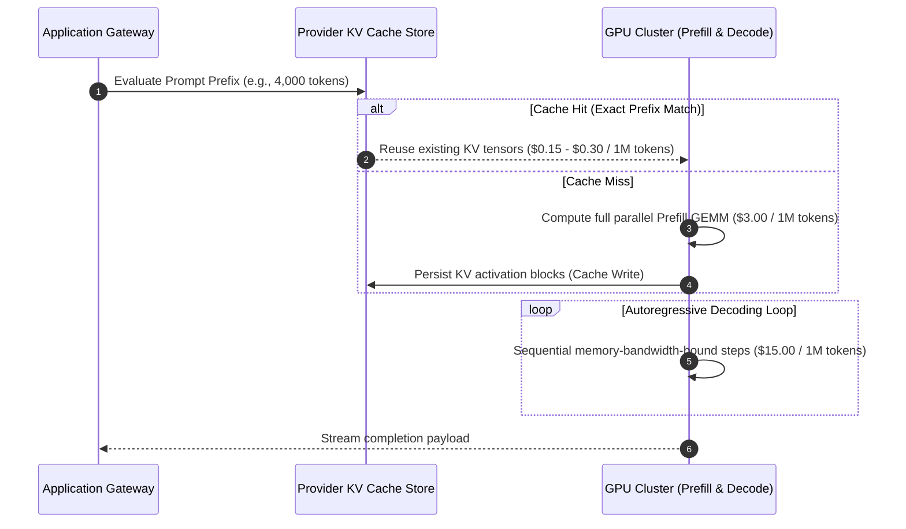
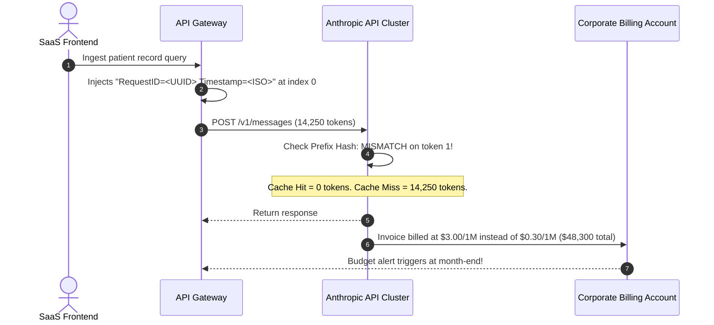

# Module 12: Token Cost Economics

> **Prerequisites:** [Module 07: Comparing Tokenizers Across Models](../07-comparing-tokenizers-across-models/README.md), [Module 11: Context Windows Explained](../11-context-windows-explained/README.md)  
> **Estimated Reading Time:** 25 minutes  
> **Target Audience:** AI Platform Architects, FinOps Engineers, Backend Engineering Leads

> [!TIP]
> **The Golden Rule of Token Cost Economics**  
> Output tokens cost **3x to 5x more than input tokens**, but **prompt caching can slash input costs by up to 90%**. Financial optimization is an architectural discipline: enforce strict prefix stability to preserve KV-cache hits, constrain output verbosity through rigid schemas, and offload asynchronous background tasks to 50%-discounted Batch APIs.

---

## 1. Visual Mental Models & Billing Mechanics

Every major LLM API (OpenAI, Anthropic, Google Cloud Vertex, DeepSeek) bills using an asymmetric formula:

$$\text{Total Cost} = \left(N_{\text{uncached\_in}} \times P_{\text{in}}\right) + \left(N_{\text{cached\_in}} \times P_{\text{cached}}\right) + \left(N_{\text{out}} \times P_{\text{out}}\right)$$

Where $P_{\text{out}} \gg P_{\text{in}} > P_{\text{cached}}$.

### Why Output Tokens Cost 3x to 5x More Than Input Tokens

The fundamental driver of price asymmetry is GPU hardware physics:
1. **Input Phase (Prefill):** The prompt is ingested in parallel. Tensor Cores execute large matrix-matrix multiplications ($GEMM$), achieving high compute saturation (~60% MFU - Model FLOPs Utilization).
2. **Output Phase (Decoding):** Tokens are generated one by one autoregressively. Each step loads gigabytes of model weights from GPU HBM into SRAM to generate a single token, operating strictly in a memory-bandwidth-bound regime (low MFU, high latency).



---

## 2. Prompt Caching: The Prefix-Match Requirement

Prompt caching achieves up to 90% cost reduction by reusing pre-computed KV-cache activation states across consecutive API requests. However, modern attention caches enforce an **exact prefix match**:

```mermaid
flowchart TD
    subgraph Optimal_Caching["Optimal Prompt Layout (Cache HIT)"]
        O1["[1. Stable System Prompt (2,500 Tokens)]"]
        O2["[2. Fixed Few-Shot Examples (1,500 Tokens)]"]
        O3["[3. Reused RAG Document (8,000 Tokens)]"]
        O4["[4. Dynamic User Query (150 Tokens)]"]
        O1 --> O2 --> O3 --> O4
    end

    subgraph Broken_Caching["Broken Prompt Layout (Cache MISS - 100% Reprocessed)"]
        B1["[1. Dynamic Timestamp / Session ID (20 Tokens)]"]
        B2["[2. Stable System Prompt (2,500 Tokens)]"]
        B3["[3. Fixed Few-Shot Examples (1,500 Tokens)]"]
        B4["[4. Reused RAG Document (8,000 Tokens)]"]
        B1 --> B2 --> B3 --> B4
    end
```



> [!WARNING]
> Placing dynamic content (such as a current timestamp, random request UUID, or per-user personalization header) at the top of a prompt instantly invalidates the cache for all subsequent tokens, forcing the provider to recompute and bill the entire sequence at full price.

---

## 3. Financial Comparison & Provider Pricing Taxonomy

*Pricing structures reflect standard industry rates (per 1,000,000 tokens) across leading frontier models:*

| Provider & Model | Standard Input (per 1M) | Cached Input (per 1M) | Cache Discount % | Output Tokens (per 1M) | Batch API Discount | Output-to-Input Ratio |
| :--- | :--- | :--- | :--- | :--- | :--- | :--- |
| **OpenAI GPT-4o** | \$2.50 | \$1.25 | **50%** | \$10.00 | 50% Off | **4.0x** |
| **OpenAI GPT-4o-mini** | \$0.15 | \$0.075 | **50%** | \$0.60 | 50% Off | **4.0x** |
| **Anthropic Claude 3.5 Sonnet** | \$3.00 | \$0.30 | **90%** | \$15.00 | 50% Off | **5.0x** |
| **Google Gemini 1.5 Pro** | \$3.50 | \$0.875 | **75%** | \$10.50 | 50% Off | **3.0x** |
| **DeepSeek-V3** | \$0.14 | \$0.014 | **90%** | \$0.28 | N/A | **2.0x** |

---

## 4. Production War Stories: Incident Post-Mortem

### The \$42,000 Dynamic Timestamp Prompt Caching Blunder

- **Severity:** P1 (Massive Financial Budget Depletion)
- **Time to Detect:** 21 days (discovered upon monthly billing invoice review)
- **Impact:** \$42,300 in unexpected cloud API billing; cash runway consumed ahead of investor milestone.

#### What Happened
A healthcare workflow SaaS platform processed 12,000,000 patient records per month. Each call evaluated a large clinical protocol document (14,000 tokens) against a concise doctor visit summary (250 tokens). The engineering team selected Claude 3.5 Sonnet, expecting Anthropic's 90% prompt-caching discount to keep monthly input costs under \$6,000.

During a routine observability sprint, a junior backend engineer added audit tracking metadata directly into the first line of the system prompt:

```typescript
// INADVERTENT CACHE-BUSTING BUG:
const prompt = `System Audit: RequestID=${crypto.randomUUID()} Timestamp=${new Date().toISOString()}\n\n` + CLINICAL_PROTOCOL;
```

Because `crypto.randomUUID()` and the timestamp changed on every single request, the prompt prefix was never identical across calls. The provider cache hit rate plummeted from **91.4% to 0.0%**. Every request was billed at the full \$3.00/1M rate instead of the \$0.30/1M cached rate.

#### The Failure Sequence Diagram



#### The Fix & Architectural Hardening
1. **Prefix Inversion:** Dynamic metadata was stripped from the prompt prefix and shifted into API request metadata headers (`metadata: { request_id: ... }`).
2. **Explicit Cache Breakpoint Headers:** Re-architected system messages using Anthropic's `cache_control: {"type": "ephemeral"}` blocks on strictly immutable content blocks.
3. **CI/CD Cache-Hit Rate Alerts:** Added Prometheus alerting monitoring the ratio of `cache_read_input_tokens / (cache_read_input_tokens + cache_creation_input_tokens)`. If the cache hit ratio falls below 80%, an automated P2 alert fires.

---

## 5. Multi-Language Production Implementations

### Go: Production Token Economics Engine & Cache-Aware Cost Tracker

```go
// Package costengine provides high-precision LLM unit economic modeling,
// cache hit valuation, and billing projections.
package main

import (
	"errors"
	"fmt"
)

// PricingTier holds rates per 1 Million tokens.
type PricingTier struct {
	ModelName      string
	UncachedInput  float64 // USD per 1M tokens
	CachedInput    float64 // USD per 1M tokens
	OutputRate     float64 // USD per 1M tokens
	BatchDiscount  float64 // Multiplier (e.g. 0.50 for 50% discount)
}

// RequestUsage contains token execution metrics returned by the LLM provider.
type RequestUsage struct {
	UncachedInputTokens int
	CachedInputTokens   int
	OutputTokens        int
	IsBatchJob          bool
}

// CostEngine manages cost calculations and budgetary assertions.
type CostEngine struct {
	tiers map[string]PricingTier
}

func NewCostEngine() *CostEngine {
	return &CostEngine{
		tiers: map[string]PricingTier{
			"claude-3-5-sonnet": {
				ModelName:     "Claude 3.5 Sonnet",
				UncachedInput: 3.00,
				CachedInput:   0.30,
				OutputRate:    15.00,
				BatchDiscount: 0.50,
			},
			"gpt-4o": {
				ModelName:     "GPT-4o",
				UncachedInput: 2.50,
				CachedInput:   1.25,
				OutputRate:    10.00,
				BatchDiscount: 0.50,
			},
		},
	}
}

// CalculateCost computes exact USD cost for an individual API transaction.
func (ce *CostEngine) CalculateCost(modelKey string, usage RequestUsage) (float64, error) {
	tier, ok := ce.tiers[modelKey]
	if !ok {
		return 0, errors.New("unknown model pricing tier")
	}

	uncachedCost := (float64(usage.UncachedInputTokens) / 1_000_000.0) * tier.UncachedInput
	cachedCost := (float64(usage.CachedInputTokens) / 1_000_000.0) * tier.CachedInput
	outputCost := (float64(usage.OutputTokens) / 1_000_000.0) * tier.OutputRate

	total := uncachedCost + cachedCost + outputCost

	if usage.IsBatchJob {
		total *= tier.BatchDiscount
	}

	return total, nil
}

func main() {
	engine := NewCostEngine()

	// Simulating 10,000 tokens system/RAG prompt + 500 token completion
	scenarioCached := RequestUsage{
		UncachedInputTokens: 250,
		CachedInputTokens:   10000,
		OutputTokens:        500,
		IsBatchJob:          false,
	}

	scenarioUncached := RequestUsage{
		UncachedInputTokens: 10250,
		CachedInputTokens:   0,
		OutputTokens:        500,
		IsBatchJob:          false,
	}

	costCached, _ := engine.CalculateCost("claude-3-5-sonnet", scenarioCached)
	costUncached, _ := engine.CalculateCost("claude-3-5-sonnet", scenarioUncached)

	fmt.Printf("Single Request (Optimized Cache Hit):   $%.6f USD\n", costCached)
	fmt.Printf("Single Request (Broken Cache Miss):    $%.6f USD\n", costUncached)
	fmt.Printf("Cost Multiplier for Cache Miss:        %.2fx\n", costUncached/costCached)

	// Monthly at 1,000,000 requests/month
	fmt.Printf("\nMonthly Projection (1M Requests):\n")
	fmt.Printf("Optimized Cache:   $%,.2f / month\n", costCached*1_000_000)
	fmt.Printf("Uncached / Misses: $%,.2f / month\n", costUncached*1_000_000)
}
```

---

### Node.js / TypeScript: Prompt Cache Alignment & Financial Simulator

```typescript
// promptCacheOptimizer.ts
// Enforces stable prefix ordering and simulates ROI for Anthropic and OpenAI prompt caching.

export interface PromptPayload {
  stableSystemInstructions: string;
  reusableContextDocuments: string[];
  dynamicTimestamp?: string;
  dynamicSessionId?: string;
  userQuestion: string;
}

export interface CacheAnalysisResult {
  formattedPrompt: string;
  cacheablePrefixTokens: number;
  dynamicTokens: number;
  isPrefixPreserved: boolean;
}

export class PromptCacheOptimizer {
  /**
   * Constructs prompts with guaranteed prefix stability to preserve KV cache hits.
   * Dynamic parameters are isolated strictly to the suffix of the prompt.
   */
  public static assemblePrompt(payload: PromptPayload): CacheAnalysisResult {
    const stablePrefixBlocks: string[] = [
      payload.stableSystemInstructions,
      ...payload.reusableContextDocuments,
    ];

    const stablePrefix = stablePrefixBlocks.join('\n\n');

    // Dynamic components must NEVER be placed ahead of the stable prefix
    const dynamicSuffixBlocks: string[] = [
      `User Query: ${payload.userQuestion}`,
    ];

    if (payload.dynamicTimestamp || payload.dynamicSessionId) {
      dynamicSuffixBlocks.push(
        `[Session Metadata: id=${payload.dynamicSessionId ?? 'N/A'}, time=${payload.dynamicTimestamp ?? 'N/A'}]`
      );
    }

    const dynamicSuffix = dynamicSuffixBlocks.join('\n');
    const fullPrompt = `${stablePrefix}\n\n---\n\n${dynamicSuffix}`;

    // Approximate token counts (4 chars per token rule-of-thumb)
    const cacheablePrefixTokens = Math.ceil(stablePrefix.length / 4.0);
    const dynamicTokens = Math.ceil(dynamicSuffix.length / 4.0);

    return {
      formattedPrompt: fullPrompt,
      cacheablePrefixTokens,
      dynamicTokens,
      isPrefixPreserved: true,
    };
  }

  /**
   * Models the financial impact of cache hit rates across a 30-day projection.
   */
  public static simulateMonthlyCost(
    requestsPerDay: number,
    prefixTokens: number,
    outputTokens: number,
    cacheHitRatio: number,
    rateUncachedPer1M: number = 3.0,
    rateCachedPer1M: number = 0.30,
    rateOutputPer1M: number = 15.0
  ): { totalCostUSD: number; savingsVsUncachedUSD: number } {
    const totalRequests = requestsPerDay * 30;

    const cachedCalls = totalRequests * cacheHitRatio;
    const uncachedCalls = totalRequests * (1 - cacheHitRatio);

    const inputCostCached = (cachedCalls * prefixTokens / 1_000_000) * rateCachedPer1M;
    const inputCostUncached = (uncachedCalls * prefixTokens / 1_000_000) * rateUncachedPer1M;
    const outputCost = (totalRequests * outputTokens / 1_000_000) * rateOutputPer1M;

    const totalCostUSD = inputCostCached + inputCostUncached + outputCost;

    const zeroCacheCost =
      (totalRequests * prefixTokens / 1_000_000) * rateUncachedPer1M + outputCost;

    return {
      totalCostUSD,
      savingsVsUncachedUSD: zeroCacheCost - totalCostUSD,
    };
  }
}

// Execution and Verification
const sample = PromptCacheOptimizer.assemblePrompt({
  stableSystemInstructions: "You are an enterprise legal reasoning AI. Adhere strictly to ISO-27001.",
  reusableContextDocuments: ["Master Service Agreement Terms... (12,000 words)"],
  dynamicTimestamp: new Date().toISOString(),
  dynamicSessionId: "sess_99812",
  userQuestion: "Does Section 4 allow termination for convenience?",
});

console.log("--- PROMPT STRUCTURE VERIFICATION ---");
console.log(`Cacheable Prefix Tokens: ~${sample.cacheablePrefixTokens}`);
console.log(`Dynamic Suffix Tokens:   ~${sample.dynamicTokens}`);

const financialSim = PromptCacheOptimizer.simulateMonthlyCost(
  50_000, // 50k requests / day
  8_000,  // 8k token prompt
  400,    // 400 token reply
  0.85    // 85% cache hit rate
);

console.log("\n--- MONTHLY FINANCIAL PROJECTION ---");
console.log(`Projected 30-Day Cost: $${financialSim.totalCostUSD.toLocaleString('en-US', { minimumFractionDigits: 2 })}`);
console.log(`Prompt Caching Net Savings: $${financialSim.savingsVsUncachedUSD.toLocaleString('en-US', { minimumFractionDigits: 2 })}`);
```

---

### Python: Real-Time Token Cost & Provider Telemetry Collector

```python
"""
token_cost_telemetry.py
Parses OpenAI and Anthropic API response headers/objects to track real-time cost,
cache-hit efficiency, and output-to-input spending ratios.
"""

from typing import Dict, Any

class TokenCostTracker:
    def __init__(self):
        # Pricing per 1M tokens
        self.PRICING = {
            "gpt-4o": {
                "input": 2.50,
                "cached_input": 1.25,
                "output": 10.00
            },
            "claude-3-5-sonnet": {
                "input": 3.00,
                "cached_input": 0.30,
                "output": 15.00
            }
        }

    def evaluate_openai_response(self, response_usage: Dict[str, Any], model: str = "gpt-4o") -> Dict[str, float]:
        """
        Parses OpenAI usage object including prompt_tokens_details.cached_tokens.
        """
        pricing = self.PRICING[model]
        total_prompt = response_usage.get("prompt_tokens", 0)
        details = response_usage.get("prompt_tokens_details", {})
        cached_tokens = details.get("cached_tokens", 0)
        uncached_tokens = total_prompt - cached_tokens
        completion_tokens = response_usage.get("completion_tokens", 0)

        cost_uncached = (uncached_tokens / 1_000_000.0) * pricing["input"]
        cost_cached = (cached_tokens / 1_000_000.0) * pricing["cached_input"]
        cost_output = (completion_tokens / 1_000_000.0) * pricing["output"]
        total_cost = cost_uncached + cost_cached + cost_output

        cache_hit_pct = (cached_tokens / total_prompt * 100.0) if total_prompt > 0 else 0.0

        return {
            "total_cost_usd": round(total_cost, 6),
            "cached_tokens": cached_tokens,
            "uncached_tokens": uncached_tokens,
            "completion_tokens": completion_tokens,
            "cache_hit_percentage": round(cache_hit_pct, 2)
        }

if __name__ == "__main__":
    tracker = TokenCostTracker()

    # Simulated OpenAI API completion response payload
    mock_usage = {
        "prompt_tokens": 12500,
        "completion_tokens": 350,
        "total_tokens": 12850,
        "prompt_tokens_details": {
            "cached_tokens": 11000
        }
    }

    metrics = tracker.evaluate_openai_response(mock_usage, model="gpt-4o")
    print("=== OpenAI Usage & Cost Telemetry ===")
    print(f"Total Cost:         ${metrics['total_cost_usd']:.6f} USD")
    print(f"Cache Hit Ratio:    {metrics['cache_hit_percentage']}%")
    print(f"Cached Tokens:      {metrics['cached_tokens']}")
    print(f"Uncached Tokens:    {metrics['uncached_tokens']}")
    print(f"Completion Tokens:  {metrics['completion_tokens']}")
```

---

## 6. Practical Hands-On Verification Workflows

### Verification 1: Inspecting Prompt Cache Tokens via OpenAI Curl

Verify that your prompt is achieving cache hits by inspecting the response usage object:

```bash
curl -s https://api.openai.com/v1/chat/completions \
  -H "Authorization: Bearer $OPENAI_API_KEY" \
  -H "Content-Type: application/json" \
  -d '{
    "model": "gpt-4o",
    "messages": [
      {"role": "system", "content": "You are a compiler assistant. Always return valid Go code."},
      {"role": "user", "content": "Write a hello world program"}
    ]
  }' | jq '.usage'
```

*Expected JSON Structure Indicating Cache Hit:*
```json
{
  "prompt_tokens": 32,
  "completion_tokens": 28,
  "total_tokens": 60,
  "prompt_tokens_details": {
    "cached_tokens": 32
  }
}
```

### Verification 2: Measuring Anthropic Prompt Cache Metrics

In Anthropic's Messages API, verify cache creation and cache reads:

```bash
curl -s https://api.anthropic.com/v1/messages \
  -H "x-api-key: $ANTHROPIC_API_KEY" \
  -H "anthropic-version: 2023-06-01" \
  -H "content-type: application/json" \
  -d '{
    "model": "claude-3-5-sonnet-20241022",
    "max_tokens": 100,
    "messages": [{"role": "user", "content": "Say hello"}],
    "system": [
      {
        "type": "text",
        "text": "You are a helpful assistant.",
        "cache_control": {"type": "ephemeral"}
      }
    ]
  }' | jq '.usage'
```

*Expected Output:*
```json
{
  "input_tokens": 25,
  "cache_creation_input_tokens": 0,
  "cache_read_input_tokens": 25,
  "output_tokens": 12
}
```

---

## 7. Operational Validation Checkpoints

### Scenario 1: The Asymmetric Optimization Tradeoff
<details>
<summary><strong>Question:</strong> An engineering team wants to reduce their monthly LLM bill. Feature A shortens the system prompt by 300 input tokens. Feature B enforces strict JSON response constraints that reduce average response verbosity by 100 output tokens. Model rates are $3.00/1M input and $15.00/1M output. Which feature provides greater financial savings?</summary>

**Answer:**
Let us compute the dollar savings per 1,000,000 requests:
- **Feature A (300 input tokens saved):**
  $$\text{Savings} = 300 \times \$3.00 = \$900\text{ per 1M requests}$$
- **Feature B (100 output tokens saved):**
  $$\text{Savings} = 100 \times \$15.00 = \$1,500\text{ per 1M requests}$$

**Feature B yields 66% greater cost savings**, despite trimming only one-third as many tokens. Because output tokens are priced at a 5x premium ($15 vs $3), output token efficiency delivers superior ROI.
</details>

### Scenario 2: Caching with Ephemeral Timestamps
<details>
<summary><strong>Question:</strong> A developer implements prompt caching with Claude 3.5 Sonnet. Their prompt begins with: <code>System: The current time is 2026-11-10T14:23:01Z. Assist the user with scheduling.</code> Their cache read hit rate is exactly 0%. Explain why and provide the fix.</summary>

**Answer:**
Prompt caching requires an **exact byte-for-byte prefix match**. Because the timestamp updates every second, the first 10 tokens of every request are completely unique.

This unique prefix invalidates the KV cache from token 0 onward. The entire downstream prompt must be evaluated afresh on every call.

**The Fix:**
1. Remove the dynamic timestamp from the system prompt prefix.
2. Place stable guidelines and tools first in the prompt.
3. Pass the timestamp as the final line of the user message: `User: Current Time: 2026-11-10T... | Schedule my meeting for tomorrow.`
</details>

### Scenario 3: Batch API vs. Synchronous Routing
<details>
<summary><strong>Question:</strong> A media monitoring platform runs automated overnight sentiment analysis over 500,000 news articles every night between 1:00 AM and 5:00 AM. They currently call <code>POST /v1/chat/completions</code> synchronously with 50 concurrent worker threads. What operational and financial improvements result from migrating to the Batch API?</summary>

**Answer:**
1. **50% Direct Cost Reduction:** Major providers (OpenAI, Anthropic) discount Batch API requests by exactly 50% across all input and output tokens.
2. **Elimination of Rate Limit (429) Throttling:** Batch submissions are processed asynchronously within a 24-hour window, bypassing strict synchronous Tier requests-per-minute (RPM) and tokens-per-minute (TPM) quota limits.
3. **Simplified Infrastructure:** Removes the need for worker pools, exponential backoff retries, and distributed concurrency management; the gateway submits a single JSONL batch file and downloads results via webhook or polling.
</details>

---

## 8. Summary & Next Steps

Token cost economics is the cornerstone of sustainable AI backend engineering. Remember:
- Output tokens cost 3x to 5x more than input tokens due to sequential memory-bandwidth decoding limits.
- Exact prefix stability is mandatory to exploit 50% to 90% prompt caching discounts.
- Dynamic data (timestamps, UUIDs) must always be placed at the prompt suffix, never the prefix.
- Asynchronous batch jobs should always leverage 50% Batch API discounts.

Continue to [Module 13: Tokenization Pitfalls and Failure Modes](../13-tokenization-pitfalls-and-failure-modes/README.md) to explore glitch tokens, whitespace sensitivities, and adversarial token traps.
