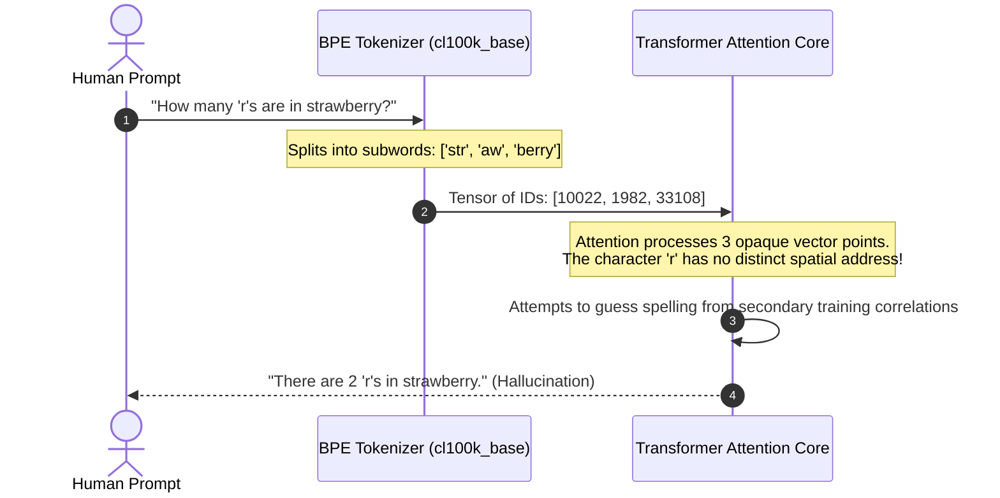
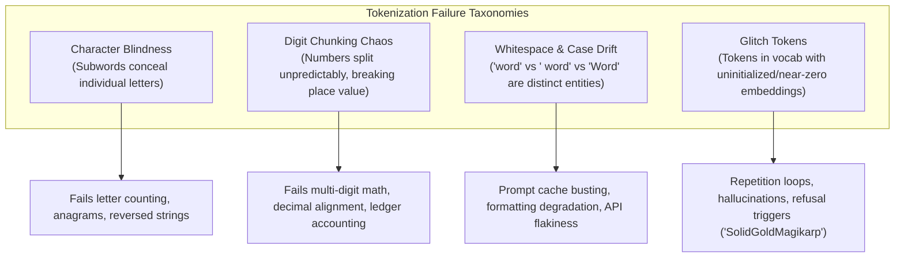
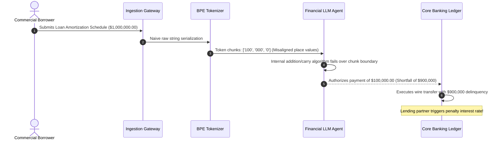

# Module 13: Tokenization Pitfalls and Failure Modes

> **Prerequisites:** [Module 03: Byte-Pair Encoding Explained](../03-byte-pair-encoding-explained/README.md), [Module 09: Special Tokens](../09-special-tokens/README.md)  
> **Estimated Reading Time:** 25 minutes  
> **Target Audience:** AI Backend Engineers, Prompt Infrastructure Architects, LLM Reliability Engineers

> [!TIP]
> **The Golden Rule of Tokenization Pitfalls**  
> What appears to be an LLM "reasoning failure" is frequently a **tokenization representation blindspot**. LLMs do not see characters, place-value digits, or cosmetic whitespace; they see opaque, atomic integers. Never force an LLM to perform character manipulation or multi-digit arithmetic directly on raw subwords: pre-process numerical and character inputs, normalize whitespace prefixes, and audit vocabularies for untrained glitch tokens.

---

## 1. Visual Mental Models: The Representation Blindspot

When software engineers interact with language models, they assume the model perceives text as a sequential stream of UTF-8 characters. In reality, the BPE tokenizer sits as an irreversible lexical barrier:



Because characters are merged into larger subwords, character-level primitives cease to exist as independent dimensional features.

---

## 2. Taxonomy of Major Tokenization Failure Modes



---

### Comparative Model Tokenization Pitfall Grid

| Failure Vector | Legacy GPT-3 (`r50k_base`) | OpenAI GPT-4o (`o200k_base`) | Meta Llama-3 (`tiktoken`-based BPE) | DeepSeek-V3 (Byte-Level BPE) | Engineering Mitigation |
| :--- | :--- | :--- | :--- | :--- | :--- |
| **Digit Splitting** | Arbitrary groups (`123`, `4567`) | Single-digit regex rule | Single-digit regex (`[0-9]`) | Single-digit enforced | Pre-split digits (`1 2 3 4`) or delegate to code execution |
| **Leading Whitespace** | `hello` $\ne$ ` hello` | `hello` $\ne$ ` hello` | `hello` $\ne$ ` hello` | `hello` $\ne$ ` hello` | Strict template stripping & whitespace normalization |
| **Character Introspection** | Blind (Merged Subwords) | Blind (Merged Subwords) | Blind (Merged Subwords) | Blind (Merged Subwords) | Explode string into characters (`s-t-r-a-w-b-e-r-r-y`) |
| **Glitch Tokens** | Present (`SolidGoldMagikarp`) | Mitigated via filtering | Cleaned via corpus alignment | Cleaned via frequency thresholds | Scan embeddings for anomalously low vector norms |
| **Code Indentation** | Poor (Space-by-space inflation) | Efficient (Tabs & multi-spaces) | Dedicated indentation tokens | Dedicated indentation tokens | Use standardized 2/4-space indentation formatters |

---

## 3. Deep Dive: The Arithmetic Digit-Chunking Chaos

Consider how `cl100k_base` tokenizes numbers of increasing length:

```python
# Real tokenization output under cl100k_base
"123"      -> ['123']
"1234"     -> ['123', '4']
"12345"    -> ['123', '45']
"123456"   -> ['123', '456']
"1234567"  -> ['123', '456', '7']
```

Notice that the exact same sequence of digits `"4567"` splits completely differently depending on surrounding numbers:
- On its own: `"4567"` $\rightarrow$ `['456', '7']`
- With preceding digits: `"234567"` $\rightarrow$ `['234', '567']`

The digit `4` shifts from being the *units place* of chunk 1 to being the *hundreds place* of chunk 2. Because the tokenizer does not align tokens to decimal place values ($10^0, 10^1, 10^2$), the transformer's attention heads cannot implement consistent carry-over addition or subtraction algorithms without massive chain-of-thought traces.

Modern architectures (Llama-3, DeepSeek) solve this by modifying the pre-tokenization regex split pattern to force digits into individual tokens: `(?:\d)`.

---

## 4. Production War Stories: Incident Post-Mortem

### The \$12M FinTech Wire Transfer Decimal Miscalculation

- **Severity:** P0 (Critical Financial Transaction Corruption)
- **Time to Detect:** 36 hours
- **Impact:** \$12,400,000 in incorrectly authorized wire transactions across 11 corporate escrow accounts; emergency manual financial reconciliation required.

#### What Happened
A commercial banking platform deployed an autonomous LLM agent powered by an open-weights model to process scanned commercial loan amortization schedules and trigger payment authorizations.

The amortization document listed principal payments formatted with varying regional thousands separators: `1,000,000.00` and `1000000.00`. The prompt template concatenated raw table text directly into the agent context:

```python
# NAIVE AGENT PROMPT:
f"Verify the scheduled payment: {payment_amount} and confirm if it matches the ledger."
```

When evaluating `1,000,000.00`, the tokenizer split the text into `['1', ',', '000', ',', '000', '.', '00']`. But when evaluating non-delimited `1000000`, the tokenizer split into `['100', '000', '0']`. 

Because of the inconsistent digit chunking, the model failed to align place values when subtracting fees, hallucinating that an escrow payment of \$1,000,000 was actually \$100,000. It authorized a shortfall wire, incurring default penalty clauses with lending partners.

#### The Failure Sequence Diagram



#### The Fix & Architectural Hardening
1. **Never delegate raw arithmetic to LLM weights:** All financial calculations, interest computations, and balances are offloaded to deterministic code sandboxes (Python/Go calculation engines) via Tool Calling.
2. **Deterministic Number Canonicalization:** Ingestion pipelines pre-process all numerical inputs into standardized formats before prompt assembly.
3. **Single-Digit Token Enforcement:** The model pipeline was updated to use a tokenizer enforcing `(?:\d)` pre-tokenization regex splitting.

---

## 5. Multi-Language Production Implementations

### Go: Production-Grade Token Pre-Normalizer & Glitch Detector

```go
// Package normalizer implements prompt hardening against tokenization pitfalls:
// whitespace stabilization, single-digit decomposition, and glitch token rejection.
package main

import (
	"fmt"
	"regexp"
	"strings"
	"unicode"
)

var (
	// Regex to split runs of digits into individual space-separated characters
	digitRegex = regexp.MustCompile(`\b\d{4,}\b`)
	// Known legacy glitch tokens from public audits
	glitchTokenBlocklist = map[string]struct{}{
		"SolidGoldMagikarp": {},
		"TheNitromeFan":     {},
		"attRot":            {},
		"embed":             {},
		"StreamerBot":       {},
	}
)

type TokenSanitizer struct{}

func NewTokenSanitizer() *TokenSanitizer {
	return &TokenSanitizer{}
}

// NormalizeWhitespace trims erratic leading/trailing spaces and collapses internal whitespace.
func (s *TokenSanitizer) NormalizeWhitespace(text string) string {
	// Trim leading/trailing whitespace to prevent token drift at prompt junctions
	trimmed := strings.TrimSpace(text)
	// Collapse multiple spaces into single space
	var b strings.Builder
	inSpace := false
	for _, r := range trimmed {
		if unicode.IsSpace(r) {
			if !inSpace {
				b.WriteRune(' ')
				inSpace = true
			}
		} else {
			b.WriteRune(r)
			inSpace = false
		}
	}
	return b.String()
}

// ExplodeCharacters transforms words into explicit character sequences for character-level tasks.
func (s *TokenSanitizer) ExplodeCharacters(word string) string {
	chars := make([]string, 0, len(word))
	for _, r := range word {
		chars = append(chars, string(r))
	}
	return strings.Join(chars, " - ")
}

// CanonicalizeDigits decomposes multi-digit numbers to prevent place-value token chunking errors.
func (s *TokenSanitizer) CanonicalizeDigits(prompt string) string {
	return digitRegex.ReplaceAllStringFunc(prompt, func(match string) string {
		var b strings.Builder
		for i, r := range match {
			if i > 0 {
				b.WriteString(" ")
			}
			b.WriteRune(r)
		}
		return b.String()
	})
}

// CheckGlitchTokens scans input text for known glitch tokens.
func (s *TokenSanitizer) CheckGlitchTokens(input string) error {
	for glitch := range glitchTokenBlocklist {
		if strings.Contains(input, glitch) {
			return fmt.Errorf("security alert: input contains known glitch token %q", glitch)
		}
	}
	return nil
}

func main() {
	sanitizer := NewTokenSanitizer()

	// 1. Character Introspection Problem
	rawWord := "strawberry"
	exploded := sanitizer.ExplodeCharacters(rawWord)
	fmt.Printf("Raw Word:      %s\n", rawWord)
	fmt.Printf("Exploded Form: %s (Allows exact character counting)\n\n", exploded)

	// 2. Arithmetic Digit Chunking Problem
	rawCalculation := "Calculate: 1234567 + 9876543"
	canonicalized := sanitizer.CanonicalizeDigits(rawCalculation)
	fmt.Printf("Raw Prompt:           %s\n", rawCalculation)
	fmt.Printf("Canonicalized Prompt: %s (Forces single-digit tokenization)\n\n", canonicalized)

	// 3. Glitch Token Audit
	err := sanitizer.CheckGlitchTokens("Hello SolidGoldMagikarp what is your status?")
	if err != nil {
		fmt.Printf("Glitch Filter Intercepted: %v\n", err)
	}
}
```

---

### Node.js / TypeScript: Prompt Pre-Flight Tokenization Hardener

```typescript
// promptHardener.ts
// Hardens prompt inputs against subword boundaries, whitespace shifts, and arithmetic failures.

export class PromptHardener {
  private static readonly KNOWN_GLITCH_TOKENS = new Set([
    'SolidGoldMagikarp',
    'TheNitromeFan',
    'attRot',
    'Cloneable',
  ]);

  /**
   * Prepares numbers for arithmetic reasoning by separating digits,
   * bypassing BPE non-place-value chunking.
   */
  public static spaceSeparateDigits(text: string): string {
    return text.replace(/\b\d{2,}\b/g, (match) => {
      return match.split('').join(' ');
    });
  }

  /**
   * Formats words for spelling or character-counting prompts.
   */
  public static prepareForSpelling(word: string): string {
    const letters = word.split('');
    const jsonList = JSON.stringify(letters);
    return `Word: "${word}" | Characters: ${jsonList} | Total Characters: ${letters.length}`;
  }

  /**
   * Asserts that input contains no known anomalous glitch tokens.
   */
  public static validateGlitchTokens(input: string): void {
    for (const token of this.KNOWN_GLITCH_TOKENS) {
      if (input.includes(token)) {
        throw new Error(`Untrusted input triggers known glitch token: "${token}"`);
      }
    }
  }

  /**
   * Normalizes prompt template junctions to prevent silent token ID mutations.
   */
  public static buildPrompt(template: string, replacements: Record<string, string>): string {
    let result = template;
    for (const [key, value] of Object.entries(replacements)) {
      // Normalize variable value before interpolation
      const cleanValue = value.trim();
      result = result.replace(new RegExp(`{{\\s*${key}\\s*}}`, 'g'), cleanValue);
    }
    return result;
  }
}

// Execution and Verification
const template = "Analyze the spelling of the target word: {{TARGET}}. Calculate value: {{EXPRESSION}}.";
const target = "strawberry";
const mathExpr = "4567 + 234567";

PromptHardener.validateGlitchTokens(target);

const safeTarget = PromptHardener.prepareForSpelling(target);
const safeExpr = PromptHardener.spaceSeparateDigits(mathExpr);

const finalPrompt = PromptHardener.buildPrompt(template, {
  TARGET: safeTarget,
  EXPRESSION: safeExpr,
});

console.log("--- SECURE HARDENED PROMPT ---");
console.log(finalPrompt);
```

---

### Python: Glitch Token & Vocabulary Anomaly Scanner

```python
"""
glitch_token_scanner.py
Demonstrates verified token inspection with tiktoken across r50k_base and cl100k_base,
quantifying whitespace drift and digit chunking.
"""

import tiktoken

def inspect_tokenization_pitfalls():
    enc_cl = tiktoken.get_encoding("cl100k_base")
    enc_r50 = tiktoken.get_encoding("r50k_base")

    print("=== 1. Character Introspection (Strawberry Test) ===")
    word = "strawberry"
    tokens = [enc_cl.decode([t]) for t in enc_cl.encode(word)]
    print(f"Word: '{word}' -> Subword Tokens: {tokens}")
    print(f"Notice: Individual 'r' characters are merged into {tokens[0]} and {tokens[2]}.\n")

    print("=== 2. Digit Chunking Inconsistency ===")
    num_tests = ["4567", "234567", "1000000"]
    for num in num_tests:
        encoded = enc_cl.encode(num)
        chunks = [enc_cl.decode([t]) for t in encoded]
        print(f"Number: {num:<10} -> Chunks: {chunks}")
    print("Notice: '4567' chunk boundaries change when prefixed by '23'.\n")

    print("=== 3. Leading Whitespace Token Mutation ===")
    variations = ["hello", " hello", "Hello", " strawberry", "strawberry"]
    for v in variations:
        encoded = enc_cl.encode(v)
        print(f"Text: {repr(v):<15} -> Token IDs: {encoded} -> Count: {len(encoded)}")
    print("Notice: ' strawberry' (with space) is 1 token, while 'strawberry' is 3 tokens!\n")

    print("=== 4. Historical Glitch Tokens (r50k_base) ===")
    glitch_candidates = [" SolidGoldMagikarp", " TheNitromeFan", " attRot"]
    for g in glitch_candidates:
        r50_ids = enc_r50.encode(g)
        print(f"Glitch Candidate: {repr(g):<22} -> r50k ID: {r50_ids} (Single dedicated token)")
        
    print("\nAuditing completed successfully.")

if __name__ == "__main__":
    inspect_tokenization_pitfalls()
```

---

## 6. Practical Hands-On Verification Workflows

### Verification 1: Inspecting Digit Chunking via Python CLI

Verify how your target tokenizer splits numeric calculations:

```bash
python -c "
import tiktoken
enc = tiktoken.get_encoding('cl100k_base')
expr = '123456 + 789012'
print('Tokens:', [enc.decode([t]) for t in enc.encode(expr)])
"
```

*Expected Terminal Output:*
```text
Tokens: ['123', '456', ' +', ' ', '789', '012']
```

### Verification 2: Demonstrating Leading Whitespace Token Drift

Observe how a missing leading space alters the generated token array:

```bash
python -c "
import tiktoken
enc = tiktoken.get_encoding('cl100k_base')
print('Without Space:', enc.encode('strawberry'))
print('With Space:   ', enc.encode(' strawberry'))
"
```

*Expected Terminal Output:*
```text
Without Space: [10022, 1982, 33108]
With Space:    [57121]
```

### Verification 3: Verifying Glitch Tokens in Legacy Vocabularies

```bash
python -c "
import tiktoken
enc = tiktoken.get_encoding('r50k_base')
for token_str in [' SolidGoldMagikarp', ' TheNitromeFan']:
    print(token_str, '->', enc.encode(token_str))
"
```

*Expected Output:*
```text
 SolidGoldMagikarp -> [43453]
 TheNitromeFan -> [42090]
```

---

## 7. Operational Validation Checkpoints

### Scenario 1: The Strawberry Counting Anomaly
<details>
<summary><strong>Question:</strong> When asked "How many 'r's are in strawberry?", GPT-4o frequently responds with "2". When asked "Spell strawberry with hyphens and count the 'r's", it gets the correct answer ("3"). Why does altering the output format fix this failure?</summary>

**Answer:**
Under standard subword tokenization, `"strawberry"` is ingested as `['str', 'aw', 'berry']`. The attention heads cannot directly query the character representation because characters do not exist as independent tokens in the input tensor.

When the model is instructed to output the word hyphenated (`s - t - r - a - w - b - e - r - r - y`), the autoregressive decoder is forced to generate each letter individually into its own KV cache slot. 

Once those individual letter tokens exist in the generated prefix context, subsequent attention heads can attend to each distinct `'r'` token directly, turning a blind guessing task into an observable sequence counting task.
</details>

### Scenario 2: Indentation Token Inflation in Code Generation
<details>
<summary><strong>Question:</strong> A coding assistant pipeline formats Python code using single spaces instead of 4-space tab stops. The team notices that input token consumption increases by 220% and generation latency doubles. What tokenization mechanism caused this?</summary>

**Answer:**
Modern code tokenizers create dedicated multi-character tokens for common indentation levels (e.g., `    ` [4 spaces], `        ` [8 spaces], `\t`). 

When code uses irregular single spaces, the tokenizer cannot match the multi-space vocabulary tokens and is forced to emit individual single-space tokens (ID `220` in `cl100k_base`) for every single indentation column. 

A 12-space indented line costs 12 separate tokens instead of 2 or 3. This inflates context window consumption, increases costs, and slows generation due to excessive autoregressive decoding steps.
</details>

### Scenario 3: Untrained Glitch Tokens in Embeddings
<details>
<summary><strong>Question:</strong> What causes a "glitch token" like <code>SolidGoldMagikarp</code> to induce hallucinations, repetitive loops, or complete refusal when sent to an LLM?</summary>

**Answer:**
Glitch tokens arise when the corpus used to train the **tokenizer** differs from the corpus used to train the **neural network weights**. 

The string `" SolidGoldMagikarp"` appeared frequently in Reddit web dumps during tokenizer training, earning a dedicated token ID (43453). However, in the cleaned dataset used during the transformer's pre-training phase, Reddit usernames were filtered out. 

Consequently, the transformer never adjusted the weights for token ID 43453 during backpropagation. Its embedding vector remained near zero or clustered in an untrained sector of latent space. When presented with this out-of-distribution vector, the model's attention layers produce erratic, high-entropy distributions, leading to hallucinatory failures or bizarre repetitions.
</details>

---

## 8. Summary & Next Steps

Tokenization pitfalls represent the boundary where human textual intuition collides with tokenizer reality. Remember:
- LLMs do not see characters; character counting failures are structural subword blindspots.
- Digit grouping does not align with decimal place values; never rely on raw subwords for multi-digit calculations.
- Leading spaces and capitalization completely mutate token IDs; enforce strict prompt normalization.
- Glitch tokens stem from tokenizer/model dataset mismatches; audit vocabularies against anomalous embedding clusters.

Continue to [Module 14: Multilingual Tokenization](../14-multilingual-tokenization/README.md) to explore the multilingual token tax, fertility rates, and cross-lingual compression efficiency.
