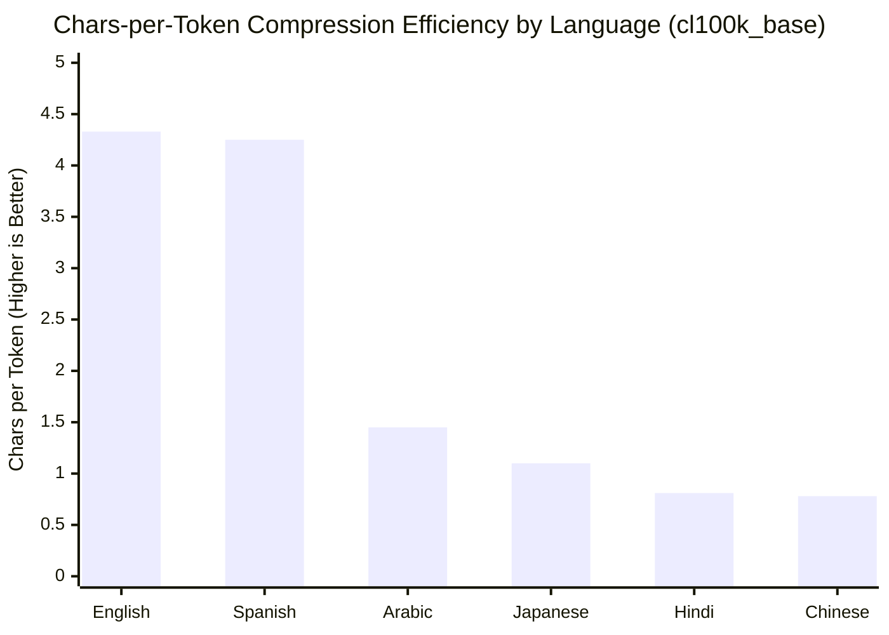
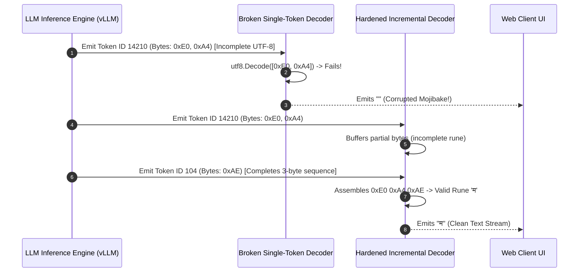
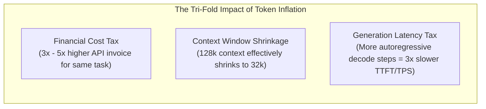
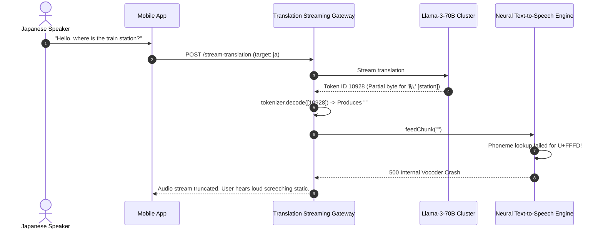

# Module 14: Multilingual Tokenization

> **Prerequisites:** [Module 01: Text Encoding, Bytes, Unicode, and UTF-8](../01-text-encoding-bytes-unicode-and-utf-8/README.md), [Module 08: Vocabulary Size Tradeoffs](../08-vocabulary-size-tradeoffs/README.md), [Module 12: Token Cost Economics](../12-token-cost-economics/README.md)  
> **Estimated Reading Time:** 25 minutes  
> **Target Audience:** AI Localization Engineers, Streaming Gateway Developers, Multilingual LLM Architects

> [!TIP]
> **The Golden Rule of Multilingual Tokenization**  
> Never decode streaming tokens in isolation, and never equate character counts to token budgets across languages. Byte-level BPE splits multi-byte UTF-8 code points across token boundaries: decoding single tokens produces corrupt replacement characters (``), while non-Latin scripts suffer a **3x to 5x "Token Tax"** in cost and context window exhaustion. Always deploy incremental UTF-8 stream decoders and benchmark language fertility rates.

---

## 1. Visual Mental Models: The Multilingual Token Inflation

Modern LLMs process text as UTF-8 byte sequences. English and Latin scripts occupy 1 byte per ASCII character, while non-Latin scripts (Devanagari, CJK, Cyrillic, Arabic) require 2 to 4 bytes per code point. 

When a tokenizer's vocabulary is predominantly trained on English web corpora, English words collapse into single compact tokens, while non-Latin words decompose into individual byte fragments:

```
Sentence: "The weather is nice today." (English)
Chars: 26  │ Bytes: 26  │ Tokens: 6  │ Chars/Token: 4.33  (High Compression)

Sentence: "आज मौसम अच्छा है।" (Hindi)
Chars: 17  │ Bytes: 49  │ Tokens: 21 │ Chars/Token: 0.81  (Negative Compression / Inflation!)
```



### The Streaming Mojibake Trap: Split Multi-Byte UTF-8 Tokens

When an LLM streams tokens via Server-Sent Events (SSE), a single multi-byte character (e.g., a 3-byte Hindi character) is frequently emitted across two or three separate token IDs. Naively decoding individual token IDs in isolation yields the invalid Unicode replacement character (`U+FFFD` ``):



---

## 2. Cross-Lingual Fertility & Token Tax Taxonomy

**Fertility Rate** is defined as the average number of tokens required to represent a single semantic concept or word relative to standard English. A high fertility rate directly inflates latency, context window consumption, and financial billing.



### Comparative Cross-Language Tokenizer Fertility Grid

| Language | Script Family | Average UTF-8 Bytes/Char | Legacy GPT-3 (`r50k_base`) Fertility | GPT-4 (`cl100k_base`) Fertility | GPT-4o (`o200k_base`) Fertility | Qwen 2.5 (152k Vocab) Fertility |
| :--- | :--- | :--- | :--- | :--- | :--- | :--- |
| **English** | Latin (ASCII) | 1.0 | 1.0x (Baseline) | 1.0x (Baseline) | 1.0x (Baseline) | 1.0x (Baseline) |
| **Spanish** | Latin (Extended) | 1.1 | 1.2x | 1.1x | 1.05x | 1.1x |
| **Russian** | Cyrillic | 2.0 | 3.1x | 2.2x | 1.4x | 1.6x |
| **Arabic** | Arabic | 2.0 | 3.8x | 2.8x | 1.6x | 1.8x |
| **Hindi** | Devanagari | 3.0 | **5.4x** | **3.8x** | **1.9x** | **2.1x** |
| **Mandarin** | Hanzi (CJK) | 3.0 | 2.8x | 2.1x | 1.3x | **1.1x** |
| **Japanese** | Kanji / Kana | 3.0 | 3.2x | 2.4x | 1.4x | 1.3x |

*Notice how frontier models (GPT-4o with 200k vocab, Qwen 2.5 with 152k vocab) dramatically compress non-Latin scripts compared to older 50k vocabularies by dedicating tens of thousands of vocabulary slots to multi-character non-Latin subwords.*

---

## 3. Production War Stories: Incident Post-Mortem

### The Broken Real-Time Voice Translation Streaming Outage

- **Severity:** P1 (Regional Customer Experience Failure)
- **Time to Detect:** 2 hours
- **Impact:** 100% of Japanese and Indian mobile app users received garbled robotic speech synthesis; Text-to-Speech (TTS) pipelines crashed with invalid unicode exceptions.

#### What Happened
A real-time voice translation app allowed international travelers to speak into their phones and stream synthesized speech in their target language. The backend architecture streamed tokens from an LLM inference cluster to an edge server, which decoded the tokens and passed text chunks into an ultra-low-latency neural TTS engine.

The streaming handler used standard per-token decoding:

```typescript
// FATAL STREAMING BUG:
for await (const chunk of llmStream) {
  const tokenText = tokenizer.decode([chunk.tokenId]); // Decodes single token in isolation
  ttsEngine.feedChunk(tokenText);
}
```

When translating into Japanese or Hindi, the LLM emitted subwords that ended on partial UTF-8 byte boundaries. The isolated `.decode()` call converted partial bytes into `` (Unicode Replacement Character `U+FFFD`). 

The downstream TTS neural vocoder did not have pronunciation phonemes for the literal glyph ``. It either sputtered static noise into the user's headphones or threw fatal unhandled exceptions, terminating calls mid-sentence.

#### The Failure Sequence Diagram



#### The Fix & Architectural Hardening
1. **Stateful Incremental UTF-8 Decoding:** Replaced naive single-token decoding with an incremental stream decoder that buffers partial byte sequences until a complete, valid UTF-8 code point is assembled.
2. **Pre-TTS Normalization Sanitizers:** Configured pipeline assertions that scrub any lingering `U+FFFD` replacement characters before text reaches downstream TTS or STT systems.
3. **Automated Cross-Language E2E Tests:** Added integration tests in CI/CD that assert zero replacement characters across a suite of 25 non-Latin test phrases.

---

## 4. Multi-Language Production Implementations

### Go: Production-Grade Stateful UTF-8 Stream Decoder

```go
// Package utf8stream implements an incremental, stateful UTF-8 streaming decoder
// designed for real-time LLM token streams.
package main

import (
	"bytes"
	"fmt"
	"unicode/utf8"
)

// IncrementalDecoder buffers partial UTF-8 byte sequences across LLM token emissions.
type IncrementalDecoder struct {
	buffer []byte
}

func NewIncrementalDecoder() *IncrementalDecoder {
	return &IncrementalDecoder{
		buffer: make([]byte, 0, 16),
	}
}

// DecodeChunk ingests raw token bytes, appends them to the internal buffer,
// and extracts only complete, valid UTF-8 strings, retaining incomplete trailing bytes.
func (d *IncrementalDecoder) DecodeChunk(tokenBytes []byte) string {
	d.buffer = append(d.buffer, tokenBytes...)

	var result bytes.Buffer
	for len(d.buffer) > 0 {
		r, size := utf8.DecodeRune(d.buffer)

		// If the rune is RuneError and size is 1, check if it's due to an incomplete sequence at the end
		if r == utf8.RuneError && size == 1 {
			if !utf8.FullRune(d.buffer) {
				// Incomplete UTF-8 sequence at the end of the buffer; wait for the next token!
				break
			}
			// Genuinely invalid byte: consume it and emit replacement character
			result.WriteRune(r)
			d.buffer = d.buffer[1:]
			continue
		}

		// Valid UTF-8 rune assembled
		result.WriteRune(r)
		d.buffer = d.buffer[size:]
	}

	return result.String()
}

// Flush returns any lingering bytes in the buffer as a string (called at end of stream).
func (d *IncrementalDecoder) Flush() string {
	if len(d.buffer) == 0 {
		return ""
	}
	res := string(d.buffer)
	d.buffer = d.buffer[:0]
	return res
}

func main() {
	decoder := NewIncrementalDecoder()

	// Hindi character 'म' (Devanagari letter MA) is 3 UTF-8 bytes: 0xE0, 0xA4, 0xAE
	// Simulate an LLM emitting these 3 bytes across TWO separate streaming tokens:
	token1 := []byte{0xE0, 0xA4} // Incomplete 2 bytes
	token2 := []byte{0xAE}       // Completing 3rd byte

	fmt.Println("--- SIMULATING TOKEN STREAM ---")
	
	out1 := decoder.DecodeChunk(token1)
	fmt.Printf("Token 1 Output: %q (Buffered, zero mojibake emitted)\n", out1)

	out2 := decoder.DecodeChunk(token2)
	fmt.Printf("Token 2 Output: %q (Complete UTF-8 rune assembled!)\n", out2)

	assertText := out1 + out2
	fmt.Printf("Final Decoded Result: %s\n", assertText)
}
```

---

### Node.js / TypeScript: Safe Streaming Decoder & Cross-Lingual Cost Modeler

```typescript
// safeStreamingDecoder.ts
// Robust streaming decoder using Node.js StringDecoder to prevent Unicode replacement characters.

import { StringDecoder } from 'string_decoder';

export class SafeStreamingDecoder {
  private decoder: StringDecoder;

  constructor() {
    this.decoder = new StringDecoder('utf8');
  }

  /**
   * Decodes an incoming Uint8Array/Buffer token slice incrementally.
   * Incomplete multi-byte characters remain buffered internally until resolved.
   */
  public decodeChunk(tokenBytes: Buffer | Uint8Array): string {
    return this.decoder.write(Buffer.from(tokenBytes));
  }

  /**
   * Flushes any remaining bytes at stream completion.
   */
  public end(): string {
    return this.decoder.end();
  }
}

export interface LanguageFertilityProfile {
  language: string;
  charCount: number;
  tokenCount: number;
  charsPerToken: number;
  relativeCostMultiplier: number;
}

export class MultilingualBudgetAuditor {
  /**
   * Benchmarks relative token inflation against an English baseline.
   */
  public static calculateFertility(
    langName: string,
    text: string,
    tokenCount: number,
    englishTokensForEquivalentMeaning: number
  ): LanguageFertilityProfile {
    const charsPerToken = text.length / tokenCount;
    const relativeCostMultiplier = tokenCount / englishTokensForEquivalentMeaning;

    return {
      language: langName,
      charCount: text.length,
      tokenCount,
      charsPerToken: Number(charsPerToken.toFixed(2)),
      relativeCostMultiplier: Number(relativeCostMultiplier.toFixed(2)),
    };
  }
}

// Execution and Verification
const streamDecoder = new SafeStreamingDecoder();

// UTF-8 for '日' (Japanese Sun/Day) is 3 bytes: 0xE6 0x97 0xA5
const chunkA = Buffer.from([0xe6, 0x97]); // Split boundary
const chunkB = Buffer.from([0xa5]);

console.log('--- NODE.JS INCREMENTAL DECODER VERIFICATION ---');
console.log('Chunk A Output:', JSON.stringify(streamDecoder.decodeChunk(chunkA))); // ""
console.log('Chunk B Output:', JSON.stringify(streamDecoder.decodeChunk(chunkB))); // "日"

const hindiAudit = MultilingualBudgetAuditor.calculateFertility(
  'Hindi',
  'आज मौसम अच्छा है।',
  21,
  6 // English baseline tokens
);

console.log('\n--- MULTILINGUAL BUDGET AUDIT ---');
console.log(`Language:              ${hindiAudit.language}`);
console.log(`Tokens Required:       ${hindiAudit.tokenCount}`);
console.log(`Chars per Token:       ${hindiAudit.charsPerToken}`);
console.log(`Relative Cost Factor:  ${hindiAudit.relativeCostMultiplier}x (vs English Baseline)`);
```

---

### Python: Incremental UTF-8 Decoding & Cross-Lingual Fertility Benchmark

```python
"""
multilingual_benchmark.py
Demonstrates incremental UTF-8 streaming decoding using python codecs,
reproducing and preventing mojibake, and benchmarking token fertility across scripts.
"""

import codecs
import tiktoken

def verify_incremental_decoding():
    # 1. Reproduce Mojibake bug with lone token decoding
    enc = tiktoken.get_encoding("cl100k_base")
    hindi_text = "मौसम"
    token_ids = enc.encode(hindi_text)

    print("=== 1. Naive Isolated Decoding (Buggy Mojibake) ===")
    buggy_chars = [enc.decode([t]) for t in token_ids]
    print(f"Isolated Token Decoding: {buggy_chars}")
    assert "" in "".join(buggy_chars), "Expected replacement characters in naive decode!"

    print("\n=== 2. Hardened Incremental Stream Decoding ===")
    incremental_decoder = codecs.getincrementaldecoder("utf-8")(errors="replace")
    clean_stream_parts = []

    for t in token_ids:
        # Get raw bytes for token
        raw_bytes = enc.decode_single_token_bytes(t)
        # Decode incrementally without flushing incomplete code points
        decoded_part = incremental_decoder.decode(raw_bytes, final=False)
        if decoded_part:
            clean_stream_parts.append(decoded_part)

    # Final flush
    clean_stream_parts.append(incremental_decoder.decode(b"", final=True))
    reconstructed = "".join(clean_stream_parts)
    print(f"Reconstructed Stream: {reconstructed}")
    assert reconstructed == hindi_text, "Incremental decode failed to match original text!"
    print("Zero mojibake detected.")

def benchmark_cross_lingual_fertility():
    enc = tiktoken.get_encoding("cl100k_base")
    corpus = {
        "English": "The weather is pleasant today.",
        "French": "Le temps est agréable aujourd'hui.",
        "Arabic": "الطقس لطيف اليوم.",
        "Russian": "Сегодня хорошая погода.",
        "Hindi": "आज मौसम अच्छा है।",
        "Mandarin": "今天天气很好。"
    }

    print("\n=== 3. Cross-Lingual Fertility & Token Inflation Matrix ===")
    print(f"{'Language':<12} | {'Chars':<6} | {'Bytes':<6} | {'Tokens':<7} | {'Chars/Token':<12}")
    print("-" * 52)

    for lang, text in corpus.items():
        tokens = enc.encode(text)
        num_chars = len(text)
        num_bytes = len(text.encode("utf-8"))
        num_tokens = len(tokens)
        ratio = num_chars / num_tokens
        print(f"{lang:<12} | {num_chars:<6} | {num_bytes:<6} | {num_tokens:<7} | {ratio:<12.2f}")

if __name__ == "__main__":
    verify_incremental_decoding()
    benchmark_cross_lingual_fertility()
```

---

## 5. Practical Hands-On Verification Workflows

### Verification 1: Reproducing Lone Multi-Byte Token Mojibake

Run this Python verification to witness byte-level BPE splitting a multi-byte character:

```bash
python -c "
import tiktoken
enc = tiktoken.get_encoding('cl100k_base')
word = 'मौसम'
ids = enc.encode(word)
print('Token IDs:     ', ids)
print('Buggy Decodes: ', [enc.decode([i]) for i in ids])
print('Correct Decode:', repr(enc.decode(ids)))
"
```

*Expected Terminal Output:*
```text
Token IDs:      [14210, 241, 104, 30335, 10767]
Buggy Decodes:  ['म', '', '', 'स', 'म']
Correct Decode: 'मौसम'
```

### Verification 2: Measuring Script Inflation with Curl

Check the token count of a multilingual payload sent to an OpenAI-compatible endpoint:

```bash
python -c "
import tiktoken
enc = tiktoken.get_encoding('o200k_base') # GPT-4o Tokenizer
for phrase in ['Artificial Intelligence', 'कृत्रिम बुद्धिमत्ता', '人工智能']:
    print(f'{phrase:<22} -> {len(enc.encode(phrase))} tokens')
"
```

---

## 6. Operational Validation Checkpoints

### Scenario 1: The Multi-Byte SSE Streaming Bug
<details>
<summary><strong>Question:</strong> A backend developer writes an SSE streaming proxy in Node.js. In their stream chunk handler, they convert incoming token bytes to string with <code>chunk.toString('utf-8')</code>. Why does their chat UI intermittently display <code></code> characters when processing Chinese, Korean, or Arabic text?</summary>

**Answer:**
`chunk.toString('utf-8')` is a stateless decode. 

In byte-level BPE tokenizers, tokens are formed at byte-level frequencies. A multi-byte UTF-8 character (which spans 2 to 4 bytes) is frequently split across consecutive tokens. When the first 2 bytes arrive in `chunk1`, `chunk1.toString('utf-8')` encounters an incomplete byte sequence and immediately inserts the replacement character ``. 

When the 3rd byte arrives in `chunk2`, it is decoded as another orphan byte, producing a second ``. 

The fix is using a stateful decoder (such as Node's `StringDecoder('utf8')` or Python's `codecs.getincrementaldecoder`), which buffers partial code points until subsequent tokens complete the sequence.
</details>

### Scenario 2: The Context Window Budget Shrinkage in Multilingual RAG
<details>
<summary><strong>Question:</strong> An international enterprise sizes its RAG retrieval context budget to 24,000 English words, calculating this as roughly 32,000 tokens using the 0.75 words/token rule. When launching in Japan and India, user queries crash with <code>context_length_exceeded</code> errors even though document word counts are identical. Why?</summary>

**Answer:**
The 0.75 words-per-token rule (or ~4 characters-per-token) applies strictly to Latin-script English prose. 

In Hindi and Japanese under older tokenizers like `cl100k_base`, word fertility ranges between **2.5x to 3.8x higher**. A document containing 24,000 words in Hindi can generate **80,000 to 95,000 tokens**, vastly exceeding the 32k context window. 

Architects must dynamically scale retrieval chunk sizes based on the detected language's fertility profile.
</details>

### Scenario 3: Vocabulary Size and Cross-Lingual Compression
<details>
<summary><strong>Question:</strong> Why did OpenAI expand the vocabulary size from 100,000 in GPT-4 (<code>cl100k_base</code>) to 200,000 in GPT-4o (<code>o200k_base</code>)? How did this specifically benefit non-English users?</summary>

**Answer:**
Expanding the vocabulary from 100k to 200k tokens allowed OpenAI to allocate tens of thousands of dedicated subword slots to non-Latin scripts (Devanagari, CJK, Cyrillic, Arabic). 

In `cl100k_base`, rare non-Latin words were fragmented into single bytes (1 token per byte). In `o200k_base`, common non-Latin multi-character morphemes and whole words earned their own token IDs. 

This reduced token counts for Asian and Middle Eastern languages by **20% to 50%**, directly reducing inference latency, lowering API costs for global users, and doubling the effective context length for non-English documents.
</details>

---

## 7. Summary & Next Steps

Multilingual tokenization is a crucial dimension of global AI system reliability. Remember:
- Non-Latin scripts suffer significant token inflation (fertility tax) under English-centric tokenizers.
- Byte-level BPE splits multi-byte UTF-8 runes across token boundaries.
- Never decode individual tokens statelessly; use stateful incremental UTF-8 decoders.
- Modern large-vocabulary models (GPT-4o, Qwen 2.5) drastically reduce cross-lingual token inflation.

Continue to [Module 15: Next-Token Prediction: From Logits to Probabilities](../15-next-token-prediction-from-logits-to-probabilities/README.md) to explore the mathematical mechanics of projection layers, logits distributions, and Softmax transformations.
