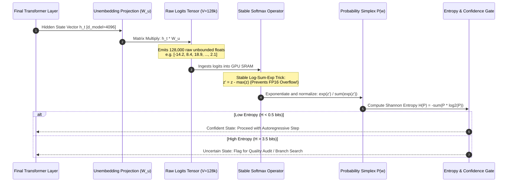
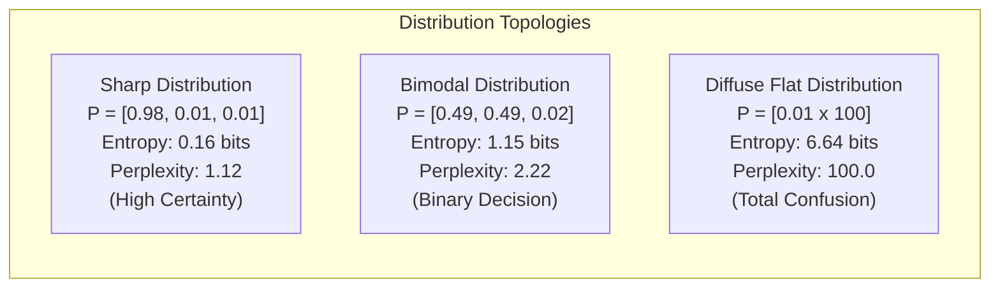
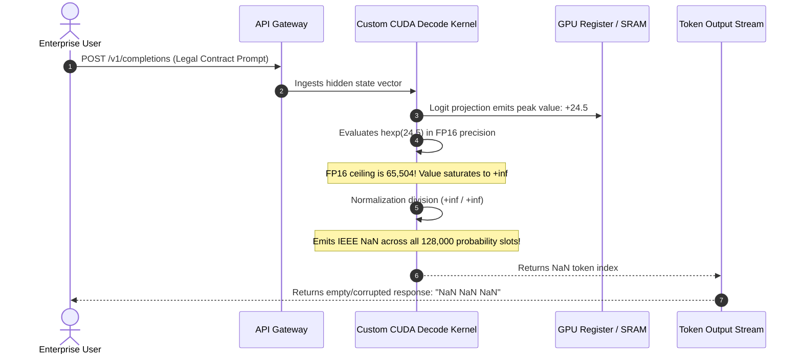

# Module 15: Next-Token Prediction: From Logits to Probabilities

> **Prerequisites:** [Module 08: Vocabulary Size Tradeoffs](../08-vocabulary-size-tradeoffs/README.md), [Module 13: Tokenization Pitfalls and Failure Modes](../13-tokenization-pitfalls-and-failure-modes/README.md)  
> **Estimated Reading Time:** 25 minutes  
> **Target Audience:** AI Backend Engineers, LLM Serving Engineers, Machine Learning Platform Architects

> [!TIP]
> **The Golden Rule of Next-Token Prediction**  
> Logits are unnormalized relative affinities; Softmax transforms them into a valid probability simplex ($\sum P_i = 1$). In production systems, **naive softmax is a numerical landmine that overflows into `NaN`**. Always enforce the log-sum-exp max-subtraction stabilization trick ($z_i - \max(z)$), and monitor per-token **Shannon Entropy** ($H(P)$) to distinguish confident generations from high-risk hallucination states.

---

## 1. Visual Mental Models: The Unembedding & Softmax Pipeline

At the terminal layer of a decoder transformer, the final hidden state vector $h_t \in \mathbb{R}^{d_{\text{model}}}$ is projected across the entire vocabulary $V$ via the **unembedding matrix** (or language model head) $W_u \in \mathbb{R}^{d_{\text{model}} \times |V|}$:

$$\mathbf{z} = h_t W_u \in \mathbb{R}^{|V|}$$

Each scalar $z_i$ is an unconstrained real number called a **logit**. To transform raw logits into discrete probabilities, the engine applies the **Softmax** function:

$$P(w_i) = \frac{\exp(z_i)}{\sum_{j=1}^{|V|} \exp(z_j)}$$



---

## 2. Numerical Stability: The Fatal Naive Softmax Overflow

In standard IEEE-754 floating-point arithmetic, single-precision (FP32) overflows above $\approx 88.7$, while half-precision (FP16) overflows at just **$65,504$**. Large transformer logits regularly reach values between $50$ and $200$.

Evaluating naive $\exp(z_i)$ on large logits immediately yields $+\infty$. Dividing $\frac{\infty}{\infty}$ generates IEEE **`NaN` (Not a Number)**, causing the entire KV-cache and downstream generation loop to emit corrupted garbage.

```mermaid
flowchart TD
    subgraph Naive_Failure["Naive Softmax (Crash Vector)"]
        N1["Logits: [1000.0, 1001.0, 999.0]"] --> N2["exp(1000.0) -> Overflow to +inf"]
        N2 --> N3["Sum of Exps -> +inf"]
        N3 --> N4["Divide: +inf / +inf -> [NaN, NaN, NaN] (CORRUPTION)"]
    end

    subgraph Stable_Implementation["Numerically Stable Softmax (Max-Shift)"]
        S1["Logits: [1000.0, 1001.0, 999.0]"] --> S2["Find Max: max(z) = 1001.0"]
        S2 --> S3["Shift Logits: z' = z - 1001.0 -> [-1.0, 0.0, -2.0]"]
        S3 --> S4["exp(z') -> [0.3678, 1.0000, 0.1353] (Safe Range: 0 to 1)"]
        S4 --> S5["Normalize -> [0.2447, 0.6652, 0.0900] (SUM = 1.0)"]
    end
```



### Mathematical Proof of Invariance
Subtracting an arbitrary scalar $c = \max(\mathbf{z})$ from all logits does not change the resulting probabilities:

$$\frac{\exp(z_i - c)}{\sum_j \exp(z_j - c)} = \frac{\exp(z_i) \cdot \exp(-c)}{\sum_j (\exp(z_j) \cdot \exp(-c))} = \frac{\exp(z_i) \cdot \exp(-c)}{\exp(-c) \sum_j \exp(z_j)} = \frac{\exp(z_i)}{\sum_j \exp(z_j)}$$

Because the maximum shifted value is $z_{\max} - z_{\max} = 0$, every exponentiated value is strictly bounded: $\exp(z'_i) \in (0, 1]$, making numerical overflow mathematically impossible.

---

## 3. Quantifying Model Confidence: Entropy & Perplexity

Examining the top-1 probability alone is misleading; a model choosing between two highly viable synonyms ($P_1 = 0.49, P_2 = 0.48$) is in a very different epistemic state than a model choosing across 50 equally vague options ($P_i \approx 0.02$).



### Metric Definitions
1. **Shannon Entropy ($H$):** Measures the uncertainty or "information content" of the probability vector in bits:
   $$H(P) = -\sum_{i=1}^{|V|} P(w_i) \log_2 P(w_i)$$
   - Minimum entropy is $0.0$ bits (total certainty: one token has probability $1.0$).
   - Maximum entropy for vocabulary $|V|$ is $\log_2(|V|)$ bits (complete uniform confusion).
2. **Perplexity ($\text{PPL}$):** The exponentiated entropy, representing the "effective branching factor" (number of equally likely candidate tokens):
   $$\text{PPL}(P) = 2^{H(P)}$$

### Distribution Comparison Grid

| Distribution Type | Top-1 Probability | Shannon Entropy ($H$) | Perplexity ($\text{PPL}$) | Interpretation | Typical LLM Context |
| :--- | :--- | :--- | :--- | :--- | :--- |
| **Degenerate Sharp** | $0.999$ | $0.01$ bits | $1.01$ | Total Certainty | Code syntax closure (`}`) or structured schema |
| **Confident** | $0.850$ | $0.72$ bits | $1.65$ | Focused Selection | Factual retrieval ("Capital of France is...") |
| **Bimodal Branch** | $0.480$ | $1.20$ bits | $2.30$ | Equi-probable Choice | Stylistic choice ("The car was [red / blue]") |
| **Diffuse / Uncertain**| $0.050$ | $4.80$ bits | $27.85$ | High Hallucination Risk | Out-of-distribution reasoning / obscure facts |
| **Uniform Random** | $1 / |V|$ | $\log_2(|V|)$ bits | $|V|$ | Complete uninitialized failure / model collapse |

---

## 4. Production War Stories: Incident Post-Mortem

### The FP16 Softmax Overflow NaN Cascade in Custom CUDA Kernel

- **Severity:** P0 (Global Inference Cluster Failure)
- **Time to Detect:** 12 minutes
- **Impact:** 100% of LLM completion endpoints returned empty string or literal `"NaN"` characters; 1,200 GPU instances required rolling restarts.

#### What Happened
An AI infrastructure startup implemented an optimized custom Flash-Decoding CUDA kernel to reduce time-to-first-token (TTFT) for their 70B parameter model. To maximize throughput on NVIDIA A100 GPUs, the kernel ran the final unembedding projection and softmax entirely in FP16 precision.

The developer wrote the reduction loop following textbook math:

```cuda
// FATAL NAIVE KERNEL BUG:
__global__ void naive_softmax_kernel(const half* logits, half* probs, int vocab_size) {
    half sum = 0.0;
    for (int i = 0; i < vocab_size; i++) {
        probs[i] = hexp(logits[i]); // In FP16, hexp(x) overflows if x > 11.089!
        sum += probs[i];
    }
    // sum becomes +inf, probs / sum emits NaN
}
```

During testing with simple greetings, logits remained between $-5.0$ and $+8.0$. But in production, an enterprise client submitted a dense legal contract containing rare formatting. The attention layers pushed the logit for the quotation mark token to **$+24.5$**. 

In FP16, $\exp(24.5) \approx 4.3 \times 10^{10}$, completely blowing past the FP16 maximum ceiling of $65,504$. The accumulator saturated to `+inf`, dividing every probability into `NaN`. The subsequent greedy sampling loop selected index 0, corrupting the generation loop across the entire cluster.

#### The Failure Sequence Diagram



#### The Fix & Architectural Hardening
1. **Three-Pass Numerically Stable Kernel:** Re-architected the kernel to use the standard 3-pass reduction:
   - Pass 1: Find $z_{\max} = \max(\mathbf{z})$ in shared memory.
   - Pass 2: Compute $\sum \exp(z_i - z_{\max})$ using 32-bit float accumulators (`float`, not `half`).
   - Pass 3: Normalize and cast back to target precision.
2. **Automated `torch.testing` Assertions:** CI test pipelines were updated with adversarial logit inputs containing values up to $+10,000$ to verify numerical overflow immunity.

---

## 5. Multi-Language Production Implementations

### Go: Production-Grade Stable Softmax & Entropy Gate

```go
// Package logits implements high-performance, numerically stable Softmax,
// Shannon Entropy calculation, and low-confidence prediction gating.
package main

import (
	"errors"
	"fmt"
	"math"
)

// PredictionEvaluation captures distribution metrics for operational auditing.
type PredictionEvaluation struct {
	TopTokenIndex int
	TopProbability float64
	EntropyBits    float64
	Perplexity     float64
	IsLowConfidence bool
}

// StableSoftmax transforms raw logits into probabilities using max-subtraction stabilization.
func StableSoftmax(logits []float64) ([]float64, error) {
	if len(logits) == 0 {
		return nil, errors.New("cannot compute softmax over empty logits")
	}

	// 1. Find maximum logit to prevent exp() overflow
	maxLogit := logits[0]
	for _, val := range logits[1:] {
		if val > maxLogit {
			maxLogit = val
		}
	}

	// 2. Compute exponentiated shifted logits and their sum
	probs := make([]float64, len(logits))
	sumExp := 0.0

	for i, val := range logits {
		// Shifted logit is guaranteed to be <= 0.0, so exp() <= 1.0 (zero overflow risk)
		expVal := math.Exp(val - maxLogit)
		probs[i] = expVal
		sumExp += expVal
	}

	if sumExp == 0.0 || math.IsNaN(sumExp) {
		return nil, errors.New("numerical underflow: sum of exponents is zero")
	}

	// 3. Normalize into valid probability simplex
	for i := range probs {
		probs[i] /= sumExp
	}

	return probs, nil
}

// EvaluateDistribution computes Shannon Entropy and Perplexity.
func EvaluateDistribution(probs []float64, entropyAlertThreshold float64) PredictionEvaluation {
	topIdx := 0
	topProb := probs[0]
	entropy := 0.0

	for i, p := range probs {
		if p > topProb {
			topProb = p
			topIdx = i
		}
		if p > 1e-12 { // Avoid log2(0)
			entropy -= p * math.Log2(p)
		}
	}

	ppl := math.Pow(2.0, entropy)

	return PredictionEvaluation{
		TopTokenIndex:   topIdx,
		TopProbability:  topProb,
		EntropyBits:     entropy,
		Perplexity:      ppl,
		IsLowConfidence: entropy > entropyAlertThreshold,
	}
}

func main() {
	// Extreme logits that would immediately crash naive softmax
	hazardousLogits := []float64{1000.0, 1002.5, 999.1, 980.0}

	probs, err := StableSoftmax(hazardousLogits)
	if err != nil {
		panic(err)
	}

	eval := EvaluateDistribution(probs, 1.5)

	fmt.Println("--- NUMERICALLY STABLE SOFTMAX RESULTS ---")
	fmt.Printf("Top Token Index:     %d\n", eval.TopTokenIndex)
	fmt.Printf("Top Probability:     %.4f\n", eval.TopProbability)
	fmt.Printf("Shannon Entropy:     %.4f bits\n", eval.EntropyBits)
	fmt.Printf("Perplexity:          %.2f\n", eval.Perplexity)
	fmt.Printf("Low Confidence Flag: %v\n", eval.IsLowConfidence)
}
```

---

### Node.js / TypeScript: Logprobs Telemetry & Hallucination Risk Analyzer

```typescript
// logprobAnalyzer.ts
// Analyzes raw logprobs from OpenAI/vLLM APIs to calculate entropy and detect hallucination flags.

export interface LogprobItem {
  token: string;
  logprob: number; // Natural log: ln(P)
  bytes?: number[];
}

export interface GenerationStepTelemetry {
  token: string;
  topProbability: number;
  entropyBits: number;
  perplexity: number;
  hallucinationRisk: 'LOW' | 'MEDIUM' | 'HIGH';
}

export class LogprobAnalyzer {
  /**
   * Evaluates top_logprobs array for a single autoregressive step.
   * Converts natural logprobs to probabilities and computes entropy.
   */
  public static analyzeStep(
    chosenToken: string,
    topLogprobs: LogprobItem[],
    entropyHighThreshold: number = 2.0
  ): GenerationStepTelemetry {
    // 1. Convert ln(P) to discrete probabilities: P = exp(ln(P))
    const probs = topLogprobs.map((item) => Math.exp(item.logprob));

    // 2. Normalize probabilities over the top-k window
    const sumProb = probs.reduce((acc, p) => acc + p, 0);
    const normalizedProbs = probs.map((p) => p / sumProb);

    // 3. Compute Shannon Entropy in bits (log2)
    let entropyBits = 0;
    for (const p of normalizedProbs) {
      if (p > 1e-9) {
        entropyBits -= p * Math.log2(p);
      }
    }

    const perplexity = Math.pow(2, entropyBits);
    const topProb = Math.max(...normalizedProbs);

    let risk: 'LOW' | 'MEDIUM' | 'HIGH' = 'LOW';
    if (entropyBits > entropyHighThreshold || topProb < 0.35) {
      risk = 'HIGH';
    } else if (entropyBits > 1.0) {
      risk = 'MEDIUM';
    }

    return {
      token: chosenToken,
      topProbability: Number(topProb.toFixed(4)),
      entropyBits: Number(entropyBits.toFixed(4)),
      perplexity: Number(perplexity.toFixed(2)),
      hallucinationRisk: risk,
    };
  }
}

// Execution and Verification
// Simulated OpenAI API response chunk with top_logprobs enabled
const mockTopLogprobs: LogprobItem[] = [
  { token: ' Paris', logprob: -0.0513 }, // exp(-0.0513) ~= 0.95
  { token: ' Lyon', logprob: -3.5065 },  // exp(-3.5065) ~= 0.03
  { token: ' Marseille', logprob: -4.6051 },
];

const telemetry = LogprobAnalyzer.analyzeStep(' Paris', mockTopLogprobs);
console.log('--- GENERATION LOGPROB TELEMETRY ---');
console.log(`Chosen Token:       "${telemetry.token}"`);
console.log(`Top Probability:    ${telemetry.topProbability}`);
console.log(`Shannon Entropy:    ${telemetry.entropyBits} bits`);
console.log(`Perplexity:         ${telemetry.perplexity}`);
console.log(`Hallucination Risk: ${telemetry.hallucinationRisk}`);
```

---

### Python: NumPy & PyTorch Logit Engine & Over-Confidence Benchmark

```python
"""
softmax_engine.py
Compares naive vs stable softmax, benchmarks entropy, and demonstrates
the Log-Sum-Exp operator on frontier vocabulary sizes.
"""

import numpy as np
import torch
import torch.nn.functional as F

def demonstrate_numerical_stability():
    print("=== 1. Naive vs. Stable Softmax Demonstration ===")
    
    # Extreme logits simulating unnormalized attention outputs
    extreme_logits = np.array([1000.0, 1002.0, 998.0])

    # A. Naive Softmax (Demonstrates Overflow)
    with np.errstate(over="ignore", invalid="ignore"):
        naive_exp = np.exp(extreme_logits)
        naive_result = naive_exp / np.sum(naive_exp)
    print(f"Naive Softmax Output:  {naive_result} (Catastrophic NaN Overflow)")

    # B. Stable Softmax (Max-Shifted)
    def stable_softmax(logits: np.ndarray) -> np.ndarray:
        shifted = logits - np.max(logits)
        exps = np.exp(shifted)
        return exps / np.sum(exps)

    stable_result = stable_softmax(extreme_logits)
    print(f"Stable Softmax Output: {stable_result} (Sum = {np.sum(stable_result):.1f})")

def benchmark_entropy_metrics():
    print("\n=== 2. Entropy and Perplexity Calibration ===")

    distributions = {
        "Sharp (Factual Consensus)": np.array([0.96, 0.02, 0.01, 0.01]),
        "Bimodal (Synonym Ambiguity)": np.array([0.48, 0.48, 0.02, 0.02]),
        "Diffuse (High Hallucination)": np.array([0.10] * 10),
    }

    print(f"{'Distribution Name':<28} | {'Top-1 P':<8} | {'Entropy (bits)':<14} | {'Perplexity':<10}")
    print("-" * 68)

    for name, p in distributions.items():
        # Shannon Entropy: -sum(p * log2(p))
        entropy = -np.sum(p * np.log2(p + 1e-12))
        perplexity = 2.0 ** entropy
        print(f"{name:<28} | {np.max(p):<8.2f} | {entropy:<14.3f} | {perplexity:<10.2f}")

def verify_pytorch_native():
    print("\n=== 3. PyTorch Native F.softmax Verification ===")
    # PyTorch natively executes the log-sum-exp stabilization trick in C++/CUDA
    t_logits = torch.tensor([[1000.0, 1002.0, 998.0]], dtype=torch.float32)
    py_result = F.softmax(t_logits, dim=-1)
    print(f"PyTorch Native Softmax: {py_result.numpy()} (Identical to Stable NumPy)")

if __name__ == "__main__":
    demonstrate_numerical_stability()
    benchmark_entropy_metrics()
    verify_pytorch_native()
```

---

## 6. Practical Hands-On Verification Workflows

### Verification 1: Inspecting Top-Logprobs via OpenAI API Curl

Query OpenAI with logprobs enabled to directly inspect model confidence:

```bash
curl -s https://api.openai.com/v1/chat/completions \
  -H "Authorization: Bearer $OPENAI_API_KEY" \
  -H "Content-Type: application/json" \
  -d '{
    "model": "gpt-4o",
    "messages": [{"role": "user", "content": "The capital of France is"}],
    "max_tokens": 1,
    "logprobs": true,
    "top_logprobs": 5
  }' | jq '.choices[0].logprobs.content[0].top_logprobs'
```

*Expected JSON Output:*
```json
[
  { "token": " Paris", "logprob": -0.00042, "bytes": [32, 80, 97, 114, 105, 115] },
  { "token": " located", "logprob": -9.214, "bytes": [32, 108, 111, 99, 97, 116, 101, 100] }
]
```
*Note: $\exp(-0.00042) \approx 0.99958$, indicating near-zero entropy (total certainty).*

### Verification 2: Reproducing Naive Softmax Overflow in CLI

```bash
python -c "
import numpy as np
z = np.array([500.0, 501.0])
print('Naive:', np.exp(z) / np.sum(np.exp(z)))
z_safe = z - np.max(z)
print('Stable:', np.exp(z_safe) / np.sum(np.exp(z_safe)))
"
```

*Output:*
```text
Naive: [nan nan]
Stable: [0.26894142 0.73105858]
```

---

## 7. Operational Validation Checkpoints

### Scenario 1: The Misleading High-Confidence Hallucination
<details>
<summary><strong>Question:</strong> An observability agent monitors an LLM answering medical questions. It flags responses whenever per-token Shannon entropy exceeds 2.0 bits. The model generates a completely fabricated drug dosage ("Administer 5000mg"), but the entropy at that token is 0.05 bits. Why did the entropy check fail to catch this hallucination?</summary>

**Answer:**
Shannon entropy measures the **concentration of the model's internal probability distribution**, NOT factual truth or grounding in external reality. 

If the model memorized a toxic or incorrect correlation during pre-training, it can assign 99% probability to the wrong token. In this state, entropy is near zero ($0.05$ bits), meaning the model is **confidently wrong**. 

Entropy is an effective filter for epistemic ambiguity and under-trained edge cases, but factual grounding requires external verification (retrieval grounding, RAG citation checks, or evaluator models).
</details>

### Scenario 2: Numerical Instability in FP16 Mixed-Precision Serving
<details>
<summary><strong>Question:</strong> During inference serving on an NVIDIA T4 (FP16), an engineer notices that temperature scaling with <code>T = 0.05</code> causes generated text to immediately become <code>NaN</code>, whereas <code>T = 1.0</code> works fine. What mathematical operation caused this?</summary>

**Answer:**
Temperature scaling divides raw logits by temperature before passing them to Softmax:
$$z_i' = \frac{z_i}{T}$$

When $T = 0.05$, this is equivalent to multiplying all logits by $\frac{1}{0.05} = 20\times$. 

A standard logit of $+50.0$ escalates to $+1,000.0$. If the softmax implementation evaluates $\exp(1000.0)$ in half-precision (FP16), the value immediately exceeds $65,504$ (the FP16 limit) and overflows to $+inf$, producing `NaN` upon normalization. 

The fix is enforcing the max-subtraction stabilization trick ($z' - \max(z')$) and computing the exponent sum in FP32 accumulators before downcasting.
</details>

### Scenario 3: Bimodal vs. Diffuse Token Ambiguity
<details>
<summary><strong>Question:</strong> Compare two token positions during code generation: Position A has top candidates <code>[';', '\n']</code> with probabilities <code>[0.49, 0.49]</code>. Position B has 10 variable name candidates with probability <code>0.10</code> each. Which position has higher entropy, and how should a speculative decoding engine handle each?</summary>

**Answer:**
- **Position A:** $H = -2 \times (0.49 \times \log_2(0.49)) \approx 1.01\text{ bits}$. This is a **bimodal branch** (binary choice between semicolons and newlines).
- **Position B:** $H = -10 \times (0.10 \times \log_2(0.10)) \approx 3.32\text{ bits}$. This is a **diffuse distribution** (10 equally plausible choices).

Position B has significantly higher entropy ($3.32\text{ bits}$ vs $1.01\text{ bits}$). 

For speculative decoding:
- At **Position A**, the speculative draft model can generate a high-confidence tree draft branch covering both top paths with 98% combined probability.
- At **Position B**, draft predictions have low individual hit rates; speculative tree expansion suffers combinatorial explosion and should fall back to standard sequential execution.
</details>

---

## 8. Summary & Next Steps

Next-token prediction transforms high-dimensional latent activations into discrete probabilistic choices. Remember:
- Softmax maps unbounded real logits onto a normalized probability distribution.
- Naive softmax overflows on large logits; always apply the $z_i - \max(z)$ stabilization trick.
- Shannon entropy and perplexity measure predictive confidence, not factual correctness.
- Low-temperature scaling amplifies logit magnitudes, increasing numerical overflow risk in FP16/BF16.

Continue to [Module 16: Sampling Strategies: Greedy, Temperature, Top-k, Top-p](../16-sampling-strategies-greedy-temperature-top-k-top-p/README.md) to master decoding hyperparameter tuning, repetition penalties, and min-p sampling algorithms.
