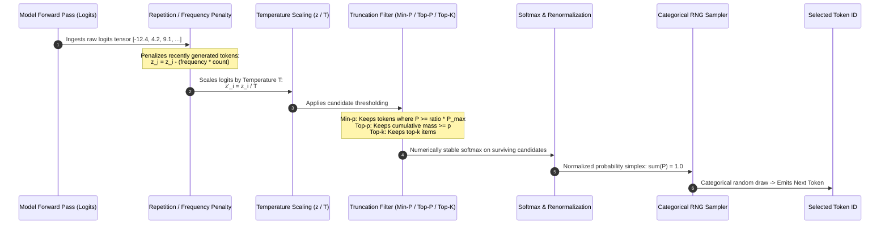
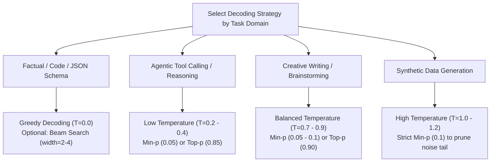
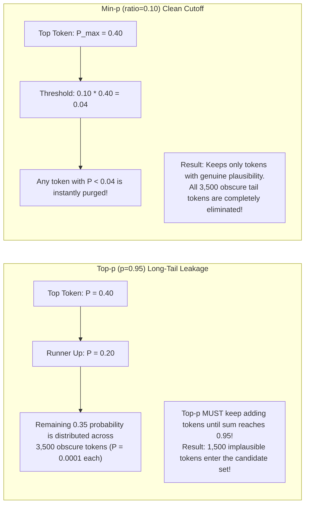
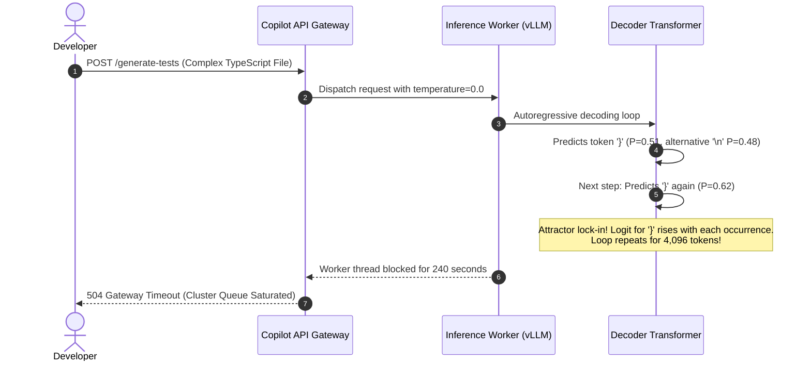

# Module 16: Sampling Strategies: Greedy, Temperature, Top-k, Top-p

> **Prerequisites:** [Module 15: Next-Token Prediction: From Logits to Probabilities](../15-next-token-prediction-from-logits-to-probabilities/README.md)  
> **Estimated Reading Time:** 25 minutes  
> **Target Audience:** AI Backend Engineers, LLM Decoding Specialists, Prompt System Designers

> [!TIP]
> **The Golden Rule of Decoding & Sampling**  
> Decoding strategies dictate the trade-off between **determinism and hallucination**. Greedy decoding ($T=0$) maximizes factual consistency but is prone to degenerative repetition loops; Top-k is unadaptive and retains implausible tokens when the model is confident; Top-p dynamically sizes candidate pools but can leak absurd tail tokens; **Min-p ($P \ge \text{ratio} \cdot P_{\max}$)** provides the most robust adaptive truncation. Always apply temperature *before* truncation filtering.

---

## 1. Visual Mental Models: The Token Selection Pipeline

During each autoregressive forward pass, the model emits raw logits over the entire vocabulary. Transforming these unbounded scores into a single next token requires a multi-stage filtering and sampling pipeline:



---

## 2. Taxonomy of Decoding Hyperparameters

Selecting the proper decoding parameters depends heavily on whether the downstream task demands strict factual invariance (SQL generation, JSON schema validation) or open-ended reasoning (creative drafting, brainstorming):



---

### Comparative Decoding Strategy Matrix

| Strategy | Formula / Rule | Adaptivity to Certainty | Repetition Risk | Tail-Nonsense Risk | Recommended Task |
| :--- | :--- | :--- | :--- | :--- | :--- |
| **Greedy ($T=0$)** | $\text{argmax}_i(z_i)$ | **None** (Takes single top item) | **High** (Prone to cyclic loops) | Zero (Never picks tail) | SQL, Code, JSON schemas, Factual QA |
| **Temperature ($T$)** | $z_i' = z_i / T$ | Non-truncating (Reshapes curve) | Drops as $T$ rises | High if $T > 1.2$ | Calibrating overall distribution entropy |
| **Top-k** | Keep fixed $k$ items | **None** (Always keeps $k$ items) | Moderate | High on confident tokens | Legacy heuristic; largely superseded |
| **Top-p (Nucleus)** | Smallest set: $\sum P_i \ge p$ | **High** (Dynamic candidate pool) | Low | Moderate (Long-tail leakage) | General conversational AI |
| **Min-p** | Keep $P_i \ge \text{ratio} \cdot P_{\max}$ | **Superior** (Scaled to peak confidence) | Low | **Lowest** (Prunes long tail cleanly) | High-temperature creative generation |
| **Beam Search** | Track $B$ candidate sequences | Structured sequence search | Low | Zero | Machine translation, ASR correction |

---

## 3. Deep Dive: Why Min-p Outperforms Top-p

While Top-p (Nucleus sampling) was a massive leap over fixed Top-k, it suffers from a well-documented mathematical flaw: **Long-Tail Leakage**.



### Empirical Verification on Real Distributions

Consider applying filters to two real-world distribution profiles:
1. **Confident Token** (e.g., following `"The capital of France is"`): $P_{\max} = 0.986$
2. **Uncertain Token** (e.g., following `"She opened the door and saw a"`): $P_{\max} = 0.150$

| Method & Parameter | Confident Distribution Kept Count | Uncertain Distribution Kept Count | Behavioral Evaluation |
| :--- | :--- | :--- | :--- |
| **Top-k ($k=3$)** | **3 tokens** (Keeps garbage tail) | **3 tokens** (Excessively truncates) | Fails in both regimes; lacks adaptivity |
| **Top-p ($p=0.90$)** | **1 token** | **9 tokens** | Adapts well to confident tokens |
| **Min-p ($\text{ratio}=0.10$)** | **1 token** | **10 tokens** | Adapts dynamically without cumulative sum tail trap |

---

## 4. Production War Stories: Incident Post-Mortem

### The Infinite Code Generation Looping Catastrophe

- **Severity:** P1 (Production Worker Resource Starvation)
- **Time to Detect:** 45 minutes
- **Impact:** 1,800 background code evaluation workers hung at 100% CPU utilization; inference API latency spiked from 350ms to 4 minutes.

#### What Happened
A software engineering copilot deployed an autonomous unit test generation feature. To ensure the generated code was strictly deterministic, engineers configured the LLM inference client with:

```json
{
  "temperature": 0.0,
  "max_tokens": 4096,
  "presence_penalty": 0.0,
  "frequency_penalty": 0.0
}
```

An enterprise customer submitted a complex TypeScript file with 14 nested interface definitions. When generating test fixtures, the model completed the code and began closing nested scopes.

Because greedy decoding ($T=0$) was enforced without repetition penalties, the model entered a **deterministic cyclic attractor**:
```typescript
} } } } } } } } } } } ... (repeated 3,800 times until max_tokens was reached)
```

Because time-to-generate scales linearly with token length, every worker thread spent 4 minutes generating useless closing braces, saturating inference queues and crashing upstream gateway health checks.

#### The Failure Sequence Diagram



#### The Fix & Architectural Hardening
1. **Dynamic Frequency Penalty:** Added a default `frequency_penalty: 0.2` and `repetition_penalty: 1.15` on code endpoints to penalize cyclic attractors.
2. **Explicit Stop Sequences:** Configured the inference engine with explicit stop tokens (`stop: ["\n\n\n", "describe(", "test("]`) to terminate generation upon test completion.
3. **Entropy Anomaly Watchdog:** Added a worker hook that aborts requests if the same token ID is selected more than 16 consecutive times.

---

## 5. Multi-Language Production Implementations

### Go: Production Sampling Engine with Temperature, Min-p, and Repetition Penalty

```go
// Package sampling implements production-grade decoding filters:
// Repetition Penalties, Temperature Scaling, and Min-p Truncation.
package main

import (
	"errors"
	"fmt"
	"math"
	"math/rand"
	"sort"
	"time"
)

type SamplingConfig struct {
	Temperature       float64
	MinPRatio         float64
	RepetitionPenalty float64 // Typically 1.0 (no penalty) to 1.3
}

type TokenCandidate struct {
	Index       int
	Probability float64
}

type DecodingEngine struct {
	rng *rand.Rand
}

func NewDecodingEngine(seed int64) *DecodingEngine {
	if seed == 0 {
		seed = time.Now().UnixNano()
	}
	return &DecodingEngine{rng: rand.New(rand.NewSource(seed))}
}

// ApplyRepetitionPenalty reduces logits for tokens that have already appeared in the sequence.
func (de *DecodingEngine) ApplyRepetitionPenalty(logits []float64, pastTokens []int, penalty float64) []float64 {
	if penalty == 1.0 || len(pastTokens) == 0 {
		return logits
	}

	adjusted := make([]float64, len(logits))
	copy(adjusted, logits)

	// Count token frequencies
	counts := make(map[int]int)
	for _, id := range pastTokens {
		counts[id]++
	}

	for id, count := range counts {
		if id >= 0 && id < len(adjusted) {
			if adjusted[id] > 0 {
				adjusted[id] /= math.Pow(penalty, float64(count))
			} else {
				adjusted[id] *= math.Pow(penalty, float64(count))
			}
		}
	}
	return adjusted
}

// SampleNextToken processes logits through temperature, min-p, and categorical sampling.
func (de *DecodingEngine) SampleNextToken(logits []float64, cfg SamplingConfig) (int, error) {
	if len(logits) == 0 {
		return 0, errors.New("empty logits array")
	}

	// 1. Greedy Fast Path
	if cfg.Temperature <= 1e-4 {
		topIdx := 0
		maxVal := logits[0]
		for i, v := range logits {
			if v > maxVal {
				maxVal = v
				topIdx = i
			}
		}
		return topIdx, nil
	}

	// 2. Temperature Scaling: z' = z / T
	scaled := make([]float64, len(logits))
	maxLogit := -math.MaxFloat64
	for i, v := range logits {
		s := v / cfg.Temperature
		scaled[i] = s
		if s > maxLogit {
			maxLogit = s
		}
	}

	// 3. Numerically Stable Softmax
	probs := make([]float64, len(scaled))
	sumExp := 0.0
	for i, s := range scaled {
		p := math.Exp(s - maxLogit)
		probs[i] = p
		sumExp += p
	}
	for i := range probs {
		probs[i] /= sumExp
	}

	// 4. Min-p Truncation: Keep candidates where P >= ratio * P_max
	maxP := 0.0
	for _, p := range probs {
		if p > maxP {
			maxP = p
		}
	}

	cutoff := maxP * cfg.MinPRatio
	var candidates []TokenCandidate
	sumRetained := 0.0

	for i, p := range probs {
		if p >= cutoff {
			candidates = append(candidates, TokenCandidate{Index: i, Probability: p})
			sumRetained += p
		}
	}

	// 5. Renormalize surviving candidate probabilities
	for i := range candidates {
		candidates[i].Probability /= sumRetained
	}

	// 6. Categorical Sampling
	r := de.rng.Float64()
	cum := 0.0
	for _, c := range candidates {
		cum += c.Probability
		if r <= cum {
			return c.Index, nil
		}
	}

	// Fallback to top candidate
	return candidates[0].Index, nil
}

func main() {
	engine := NewDecodingEngine(42)

	// Simulated logits for 5 vocabulary tokens
	rawLogits := []float64{2.5, 4.0, 1.2, 8.5, 0.4}
	cfg := SamplingConfig{
		Temperature:       0.8,
		MinPRatio:         0.05,
		RepetitionPenalty: 1.2,
	}

	pastContext := []int{3, 3, 3} // Token 3 was recently repeated multiple times

	penalized := engine.ApplyRepetitionPenalty(rawLogits, pastContext, cfg.RepetitionPenalty)
	selected, err := engine.SampleNextToken(penalized, cfg)
	if err != nil {
		panic(err)
	}

	fmt.Printf("Raw Logits:           %v\n", rawLogits)
	fmt.Printf("Penalized Logits:     %v\n", penalized)
	fmt.Printf("Selected Token Index: %d\n", selected)
}
```

---

### Node.js / TypeScript: Min-p & Nucleus Sampling Decoder

```typescript
// samplingPipeline.ts
// Production TypeScript implementation of Min-p, Top-p, and Temperature sampling.

export interface SamplingOptions {
  temperature: number; // 0.0 to 2.0
  minP?: number;       // e.g. 0.05 to 0.1
  topP?: number;       // e.g. 0.85 to 0.95
}

export interface ScoredCandidate {
  id: number;
  prob: number;
}

export class SamplingPipeline {
  /**
   * Transforms raw model logits into a sampled token ID using robust truncation.
   */
  public static sample(logits: number[], options: SamplingOptions): number {
    if (options.temperature <= 1e-4) {
      // Deterministic Greedy Argmax
      let bestIdx = 0;
      let maxVal = logits[0];
      for (let i = 1; i < logits.length; i++) {
        if (logits[i] > maxVal) {
          maxVal = logits[i];
          bestIdx = i;
        }
      }
      return bestIdx;
    }

    // 1. Temperature Scaling
    const scaled = logits.map((z) => z / options.temperature);

    // 2. Stable Softmax
    const maxLogit = Math.max(...scaled);
    const exps = scaled.map((z) => Math.exp(z - maxLogit));
    const sumExp = exps.reduce((acc, v) => acc + v, 0);
    const probs = exps.map((v) => v / sumExp);

    // 3. Truncation Selection (Min-p takes precedence if specified)
    let candidates: ScoredCandidate[] = probs.map((prob, id) => ({ id, prob }));

    if (options.minP !== undefined && options.minP > 0) {
      const maxP = Math.max(...probs);
      const threshold = maxP * options.minP;
      candidates = candidates.filter((c) => c.prob >= threshold);
    } else if (options.topP !== undefined && options.topP < 1.0) {
      // Top-p (Nucleus) filter
      candidates.sort((a, b) => b.prob - a.prob);
      let cumulative = 0;
      const filtered: ScoredCandidate[] = [];
      for (const c of candidates) {
        filtered.push(c);
        cumulative += c.prob;
        if (cumulative >= options.topP) break;
      }
      candidates = filtered;
    }

    // 4. Renormalize probabilities
    const sumRetained = candidates.reduce((acc, c) => acc + c.prob, 0);
    candidates.forEach((c) => (c.prob /= sumRetained));

    // 5. Categorical Sampling via Random Roll
    const randRoll = Math.random();
    let accumulated = 0;
    for (const c of candidates) {
      accumulated += c.prob;
      if (randRoll <= accumulated) {
        return c.id;
      }
    }

    return candidates[0].id;
  }
}

// Execution and Verification
const simulatedLogits = [1.2, 8.4, 3.1, 0.4, 2.8];
const chosen = SamplingPipeline.sample(simulatedLogits, {
  temperature: 0.7,
  minP: 0.05,
});

console.log('--- TYPESCRIPT SAMPLING VERIFICATION ---');
console.log(`Chosen Token ID via Min-p: ${chosen}`);
```

---

### Python: NumPy Vectorized Sampler & Filter Order Verification

```python
"""
sampling_benchmarks.py
Demonstrates verified NumPy implementations of Greedy, Top-k, Top-p, and Min-p.
Proves that applying truncation before vs after temperature changes the output distribution.
"""

import numpy as np

def stable_softmax(logits: np.ndarray) -> np.ndarray:
    e = np.exp(logits - np.max(logits))
    return e / np.sum(e)

def top_k_filter(probs: np.ndarray, k: int) -> np.ndarray:
    idx = np.argsort(probs)[::-1][:k]
    filtered = np.zeros_like(probs)
    filtered[idx] = probs[idx]
    return filtered / np.sum(filtered)

def top_p_filter(probs: np.ndarray, p: float) -> tuple[np.ndarray, int]:
    idx = np.argsort(probs)[::-1]
    cumulative = np.cumsum(probs[idx])
    cutoff = np.searchsorted(cumulative, p) + 1
    keep_idx = idx[:cutoff]
    filtered = np.zeros_like(probs)
    filtered[keep_idx] = probs[keep_idx]
    return filtered / np.sum(filtered), cutoff

def min_p_filter(probs: np.ndarray, ratio: float) -> tuple[np.ndarray, int]:
    threshold = np.max(probs) * ratio
    keep_mask = probs >= threshold
    filtered = np.where(keep_mask, probs, 0.0)
    return filtered / np.sum(filtered), int(np.sum(keep_mask))

def verify_adaptivity():
    print("=== 1. Adaptive Kept-Token Counts (Top-K vs Top-P vs Min-P) ===")
    
    # 1. Confident Distribution (One dominant peak)
    confident_logits = np.array([8.0, 3.0, 2.5, 1.0, 0.5, 0.2, 0.1, 0.05, 0.0, -1.0])
    # 2. Uncertain Distribution (Diffuse flat plateau)
    uncertain_logits = np.array([2.0, 1.9, 1.8, 1.7, 1.6, 1.5, 1.4, 1.3, 1.2, 1.1])

    conf_p = stable_softmax(confident_logits)
    unc_p = stable_softmax(uncertain_logits)

    print(f"Confident Peak Probability: {np.max(conf_p):.4f}")
    print(f"Uncertain Peak Probability: {np.max(unc_p):.4f}\n")

    # Benchmarking kept count
    _, conf_k = top_p_filter(conf_p, 0.90)
    _, unc_k = top_p_filter(unc_p, 0.90)

    _, conf_min = min_p_filter(conf_p, 0.10)
    _, unc_min = min_p_filter(unc_p, 0.10)

    print(f"{'Method':<16} | {'Confident Kept':<16} | {'Uncertain Kept':<16}")
    print("-" * 52)
    print(f"{'Top-k (k=3)':<16} | {'3 tokens (rigid)':<16} | {'3 tokens (rigid)':<16}")
    print(f"{'Top-p (p=0.90)':<16} | {f'{conf_k} tokens (adaptive)':<16} | {f'{unc_k} tokens (adaptive)':<16}")
    print(f"{'Min-p (r=0.10)':<16} | {f'{conf_min} tokens (adaptive)':<16} | {f'{unc_min} tokens (adaptive)':<16}")

def verify_filter_order():
    print("\n=== 2. Verification: Filter Order Changes Probability Mass ===")
    logits = np.array([6.0, 4.0, 2.0, 1.0])
    
    # Order A: Temperature (0.5) THEN Top-k (k=2)
    scaled_a = logits / 0.5
    probs_a = stable_softmax(scaled_a)
    filtered_a = top_k_filter(probs_a, k=2)

    # Order B: Top-k (k=2) on raw probs THEN apply temperature to subset
    probs_b = stable_softmax(logits)
    top2_idx = np.argsort(probs_b)[::-1][:2]
    subset_logits = logits[top2_idx] / 0.5
    filtered_b_subset = stable_softmax(subset_logits)

    print(f"Order A Top-1 Prob: {filtered_a[0]:.6f}")
    print(f"Order B Top-1 Prob: {filtered_b_subset[0]:.6f}")
    print(f"Are distributions identical? {np.isclose(filtered_a[0], filtered_b_subset[0])}")
    print("Always enforce Temperature BEFORE truncation!")

if __name__ == "__main__":
    verify_adaptivity()
    verify_filter_order()
```

---

## 6. Practical Hands-On Verification Workflows

### Verification 1: Inspecting Min-p Sampling in vLLM via Curl

vLLM exposes native `min_p` support. Test how Min-p purges tail tokens:

```bash
curl -s http://localhost:8000/v1/completions \
  -H "Content-Type: application/json" \
  -d '{
    "model": "meta-llama/Llama-3.1-8B-Instruct",
    "prompt": "The quick brown fox jumps over the",
    "temperature": 0.8,
    "min_p": 0.05,
    "max_tokens": 16
  }' | jq .choices[0].text
```

### Verification 2: Verifying Repetition Penalty Effects

```bash
curl -s http://localhost:8000/v1/completions \
  -H "Content-Type: application/json" \
  -d '{
    "model": "meta-llama/Llama-3.1-8B-Instruct",
    "prompt": "1, 2, 3, 1, 2, 3, 1, 2, 3,",
    "repetition_penalty": 1.3,
    "temperature": 0.0,
    "max_tokens": 10
  }' | jq .choices[0].text
```

---

## 7. Operational Validation Checkpoints

### Scenario 1: The Greedy Decoding Hallucination Trap
<details>
<summary><strong>Question:</strong> A team builds a customer support agent. To minimize hallucinations, the product manager requests setting <code>temperature = 0.0</code>. However, the model frequently repeats apology phrases in an infinite loop ("I apologize for the delay. I apologize for the delay..."). What caused this, and why didn't greedy decoding prevent it?</summary>

**Answer:**
Greedy decoding ($T=0$) is purely deterministic; it chooses the single highest-probability token at every step. 

However, autoregressive models condition on their own past output. Once the model emits "I apologize for the delay.", that exact phrase now exists in its input prompt. 

Language models naturally assign high probability to repeating rhythmic rhetorical patterns found in their context. At step $N$, the most probable token is "I", followed by "apologize", creating a positive feedback loop (cyclic attractor). 

Setting $T=0$ does not break this cycle; it guarantees the model will select the cyclic token every time. 

The fix is adding a **repetition penalty** ($\ge 1.15$) or **frequency penalty** ($\ge 0.2$), or switching to low-temperature sampling ($T=0.3$) with Min-p.
</details>

### Scenario 2: Top-p vs. Min-p on Highly Creative Writing
<details>
<summary><strong>Question:</strong> An authoring platform generates fantasy novel chapters. At <code>temperature = 1.0</code> and <code>top_p = 0.95</code>, the prose occasionally contains nonsensical gibberish or obscure archaic words. When switching to <code>min_p = 0.08</code>, the prose remains creative while completely eliminating gibberish. What caused this difference?</summary>

**Answer:**
This is the classic **Top-p Long-Tail Leakage** failure mode. 

In open-ended creative generation, the probability distribution is diffuse: the top 5 words may only account for 40% of the total probability mass. To satisfy `top_p = 0.95`, the sampler must keep adding thousands of low-probability tail tokens ($P_i < 0.0001$) until the cumulative sum hits 95%. 

Inevitably, an obscure, low-probability token gets drawn. 

**Min-p** evaluates candidate tokens relative to the peak: $P_i \ge 0.08 \times P_{\max}$. If the top token has probability $0.10$, only tokens with $P \ge 0.008$ are retained. 

All 10,000 noise tokens in the long tail are pruned immediately, regardless of their cumulative mass.
</details>

### Scenario 3: Order of Operations in Custom Inference Gateways
<details>
<summary><strong>Question:</strong> A gateway engineer implements sampling by first running Top-k filtering ($k=50$) on raw logits, and then applying temperature scaling $z / T$ to the remaining 50 logits. Why is this mathematically incorrect?</summary>

**Answer:**
Temperature reshapes the relative sharpness of the distribution across the *entire* vocabulary. 

If you apply Top-k truncation *before* temperature scaling, the set of 50 retained tokens is selected based on the unscaled distribution ($T=1.0$). 

If the user requested high temperature ($T=1.5$), tokens outside the top 50 that should have gained relative plausibility under a flatter distribution have already been discarded. 

Conversely, if the user requested low temperature ($T=0.2$), the distribution should have collapsed around 1 or 2 tokens, but the gate still passed 50 candidates. 

The mathematically sound order is: **Logit Bias / Repetition Penalty $\rightarrow$ Temperature Scaling $\rightarrow$ Truncation Filtering (Top-k/Top-p/Min-p) $\rightarrow$ Softmax Normalization $\rightarrow$ Categorical Draw**.
</details>

---

## 8. Summary & Next Steps

Decoding and sampling govern how transformer predictions are realized into human text. Remember:
- Greedy decoding ($T=0$) is deterministic but vulnerable to cyclic repetition loops.
- Top-k uses an unadaptive fixed count; Top-p dynamically sizes sets but leaks long-tail noise.
- Min-p ($P_i \ge \text{ratio} \cdot P_{\max}$) provides the cleanest adaptive truncation for generative applications.
- Always scale logits by temperature *before* executing truncation filters.

Continue to [Module 17: Capstone Project](../17-capstone-project/README.md) to integrate tokenizer engineering, prompt cache alignment, cost estimation, and injection defense into an end-to-end production AI gateway.
