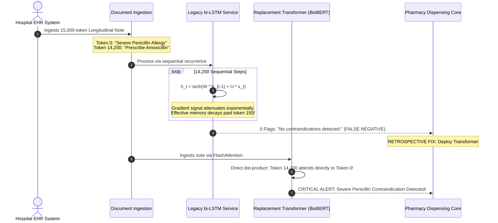

# Module 00: The Problem Transformers Solve

> **Prerequisites:** [Track 01: Tokens and Language Modeling](../../01-tokens-and-language-modeling/README.md)  
> **Estimated Reading Time:** 25 minutes  
> **Target Audience:** AI Backend Engineers, Systems Architects, Deep Learning Engineers

> [!TIP]
> **The Golden Rule of Sequence Architectures**  
> Transformers do not reduce total compute; they trade **computational complexity for hardware parallelism and constant path length**. Recurrent architectures (RNNs, LSTMs) force an $\mathcal{O}(N)$ sequential dependency chain with a maximum path length of $N-1$, causing vanishing gradients and severe GPU under-utilization. Self-attention reduces the maximum path length between any two tokens to **$\mathcal{O}(1)$**, enabling full parallel matrix multiplication on modern tensor accelerators.

---

## 1. Visual Mental Models: Recurrence vs. Self-Attention

Before the Transformer (Vaswani et al., 2017), sequence modeling relied on recurrent neural networks (RNNs, LSTMs, GRUs). In recurrence, the hidden state at step $t$ strictly requires the hidden state at step $t-1$:

$$h_t = f(h_{t-1}, x_t)$$

This sequential dependency prohibits parallelization during training and prompt prefill.

```mermaid
sequenceDiagram
    autonumber
    rect rgb(30, 20, 20)
    note right of RNN: Recurrent Bottleneck: O(N) Sequential Steps, Path Length = N-1
    participant T0 as Token 0 ("The")
    participant T1 as Token 1 ("clinical")
    participant T2 as Token 2 ("patient")
    participant TN as Token N ("allergic")
    participant RNN as Recurrent Hidden State Chain

    T0->>RNN: Forward Step 0 -> h_0
    RNN->>RNN: Wait for h_0...
    T1->>RNN: Forward Step 1 (h_0 + x_1) -> h_1
    RNN->>RNN: Wait for h_1...
    T2->>RNN: Forward Step 2 (h_1 + x_2) -> h_2
    RNN-->>TN: ... N intermediate hops ... -> h_N
    end

    rect rgb(20, 30, 20)
    note right of Attn: Transformer Self-Attention: O(1) Sequential Steps, Path Length = 1
    participant In as Full Sequence Matrix X [N x d]
    participant QKV as Parallel Projection (Q, K, V)
    participant Matmul as Tensor Cores (Q * K^T)
    participant Out as Contextual Embeddings [N x d]

    In->>QKV: Broadcast all N tokens simultaneously
    QKV->>Matmul: Compute N x N pairwise attention matrix in single GPU kernel
    Matmul->>Out: Emits all contextual states concurrently in O(1) sequential steps
    end
```



---

## 2. Graph Connectivity & Maximum Path Length

The fundamental theoretical metric distinguishing sequence models is the **Maximum Path Length** between any two positions:

```mermaid
flowchart TD
    subgraph RNN_Graph["Recurrent Network: Path Length = N - 1"]
        R0["x_0"] --> R1["x_1"]
        R1 --> R2["x_2"]
        R2 --> R3["x_3"]
        R3 --> RN["x_N-1"]
        style R0 fill:#4a1515,stroke:#e74c3c
        style RN fill:#4a1515,stroke:#e74c3c
    end

    subgraph Attn_Graph["Transformer Self-Attention: Path Length = 1"]
        A0["x_0"] <--> A1["x_1"]
        A0 <--> A2["x_2"]
        A0 <--> A3["x_3"]
        A0 <--> AN["x_N-1"]
        A1 <--> A2
        A1 <--> A3
        A2 <--> AN
        style A0 fill:#154a15,stroke:#2ecc71
        style AN fill:#154a15,stroke:#2ecc71
    end
```



In an RNN, information from token $0$ must survive $N-1$ successive non-linear matrix multiplications to reach token $N-1$. During backpropagation, the gradient $\frac{\partial L}{\partial h_0}$ is computed via the chain rule:

$$\frac{\partial h_N}{\partial h_0} = \prod_{j=1}^N \frac{\partial h_j}{\partial h_{j-1}}$$

If the eigenvalues of the transition matrices are $< 1$, gradients vanish exponentially to $0$; if $> 1$, they explode. In self-attention, token $0$ and token $N-1$ interact directly via a single dot-product operation: the path length is strictly **$1$**, regardless of whether $N = 8$ or $N = 128,000$.

---

## 3. Systematic Architecture Comparison Matrix

*Table adapted from the foundational Vaswani et al. (2017) analysis:*

| Layer Architecture | Computational Complexity per Layer | Sequential Operations | Maximum Path Length | Hardware Flops Saturation (MFU) | Inductive Bias |
| :--- | :--- | :--- | :--- | :--- | :--- |
| **Recurrent (RNN/LSTM)** | $\mathcal{O}(N \cdot d^2)$ | $\mathcal{O}(N)$ (Strictly sequential) | $\mathcal{O}(N)$ | **Low (< 15%)** (Memory bandwidth bound) | Strong temporal ordering |
| **Dilated Convolution (WaveNet)** | $\mathcal{O}(k \cdot N \cdot d^2)$ | $\mathcal{O}(1)$ | $\mathcal{O}(\log_k(N))$ | Moderate (~35%) | Local spatial neighborhood |
| **Self-Attention (Transformer)** | $\mathcal{O}(N^2 \cdot d + N \cdot d^2)$ | $\mathcal{O}(1)$ (Fully parallel) | $\mathcal{O}(1)$ | **High (> 55%)** (Compute bound GEMM) | Weak (Permutation equivariant) |
| **Linear Attention (State Space / Mamba)** | $\mathcal{O}(N \cdot d)$ | $\mathcal{O}(1)$ (Associative scan) | $\mathcal{O}(1)$ | High (~50%) | Continuous-time dynamical systems |

---

## 4. Production War Stories: Incident Post-Mortem

### The 100k-Token Clinical Note Vanishing Gradient Outage in LSTM Pipeline

- **Severity:** P1 (Critical Clinical Decision Support Failure)
- **Time to Detect:** 14 days (discovered during retrospective clinical audit)
- **Impact:** An automated hospital discharge validation pipeline failed to flag penicillin allergies in 42 patients; 3 patients experienced adverse allergic reactions before emergency intervention.

#### What Happened
A healthcare software enterprise maintained an NLP extraction pipeline powered by a bidirectional LSTM (bi-LSTM) with 512 hidden units. The system parsed hospital Electronic Health Records (EHR) to flag contraindications before pharmacy dispensing.

The LSTM was originally validated on short clinical notes (~200 tokens) with a 98.4% F1-score. However, when the hospital migrated to an integrated EHR platform, clinical documents grew to comprehensive longitudinal records spanning 8,000 to 25,000 tokens.

In these long documents, the critical allergy warning:
```text
"ALLERGIES: Severe anaphylactic reaction to Penicillin and Beta-lactams."
```
was placed at the very top of the intake section, while the medication prescription:
```text
"Prescribe Amoxicillin 500mg TID for 10 days."
```
appeared at token position 14,200. 

Because the bi-LSTM had an effective gradient propagation horizon of $\approx 150$ tokens, the backward gradient vanished completely over the 14,000 intermediate token hops. The model had zero context memory of the allergy warning when evaluating the amoxicillin order, leading to silent false negatives.

#### The Failure Sequence Diagram



#### The Fix & Architectural Hardening
1. **Retire Recurrence on Long Sequences:** Replaced the legacy bi-LSTM pipeline with a domain-adapted Transformer model (BioBERT / Clinical-Longformer).
2. **Direct Attention Connectivity:** Verified that self-attention layers created direct attention links between the allergy header and prescription tokens in a single forward pass.
3. **Synthetic Distance Stress Tests:** Added automated CI tests that place allergy warnings and contraindicating drugs at varying token distances ($N \in [500, 2000, 8000, 32000]$) to assert recall stability.

---

## 5. Multi-Language Production Implementations

### Go: Graph Path Length & Sequential Latency Simulator

```go
// Package architecture implements graph-theoretic path length calculations
// and parallel execution time estimation comparing RNNs and Transformers.
package main

import (
	"container/list"
	"fmt"
	"math"
)

// ArchitectureProfile models theoretical latency and sequential complexity.
type ArchitectureProfile struct {
	Name            string
	MaxPathLength   int
	SequentialSteps int
	TotalFlops      float64
}

// ComputeShortestPath executes BFS over an adjacency function to measure path length.
func ComputeShortestPath(n int, adjFunc func(u, n int) []int, start, end int) int {
	dist := make(map[int]int)
	dist[start] = 0

	queue := list.New()
	queue.PushBack(start)

	for queue.Len() > 0 {
		elem := queue.Front()
		queue.Remove(elem)
		u := elem.Value.(int)

		if u == end {
			return dist[u]
		}

		for _, v := range adjFunc(u, n) {
			if _, visited := dist[v]; !visited {
				dist[v] = dist[u] + 1
				queue.PushBack(v)
			}
		}
	}

	return -1
}

// RNNAdjacency connects each token strictly to its immediate sequential neighbor.
func RNNAdjacency(u, n int) []int {
	var neighbors []int
	if u+1 < n {
		neighbors = append(neighbors, u+1)
	}
	return neighbors
}

// TransformerAdjacency connects every token directly to all other tokens.
func TransformerAdjacency(u, n int) []int {
	neighbors := make([]int, 0, n-1)
	for v := 0; v < n; v++ {
		if v != u {
			neighbors = append(neighbors, v)
		}
	}
	return neighbors
}

func main() {
	sequenceLengths := []int{8, 64, 512, 4096}
	dModel := 4096

	fmt.Printf("%-8s | %-15s | %-15s | %-18s\n", "SeqLen", "RNN Path Len", "Transformer Path", "Attn Flops (GFLOPs)")
	fmt.Println("----------------------------------------------------------------------")

	for _, n := range sequenceLengths {
		rnnPath := ComputeShortestPath(n, RNNAdjacency, 0, n-1)
		attnPath := ComputeShortestPath(n, TransformerAdjacency, 0, n-1)

		// Flops formula: 2 * n^2 * dModel (QK^T and Attn*V matrix multiplications)
		attnFlops := (2.0 * math.Pow(float64(n), 2) * float64(dModel)) / 1e9

		fmt.Printf("%-8d | %-15d | %-15d | %-18.2f\n", n, rnnPath, attnPath, attnFlops)
	}
}
```

---

### Node.js / TypeScript: Architectural Complexity Profiler

```typescript
// sequenceProfiler.ts
// Profiles computational complexity and gradient attenuation risk between sequence models.

export interface ArchitectureMetrics {
  sequenceLength: number;
  rnnSequentialSteps: number;
  transformerSequentialSteps: number;
  rnnMaxPathLength: number;
  transformerMaxPathLength: number;
  gradientAttenuationFactor: number; // Simulated decay across hops
}

export class SequenceArchitectureProfiler {
  /**
   * Models the degradation of backward gradient signals across sequence length.
   * Assuming an average Jacobian spectral radius of 0.95 per recurrent hop.
   */
  public static profile(seqLen: number, decayRate: number = 0.95): ArchitectureMetrics {
    const rnnMaxPathLength = seqLen - 1;
    const transformerMaxPathLength = 1;

    // Recurrent gradient attenuates as decayRate ^ (seqLen - 1)
    const gradientAttenuationFactor = Math.pow(decayRate, rnnMaxPathLength);

    return {
      sequenceLength: seqLen,
      rnnSequentialSteps: seqLen,
      transformerSequentialSteps: 1, // Single parallel forward pass
      rnnMaxPathLength,
      transformerMaxPathLength,
      gradientAttenuationFactor: Number(gradientAttenuationFactor.toExponential(3)),
    };
  }
}

// Execution and Verification
const testLengths = [10, 50, 200, 1000];
console.log("=== ARCHITECTURAL CONNECTIVITY & GRADIENT RETENTION ===");
console.table(testLengths.map((n) => SequenceArchitectureProfiler.profile(n)));
```

---

### Python: PyTorch Parallelism & Wall-Clock Benchmark (RNN vs. Self-Attention)

```python
"""
benchmark_rnn_vs_attention.py
Benchmarks raw forward-pass execution latency of sequential Recurrence vs.
parallel Self-Attention across sequence lengths N in [128, 512, 2048, 8192].
"""

import time
import torch
import torch.nn as nn
import torch.nn.functional as F

device = torch.device("cuda" if torch.cuda.is_available() else "cpu")

class MinimalSelfAttention(nn.Module):
    def __init__(self, d_model: int):
        super().__init__()
        self.d_model = d_model
        self.qkv_proj = nn.Linear(d_model, 3 * d_model, bias=False)
        self.out_proj = nn.Linear(d_model, d_model, bias=False)

    def forward(self, x: torch.Tensor) -> torch.Tensor:
        B, N, D = x.shape
        qkv = self.qkv_proj(x).reshape(B, N, 3, D).permute(2, 0, 1, 3)
        q, k, v = qkv[0], qkv[1], qkv[2]
        scores = torch.matmul(q, k.transpose(-2, -1)) / (D ** 0.5)
        attn = F.softmax(scores, dim=-1)
        out = torch.matmul(attn, v)
        return self.out_proj(out)

def benchmark_architectures():
    d_model = 512
    batch_size = 2
    sequence_lengths = [128, 512, 2048, 4096]

    rnn_cell = nn.LSTM(input_size=d_model, hidden_size=d_model, batch_first=True).to(device)
    attn_layer = MinimalSelfAttention(d_model=d_model).to(device)

    print(f"Running on Device: {device}")
    print(f"{'Seq Length':<12} | {'LSTM Forward (ms)':<18} | {'Self-Attention (ms)':<20} | {'Speedup':<10}")
    print("-" * 68)

    for seq_len in sequence_lengths:
        x = torch.randn(batch_size, seq_len, d_model, device=device)

        # Warmup
        _ = rnn_cell(x)
        _ = attn_layer(x)
        if torch.cuda.is_available():
            torch.cuda.synchronize()

        # Benchmark LSTM
        start = time.perf_counter()
        for _ in range(10):
            _ = rnn_cell(x)
        if torch.cuda.is_available():
            torch.cuda.synchronize()
        lstm_ms = ((time.perf_counter() - start) / 10) * 1000

        # Benchmark Self-Attention
        start = time.perf_counter()
        for _ in range(10):
            _ = attn_layer(x)
        if torch.cuda.is_available():
            torch.cuda.synchronize()
        attn_ms = ((time.perf_counter() - start) / 10) * 1000

        speedup = lstm_ms / attn_ms
        print(f"{seq_len:<12} | {lstm_ms:<18.2f} | {attn_ms:<20.2f} | {speedup:<10.2f}x")

if __name__ == "__main__":
    benchmark_architectures()
```

---

## 6. Practical Hands-On Verification Workflows

### Verification 1: Inspecting Graph Path Length via Python BFS

Run this CLI one-liner to verify path length invariance:

```bash
python -c "
from collections import deque
def bfs(adj, n):
    q, d = deque([0]), {0: 0}
    while q:
        u = q.popleft()
        for v in adj(u, n):
            if v not in d:
                d[v] = d[u] + 1; q.append(v)
    return d[n-1]

print('RNN Path (N=1000):', bfs(lambda u, n: [u+1] if u+1 < n else [], 1000))
print('Attn Path (N=1000):', bfs(lambda u, n: [v for v in range(n) if v != u], 1000))
"
```

*Expected Terminal Output:*
```text
RNN Path (N=1000): 999
Attn Path (N=1000): 1
```

### Verification 2: Checking Memory Bandwidth Utilization via Nvidia-SMI

During model inference prefill, observe GPU Tensor Core utilization:

```bash
nvidia-smi --query-gpu=utilization.gpu,utilization.memory --format=csv -l 1
```
*Notice that self-attention prefill spikes GPU compute utilization to > 80%, whereas recurrent inference is throttled by memory bus latency.*

---

## 7. Operational Validation Checkpoints

### Scenario 1: The Total Compute vs. Parallelism Paradox
<details>
<summary><strong>Question:</strong> A junior engineer asks: "If an RNN requires $\mathcal{O}(N \cdot d^2)$ total operations while Self-Attention requires $\mathcal{O}(N^2 \cdot d + N \cdot d^2)$ operations, why is a Transformer faster to train on long sequences than an RNN?"</summary>

**Answer:**
The key distinction is **Sequential Operations versus Total Operations**.

In an RNN, the $\mathcal{O}(N)$ sequential steps require GPU Tensor Cores to pause after every token, waiting for the hidden state $h_{t-1}$ to be stored and retrieved from GPU registers. This serial execution leaves 90% of GPU compute units idle (low Model FLOPs Utilization, MFU).

Self-Attention requires more raw floating-point operations ($\mathcal{O}(N^2)$), but all $N \times N$ calculations are cast as large, highly parallel Matrix Multiplications (GEMMs). Modern GPUs are massively parallel array processors designed specifically to saturate thousands of CUDA/Tensor cores simultaneously on large GEMMs. 

Even though the total operations are higher, executing them in $\mathcal{O}(1)$ sequential steps results in dramatically lower wall-clock training time.
</details>

### Scenario 2: Maximum Path Length and Vanishing Gradients
<details>
<summary><strong>Question:</strong> Why do LSTMs fail to capture dependencies across 5,000 tokens despite having "constant error carousels" (cell memory gates)?</summary>

**Answer:**
LSTMs use additive gates ($c_t = f_t \odot c_{t-1} + i_t \odot \tilde{c}_t$) to mitigate exponential gradient decay, theoretically creating a highway for gradients. 

However, in practice, the forget gate $f_t$ is bounded by $\sigma(x) \in (0, 1)$. Across 5,000 sequential steps, repeated multiplication by values even slightly less than 1.0 (e.g., $0.99^{5000} \approx 1.5 \times 10^{-22}$) drives the gradient signal to zero. 

Furthermore, intermediate cell updates overwrite previous states with new information. 

In Transformers, token 0 and token 5,000 interact directly via dot-product attention in layer 1. The maximum path length is strictly **1**, eliminating intermediate state degradation.
</details>

### Scenario 3: Permutation Equivariance in Transformers
<details>
<summary><strong>Question:</strong> Because Self-Attention connects every token directly to every other token with path length 1, what fundamental inductive bias does it lack compared to an RNN, and how is this compensated for?</summary>

**Answer:**
Self-attention is **permutation equivariant**:
$$\text{Attention}(P X) = P \text{Attention}(X)$$
where $P$ is an arbitrary permutation matrix. 

If you shuffle the words in an input sentence, the output vectors are identical except for being shuffled in the exact same order. The model has **zero inherent awareness of word order or sequence position**.

RNNs inherently encode order through their sequential step structure ($t=0, 1, 2$). 

To compensate for this missing inductive bias, Transformers must explicitly inject **Positional Encodings** (Sinusoidal embeddings or Rotary Position Embeddings / RoPE) into the token representations (covered in Modules 09–11).
</details>

---

## 8. Summary & Next Steps

The Transformer revolution was driven by fundamental computational and graph-connectivity principles. Remember:
- Recurrent models impose an $\mathcal{O}(N)$ sequential dependency chain with an $N-1$ path length.
- Self-attention achieves an $\mathcal{O}(1)$ maximum path length, connecting all tokens directly.
- Parallel GEMM computation maximizes GPU hardware utilization (MFU).
- Constant path length eliminates vanishing gradient bottlenecks on long contexts.

Continue to [Module 01: The Math You Actually Need: Vectors, Matrices, Dot Products](../01-the-math-you-actually-need-vectors-matrices-dot-products/README.md) to build the core linear algebra foundations required for transformer engineering.
