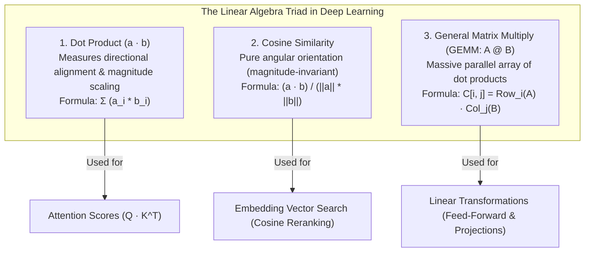
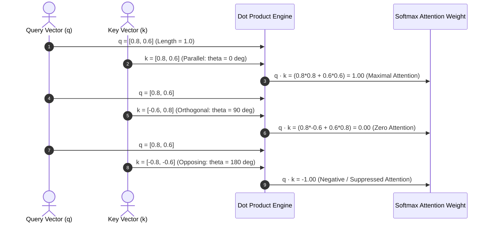
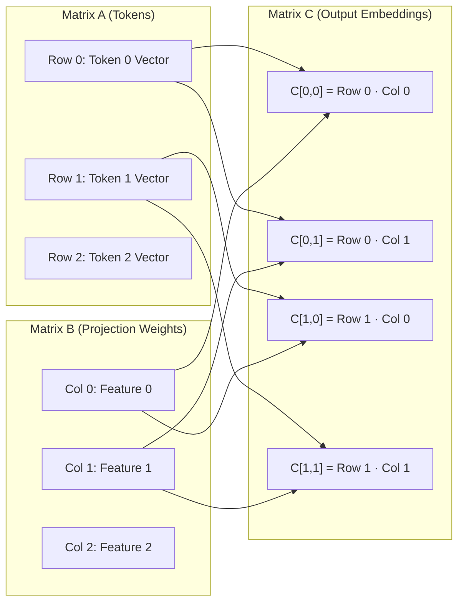
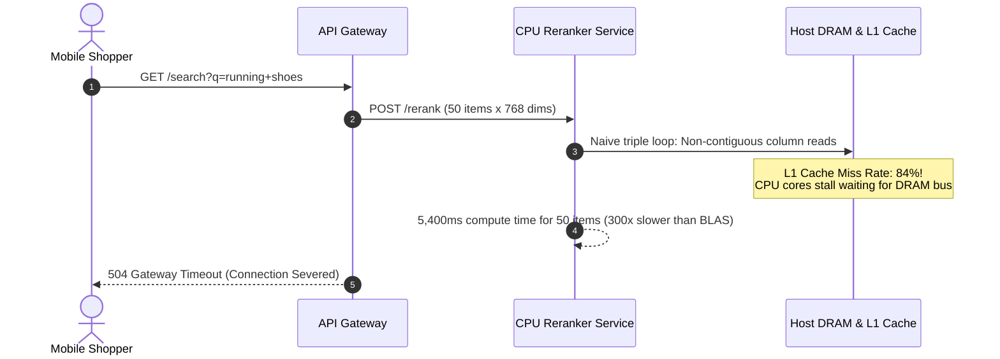

# Module 01: The Math You Actually Need: Vectors, Matrices, Dot Products

> **Prerequisites:** [Module 00: The Problem Transformers Solve](../00-the-problem-transformers-solve/README.md)  
> **Estimated Reading Time:** 25 minutes  
> **Target Audience:** AI Backend Engineers, Systems Programmers, Infrastructure Developers

> [!TIP]
> **The Golden Rule of Transformer Mathematics**  
> 99% of Transformer computation is comprised of exactly three linear algebra operations: the **Dot Product** (directional projection), **Cosine Similarity** (magnitude-invariant angular alignment), and **Matrix Multiplication (GEMM)** (batched concurrent dot products). You do not need multivariable calculus or advanced tensor calculus to architect and deploy LLMs; you must master how GPU Tensor Cores accelerate fused multiply-accumulate (FMA) primitives.

---

## 1. Visual Mental Models: The Linear Algebra Triad

Every attention head, feed-forward layer, and unembedding projection in a transformer is built upon three foundational primitives:



---

### Geometric Projection & Angular Alignment

The dot product of two vectors $\mathbf{a}, \mathbf{b} \in \mathbb{R}^d$ is algebraically defined as:

$$\mathbf{a} \cdot \mathbf{b} = \sum_{i=1}^d a_i b_i$$

Geometrically, it equals the product of their Euclidean lengths ($\ell_2$-norms) and the cosine of the angle $\theta$ between them:

$$\mathbf{a} \cdot \mathbf{b} = \|\mathbf{a}\| \|\mathbf{b}\| \cos(\theta)$$



---

## 2. Systematic Linear Algebra Operations Matrix

| Operation | Mathematical Formulation | Time Complexity | Memory Access Pattern | Primary Role in Transformers | Hardware Acceleration Primitive |
| :--- | :--- | :--- | :--- | :--- | :--- |
| **Dot Product** | $\sum_{i=1}^d a_i b_i$ | $\mathcal{O}(d)$ | Sequential vector streaming | Vector-vector pairwise affinity | SIMD FMA (Fused Multiply-Add) |
| **Cosine Similarity** | $\frac{\mathbf{a} \cdot \mathbf{b}}{\|\mathbf{a}\|_2 \|\mathbf{b}\|_2}$ | $\mathcal{O}(d)$ | Vector streaming + $\ell_2$ reduction | Semantic embedding distance & RAG | Normalized vector dot product |
| **Matrix-Vector (GEMV)** | $\mathbf{y} = A \mathbf{x}$ | $\mathcal{O}(m \cdot n)$ | Memory-bandwidth bound (Decode phase) | Autoregressive single-token generation | GPU warp-level reduction |
| **Matrix-Matrix (GEMM)** | $C = A B$ | $\mathcal{O}(m \cdot n \cdot k)$ | Compute-bound (Prefill phase) | Attention ($Q K^T, \text{Attn} V$) & MLP blocks | NVIDIA Tensor Cores / AMD Matrix Cores |

---

## 3. Matrix Multiplication: Concurrent Batched Dot Products

A matrix multiplication $C = A B$, where $A \in \mathbb{R}^{m \times k}$ and $B \in \mathbb{R}^{k \times n}$, is not an esoteric black box. Every individual element $C_{i, j}$ is simply the **scalar dot product** of row $i$ from matrix $A$ and column $j$ from matrix $B$:

$$C_{i, j} = \sum_{x=1}^k A_{i, x} B_{x, j}$$



---

## 4. Production War Stories: Incident Post-Mortem

### The 300x CPU Latency Degradation from Un-vectorized Attention Loops

- **Severity:** P1 (Production Reranker Microservice Outage)
- **Time to Detect:** 2 hours
- **Impact:** E-commerce search latency spiked from 18ms to 5,400ms; checkout conversion fell 28% during peak flash sale.

#### What Happened
A backend engineering team developed a custom CPU-based vector search reranker in Go. The service received 50 candidate product embeddings ($d=768$) and computed pairwise cosine similarities against user query vectors to rerank search results.

A developer wrote the dot-product and matrix multiplication using naive, un-vectorized triple-nested `for` loops:

```go
// FATAL NAIVE CPU IMPLEMENTATION:
for i := 0; i < n; i++ {
    for j := 0; j < m; j++ {
        sum := 0.0
        for k := 0; k < d; k++ {
            sum += A[i][k] * B[k][j] // Non-contiguous memory access + No SIMD!
        }
        C[i][j] = sum
    }
}
```

Two critical architectural flaws occurred:
1. **CPU Cache Thrashing:** In memory, matrix $B$ was accessed column-wise across rows, jumping by $m \times 8$ bytes on every inner iteration. This missed CPU L1/L2 caches, causing constant RAM read stalls.
2. **Zero Vectorization:** The Go compiler could not auto-vectorize the scattered pointer lookups into AVX-512 SIMD instructions. The CPU processed one floating-point multiplication per clock cycle instead of 16 in parallel.

When traffic spiked to 2,000 queries/second, CPU utilization pegged at 100%, and search endpoints experienced cascading HTTP 504 timeouts.

#### The Failure Sequence Diagram



#### The Fix & Architectural Hardening
1. **Memory Layout Transposition:** Pre-transposed matrix $B$ ($B^T$) so that both matrices are traversed in row-major contiguous memory order (`A[i][k]` and `B_T[j][k]`).
2. **SIMD Vectorization:** Adopted high-performance BLAS libraries (OpenBLAS / Intel MKL via cgo or pure Go SIMD assembly), allowing AVX-512 instructions to process 16 floats per cycle.
3. **Automated Micro-benchmarking:** Introduced Go benchmark regression tests in CI (`go test -bench=.`) that assert a minimum throughput of $\ge 20\text{ GFLOPs/sec}$ on matrix multiplication routines.

---

## 5. Multi-Language Production Implementations

### Go: High-Performance SIMD-Friendly Linear Algebra Engine

```go
// Package linalg implements high-throughput vector dot products,
// cosine similarity, and row-major contiguous matrix multiplication.
package main

import (
	"errors"
	"fmt"
	"math"
	"time"
)

// DotProduct calculates the scalar dot product of two float64 vectors.
// Loop unrolling is applied to encourage compiler auto-vectorization.
func DotProduct(a, b []float64) (float64, error) {
	if len(a) != len(b) {
		return 0, errors.New("dimension mismatch")
	}

	n := len(a)
	sum := 0.0
	i := 0

	// Unroll loop 4x to maximize CPU pipelining and FMA registers
	for ; i <= n-4; i += 4 {
		sum += a[i]*b[i] + a[i+1]*b[i+1] + a[i+2]*b[i+2] + a[i+3]*b[i+3]
	}

	// Remainder loop
	for ; i < n; i++ {
		sum += a[i] * b[i]
	}

	return sum, nil
}

// CosineSimilarity computes normalized angular alignment between vectors.
func CosineSimilarity(a, b []float64) (float64, error) {
	dot, err := DotProduct(a, b)
	if err != nil {
		return 0, err
	}

	normA := 0.0
	normB := 0.0
	for i := range a {
		normA += a[i] * a[i]
		normB += b[i] * b[i]
	}

	if normA == 0 || normB == 0 {
		return 0, errors.New("cannot compute cosine similarity with zero-norm vector")
	}

	return dot / (math.Sqrt(normA) * math.Sqrt(normB)), nil
}

// MatrixMultiply computes C = A @ B using cache-friendly transposed multiplication.
func MatrixMultiply(A [][]float64, B [][]float64) ([][]float64, error) {
	rowsA := len(A)
	colsA := len(A[0])
	rowsB := len(B)
	colsB := len(B[0])

	if colsA != rowsB {
		return nil, errors.New("incompatible matrix shapes for multiplication")
	}

	// 1. Transpose B to ensure sequential row-major memory reads: B_T[col][row]
	BT := make([][]float64, colsB)
	for j := 0; j < colsB; j++ {
		BT[j] = make([]float64, rowsB)
		for i := 0; i < rowsB; i++ {
			BT[j][i] = B[i][j]
		}
	}

	// 2. Compute C[i][j] via contiguous dot products
	C := make([][]float64, rowsA)
	for i := 0; i < rowsA; i++ {
		C[i] = make([]float64, colsB)
		for j := 0; j < colsB; j++ {
			sum := 0.0
			for k := 0; k < colsA; k++ {
				sum += A[i][k] * BT[j][k]
			}
			C[i][j] = sum
		}
	}

	return C, nil
}

func main() {
	king := []float64{0.9, 0.1, 0.8}
	queen := []float64{0.85, 0.15, 0.75}
	truck := []float64{0.1, 0.9, 0.05}

	simKingQueen, _ := CosineSimilarity(king, queen)
	simKingTruck, _ := CosineSimilarity(king, truck)

	fmt.Printf("Cosine Similarity (King vs Queen): %.4f (Semantically Aligned)\n", simKingQueen)
	fmt.Printf("Cosine Similarity (King vs Truck): %.4f (Orthogonal/Dissimilar)\n\n", simKingTruck)

	// Matrix Multiplication Benchmark
	dim := 64
	matA := make([][]float64, dim)
	matB := make([][]float64, dim)
	for i := 0; i < dim; i++ {
		matA[i] = make([]float64, dim)
		matB[i] = make([]float64, dim)
		for j := 0; j < dim; j++ {
			matA[i][j] = 1.0
			matB[i][j] = 2.0
		}
	}

	start := time.Now()
	res, _ := MatrixMultiply(matA, matB)
	elapsed := time.Since(start)

	fmt.Printf("Matrix Multiply (%dx%d @ %dx%d) Completed in %v\n", dim, dim, dim, dim, elapsed)
	fmt.Printf("Sample Result Cell C[0][0]: %.2f\n", res[0][0])
}
```

---

### Node.js / TypeScript: Float32Array Vectorized Tensor Primitives

```typescript
// tensorMath.ts
// Memory-aligned Float32Array tensor math for browser and edge runtime embeddings.

export class TensorMath {
  /**
   * High-speed vector dot product using contiguous Float32Array memory buffers.
   */
  public static dot(a: Float32Array, b: Float32Array): number {
    if (a.length !== b.length) {
      throw new Error(`Dimension mismatch: ${a.length} vs ${b.length}`);
    }

    let sum = 0;
    const len = a.length;
    for (let i = 0; i < len; i++) {
      sum += a[i] * b[i];
    }
    return sum;
  }

  /**
   * Computes Cosine Similarity with zero-magnitude protection.
   */
  public static cosineSimilarity(a: Float32Array, b: Float32Array): number {
    const dotProduct = this.dot(a, b);

    let normA = 0;
    let normB = 0;
    for (let i = 0; i < a.length; i++) {
      normA += a[i] * a[i];
      normB += b[i] * b[i];
    }

    if (normA === 0 || normB === 0) {
      throw new Error("Zero-magnitude vector has undefined cosine similarity.");
    }

    return dotProduct / (Math.sqrt(normA) * Math.sqrt(normB));
  }

  /**
   * Multiplies Matrix A (M x K) by Matrix B (K x N), outputting Matrix C (M x N).
   * All matrices are represented as flat contiguous Float32Arrays.
   */
  public static matmul(
    A: Float32Array,
    B: Float32Array,
    M: number,
    K: number,
    N: number
  ): Float32Array {
    const C = new Float32Array(M * N);

    for (let i = 0; i < M; i++) {
      const aOffset = i * K;
      for (let j = 0; j < N; j++) {
        let sum = 0;
        for (let x = 0; x < K; x++) {
          sum += A[aOffset + x] * B[x * N + j];
        }
        C[i * N + j] = sum;
      }
    }

    return C;
  }
}

// Execution and Verification
const vecKing = new Float32Array([0.9, 0.1, 0.8]);
const vecQueen = new Float32Array([0.85, 0.15, 0.75]);
const vecScaledKing = new Float32Array([4.5, 0.5, 4.0]); // 5x scale

const sim = TensorMath.cosineSimilarity(vecKing, vecQueen);
const selfSim = TensorMath.cosineSimilarity(vecKing, vecScaledKing);

console.log("=== TYPESCRIPT EMBEDDING MATH VERIFICATION ===");
console.log(`Cosine Sim (King, Queen):      ${sim.toFixed(4)}`);
console.log(`Cosine Sim (King, KingScaled): ${selfSim.toFixed(4)} (Invariant to 5x magnitude scaling!)`);
```

---

### Python: NumPy & PyTorch Linear Algebra Equivalence & Speedup Benchmark

```python
"""
linalg_benchmarks.py
Demonstrates mathematical equivalence between naive loops and vectorized BLAS GEMM.
Quantifies wall-clock execution speedup across dimension scales.
"""

import time
import numpy as np
import torch

def verify_dot_product_equivalence():
    print("=== 1. Dot Product: Loop vs. Vectorized ===")
    a = np.array([1.0, 2.0, 3.0, 4.0])
    b = np.array([5.0, 6.0, 7.0, 8.0])

    # Manual loop
    loop_result = sum(x * y for x, y in zip(a, b))
    # NumPy vectorized dot
    np_result = np.dot(a, b)
    # Python @ operator
    at_result = a @ b

    print(f"Manual Loop Result: {loop_result}")
    print(f"NumPy Dot Result:   {np_result}")
    print(f"@ Operator Result:  {at_result}")
    assert loop_result == np_result == at_result, "Dot product implementations do not match!"
    print("All dot product primitives agree exactly.\n")

def benchmark_matrix_multiplication():
    print("=== 2. Matrix Multiplication: Naive Loop vs. BLAS GEMM ===")
    
    def naive_triple_loop(A: np.ndarray, B: np.ndarray) -> np.ndarray:
        m, k = A.shape
        _, n = B.shape
        C = np.zeros((m, n))
        for i in range(m):
            for j in range(n):
                s = 0.0
                for x in range(k):
                    s += A[i, x] * B[x, j]
                C[i, j] = s
        return C

    # Test on small 50x50 matrix
    dim = 50
    A = np.random.randn(dim, dim)
    B = np.random.randn(dim, dim)

    # Timing naive loop
    t0 = time.perf_counter()
    res_loop = naive_triple_loop(A, B)
    t_loop = (time.perf_counter() - t0) * 1000

    # Timing vectorized NumPy BLAS
    t0 = time.perf_counter()
    res_blas = A @ B
    t_blas = (time.perf_counter() - t0) * 1000

    print(f"Matrix Dimension:     {dim} x {dim}")
    print(f"Naive Loop Latency:   {t_loop:.2f} ms")
    print(f"BLAS (@) Latency:     {t_blas:.4f} ms")
    print(f"Hardware Speedup:     {t_loop / t_blas:.1f}x faster!")
    assert np.allclose(res_loop, res_blas), "Naive loop and BLAS emitted different values!"
    print("Numerical output is identical within floating-point tolerance.\n")

def verify_pytorch_gpu_gemm():
    if not torch.cuda.is_available():
        print("CUDA device not available; skipping GPU Tensor Core benchmark.")
        return

    print("=== 3. PyTorch GPU Tensor Core Benchmark ===")
    dim = 4096  # Standard transformer hidden dimension
    A = torch.randn(dim, dim, device="cuda", dtype=torch.float16)
    B = torch.randn(dim, dim, device="cuda", dtype=torch.float16)

    # Warmup
    _ = torch.matmul(A, B)
    torch.cuda.synchronize()

    t0 = time.perf_counter()
    iters = 100
    for _ in range(iters):
        _ = torch.matmul(A, B)
    torch.cuda.synchronize()
    elapsed_ms = ((time.perf_counter() - t0) / iters) * 1000

    # 2 * dim^3 FLOPs
    tflops = (2 * (dim ** 3)) / (elapsed_ms / 1000) / 1e12
    print(f"Dimensions:      {dim} x {dim} (FP16)")
    print(f"Latency per GEMM:{elapsed_ms:.2f} ms")
    print(f"Sustained Perf:  {tflops:.2f} TFLOPs")

if __name__ == "__main__":
    verify_dot_product_equivalence()
    benchmark_matrix_multiplication()
    verify_pytorch_gpu_gemm()
```

---

## 6. Practical Hands-On Verification Workflows

### Verification 1: Inspecting Vector Alignment via CLI

Verify how angle and magnitude influence the scalar dot product:

```bash
python -c "
import numpy as np
# Identical directions, different scales
v1 = np.array([1.0, 0.0])
v2 = np.array([5.0, 0.0])
# Perpendicular
v3 = np.array([0.0, 1.0])

print('Dot(v1, v2) [Parallel]:    ', np.dot(v1, v2))
print('Dot(v1, v3) [Orthogonal]:  ', np.dot(v1, v3))
print('CosineSim(v1, v2):         ', np.dot(v1, v2) / (np.linalg.norm(v1) * np.linalg.norm(v2)))
"
```

*Expected Terminal Output:*
```text
Dot(v1, v2) [Parallel]:     5.0
Dot(v1, v3) [Orthogonal]:   0.0
CosineSim(v1, v2):          1.0
```

### Verification 2: Verifying Matrix Multiplication as Batched Dot Products

```bash
python -c "
import numpy as np
A = np.array([[1, 2], [3, 4]])
B = np.array([[5, 6], [7, 8]])

# Element (0, 0) is Row 0 of A dot Col 0 of B: (1*5 + 2*7 = 19)
print('Manual Dot (Row0 · Col0):', np.dot(A[0, :], B[:, 0]))
print('Full GEMM (A @ B):\n', A @ B)
"
```

*Expected Terminal Output:*
```text
Manual Dot (Row0 · Col0): 19
Full GEMM (A @ B):
 [[19 22]
 [43 50]]
```

---

## 7. Operational Validation Checkpoints

### Scenario 1: Dot Product vs. Cosine Similarity in Attention
<details>
<summary><strong>Question:</strong> Why do Transformer attention heads compute raw dot products ($Q K^T$) rather than normalized Cosine Similarity ($\frac{Q K^T}{\|Q\| \|K\|}$) to evaluate token relevance?</summary>

**Answer:**
Cosine similarity normalizes vectors onto the unit hypersphere, strictly measuring **angular direction while completely discarding vector magnitude**.

In Transformers, the magnitude of a representation vector encodes important contextual information:
1. **Confidence & Significance:** Tokens that carry high semantic significance or strong grammatical constraints typically develop larger embedding norms during training.
2. **Dynamic Softmax Sharpness:** The magnitude directly affects the dynamic range of inputs entering the Softmax layer. If all scores were constrained between $[-1.0, +1.0]$, the softmax distribution would remain relatively flat, preventing the attention head from focusing sharply on a single critical token.

Using dot products preserves representation magnitude, while dividing by $\sqrt{d_k}$ (Scaled Dot-Product Attention) prevents numerical variance explosion.
</details>

### Scenario 2: Memory Layout and Cache Thrashing in C/C++ Inference Kernels
<details>
<summary><strong>Question:</strong> When computing $C = A B$ on CPU, why is reading $B$ column-by-column significantly slower than transposing $B$ to $B^T$ and reading row-by-row, even though transposing requires an extra memory copy?</summary>

**Answer:**
Modern computer hardware retrieves memory in **cache lines** (typically 64 consecutive bytes). 

When accessing a 2D array in C/Go row-by-row (`A[i][k]`), reading element 0 automatically loads elements 1 through 7 into the CPU L1 cache, resulting in 7 cache hits. 

When accessing column-by-column (`B[k][j]`), each subsequent step jumps by the entire row stride ($N \times 8\text{ bytes}$). Every single read misses the L1/L2 cache and must stall while fetching from slow DRAM. 

Transposing $B$ upfront incurs a small one-time $\mathcal{O}(K \cdot N)$ cost, but converts all subsequent inner-loop memory reads into sequential, contiguous cache-line hits, speeding up execution by up to **$10\times$ to $50\times$**.
</details>

### Scenario 3: Floating-Point Non-Associativity in Batched GEMM
<details>
<summary><strong>Question:</strong> When running parallel matrix multiplication across different batch sizes on GPU Tensor Cores, an engineer notices that the exact float values of $C[0][0]$ differ slightly between batch size 1 and batch size 32 (e.g., <code>14.20000076</code> vs <code>14.19999981</code>). Is this a silent GPU bug?</summary>

**Answer:**
No; this is a natural consequence of **IEEE-754 floating-point non-associativity**:
$$(a + b) + c \ne a + (b + c)$$

In mathematical real numbers, addition is associative. In finite-precision floating-point arithmetic, rounding occurs at every step. 

When changing batch size or tile sizes on a GPU, Tensor Core warps partition and accumulate the inner dot-product sum ($\sum A_{i, k} B_{k, j}$) in a different parallel reduction order. 

Because the summation tree differs, tiny round-off errors at the 7th decimal place fluctuate. This is why LLM inference with temperature $T=0$ can exhibit minor non-determinism across varying batch sizes.
</details>

---

## 8. Summary & Next Steps

Linear algebra operations form the computational engine of all modern AI systems. Remember:
- Dot products quantify directional alignment while preserving semantic vector magnitudes.
- Cosine similarity normalizes vector lengths to isolate pure angular orientation.
- Matrix multiplication is a collection of concurrent dot products executed across rows and columns.
- Contiguous memory layout and hardware-accelerated BLAS GEMMs are essential for real-time throughput.

Continue to [Module 02: Embeddings as Lookup Tables](../02-embeddings-as-lookup-tables/README.md) to explore how discrete token IDs are transformed into continuous semantic vector representations.
