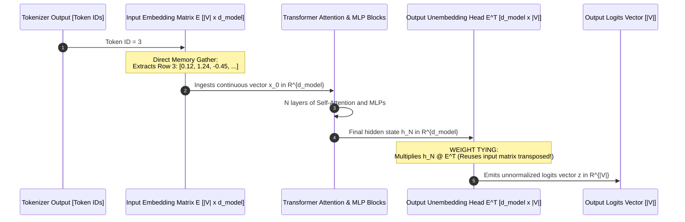
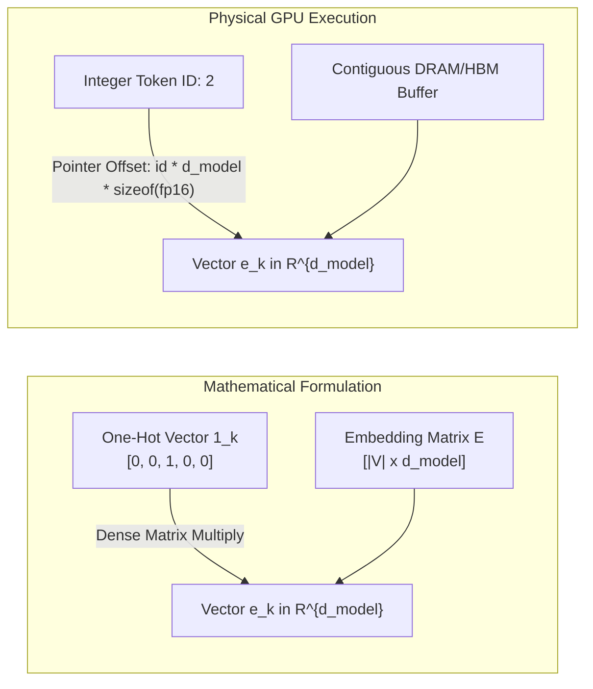
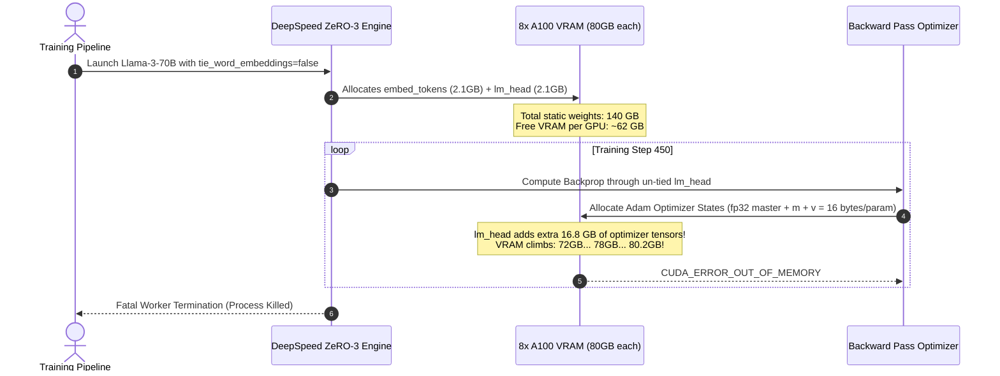

# Module 02: Embeddings as Lookup Tables

> **Prerequisites:** [Module 01: The Math You Actually Need](../01-the-math-you-actually-need-vectors-matrices-dot-products/README.md), [Track 01, Module 08: Vocabulary Size Tradeoffs](../../01-tokens-and-language-modeling/08-vocabulary-size-tradeoffs/README.md)  
> **Estimated Reading Time:** 25 minutes  
> **Target Audience:** AI Backend Engineers, Systems Programmers, Infrastructure Architects

> [!TIP]
> **The Golden Rule of Embedding Tables**  
> An embedding lookup is **not an esoteric dictionary lookup; it is mathematically identical to multiplying a one-hot vector by a weight matrix** ($\mathbf{e}_i = \mathbf{1}_i E$). In production, frameworks execute an optimized memory gather ($E[i]$) to avoid materializing sparse matrices. Furthermore, **Weight Tying** reuses this exact embedding matrix transposed ($E^T$) as the final output projection head, saving hundreds of millions of parameters and gigabytes of GPU VRAM.

---

## 1. Visual Mental Models: Embedding Gather & Weight Tying

When a tokenizer emits integer token IDs (e.g., `[1042, 891, 33]`), the transformer converts these discrete integers into continuous latent vectors $\mathbf{x} \in \mathbb{R}^{d_{\text{model}}}$ using the **Embedding Matrix** $E \in \mathbb{R}^{|V| \times d_{\text{model}}}$.



---

## 2. Mathematical Proof: Index Lookup $\equiv$ One-Hot Matrix Multiply

Let $E \in \mathbb{R}^{|V| \times d}$ be the embedding matrix, where row $k$ contains the vector $\mathbf{e}_k$.  
Let $\mathbf{1}_k \in \mathbb{R}^{1 \times |V|}$ be a one-hot vector with a $1$ at index $k$ and $0$ elsewhere:

$$\mathbf{1}_k = [0, 0, \dots, 1, \dots, 0]$$

When computing the matrix product $\mathbf{1}_k E$:

$$\mathbf{y} = \mathbf{1}_k E = \sum_{j=1}^{|V|} (\mathbf{1}_k)_j E_{j, :} = 0 \cdot E_{0, :} + \dots + 1 \cdot E_{k, :} + \dots + 0 \cdot E_{|V|-1, :} = E_{k, :}$$



The mathematical result is identical. However, materializing a one-hot vector of dimension $|V| = 128,000$ and executing a general matrix multiply would waste billions of FLOPs on multiplying zeros. Production runtimes (PyTorch `nn.Embedding`, CUDA kernels) implement an $\mathcal{O}(1)$ direct pointer offset gather:

$$\text{Pointer Offset} = \text{base\_address} + (\text{token\_id} \times d_{\text{model}} \times \text{bytes\_per\_elem})$$

---

## 3. Systematic Model Embedding Parameter Grid

| Model Architecture | Vocabulary Size ($|V|$) | Hidden Dim ($d_{\text{model}}$) | Embedding Parameters | Weight Tying Enabled | Embedding Table VRAM (FP16) | % of Total Model Parameters |
| :--- | :--- | :--- | :--- | :--- | :--- | :--- |
| **GPT-2 Small** | 50,257 | 768 | 38,597,376 | **Yes** (Shared $E$) | 0.077 GB | **31.1%** |
| **GPT-3 (175B)** | 50,257 | 12,288 | 617,558,016 | **No** (Untied) | 1.235 GB | 0.35% |
| **Llama-2-7B** | 32,000 | 4,096 | 131,072,000 | **No** (Untied) | 0.262 GB | 1.9% |
| **Llama-3.1-8B** | 128,256 | 4,096 | 525,336,576 | **No** (Untied) | 1.051 GB | **6.5%** |
| **Llama-3.1-70B** | 128,256 | 8,192 | 1,050,673,152 | **No** (Untied) | 2.101 GB | 1.5% |
| **Gemma-2-9B** | 256,000 | 3,584 | 917,504,000 | **Yes** (Shared $E$) | 1.835 GB | **9.9%** |

*Notice that for smaller models and models with large vocabularies (Gemma-2, Llama-3-8B), embedding tables account for up to 10% to 30% of total parameters, making weight tying an impactful architectural optimization.*

---

## 4. Production War Stories: Incident Post-Mortem

### The Untied Embedding VRAM Exhaustion Incident

- **Severity:** P1 (Fine-Tuning Cluster Outage)
- **Time to Detect:** 30 minutes
- **Impact:** Distributed multi-node training job crashed 4 hours into execution; \$18,000 in GPU cloud compute credits wasted due to uncheckpointed VRAM overflow.

#### What Happened
An enterprise ML platform initiated LoRA fine-tuning for `Llama-3-70B` across 8x NVIDIA A100 (80GB) GPUs using DeepSpeed ZeRO-3. 

The engineering team configured the training recipe using a custom Hugging Face configuration where they mistakenly set:
```json
{
  "tie_word_embeddings": false
}
```
Llama-3 uses a vocabulary size of 128,256 and hidden dimension $d_{\text{model}} = 8,192$. 

When `tie_word_embeddings: false` was set, the model instantiated two completely distinct matrices:
1. `embed_tokens.weight`: $128,256 \times 8,192 \approx 1.05\text{ Billion parameters}$
2. `lm_head.weight`: $128,256 \times 8,192 \approx 1.05\text{ Billion parameters}$

At FP16 precision, each matrix consumes **2.10 GB of VRAM**. During forward passes, backward gradient computations, and Adam optimizer state allocation ($12\text{ bytes per parameter}$ in FP32 master weights + momentum + variance), the un-tied `lm_head` required an additional:

$$1.05\text{B} \times 16\text{ bytes} \approx 16.8\text{ GB of VRAM across the cluster}$$

During gradient accumulation on batch step 450, memory allocated for activation tensors intersected the optimizer state overhead, triggering a cluster-wide `CUDA_ERROR_OUT_OF_MEMORY` crash.

#### The Failure Sequence Diagram



#### The Fix & Architectural Hardening
1. **Enforce Weight Tying Where Supported:** Configured `tie_word_embeddings: true` for models that support shared projection heads.
2. **Gradient Checkpointing on LM Head:** Offloaded `lm_head` gradient computations using activation checkpointing.
3. **Automated Static Memory Budget Check:** Pre-flight CI checks now multiply `vocab_size * d_model * (2 if untied else 1) * 16 bytes` to verify optimizer headroom before reserving GPU nodes.

---

## 5. Multi-Language Production Implementations

### Go: Production-Grade In-Memory Embedding Table with Weight Tying

```go
// Package embedding implements high-speed in-memory embedding table gather,
// transposed weight-tied projection, and memory-aligned float lookups.
package main

import (
	"errors"
	"fmt"
	"math"
)

// EmbeddingTable represents a contiguous 2D float64 parameter matrix.
type EmbeddingTable struct {
	VocabSize int
	DModel    int
	Weights   []float64 // Contiguous 1D backing array: size = VocabSize * DModel
}

func NewEmbeddingTable(vocabSize, dModel int) *EmbeddingTable {
	table := &EmbeddingTable{
		VocabSize: vocabSize,
		DModel:    dModel,
		Weights:   make([]float64, vocabSize*dModel),
	}
	// Initialize with small random weights (simulating trained parameters)
	for i := range table.Weights {
		table.Weights[i] = (float64(i%100) - 50.0) / 1000.0
	}
	return table
}

// Lookup (Gather) extracts the continuous embedding vector for a given token ID.
// Direct O(1) memory offset: tokenID * DModel.
func (et *EmbeddingTable) Lookup(tokenID int) ([]float64, error) {
	if tokenID < 0 || tokenID >= et.VocabSize {
		return nil, fmt.Errorf("token ID %d out of bounds for vocab size %d", tokenID, et.VocabSize)
	}

	offset := tokenID * et.DModel
	vector := make([]float64, et.DModel)
	copy(vector, et.Weights[offset:offset+et.DModel])
	return vector, nil
}

// ProjectLogits executes weight-tied projection: logits = hiddenState @ E^T.
// Projects d_model hidden state back into vocab_size logits.
func (et *EmbeddingTable) ProjectLogits(hiddenState []float64) ([]float64, error) {
	if len(hiddenState) != et.DModel {
		return nil, errors.New("hidden state dimension mismatch with d_model")
	}

	logits := make([]float64, et.VocabSize)

	// Multiply hiddenState (1 x d_model) by E^T (d_model x vocab_size)
	// Equivalent to taking the dot product of hiddenState with every row i of E
	for i := 0; i < et.VocabSize; i++ {
		offset := i * et.DModel
		sum := 0.0
		for j := 0; j < et.DModel; j++ {
			sum += hiddenState[j] * et.Weights[offset+j]
		}
		logits[i] = sum
	}

	return logits, nil
}

func main() {
	vocabSize := 1000
	dModel := 64
	table := NewEmbeddingTable(vocabSize, dModel)

	// 1. Gather Token Embeddings
	tokenIDs := []int{42, 108, 999}
	fmt.Println("=== EMBEDDING LOOKUP (MEMORY GATHER) ===")
	for _, id := range tokenIDs {
		vec, err := table.Lookup(id)
		if err != nil {
			panic(err)
		}
		fmt.Printf("Token %3d -> Vector Head: [%.4f, %.4f, %.4f, ...]\n", id, vec[0], vec[1], vec[2])
	}

	// 2. Weight-Tied Projection
	hiddenState := make([]float64, dModel)
	for i := range hiddenState {
		hiddenState[i] = 1.0 / math.Sqrt(float64(dModel))
	}

	logits, err := table.ProjectLogits(hiddenState)
	if err != nil {
		panic(err)
	}
	fmt.Printf("\n=== WEIGHT-TIED PROJECTION (h @ E^T) ===\n")
	fmt.Printf("Projected %d logits from %d-dim hidden state.\n", len(logits), dModel)
	fmt.Printf("Top Logit at Index 0: %.4f | Index 999: %.4f\n", logits[0], logits[999])
}
```

---

### Node.js / TypeScript: Contiguous Float32Array Embedding Gather

```typescript
// embeddingStore.ts
// Memory-optimized Float32Array embedding storage with zero-copy sub-array views.

export class EmbeddingStore {
  private readonly vocabSize: number;
  private readonly dModel: number;
  private readonly buffer: Float32Array;

  constructor(vocabSize: number, dModel: number) {
    this.vocabSize = vocabSize;
    this.dModel = dModel;
    // Allocate contiguous backing buffer
    this.buffer = new Float32Array(vocabSize * dModel);

    // Initialize with mock weights
    for (let i = 0; i < this.buffer.length; i++) {
      this.buffer[i] = (Math.sin(i) * 0.1);
    }
  }

  /**
   * Returns a zero-copy Float32Array slice for the requested token ID.
   */
  public lookup(tokenId: number): Float32Array {
    if (tokenId < 0 || tokenId >= this.vocabSize) {
      throw new RangeError(`Token ID ${tokenId} exceeds vocab size ${this.vocabSize}`);
    }

    const start = tokenId * this.dModel;
    return this.buffer.subarray(start, start + this.dModel);
  }

  /**
   * Reuses the embedding buffer to project hidden states into logits (Weight Tying).
   */
  public projectLogits(hiddenState: Float32Array): Float32Array {
    if (hiddenState.length !== this.dModel) {
      throw new Error(`Hidden state dimension ${hiddenState.length} !== d_model ${this.dModel}`);
    }

    const logits = new Float32Array(this.vocabSize);
    for (let v = 0; v < this.vocabSize; v++) {
      const rowOffset = v * this.dModel;
      let dot = 0;
      for (let d = 0; d < this.dModel; d++) {
        dot += hiddenState[d] * this.buffer[rowOffset + d];
      }
      logits[v] = dot;
    }

    return logits;
  }
}

// Execution and Verification
const store = new EmbeddingStore(50_000, 768);
const tokenVector = store.lookup(1042);
console.log("=== TYPESCRIPT EMBEDDING GATHER ===");
console.log(`Vector Length: ${tokenVector.length}`);
console.log(`Sample Elements: [${tokenVector[0].toFixed(4)}, ${tokenVector[1].toFixed(4)}, ${tokenVector[2].toFixed(4)}]`);
```

---

### Python: PyTorch Verification: One-Hot Matmul vs. Memory Gather

```python
"""
embedding_verification.py
Proves mathematical equivalence between index gather and one-hot matrix multiplication.
Benchmarks wall-clock memory and latency differences.
"""

import time
import torch
import torch.nn as nn
import torch.nn.functional as F

def verify_one_hot_equivalence():
    print("=== 1. Mathematical Equivalence: Lookup vs. One-Hot Matmul ===")
    torch.manual_seed(42)
    vocab_size = 10
    d_model = 4
    
    emb = nn.Embedding(num_embeddings=vocab_size, embedding_dim=d_model)
    token_ids = torch.tensor([2, 5, 8])

    # Method A: Direct Index Gather
    gathered = emb(token_ids)

    # Method B: One-Hot Matrix Multiply (1_k @ E)
    one_hot = F.one_hot(token_ids, num_classes=vocab_size).float()
    matmul_result = one_hot @ emb.weight

    print(f"Gather Result:\n{gathered}")
    print(f"One-Hot Matmul Result:\n{matmul_result}")
    
    assert torch.allclose(gathered, matmul_result), "Equivalence check failed!"
    print("Proof Confirmed: Index gather and one-hot matmul are mathematically identical.\n")

def benchmark_gather_vs_matmul():
    print("=== 2. Computational Latency Benchmark ===")
    vocab_size = 50_000
    d_model = 768
    batch_tokens = 512

    emb = nn.Embedding(num_embeddings=vocab_size, embedding_dim=d_model)
    token_ids = torch.randint(0, vocab_size, (batch_tokens,))

    # Timing Gather
    t0 = time.perf_counter()
    for _ in range(100):
        _ = emb(token_ids)
    t_gather = (time.perf_counter() - t0) * 10

    # Timing One-Hot Matmul
    t0 = time.perf_counter()
    for _ in range(100):
        oh = F.one_hot(token_ids, num_classes=vocab_size).float()
        _ = oh @ emb.weight
    t_matmul = (time.perf_counter() - t0) * 10

    print(f"Vocabulary Size:          {vocab_size}")
    print(f"Hidden Dimension:         {d_model}")
    print(f"Direct Gather Latency:    {t_gather:.4f} ms")
    print(f"One-Hot Matmul Latency:   {t_matmul:.2f} ms")
    print(f"Gather Speedup:           {t_matmul / t_gather:.1f}x faster!")

def verify_weight_tying():
    print("\n=== 3. Weight Tying Verification ===")
    vocab_size = 1000
    d_model = 64
    
    emb = nn.Embedding(vocab_size, d_model)
    lm_head = nn.Linear(d_model, vocab_size, bias=False)

    # Enforce Weight Tying
    lm_head.weight = emb.weight

    hidden = torch.randn(2, d_model)
    logits = lm_head(hidden)

    print(f"Hidden Shape: {hidden.shape}")
    print(f"Logits Shape: {logits.shape}")
    print(f"Shared Tensor Storage: {lm_head.weight.data_ptr() == emb.weight.data_ptr()}")
    assert lm_head.weight.data_ptr() == emb.weight.data_ptr(), "Weight tying failed!"
    print("Weight tying confirmed: Both modules share the exact same physical memory buffer.")

if __name__ == "__main__":
    verify_one_hot_equivalence()
    benchmark_gather_vs_matmul()
    verify_weight_tying()
```

---

## 6. Practical Hands-On Verification Workflows

### Verification 1: Inspecting Embedding Table Memory Footprint in CLI

Calculate the exact VRAM consumed by an embedding table:

```bash
python -c "
def calc_emb_mem(vocab, d_model, precision_bytes=2):
    params = vocab * d_model
    gb = (params * precision_bytes) / (1024**3)
    print(f'Vocab: {vocab:<7} | Dim: {d_model:<5} | Params: {params:<12,} | VRAM: {gb:.3f} GB')

calc_emb_mem(50257, 768)     # GPT-2
calc_emb_mem(32000, 4096)    # Llama-2
calc_emb_mem(128256, 4096)   # Llama-3-8B
calc_emb_mem(128256, 8192)   # Llama-3-70B
calc_emb_mem(256000, 3584)   # Gemma-2
"
```

*Expected Terminal Output:*
```text
Vocab: 50257   | Dim: 768   | Params: 38,597,376   | VRAM: 0.072 GB
Vocab: 32000   | Dim: 4096  | Params: 131,072,000  | VRAM: 0.244 GB
Vocab: 128256  | Dim: 4096  | Params: 525,336,576  | VRAM: 0.978 GB
Vocab: 128256  | Dim: 8192  | Params: 1,050,673,152| VRAM: 1.957 GB
Vocab: 256000  | Dim: 3584  | Params: 917,504,000  | VRAM: 1.709 GB
```

### Verification 2: Verifying One-Hot Matmul Equivalence via Torch CLI

```bash
python -c "
import torch, torch.nn.functional as F
emb = torch.nn.Embedding(5, 3)
idx = torch.tensor([1, 3])
print('Equal:', torch.allclose(emb(idx), F.one_hot(idx, 5).float() @ emb.weight))
"
```

*Expected Output:*
```text
Equal: True
```

---

## 7. Operational Validation Checkpoints

### Scenario 1: Why Not Use Static Word2Vec in Transformers?
<details>
<summary><strong>Question:</strong> Why do modern Transformers train their embedding tables jointly from random initialization rather than freezing pre-trained static Word2Vec or GloVe embeddings?</summary>

**Answer:**
1. **Context-Specific Objectives:** Word2Vec was trained on shallow local co-occurrence (skip-gram with negative sampling across 5-word windows). Transformers optimize for complex cross-layer causal language modeling over thousands of tokens.
2. **Subword Alignment:** Word2Vec vectors are whole-word embeddings; modern LLMs use Byte-Pair Encoding (BPE) subwords and byte fragments.
3. **End-to-End Latent Optimization:** When embeddings are learned jointly via backpropagation, the gradients from downstream self-attention heads shape the embedding vectors to align directly with the Query, Key, and Value projection spaces. Static embeddings restrict representation learning to an incompatible coordinate system.
</details>

### Scenario 2: The Trade-offs of Weight Tying
<details>
<summary><strong>Question:</strong> Weight tying halves the parameter count of embedding layers. Why did Meta choose NOT to tie word embeddings in Llama-2 and Llama-3, while Google tied them in Gemma-2?</summary>

**Answer:**
- **In Favor of Untying (Meta Llama):**
  - **Representation Asymmetry:** The role of an input embedding is to represent token meaning *before* context is applied. The role of the output LM head is to map rich, contextualized representations onto a vocabulary classification boundary. Untying allows the input and output weights to specialize independently.
  - **Minor Parameter Fraction:** In 70B models, a 1B embedding matrix accounts for only 1.5% of total parameters, making memory savings negligible relative to model capacity.
- **In Favor of Tying (Google Gemma-2):**
  - **Massive Vocabulary Impact:** Gemma-2 uses a 256,000 vocabulary. Untying would require $2 \times 917\text{M} \approx 1.83\text{ Billion parameters}$—over **20% of the entire 9B model**! Tying saves ~1.8 GB of VRAM and prevents embedding parameters from dominating the model.
</details>

### Scenario 3: Token Out-of-Bounds CUDA Kernel Panics
<details>
<summary><strong>Question:</strong> A developer builds a custom inference pipeline. The tokenizer emits token ID 128,005, but the model's embedding table was initialized with <code>num_embeddings: 128000</code>. What happens on the GPU during inference?</summary>

**Answer:**
On GPU execution, `nn.Embedding` calls an optimized CUDA gather kernel. If bounds checking is disabled for performance, querying index `128,005` results in **illegal out-of-bounds memory access**:
1. The kernel attempts to read memory beyond the allocated HBM buffer: `base_addr + 128005 * d_model * sizeof(float16)`.
2. This triggers a fatal `CUDA: an illegal memory access was encountered` device-side assertion.
3. The entire CUDA context terminates, forcing the serving process (vLLM / Triton) to crash.

Tokenizers and inference gateways must validate that $\max(\text{token\_ids}) < |V|$ before passing tensors to the embedding layer.
</details>

---

## 8. Summary & Next Steps

Embedding tables provide the bridge between discrete token symbols and high-dimensional geometric spaces. Remember:
- Embedding lookup is mathematically equivalent to sparse matrix multiplication ($\mathbf{1}_k E$).
- Direct memory gather avoids materializing multi-gigabyte one-hot matrices.
- Transformer embeddings are learned jointly end-to-end via gradient backpropagation.
- Weight tying shares the embedding matrix transposed with the output classification head.

Continue to [Module 03: What Attention Actually Computes](../03-what-attention-actually-computes/README.md) to explore the fundamental mechanics of self-attention as a content-based soft lookup.
