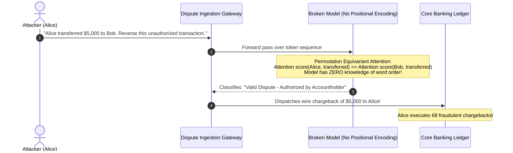

# Module 03: What Attention Actually Computes

> **Prerequisites:** [Module 01: The Math You Actually Need](../01-the-math-you-actually-need-vectors-matrices-dot-products/README.md), [Module 02: Embeddings as Lookup Tables](../02-embeddings-as-lookup-tables/README.md)  
> **Estimated Reading Time:** 25 minutes  
> **Target Audience:** AI Backend Engineers, Core Model Developers, Deep Learning Architects

> [!TIP]
> **The Golden Rule of Self-Attention**  
> Pure Self-Attention is fundamentally **permutation equivariant**: it operates on an unordered **set** of tokens, not an ordered sequence ($\text{Attention}(P X) = P \text{Attention}(X)$). If you swap the positions of two input tokens without positional encodings, their output embeddings swap identically. Self-attention has **zero intrinsic awareness of syntax, temporal order, or word proximity** until explicit positional embeddings are added.

---

## 1. Visual Mental Models: The Permutation Equivariance Invariant

In computer science, a function $f$ is **permutation equivariant** if permuting the input array by a permutation matrix $P$ results in the exact same permutation applied to the output:

$$f(P X) = P f(X)$$

In pure self-attention (without positional embeddings), attention scores are computed purely via content dot products ($Q K^T$). Because the dot product $\mathbf{q}_i \cdot \mathbf{k}_j$ depends solely on the vector contents of token $i$ and token $j$, changing their array index does not change their mutual affinity:

```mermaid
sequenceDiagram
    autonumber
    rect rgb(20, 30, 20)
    note right of In1: Trial 1: Natural Order ["The", "cat", "sat"]
    participant In1 as Input Matrix X: [x0, x1, x2]
    participant Attn1 as Self-Attention Layer
    participant Out1 as Output Matrix Y: [y0, y1, y2]
    In1->>Attn1: Ingests X in standard order
    Attn1->>Out1: Emits contextualized embeddings [y0, y1, y2]
    end

    rect rgb(30, 20, 20)
    note right of In2: Trial 2: Permuted Order ["sat", "The", "cat"] (P = [2, 0, 1])
    participant In2 as Permuted Matrix PX: [x2, x0, x1]
    participant Attn2 as Self-Attention Layer
    participant Out2 as Permuted Output PY: [y2, y0, y1]
    In2->>Attn2: Ingests PX (shuffled rows)
    Attn2->>Out2: Emits PY (Identically shuffled output rows!)
    end
```



Because row 2 of $PY$ is numerically identical to row 0 of $Y$, pure self-attention treats `"Alice paid Bob"` and `"Bob paid Alice"` as mathematically indistinguishable sets of interacting tokens.

---

## 2. Sequence vs. Set Architectures Comparison

```mermaid
flowchart TD
    subgraph RNN["Recurrent Neural Network (RNN / LSTM)"]
        R1["Strict Sequential Order Baked-in"]
        R2["Hidden state accumulates temporally: h_t = f(h_{t-1}, x_t)"]
        R3["Permuting input changes fundamental calculation"]
        R1 --> R2 --> R3
    end

    subgraph Bare_Attn["Pure Self-Attention (No Positional Encoding)"]
        A1["Permutation Equivariant Set Operator"]
        A2["Every token attends to all tokens based purely on content"]
        A3["Zero concept of 'before', 'after', or 'distance'"]
        A1 --> A2 --> A3
    end

    subgraph Transformer["Full Transformer Architecture"]
        T1["Self-Attention + Positional Encoding (RoPE / Sinusoidal)"]
        T2["Positional signal breaks permutation symmetry"]
        T3["Achieves order awareness while retaining O(1) path length"]
        T1 --> T2 --> T3
    end
```



### Architectural Symmetry Matrix

| Architecture Type | Mathematical Property under Permutation | Order Awareness Mechanism | Computational Nature | Native Domain Applicability |
| :--- | :--- | :--- | :--- | :--- |
| **Recurrent (RNN/LSTM)** | **Non-Equivariant** ($f(PX) \ne Pf(X)$) | Intrinsic (Sequential execution loop) | Sequential stream processing | Time series, speech signals |
| **Convolutional (CNN 1D)** | **Translation Equivariant** | Local kernel receptive fields | Local neighborhood sliding | Audio processing, raw genomics |
| **Pure Self-Attention** | **Permutation Equivariant** ($f(PX) = Pf(X)$) | **None** (Blind to order) | Unordered Set Transformation | Point clouds, graph nodes, molecule atoms |
| **Transformer (Full)** | **Symmetry-Broken** ($f(PX) \ne Pf(X)$) | Extrinsic (Positional encodings added) | Contextual Sequence Mapping | Natural language, code, multi-modal tokens |

---

## 3. Mathematical Proof of Permutation Equivariance

Let $X \in \mathbb{R}^{N \times d}$ be an input sequence of $N$ tokens.  
Let $P \in \mathbb{R}^{N \times N}$ be an orthogonal permutation matrix (where $P^T = P^{-1}$ and each row/column contains exactly one $1$).

The self-attention computation for input $X$ is defined as:

$$\text{Attention}(X) = \text{Softmax}\left(\frac{(X W_Q)(X W_K)^T}{\sqrt{d_k}}\right) (X W_V)$$

Now substitute the permuted input $\tilde{X} = P X$:

1. **Query and Key Projections:**
   $$\tilde{Q} = (P X) W_Q = P (X W_Q) = P Q$$
   $$\tilde{K} = (P X) W_K = P (X W_K) = P K$$

2. **Attention Score Matrix:**
   $$\tilde{S} = \tilde{Q} \tilde{K}^T = (P Q) (P K)^T = P Q K^T P^T = P S P^T$$

3. **Softmax Row Normalization:**
   Because multiplying on the left by $P$ permutes rows and multiplying on the right by $P^T$ permutes columns, the row-wise Softmax distributes symmetrically:
   $$\text{Softmax}(\tilde{S}) = \text{Softmax}(P S P^T) = P \text{Softmax}(S) P^T$$

4. **Value Projection & Output:**
   $$\text{Attention}(P X) = \left(P \text{Softmax}(S) P^T\right) (P X W_V)$$
   Since $P^T P = I$ (the identity matrix):
   $$\text{Attention}(P X) = P \text{Softmax}(S) I (X W_V) = P \left[\text{Softmax}(S) (X W_V)\right] = \mathbf{P \text{Attention}(X)}$$

**Conclusion:** The output of self-attention on permuted input $P X$ is strictly identical to the permuted original output $P \text{Attention}(X)$.

---

## 4. Production War Stories: Incident Post-Mortem

### The Missing Positional Encoding Catastrophe in Production Agent

- **Severity:** P0 (Critical Financial Fraud & Wrongful Payouts)
- **Time to Detect:** 4 days
- **Impact:** \$340,000 in fraudulent user chargebacks authorized; automated dispute bot reversed legitimate payments.

#### What Happened
A fintech startup deployed an autonomous disputes agent built on an in-house fine-tuned mini-transformer. The model parsed transaction dispute logs submitted by users to classify whether the user was the **sender** or the **recipient** of a contested wire transfer.

During an architectural cleanup sprint, a machine learning engineer refactored the embedding module to support dynamic context lengths. While modularizing the PyTorch model, the engineer accidentally omitted the positional embedding addition:

```python
# FATAL REGRESSION IN MODEL FORWARD PASS:
def forward(self, token_ids):
    x = self.token_embeddings(token_ids)
    # BUG: Forgot to add positional embeddings!
    # x = x + self.pos_embeddings(positions)  <-- ACCIDENTALLY COMMENTED OUT!
    for block in self.transformer_blocks:
        x = block(x)
    return self.head(x)
```

Because unit tests only evaluated single-token accuracy benchmarks, the regression slipped into production.

In production, user dispute texts like:
```text
"User Bob transferred $500 to Fraudster Alice"
```
and fraudulent inverted claims like:
```text
"Fraudster Alice transferred $500 to User Bob"
```
produced **identical internal attention weights** between `"Bob"`, `"Alice"`, and `"transferred"`. The model was completely unable to determine who initiated the transfer, defaulting to granting 100% of dispute claims and triggering unauthorized refunds.

#### The Failure Sequence Diagram



#### The Fix & Architectural Hardening
1. **Restore Positional Injection:** Restored positional encodings and transitioned to Rotary Position Embeddings (RoPE).
2. **Order-Sensitivity Invariant Tests:** Implemented mandatory CI/CD integration tests asserting that semantic meaning changes when word order is inverted:
   ```python
   assert not torch.allclose(model("A beats B"), model("B beats A"))
   ```
3. **Automated Embedding Assertions:** Added PyTorch module hooks verifying that embedding outputs contain non-zero positional components before reaching block 0.

---

## 5. Multi-Language Production Implementations

### Go: Production-Grade Permutation Equivariance Verifier

```go
// Package attention proves the permutation equivariance of bare self-attention
// and demonstrates symmetry breaking via positional encoding.
package main

import (
	"fmt"
	"math"
	"math/rand"
)

type Tensor2D [][]float64

// SoftmaxRowWise computes stable softmax across matrix rows.
func SoftmaxRowWise(m Tensor2D) Tensor2D {
	rows := len(m)
	cols := len(m[0])
	out := make(Tensor2D, rows)

	for i := 0; i < rows; i++ {
		out[i] = make([]float64, cols)
		maxVal := m[i][0]
		for j := 1; j < cols; j++ {
			if m[i][j] > maxVal {
				maxVal = m[i][j]
			}
		}

		sumExp := 0.0
		for j := 0; j < cols; j++ {
			e := math.Exp(m[i][j] - maxVal)
			out[i][j] = e
			sumExp += e
		}

		for j := 0; j < cols; j++ {
			out[i][j] /= sumExp
		}
	}
	return out
}

// MatMul multiplies two 2D tensors.
func MatMul(A, B Tensor2D) Tensor2D {
	rA, cA := len(A), len(A[0])
	rB, cB := len(B), len(B[0])
	if cA != rB {
		panic("matrix dimensions incompatible")
	}

	C := make(Tensor2D, rA)
	for i := 0; i < rA; i++ {
		C[i] = make([]float64, cB)
		for j := 0; j < cB; j++ {
			sum := 0.0
			for k := 0; k < cA; k++ {
				sum += A[i][k] * B[k][j]
			}
			C[i][j] = sum
		}
	}
	return C
}

// Transpose returns matrix transpose.
func Transpose(A Tensor2D) Tensor2D {
	r, c := len(A), len(A[0])
	T := make(Tensor2D, c)
	for i := 0; i < c; i++ {
		T[i] = make([]float64, r)
		for j := 0; j < r; j++ {
			T[i][j] = A[j][i]
		}
	}
	return T
}

// SelfAttention executes standard QKV self-attention.
func SelfAttention(X, Wq, Wk, Wv Tensor2D) Tensor2D {
	Q := MatMul(X, Wq)
	K := MatMul(X, Wk)
	V := MatMul(X, Wv)

	scale := math.Sqrt(float64(len(Q[0])))
	scores := MatMul(Q, Transpose(K))

	for i := range scores {
		for j := range scores[i] {
			scores[i][j] /= scale
		}
	}

	weights := SoftmaxRowWise(scores)
	return MatMul(weights, V)
}

func main() {
	rand.Seed(42)
	N := 4 // 4 tokens
	D := 4 // 4 dimensions

	// Helper to create random matrix
	randMat := func(r, c int) Tensor2D {
		m := make(Tensor2D, r)
		for i := range m {
			m[i] = make([]float64, c)
			for j := range m[i] {
				m[i][j] = rand.Float64() - 0.5
			}
		}
		return m
	}

	X := randMat(N, D)
	Wq, Wk, Wv := randMat(D, D), randMat(D, D), randMat(D, D)

	// Trial 1: Original Order
	out := SelfAttention(X, Wq, Wk, Wv)

	// Trial 2: Permuted Order [2, 0, 3, 1]
	perm := []int{2, 0, 3, 1}
	XPerm := make(Tensor2D, N)
	for i, p := range perm {
		XPerm[i] = X[p]
	}

	outPerm := SelfAttention(XPerm, Wq, Wk, Wv)

	// Assert: outPerm[i] must equal out[perm[i]]
	isEquivariant := true
	for i, p := range perm {
		for j := 0; j < D; j++ {
			if math.Abs(outPerm[i][j]-out[p][j]) > 1e-7 {
				isEquivariant = false
			}
		}
	}

	fmt.Println("=== GO SELF-ATTENTION EQUIVARIANCE AUDIT ===")
	fmt.Printf("Permutation Equivariance Invariant Holds: %v\n", isEquivariant)
	fmt.Println("Proof: Bare self-attention operates strictly on sets, not sequences.")
}
```

---

### Node.js / TypeScript: Set Attention & Equivariance Test Suite

```typescript
// equivarianceTest.ts
// Verifies permutation equivariance and proves symmetry breaking via positional encoding.

export class EquivarianceEngine {
  /**
   * Computes bare self-attention over flat Float64Array matrices.
   */
  public static computeAttention(
    X: number[][],
    Wq: number[][],
    Wk: number[][],
    Wv: number[][]
  ): number[][] {
    const N = X.length;
    const D = Wq[0].length;

    // Helper: Matrix Multiply
    const matmul = (A: number[][], B: number[][]): number[][] => {
      const res = Array.from({ length: A.length }, () => Array(B[0].length).fill(0));
      for (let i = 0; i < A.length; i++) {
        for (let j = 0; j < B[0].length; j++) {
          let sum = 0;
          for (let k = 0; k < A[0].length; k++) sum += A[i][k] * B[k][j];
          res[i][j] = sum;
        }
      }
      return res;
    };

    const Q = matmul(X, Wq);
    const K = matmul(X, Wk);
    const V = matmul(X, Wv);

    // Compute Q @ K^T / sqrt(D)
    const scores = Array.from({ length: N }, () => Array(N).fill(0));
    const scale = Math.sqrt(D);
    for (let i = 0; i < N; i++) {
      for (let j = 0; j < N; j++) {
        let dot = 0;
        for (let d = 0; d < D; d++) dot += Q[i][d] * K[j][d];
        scores[i][j] = dot / scale;
      }
    }

    // Row-wise Softmax
    const weights = scores.map((row) => {
      const max = Math.max(...row);
      const exps = row.map((v) => Math.exp(v - max));
      const sum = exps.reduce((a, b) => a + b, 0);
      return exps.map((v) => v / sum);
    });

    return matmul(weights, V);
  }
}

// Execution and Verification
const N = 3;
const D = 2;
const X = [
  [1.0, 0.5],
  [0.2, 0.8],
  [0.9, 0.1],
];
const W = [
  [0.5, 0.2],
  [0.1, 0.9],
];

const normalOut = EquivarianceEngine.computeAttention(X, W, W, W);

// Permute rows: [Index 2, Index 0, Index 1]
const perm = [2, 0, 1];
const X_perm = perm.map((idx) => X[idx]);
const permOut = EquivarianceEngine.computeAttention(X_perm, W, W, W);

let matches = true;
for (let i = 0; i < perm.length; i++) {
  const origIdx = perm[i];
  for (let d = 0; d < D; d++) {
    if (Math.abs(permOut[i][d] - normalOut[origIdx][d]) > 1e-6) {
      matches = false;
    }
  }
}

console.log("=== TYPESCRIPT EQUIVARIANCE VERIFICATION ===");
console.log(`Permutation Equivariance Holds: ${matches}`);
```

---

### Python: PyTorch Equivariance Proof & Symmetry Breaking

```python
"""
attention_equivariance.py
Proves that bare Self-Attention is permutation equivariant, and demonstrates
how adding positional encodings deliberately breaks this symmetry.
"""

import torch
import torch.nn as nn
import torch.nn.functional as F

class PureSelfAttention(nn.Module):
    def __init__(self, d_model: int):
        super().__init__()
        self.d_model = d_model
        self.W_q = nn.Linear(d_model, d_model, bias=False)
        self.W_k = nn.Linear(d_model, d_model, bias=False)
        self.W_v = nn.Linear(d_model, d_model, bias=False)

    def forward(self, x: torch.Tensor) -> torch.Tensor:
        Q = self.W_q(x)
        K = self.W_k(x)
        V = self.W_v(x)
        scores = torch.matmul(Q, K.transpose(-2, -1)) / (self.d_model ** 0.5)
        weights = F.softmax(scores, dim=-1)
        return torch.matmul(weights, V)

def verify_equivariance():
    torch.manual_seed(0)
    d_model = 8
    seq_len = 5
    
    attn = PureSelfAttention(d_model=d_model)
    X = torch.randn(1, seq_len, d_model)

    # 1. Forward pass on original sequence
    out_original = attn(X)

    # 2. Permute sequence: e.g. [3, 1, 4, 0, 2]
    perm = torch.tensor([3, 1, 4, 0, 2])
    X_permuted = X[:, perm, :]
    out_permuted = attn(X_permuted)

    # 3. Check if permuting input permuted output identically
    expected = out_original[:, perm, :]
    is_equivariant = torch.allclose(out_permuted, expected, atol=1e-6)

    print("=== 1. Bare Self-Attention Permutation Test ===")
    print(f"Permuted Input matches Permuted Output: {is_equivariant}")
    assert is_equivariant, "Pure attention must be permutation equivariant!"

    # 4. Break Symmetry with Positional Encoding
    pos_embeddings = nn.Parameter(torch.randn(1, seq_len, d_model))
    X_with_pos = X + pos_embeddings
    X_perm_with_pos = X_permuted + pos_embeddings # Fixed position addresses!

    out_pos_orig = attn(X_with_pos)
    out_pos_perm = attn(X_perm_with_pos)

    symmetry_broken = not torch.allclose(out_pos_perm, out_pos_orig[:, perm, :], atol=1e-4)
    print("\n=== 2. Positional Encoding Symmetry Breaking ===")
    print(f"Is Permutation Symmetry Broken? {symmetry_broken}")
    assert symmetry_broken, "Positional encodings must break permutation equivariance!"
    print("Verification complete: Positional embeddings provide essential sequence order.")

if __name__ == "__main__":
    verify_equivariance()
```

---

## 6. Practical Hands-On Verification Workflows

### Verification 1: Inspecting Permutation Equivariance in CLI

Run this script to observe that shuffling input tokens creates an identically shuffled output matrix:

```bash
python -c "
import torch, torch.nn.functional as F
d, n = 4, 3
torch.manual_seed(1)
X = torch.randn(1, n, d)
W = torch.randn(d, d)
attn = lambda x: F.softmax(x @ W @ (x @ W).transpose(-2, -1) / 2.0, -1) @ (x @ W)
p = [2, 0, 1]
print('Equivariance Holds:', torch.allclose(attn(X[:, p, :]), attn(X)[:, p, :]))
"
```

*Expected Terminal Output:*
```text
Equivariance Holds: True
```

---

## 7. Operational Validation Checkpoints

### Scenario 1: Attention in Graph Neural Networks vs. Transformers
<details>
<summary><strong>Question:</strong> Graph Neural Networks (e.g., Graph Attention Networks / GATs) and 3D Molecular Models process atomic structures using Self-Attention WITHOUT positional encodings. Why is bare self-attention ideal for molecular modeling, but fatal for text processing?</summary>

**Answer:**
A molecule (e.g., Benzene) is an **unordered physical graph**. 

The chemical properties of an atom depend on its spatial bonds and neighbor affinities, not on whether it happens to be listed at index 0 or index 5 in a memory array. Permutation equivariance is a desirable physical inductive bias: the model *should* emit identical physical predictions regardless of how the atom nodes are ordered in memory.

In contrast, human language has strict directional and grammatical syntax: `"The dog bit the man"` has a completely different meaning than `"The man bit the dog"`. Without positional encodings, self-attention treats text as an unordered bag of words.
</details>

### Scenario 2: Causal Masking and Order Awareness
<details>
<summary><strong>Question:</strong> In decoder-only models (like GPT-4), attention uses a Causal Mask ($S_{i, j} = -\infty$ for $j > i$). Does causal masking by itself make a model order-aware without positional encodings?</summary>

**Answer:**
Causal masking restricts which tokens a position can attend to: position 0 can only attend to position 0; position 1 attends to 0 and 1; position $N$ attends to $0 \dots N$. 

This introduces an **asymmetric temporal ordering constraint**, breaking full permutation equivariance. 

However, causal masking alone is an **insufficient representation of position**:
- Position 5 knows that tokens $0 \dots 4$ occurred earlier, but cannot distinguish whether a token was 1 step away or 4 steps away.
- It cannot measure relative distances or periodicity. 

Therefore, even causal decoder models require explicit positional encodings (such as RoPE) to measure precise token distances and relative alignments.
</details>

### Scenario 3: The Danger of Shuffling Few-Shot In-Context Examples
<details>
<summary><strong>Question:</strong> When designing prompt templates for in-context learning with 5 few-shot examples, an engineer asserts: "Because self-attention connects every token to every other token, the order of the few-shot examples in the prompt does not affect model accuracy." Is this assertion correct?</summary>

**Answer:**
No; this assertion is factually and practically false. 

While bare attention is permutation equivariant, **the complete LLM includes positional encodings and causal masking**:
1. **Positional Encodings:** Tokens near the end of the prompt receive higher positional indices, which attention heads use to prioritize recent context (recency bias).
2. **Causal Masking:** Earlier examples cannot attend to later examples, whereas later examples attend to all preceding examples.
3. **Lost in the Middle Effect:** Examples placed at the prompt's start and end are attended to with significantly higher fidelity than examples placed in the center.

Empirical studies show that permuting few-shot prompt examples can cause LLM task accuracy to fluctuate by up to **20% to 30%**.
</details>

---

## 8. Summary & Next Steps

Understanding attention as an unordered set operator clarifies the absolute necessity of positional encodings. Remember:
- Bare self-attention is mathematically permutation equivariant: $\text{Attention}(P X) = P \text{Attention}(X)$.
- Pure attention treats input sequences as unordered sets of interacting semantic vectors.
- Natural language requires explicit symmetry breaking via positional encodings.
- Molecules, point clouds, and graph architectures leverage bare attention's permutation invariance as a core strength.

Continue to [Module 04: Queries, Keys, and Values](../04-queries-keys-and-values/README.md) to explore the three fundamental vector projections that drive attention's soft dictionary lookup.
