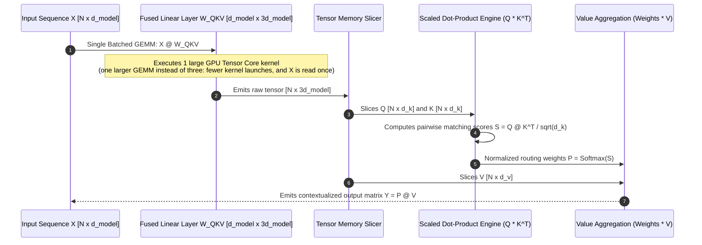
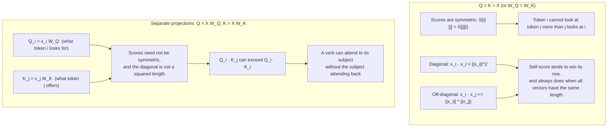

# Module 04: Queries, Keys, and Values

> **Prerequisites:** [Module 01: The Math You Actually Need](../01-the-math-you-actually-need-vectors-matrices-dot-products/README.md), [Module 03: What Attention Actually Computes](../03-what-attention-actually-computes/README.md)  
> **Estimated Reading Time:** 25 minutes  
> **Target Audience:** AI Backend Engineers, Core Model Developers, Deep Learning Architects

> [!TIP]
> **The Golden Rule of Queries, Keys, and Values**  
> $Q, K,$ and $V$ are three learned projections of the same input, each with its own job: $Q$ is what a token is looking for, $K$ is what it offers to be found by, and $V$ is what it hands over once it is found. If you used $X$ itself as both $Q$ and $K$, the score matrix $XX^T$ would be **symmetric** (token $i$ would score token $j$ exactly as token $j$ scores token $i$), and each token's score against itself, $\|\mathbf{x}_i\|^2$, would tend to be the largest in its row. Separate $W_Q$ and $W_K$ remove both limits, and $W_V$ lets what is retrieved differ from what is matched.

---

## 1. Visual Mental Models: The QKV Triad & Fused Projection

In standard self-attention, input representations $X \in \mathbb{R}^{N \times d_{\text{model}}}$ are transformed into three distinct vector sets via learned linear weights:

$$Q = X W_Q \in \mathbb{R}^{N \times d_k}, \quad K = X W_K \in \mathbb{R}^{N \times d_k}, \quad V = X W_V \in \mathbb{R}^{N \times d_v}$$

In production GPU runtimes, executing three separate matrix multiplications ($X W_Q, X W_K, X W_V$) under-utilizes hardware. Instead, modern engines fuse the weights into a single combined projection matrix $W_{QKV} \in \mathbb{R}^{d_{\text{model}} \times (2d_k + d_v)}$ and slice the output:



---

## 2. Why Not Use $X$ Directly? The Math of $Q = K = X$

Why can't a model simply use its input embeddings directly, $Q = K = X$? Look at the score matrix that would produce, $S = X X^T$:

- It is **symmetric**: $S_{i, j} = \mathbf{x}_i \cdot \mathbf{x}_j = \mathbf{x}_j \cdot \mathbf{x}_i = S_{j, i}$. Token $i$ can never score token $j$ higher than token $j$ scores token $i$, so a relation like "a verb looks at its subject, but the subject does not look back at the verb" cannot be expressed.
- Its diagonal is a squared length: $S_{i, i} = \mathbf{x}_i \cdot \mathbf{x}_i = \|\mathbf{x}_i\|^2$.

The **Cauchy-Schwarz inequality** says that for any two real vectors $\mathbf{a}$ and $\mathbf{b}$:

$$|\mathbf{a} \cdot \mathbf{b}| \le \|\mathbf{a}\| \|\mathbf{b}\|$$

with equality exactly when $\mathbf{a}$ and $\mathbf{b}$ are linearly dependent (they lie on the same line). Apply it to one row of $S$: $S_{i, j} \le \|\mathbf{x}_i\| \|\mathbf{x}_j\|$. That is at most $S_{i, i} = \|\mathbf{x}_i\|^2$ **only when** $\|\mathbf{x}_j\| \le \|\mathbf{x}_i\|$. So:

- If all the vectors have the same length (for example, after normalizing them to length 1), then $S_{i, i} \ge S_{i, j}$ for every $j$: each token scores highest against itself.
- If they do not, there is **no such guarantee**. For $\mathbf{x}_i = (1, 0)$ and $\mathbf{x}_j = (5, 0)$, the self-score is $1$ and the score against the longer vector is $5$.

In practice the vectors in a layer have similar lengths, so a token's score against itself **tends** to win its row. The Reformer paper, which ties queries and keys on purpose, makes the same observation: a vector's dot product with itself will almost always be larger than its dot product with a vector at another position, so it forbids a token from attending to itself unless the token has no other target (see Section 4 and Further reading). The effect is real and manageable. It is not an inevitable collapse.

With separate projections the scores are $S = (X W_Q)(X W_K)^T = X \, (W_Q W_K^T) \, X^T$. The matrix $W_Q W_K^T$ is generally **not symmetric**, so $S$ is not symmetric either, and $S_{i, i} = \mathbf{x}_i (W_Q W_K^T) \mathbf{x}_i^T$ is no longer a squared length. A token can score another token higher than itself, and token $i$ can attend to token $j$ without token $j$ attending back. (Tying $W_Q = W_K = W$ gives $S = (XW)(XW)^T$: symmetric again, with the same diagonal story in the projected space.)



---

## 3. Systematic Q, K, V Functionality Matrix

| Vector Projection | Mathematical Definition | Analogy in Database / Search | Geometric Dimensionality | Decoupling Responsibility | Consequence if Tied to Another Matrix |
| :--- | :--- | :--- | :--- | :--- | :--- |
| **Query ($Q$)** | $X W_Q$ | SQL `WHERE` clause or Search Query | $\mathbb{R}^{N \times d_k}$ | Defines what features the current token is actively seeking | If $W_Q = W_K$, the scores become symmetric and a token's self-score is a squared length, which tends to win its row |
| **Key ($K$)** | $X W_K$ | Indexed Table Column / Document Header | $\mathbb{R}^{N \times d_k}$ | Defines what features this token advertises to potential queries | If $W_K = W_V$, matching criteria and retrieved content are conflated |
| **Value ($V$)** | $X W_V$ | Retrieved Row Content / Payload | $\mathbb{R}^{N \times d_v}$ | Encodes the actual semantic payload to pass to the next layer | If $W_V = I$, output is constrained to linear combinations of inputs |

---

## 4. In Practice: Tying Q and K on Purpose (the Reformer)

Sharing one projection for queries and keys does not break a model. At least one well-known architecture does it deliberately. The **Reformer** (Kitaev, Kaiser and Levskaya, 2020) uses *shared-QK* attention: queries and keys come from the same projection, with each key scaled to unit length. It needs the two to share a space so that one hash function can place each query and the keys it should attend to in the same bucket.

Two findings from the paper are worth knowing:

1. **The self-score problem is real, and it is handled with a mask.** Because a vector's dot product with itself will almost always be larger than its dot product with a vector at another position, the Reformer forbids a token from attending to itself, except when the token has no other valid target (the first token of a sequence, for example). This is in Section 2 of the paper.
2. **Tying did not cost accuracy in its experiments.** On enwik8 and imagenet64, a shared query-key space did not perform worse than separate projections (Section 5, Figure 3).

So the honest summary is narrower than "never share $W_Q$ and $W_K$". Tying removes the asymmetry and gives a token's self-score an advantage that has to be dealt with; in return it saves parameters and makes the hashing trick possible. Most widely used models, GPT-2 and Llama among them, keep separate query and key projections.

### How to Check Your Own Model

If you train or modify attention, measure it instead of assuming. For each layer, compute the average share of attention that each token puts on itself:

$$\text{Diagonal Ratio} = \frac{1}{N} \sum_{i=1}^N \text{Attention}_{i, i}$$

and compare it with a baseline model that uses separate projections, trained the same way. Look closely at layers where it is far higher. There is no universal threshold: a high ratio is not automatically a bug, because some heads of healthy models do put most of their attention on the current token.

---

## 5. Multi-Language Production Implementations

### Go: Production Fused QKV Projection & Self-Score Audit

```go
// Package qkv implements fused QKV projection GEMM, tensor slicing,
// and an audit of whether each token's score is highest against itself.
package main

import (
	"fmt"
	"math"
	"math/rand"
)

type Matrix [][]float64

// NewMatrix allocates a zeroed 2D matrix.
func NewMatrix(rows, cols int) Matrix {
	m := make(Matrix, rows)
	for i := range m {
		m[i] = make([]float64, cols)
	}
	return m
}

// FusedQKVProjector manages single-GEMM projections for transformer attention.
type FusedQKVProjector struct {
	DModel int
	WQKV   Matrix // Shape: [DModel x 3*DModel]
}

func NewFusedQKVProjector(dModel int) *FusedQKVProjector {
	p := &FusedQKVProjector{
		DModel: dModel,
		WQKV:   NewMatrix(dModel, 3*dModel),
	}
	// Initialize weights
	for i := 0; i < dModel; i++ {
		for j := 0; j < 3*dModel; j++ {
			p.WQKV[i][j] = (rand.Float64() - 0.5) / math.Sqrt(float64(dModel))
		}
	}
	return p
}

// ProjectAndSlice executes single fused GEMM: X @ W_QKV, then slices Q, K, V.
func (p *FusedQKVProjector) ProjectAndSlice(X Matrix) (Q, K, V Matrix) {
	N := len(X)
	d := p.DModel

	// 1. Single Fused GEMM: Out = X @ WQKV (N x 3*d)
	fusedOut := NewMatrix(N, 3*d)
	for i := 0; i < N; i++ {
		for j := 0; j < 3*d; j++ {
			sum := 0.0
			for k := 0; k < d; k++ {
				sum += X[i][k] * p.WQKV[k][j]
			}
			fusedOut[i][j] = sum
		}
	}

	// 2. Slice into Q, K, V
	Q = NewMatrix(N, d)
	K = NewMatrix(N, d)
	V = NewMatrix(N, d)

	for i := 0; i < N; i++ {
		copy(Q[i], fusedOut[i][0:d])
		copy(K[i], fusedOut[i][d:2*d])
		copy(V[i], fusedOut[i][2*d:3*d])
	}

	return Q, K, V
}

// AuditDiagonalBias tests if the diagonal scores dominate every row.
func AuditDiagonalBias(scores Matrix) (isDiagonalDominant bool, diagonalMaxCount int) {
	N := len(scores)
	maxOnDiagonal := 0

	for i := 0; i < N; i++ {
		maxVal := scores[i][0]
		maxIdx := 0
		for j := 1; j < N; j++ {
			if scores[i][j] > maxVal {
				maxVal = scores[i][j]
				maxIdx = j
			}
		}
		if maxIdx == i {
			maxOnDiagonal++
		}
	}

	return maxOnDiagonal == N, maxOnDiagonal
}

func main() {
	rand.Seed(42)
	N := 5
	D := 8

	X := NewMatrix(N, D)
	for i := 0; i < N; i++ {
		for j := 0; j < D; j++ {
			X[i][j] = rand.Float64() - 0.5
		}
	}

	// Case 1: Unprojected Attention (Q = K = X): the score matrix is symmetric
	unprojectedScores := NewMatrix(N, N)
	for i := 0; i < N; i++ {
		for j := 0; j < N; j++ {
			sum := 0.0
			for k := 0; k < D; k++ {
				sum += X[i][k] * X[j][k]
			}
			unprojectedScores[i][j] = sum
		}
	}

	bias1, count1 := AuditDiagonalBias(unprojectedScores)
	fmt.Println("=== SELF-SCORE AUDIT ===")
	fmt.Printf("Case 1: No Projections (Q = K = X)\n")
	fmt.Printf("  Rows whose maximum is on the diagonal: %d / %d\n", count1, N)
	fmt.Printf("  Is the diagonal the maximum of every row? %v (the scores are symmetric, and the diagonal is a squared length)\n\n", bias1)

	// Case 2: Separate Fused Projections
	projector := NewFusedQKVProjector(D)
	Q, K, _ := projector.ProjectAndSlice(X)

	projectedScores := NewMatrix(N, N)
	for i := 0; i < N; i++ {
		for j := 0; j < N; j++ {
			sum := 0.0
			for k := 0; k < D; k++ {
				sum += Q[i][k] * K[j][k]
			}
			projectedScores[i][j] = sum
		}
	}

	bias2, count2 := AuditDiagonalBias(projectedScores)
	fmt.Printf("Case 2: Separate Learned Projections (Q = X@Wq, K = X@Wk)\n")
	fmt.Printf("  Rows whose maximum is on the diagonal: %d / %d\n", count2, N)
	fmt.Printf("  Is the diagonal the maximum of every row? %v (not guaranteed either way: the scores are no longer symmetric)\n", bias2)
}
```

---

### Node.js / TypeScript: Fused QKV Projection & Attention Head Engine

```typescript
// qkvProjectionEngine.ts
// Memory-efficient fused QKV projection engine with typed array slicing.

export class QKVProjectionEngine {
  private dModel: number;
  private wQKV: Float32Array; // Flattened [dModel x 3*dModel]

  constructor(dModel: number) {
    this.dModel = dModel;
    this.wQKV = new Float32Array(dModel * (3 * dModel));

    // Xavier initialization
    const scale = Math.sqrt(2.0 / (dModel + 3 * dModel));
    for (let i = 0; i < this.wQKV.length; i++) {
      this.wQKV[i] = (Math.random() - 0.5) * 2 * scale;
    }
  }

  /**
   * Performs fused matrix multiply and returns Q, K, and V typed views.
   */
  public project(X: Float32Array, seqLen: number): {
    Q: Float32Array;
    K: Float32Array;
    V: Float32Array;
  } {
    const d = this.dModel;
    const stride = 3 * d;
    const fusedOut = new Float32Array(seqLen * stride);

    // GEMM: fusedOut = X @ wQKV
    for (let i = 0; i < seqLen; i++) {
      const xOffset = i * d;
      const outOffset = i * stride;
      for (let j = 0; j < stride; j++) {
        let sum = 0;
        for (let k = 0; k < d; k++) {
          sum += X[xOffset + k] * this.wQKV[k * stride + j];
        }
        fusedOut[outOffset + j] = sum;
      }
    }

    // Allocate separate Q, K, V buffers
    const Q = new Float32Array(seqLen * d);
    const K = new Float32Array(seqLen * d);
    const V = new Float32Array(seqLen * d);

    for (let i = 0; i < seqLen; i++) {
      const src = i * stride;
      const dst = i * d;
      Q.set(fusedOut.subarray(src, src + d), dst);
      K.set(fusedOut.subarray(src + d, src + 2 * d), dst);
      V.set(fusedOut.subarray(src + 2 * d, src + 3 * d), dst);
    }

    return { Q, K, V };
  }
}

// Execution and Verification
const engine = new QKVProjectionEngine(4);
const mockX = new Float32Array([
  0.5, 0.1, -0.2, 0.8,
  -0.4, 0.9, 0.3, 0.1,
  0.2, -0.5, 0.7, -0.3,
]);

const { Q, K, V } = engine.project(mockX, 3);
console.log("=== TYPESCRIPT FUSED QKV VERIFICATION ===");
console.log(`Q Tensor Elements: ${Q.length} (3 tokens x 4 dims)`);
console.log(`K Tensor Elements: ${K.length}`);
console.log(`V Tensor Elements: ${V.length}`);
```

---

### Python: PyTorch Tied vs. Separate Q/K Scores & Fused QKV Benchmark

```python
"""
qkv_projections.py
Shows what tying queries and keys does to the score matrix (it becomes symmetric, and its
diagonal is a squared length), and benchmarks GPU latency between 3 separate Linear layers
and 1 fused Linear layer.
"""

import time
import torch
import torch.nn as nn

def verify_tied_qk_scores():
    print("=== 1. What Q = K = X does to the score matrix ===")
    torch.manual_seed(1)
    seq_len = 5
    d_model = 8
    X = torch.randn(seq_len, d_model)

    # A. No projections: Q = K = X
    scores_tied = X @ X.T
    print(f"Scores (X @ X^T):\n{scores_tied.round(decimals=2)}")
    # These two hold for any X, whatever the seed:
    assert torch.allclose(scores_tied, scores_tied.T), "X @ X^T is symmetric"
    assert torch.allclose(scores_tied.diagonal(), X.pow(2).sum(dim=1)), "the diagonal is the squared length"
    print("Symmetric: True   Diagonal equals squared lengths: True")

    # Cauchy-Schwarz bounds each score by a product of two lengths, so the self-score
    # is only guaranteed to win when no other vector is longer. Scale every row to length 1:
    unit = X / X.norm(dim=1, keepdim=True)
    unit_scores = unit @ unit.T
    assert bool((unit_scores.diagonal().unsqueeze(1) >= unit_scores - 1e-6).all()), "equal lengths: the diagonal wins every row"
    print("All rows scaled to length 1: the diagonal is the maximum of every row: True")

    # ...and when lengths differ, a longer vector beats the self-score:
    longer = torch.tensor([[1.0, 0.0], [5.0, 0.0]])
    s = longer @ longer.T
    print(f"Vectors (1, 0) and (5, 0):\n{s}")
    assert s[0, 1] > s[0, 0], "token 0 scores higher against the longer vector than against itself"

    # B. Separate projections: Q = X @ W_q, K = X @ W_k
    W_q = torch.randn(d_model, d_model)
    W_k = torch.randn(d_model, d_model)
    Q, K = X @ W_q, X @ W_k
    scores_sep = Q @ K.T
    print(f"\nSeparate projections (Q @ K^T):\n{scores_sep.round(decimals=2)}")
    assert not torch.allclose(scores_sep, scores_sep.T), "separate projections give an asymmetric score matrix"
    print("Symmetric: False (token i can score token j differently from how j scores i)\n")

def benchmark_fused_vs_unfused():
    print("=== 2. Hardware Benchmark: 3 Unfused Linears vs. 1 Fused Linear ===")
    d_model = 4096
    batch = 4
    seq_len = 2048
    device = "cuda" if torch.cuda.is_available() else "cpu"

    x = torch.randn(batch, seq_len, d_model, device=device)

    # 3 Separate Layers
    l_q = nn.Linear(d_model, d_model, bias=False).to(device)
    l_k = nn.Linear(d_model, d_model, bias=False).to(device)
    l_v = nn.Linear(d_model, d_model, bias=False).to(device)

    # 1 Fused Layer
    l_fused = nn.Linear(d_model, 3 * d_model, bias=False).to(device)

    # Warmup
    _ = l_q(x); _ = l_k(x); _ = l_v(x)
    _ = l_fused(x)
    if torch.cuda.is_available(): torch.cuda.synchronize()

    # Benchmark Unfused
    t0 = time.perf_counter()
    for _ in range(50):
        q, k, v = l_q(x), l_k(x), l_v(x)
    if torch.cuda.is_available(): torch.cuda.synchronize()
    t_unfused = (time.perf_counter() - t0) * 20

    # Benchmark Fused
    t0 = time.perf_counter()
    for _ in range(50):
        qkv = l_fused(x)
        q, k, v = torch.chunk(qkv, 3, dim=-1)
    if torch.cuda.is_available(): torch.cuda.synchronize()
    t_fused = (time.perf_counter() - t0) * 20

    print(f"Unfused (3x GEMMs) Latency: {t_unfused:.2f} ms")
    print(f"Fused   (1x GEMM)  Latency: {t_fused:.2f} ms")
    print(f"Ratio (unfused / fused):    {t_unfused / t_fused:.2f}x")

if __name__ == "__main__":
    verify_tied_qk_scores()
    benchmark_fused_vs_unfused()
```

---

## 6. Practical Hands-On Verification Workflows

### Verification 1: Tied Queries and Keys Give a Symmetric Score Matrix

```bash
python -c "
import numpy as np
X = np.array([[1.0, 0.0], [5.0, 0.0], [0.0, 2.0]])
S = X @ X.T
print(S)
print('Symmetric:', np.allclose(S, S.T))
print('Diagonal equals squared lengths:', np.allclose(np.diag(S), (X ** 2).sum(axis=1)))
print('Token 0 scores highest against itself:', np.argmax(S[0]) == 0)
"
```

*Expected Terminal Output:*
```text
[[ 1.  5.  0.]
 [ 5. 25.  0.]
 [ 0.  0.  4.]]
Symmetric: True
Diagonal equals squared lengths: True
Token 0 scores highest against itself: False
```

Token 0 is the vector $(1, 0)$. Token 1, the longer vector $(5, 0)$ on the same line, beats its self-score. This is why Cauchy-Schwarz alone does not guarantee that the diagonal wins.

### Verification 2: Checking Fused Layer Parameter Shapes

Inspect how modern models implement QKV in weights:

```bash
python -c "
from transformers import AutoConfig
cfg = AutoConfig.from_pretrained('gpt2')
print('Hidden Dim:', cfg.n_embd)
print('Fused Attention Weight Dim: 3 * d_model =', 3 * cfg.n_embd)
"
```

*Expected Output:*
```text
Hidden Dim: 768
Fused Attention Weight Dim: 3 * d_model = 2304
```

---

## 7. Operational Validation Checkpoints

### Scenario 1: Why Not Compute Attention as $Q V^T$?
<details>
<summary><strong>Question:</strong> An engineer proposes eliminating the Key projection ($K$) and computing attention scores directly as $S = Q V^T$. What is the fatal flaw in this design?</summary>

**Answer:**
This design conflates the **matching criterion** with the **retrieved content**:
1. **Dimension Constraint:** The Key dimension $d_k$ must equal the Query dimension $d_k$ to compute the dot product. However, the Value dimension $d_v$ does not mathematically need to match $d_k$. Conflating them limits architectural flexibility.
2. **Representational Interference:** A token may need to advertise a simple structural attribute (e.g., *"I am a plural subject noun"*) to attract verbs, while carrying rich, nuanced semantic payload in $V$ (e.g., *"detailed description of an autonomous submarine"*). 

If $K$ and $V$ are tied, adjusting the weights to improve retrieval content directly corrupts the matching score, causing severe optimization interference during gradient descent.
</details>

### Scenario 2: GPU Memory Coalescing with Fused QKV
<details>
<summary><strong>Question:</strong> Why does executing one fused projection $W_{QKV} \in \mathbb{R}^{d \times 3d}$ achieve higher Tensor Core throughput than launching three separate kernels for $W_Q, W_K,$ and $W_V$?</summary>

**Answer:**
1. **Kernel Launch Overhead:** Launching three distinct CUDA kernels incurs driver and GPU dispatch overhead three times instead of once.
2. **Memory Bandwidth & SRAM Reuse:** In a fused GEMM, the input activation matrix $X$ is read from GPU High Bandwidth Memory (HBM) into fast on-chip SRAM registers **once**. In three unfused operations, $X$ is loaded from HBM three separate times, saturating the GPU memory bus.
3. **GEMM Tiling Efficiency:** Larger matrix dimensions allow CUDA warp schedulers to partition work into larger $128 \times 128$ compute tiles, maximizing hardware Model FLOPs Utilization (MFU).
</details>

### Scenario 3: Decoupled Multi-Query and Grouped-Query Attention
<details>
<summary><strong>Question:</strong> In modern architectures (like Llama-3), there are 32 Query heads but only 8 Key and 8 Value heads (Grouped-Query Attention, GQA). How does this affect the dimensions of the fused $W_{QKV}$ projection matrix?</summary>

**Answer:**
In standard Multi-Head Attention (MHA), $Q, K,$ and $V$ all have identical dimensions ($d_{\text{model}}$). 

In GQA with a 4:1 ratio:
- $Q$ has dimension: $32 \times 128 = 4,096$.
- $K$ has dimension: $8 \times 128 = 1,024$.
- $V$ has dimension: $8 \times 128 = 1,024$.

The total fused projection matrix $W_{QKV}$ has output dimension:
$$d_Q + d_K + d_V = 4,096 + 1,024 + 1,024 = \mathbf{6,144}$$
(instead of $3 \times 4096 = 12,288$ in MHA). 

This reduces the parameter count of the attention projections and slashes KV-cache memory consumption by $4\times$.
</details>

---

## 8. Summary & Next Steps

Queries, Keys, and Values form the cornerstone of transformer attention mechanisms. Remember:
- $Q$ defines the search intent; $K$ defines the matching signature; $V$ carries the payload.
- Separate $W_Q$ and $W_K$ projections let attention scores be asymmetric and stop a token's self-score from being a squared length. Tying them is possible (the Reformer does it, and masks the diagonal), but then both effects have to be managed.
- Fusing $W_Q, W_K, W_V$ into a single $W_{QKV}$ matrix maximizes GPU Tensor Core throughput.
- Modern architectures (GQA) reduce $K$ and $V$ dimensions to compress memory while keeping full $Q$ expressivity.

---

## Further reading & sources

- [Attention Is All You Need](https://arxiv.org/abs/1706.03762) - Vaswani et al., 2017: defines scaled dot-product attention with learned $W_Q$, $W_K$ and $W_V$.
- [Reformer: The Efficient Transformer](https://arxiv.org/abs/2001.04451) - Kitaev, Kaiser and Levskaya, 2020: shared-QK attention, why it masks a token's attention to itself (Section 2), and the finding that sharing did not cost accuracy (Section 5, Figure 3).
- [Fast Transformer Decoding: One Write-Head is All You Need](https://arxiv.org/abs/1911.02150) - Shazeer, 2019: multi-query attention, the first step toward the shared K and V heads in Scenario 3.
- [GQA: Training Generalized Multi-Query Transformer Models from Multi-Head Checkpoints](https://arxiv.org/abs/2305.13245) - Ainslie et al., 2023: grouped-query attention, the design Scenario 3 describes.

---

## Next

Continue to [Module 05: Self-Attention Step by Step, By Hand](../05-self-attention-step-by-step-by-hand/README.md) to calculate a complete numeric forward pass of self-attention using pencil-and-paper arithmetic.
