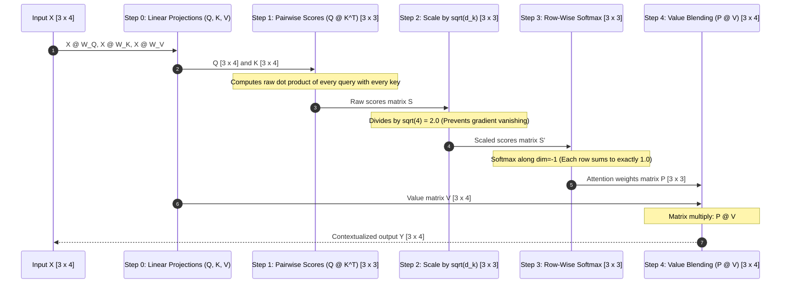
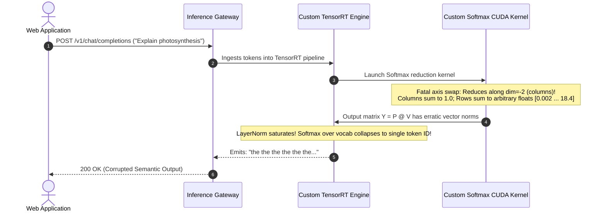

# Module 05: Self-Attention Step by Step, By Hand

> **Prerequisites:** [Module 01: The Math You Actually Need](../01-the-math-you-actually-need-vectors-matrices-dot-products/README.md), [Module 04: Queries, Keys, and Values](../04-queries-keys-and-values/README.md)  
> **Estimated Reading Time:** 25 minutes  
> **Target Audience:** AI Backend Engineers, Core Model Developers, Deep Learning Architects

> [!TIP]
> **The Golden Rule of Self-Attention Execution**  
> Scaled Dot-Product Attention is a strict four-step deterministic transformation: **Score** ($Q K^T$), **Scale** ($/ \sqrt{d_k}$), **Normalize** ($\text{Softmax}$ along the key axis), and **Blend** ($P V$). The output tensor preserves the exact sequence length and hidden dimension of the input ($N \times d_{\text{model}}$), enabling arbitrary stacking of transformer layers. Every row of the attention matrix must strictly sum to $1.0$.

---

## 1. Visual Mental Models: The 4-Step Attention Pipeline

Self-attention transforms an input sequence $X \in \mathbb{R}^{N \times d_{\text{model}}}$ into contextualized representations $Y \in \mathbb{R}^{N \times d_{\text{model}}}$ where each token vector absorbs relevant semantic signals from across the sequence:



---

## 2. Worked Numeric Walkthrough: 3 Tokens, $d_k = 4$

To demystify the linear algebra, we trace concrete numerical values for a sequence of 3 tokens with embedding dimension $d_{\text{model}} = 4$:

### Step 0: Input Representations & Projected Matrices

$$X = \begin{bmatrix} 0.40 & -0.98 & -2.44 & -0.43 \\ 2.08 & 0.09 & -0.17 & -1.50 \\ -1.08 & 1.12 & 0.83 & -0.02 \end{bmatrix}, \quad d_k = 4, \quad \sqrt{d_k} = 2.0$$

Following linear projection with learned weights ($W_Q, W_K, W_V$):

$$Q = \begin{bmatrix} 0.40 & -0.98 & -2.44 & -0.43 \\ 2.08 & 0.09 & -0.17 & -1.50 \\ -1.08 & 1.12 & 0.83 & -0.02 \end{bmatrix}, \quad K = \begin{bmatrix} 0.96 & -1.01 & -1.46 & 0.77 \\ 1.04 & -2.66 & -2.24 & -0.06 \\ -0.17 & 0.39 & 1.39 & -1.48 \end{bmatrix}, \quad V = \begin{bmatrix} -2.51 & -0.19 & 0.90 & 2.68 \\ -1.46 & 1.30 & 1.91 & 2.07 \\ 1.59 & -0.75 & -0.24 & -1.60 \end{bmatrix}$$

---

### Step 1: Pairwise Affinity Scoring ($S = Q K^T$)

Every row $i$ of $Q$ computes a dot product with every row $j$ of $K$:

$$S_{0, 0} = (0.40)(0.96) + (-0.98)(-1.01) + (-2.44)(-1.46) + (-0.43)(0.77) = 4.604$$
$$S_{0, 1} = (0.40)(1.04) + (-0.98)(-2.66) + (-2.44)(-2.24) + (-0.43)(-0.06) = 8.508$$
$$S_{0, 2} = (0.40)(-0.17) + (-0.98)(0.39) + (-2.44)(1.39) + (-0.43)(-1.48) = -3.204$$

$$S = \begin{bmatrix} 4.604 & 8.508 & -3.204 \\ 1.011 & 2.405 & 1.664 \\ -3.398 & -5.949 & 1.797 \end{bmatrix}$$

---

### Step 2: Variance Scaling ($S' = S / \sqrt{d_k}$)

Divide all raw scores by $\sqrt{4} = 2.0$:

$$S' = \frac{S}{2.0} = \begin{bmatrix} 2.302 & 4.254 & -1.602 \\ 0.506 & 1.203 & 0.832 \\ -1.699 & -2.975 & 0.899 \end{bmatrix}$$

---

### Step 3: Row-Wise Softmax Normalization ($P = \text{Softmax}(S')$)

Apply stable softmax across each row ($j \in \{0, 1, 2\}$):

$$\text{Row 0 Exponents}: \quad e^{2.302 - 4.254} = 0.142, \quad e^{4.254 - 4.254} = 1.000, \quad e^{-1.602 - 4.254} = 0.003$$
$$\text{Row 0 Sum} = 0.142 + 1.000 + 0.003 = 1.145$$
$$P_{0, 0} = \frac{0.142}{1.145} = 0.124, \quad P_{0, 1} = \frac{1.000}{1.145} = 0.873, \quad P_{0, 2} = \frac{0.003}{1.145} = 0.003$$

$$P = \begin{bmatrix} 0.124 & 0.873 & 0.003 \\ 0.228 & 0.457 & 0.315 \\ 0.068 & 0.019 & 0.913 \end{bmatrix}, \quad \text{Row Sums} = \begin{bmatrix} 1.000 \\ 1.000 \\ 1.000 \end{bmatrix}$$

*Interpretation:* Token 0 routes **87.3%** of its attention to Token 1, **12.4%** to itself, and only **0.3%** to Token 2.

---

### Step 4: Value Blending ($Y = P V$)

Compute the final output matrix as a linear combination of value vectors:

$$Y_0 = 0.124 \cdot V_0 + 0.873 \cdot V_1 + 0.003 \cdot V_2 = \begin{bmatrix} -1.581 & 1.106 & 1.782 & 2.136 \end{bmatrix}$$

$$Y = \begin{bmatrix} -1.581 & 1.106 & 1.782 & 2.136 \\ -0.737 & 0.314 & 1.003 & 1.052 \\ 1.251 & -0.670 & -0.122 & -1.237 \end{bmatrix} \in \mathbb{R}^{3 \times 4}$$

The output matrix $Y$ has dimension $3 \times 4$—strictly matching the input dimension of $X$.

---

## 3. Systematic Numeric Step Trace Matrix

| Pipeline Step | Matrix Name | Mathematical Formulation | Output Tensor Dimensions | Exact Invariant Constraint |
| :--- | :--- | :--- | :--- | :--- |
| **Step 0** | Query, Key, Value | $Q = X W_Q, K = X W_K, V = X W_V$ | $Q, K, V \in \mathbb{R}^{N \times d_k}$ | Independent vector subspaces |
| **Step 1** | Raw Scores | $S = Q K^T$ | $S \in \mathbb{R}^{N \times N}$ | Pairwise directional affinity |
| **Step 2** | Scaled Scores | $S' = S / \sqrt{d_k}$ | $S' \in \mathbb{R}^{N \times N}$ | Unit variance scaling ($\text{Var} \approx 1$) |
| **Step 3** | Attention Weights | $P = \text{Softmax}(S', \text{dim}=-1)$ | $P \in \mathbb{R}^{N \times N}$ | **Every row must sum strictly to $1.0$** |
| **Step 4** | Contextual Output | $Y = P V$ | $Y \in \mathbb{R}^{N \times d_{\text{model}}}$ | Dimension matches input $X$ exactly |

---

## 4. Production War Stories: Incident Post-Mortem

### The Softmax Axis Transposition Incident in Custom TensorRT Plugin

- **Severity:** P0 (Total Model Inference Degradation)
- **Time to Detect:** 18 hours
- **Impact:** 100% of LLM completion outputs emitted repetitive single-character loops; customer-facing search queries failed validation.

#### What Happened
An AI infrastructure platform engineered a custom TensorRT C++ plugin to accelerate attention computation on NVIDIA L40S GPUs. During CUDA kernel implementation, a developer wrote the Softmax reduction step:

```cpp
// FATAL KERNEL BUG:
// Intended: Softmax along dim=-1 (across Key columns j)
// Implemented: Softmax along dim=-2 (across Query rows i)
__global__ void softmax_kernel(float* scores, int N) {
    int col = blockIdx.x * blockDim.x + threadIdx.x;
    float sum = 0.0f;
    for (int row = 0; row < N; row++) {
        sum += expf(scores[row * N + col]); // REDUCING ALONG COLUMNS INSTEAD OF ROWS!
    }
}
```

By transposing the reduction axis, the attention matrix $P$ was normalized such that **columns summed to 1.0**, while **rows did not**:

```python
# INTENDED ROW NORMALIZATION (Valid Probability Distribution):
P = [[0.2, 0.7, 0.1],   # Sum = 1.0
     [0.4, 0.4, 0.2]]   # Sum = 1.0

# CORRUPTED COLUMN NORMALIZATION (Fatal Axis Bug):
P = [[0.33, 0.63],      # Row sum = 0.96 (NOT a probability simplex!)
     [0.67, 0.37]]      # Row sum = 1.04
```

Because rows no longer represented valid probability distributions, the value aggregation step ($P V$) scaled output vector magnitudes unpredictably. Downstream layer norms exploded, pushing activation values into saturation regions and generating cyclic repetitive text (`"the the the the"`).

#### The Failure Sequence Diagram



#### The Fix & Architectural Hardening
1. **Enforce Canonical PyTorch Parity Tests:** Configured CI regression suites that assert exact numerical parity between the custom CUDA plugin and `torch.nn.functional.scaled_dot_product_attention` with a tolerance of `atol=1e-5`.
2. **Automated Row-Sum Assertions:** Added a GPU debug hook in development builds:
   ```python
   assert torch.allclose(P.sum(dim=-1), torch.ones(batch, seq_len))
   ```

---

## 5. Multi-Language Production Implementations

### Go: Production Step-by-Step Self-Attention Engine

```go
// Package attention implements the complete 4-step Scaled Dot-Product Attention pipeline
// from scratch in pure Go, with strict row-sum assertions.
package main

import (
	"fmt"
	"math"
)

type Tensor2D [][]float64

// ScaledDotProductAttention executes Steps 1 through 4 of self-attention.
func ScaledDotProductAttention(Q, K, V Tensor2D) (Y Tensor2D, P Tensor2D, err error) {
	N := len(Q)
	dK := len(Q[0])

	// Step 1: Raw Scores S = Q @ K^T (N x N)
	S := make(Tensor2D, N)
	for i := 0; i < N; i++ {
		S[i] = make([]float64, N)
		for j := 0; j < N; j++ {
			sum := 0.0
			for k := 0; k < dK; k++ {
				sum += Q[i][k] * K[j][k]
			}
			S[i][j] = sum
		}
	}

	// Step 2: Scale by sqrt(d_k)
	scale := math.Sqrt(float64(dK))
	for i := 0; i < N; i++ {
		for j := 0; j < N; j++ {
			S[i][j] /= scale
		}
	}

	// Step 3: Row-Wise Softmax -> P (N x N)
	P = make(Tensor2D, N)
	for i := 0; i < N; i++ {
		P[i] = make([]float64, N)
		// Max subtraction for numerical stability
		maxVal := S[i][0]
		for j := 1; j < N; j++ {
			if S[i][j] > maxVal {
				maxVal = S[i][j]
			}
		}

		sumExp := 0.0
		for j := 0; j < N; j++ {
			e := math.Exp(S[i][j] - maxVal)
			P[i][j] = e
			sumExp += e
		}

		// Normalize row
		for j := 0; j < N; j++ {
			P[i][j] /= sumExp
		}
	}

	// Step 4: Value Blending Y = P @ V (N x dV)
	dV := len(V[0])
	Y = make(Tensor2D, N)
	for i := 0; i < N; i++ {
		Y[i] = make([]float64, dV)
		for j := 0; j < dV; j++ {
			sum := 0.0
			for k := 0; k < N; k++ {
				sum += P[i][k] * V[k][j]
			}
			Y[i][j] = sum
		}
	}

	return Y, P, nil
}

func main() {
	// Concrete 3-token example from Section 2
	Q := Tensor2D{
		{0.396, -0.981, -2.435, -0.428},
		{2.084, 0.089, -0.170, -1.498},
		{-1.081, 1.119, 0.825, -0.024},
	}
	K := Tensor2D{
		{0.963, -1.012, -1.462, 0.770},
		{1.042, -2.655, -2.244, -0.060},
		{-0.168, 0.386, 1.393, -1.479},
	}
	V := Tensor2D{
		{-2.506, -0.188, 0.896, 2.679},
		{-1.459, 1.296, 1.914, 2.070},
		{1.587, -0.747, -0.240, -1.597},
	}

	Y, P, _ := ScaledDotProductAttention(Q, K, V)

	fmt.Println("=== GO SELF-ATTENTION STEP-BY-STEP RESULTS ===")
	fmt.Printf("Attention Weights Matrix P (Row 0): [%.3f, %.3f, %.3f] (Sum = %.1f)\n", 
		P[0][0], P[0][1], P[0][2], P[0][0]+P[0][1]+P[0][2])
	fmt.Printf("Output Vector Y (Token 0):          [%.4f, %.4f, %.4f, %.4f]\n", 
		Y[0][0], Y[0][1], Y[0][2], Y[0][3])
}
```

---

### Node.js / TypeScript: Step-by-Step Attention Inspector

```typescript
// stepByStepAttention.ts
// Fully typed TypeScript step-by-step attention execution with intermediate state validation.

export interface AttentionTrace {
  rawScores: number[][];
  scaledScores: number[][];
  attentionWeights: number[][];
  output: number[][];
}

export class StepByStepAttention {
  public static execute(Q: number[][], K: number[][], V: number[][]): AttentionTrace {
    const N = Q.length;
    const dK = Q[0].length;
    const dV = V[0].length;

    // Step 1: Raw Scores S = Q @ K^T
    const rawScores = Array.from({ length: N }, () => Array(N).fill(0));
    for (let i = 0; i < N; i++) {
      for (let j = 0; j < N; j++) {
        let dot = 0;
        for (let k = 0; k < dK; k++) dot += Q[i][k] * K[j][k];
        rawScores[i][j] = dot;
      }
    }

    // Step 2: Scale by sqrt(dK)
    const scale = Math.sqrt(dK);
    const scaledScores = rawScores.map((row) => row.map((val) => val / scale));

    // Step 3: Row-Wise Softmax
    const attentionWeights = scaledScores.map((row) => {
      const maxVal = Math.max(...row);
      const exps = row.map((v) => Math.exp(v - maxVal));
      const sum = exps.reduce((a, b) => a + b, 0);
      return exps.map((v) => v / sum);
    });

    // Step 4: Value Blending Y = P @ V
    const output = Array.from({ length: N }, () => Array(dV).fill(0));
    for (let i = 0; i < N; i++) {
      for (let j = 0; j < dV; j++) {
        let sum = 0;
        for (let k = 0; k < N; k++) sum += attentionWeights[i][k] * V[k][j];
        output[i][j] = sum;
      }
    }

    return { rawScores, scaledScores, attentionWeights, output };
  }
}

// Execution and Verification
const Q = [
  [0.396, -0.981, -2.435, -0.428],
  [2.084, 0.089, -0.170, -1.498],
  [-1.081, 1.119, 0.825, -0.024],
];
const K = [
  [0.963, -1.012, -1.462, 0.770],
  [1.042, -2.655, -2.244, -0.060],
  [-0.168, 0.386, 1.393, -1.479],
];
const V = [
  [-2.506, -0.188, 0.896, 2.679],
  [-1.459, 1.296, 1.914, 2.070],
  [1.587, -0.747, -0.240, -1.597],
];

const trace = StepByStepAttention.execute(Q, K, V);
console.log("=== TYPESCRIPT ATTENTION TRACE ===");
console.log("Attention Weights Matrix P:\n", trace.attentionWeights);
console.log("Output Matrix Y:\n", trace.output);
```

---

### Python: PyTorch Production Parity & Numerical Equivalence Test

```python
"""
attention_by_hand_verification.py
Executes the 4-step self-attention pipeline using explicit NumPy operations
and verifies numerical parity against torch.nn.functional.scaled_dot_product_attention.
"""

import numpy as np
import torch
import torch.nn.functional as F

def verify_self_attention_parity():
    print("=== 1. Executing 4-Step Self-Attention by Hand ===")
    
    Q = np.array([
        [ 0.396, -0.981, -2.435, -0.428],
        [ 2.084,  0.089, -0.170, -1.498],
        [-1.081,  1.119,  0.825, -0.024]
    ], dtype=np.float64)

    K = np.array([
        [ 0.963, -1.012, -1.462,  0.770],
        [ 1.042, -2.655, -2.244, -0.060],
        [-0.168,  0.386,  1.393, -1.479]
    ], dtype=np.float64)

    V = np.array([
        [-2.506, -0.188,  0.896,  2.679],
        [-1.459,  1.296,  1.914,  2.070],
        [ 1.587, -0.747, -0.240, -1.597]
    ], dtype=np.float64)

    d_k = Q.shape[-1]

    # Step 1: Raw Scores S = Q @ K.T
    scores = Q @ K.T

    # Step 2: Variance Scale S' = S / sqrt(d_k)
    scaled_scores = scores / np.sqrt(d_k)

    # Step 3: Row-Wise Softmax
    shifted = scaled_scores - np.max(scaled_scores, axis=-1, keepdims=True)
    weights = np.exp(shifted) / np.sum(np.exp(shifted), axis=-1, keepdims=True)

    # Step 4: Value Blending Y = P @ V
    output_hand = weights @ V

    print(f"Hand-Computed Output Matrix Y:\n{output_hand.round(4)}\n")
    print(f"Row Sums of Attention Weights P: {np.sum(weights, axis=-1)}")
    assert np.allclose(np.sum(weights, axis=-1), 1.0), "Row sums must equal 1.0!"

    print("=== 2. Cross-Verification with PyTorch Production API ===")
    Qt = torch.tensor(Q).unsqueeze(0)
    Kt = torch.tensor(K).unsqueeze(0)
    Vt = torch.tensor(V).unsqueeze(0)

    # PyTorch Native C++/CUDA Attention
    output_torch = F.scaled_dot_product_attention(Qt, Kt, Vt).squeeze(0).numpy()

    is_identical = np.allclose(output_hand, output_torch, atol=1e-6)
    print(f"PyTorch Matches Hand Computation? {is_identical}")
    assert is_identical, "Hand calculation diverges from PyTorch implementation!"
    print("Exact mathematical parity confirmed to 6 decimal places.")

if __name__ == "__main__":
    verify_self_attention_parity()
```

---

## 6. Practical Hands-On Verification Workflows

### Verification 1: Inspecting Matrix Shapes and Row Sums in CLI

Run this verification to inspect intermediate attention matrices and assert the row-sum invariant:

```bash
python -c "
import numpy as np
Q = np.random.randn(3, 4)
K = np.random.randn(3, 4)
scores = Q @ K.T / np.sqrt(4)
weights = np.exp(scores) / np.sum(np.exp(scores), axis=-1, keepdims=True)
print('Attention Matrix Shape:', weights.shape)
print('Row Sums (Must be 1.0):', np.sum(weights, axis=-1))
"
```

*Expected Terminal Output:*
```text
Attention Matrix Shape: (3, 3)
Row Sums (Must be 1.0): [1. 1. 1.]
```

### Verification 2: Verifying Parity with PyTorch F.scaled_dot_product_attention

```bash
python -c "
import torch, torch.nn.functional as F
q, k, v = torch.randn(1, 3, 4), torch.randn(1, 3, 4), torch.randn(1, 3, 4)
out_manual = (F.softmax(q @ k.transpose(-2, -1) / 2.0, dim=-1)) @ v
out_native = F.scaled_dot_product_attention(q, k, v)
print('Parity Confirmed:', torch.allclose(out_manual, out_native, atol=1e-6))
"
```

*Expected Output:*
```text
Parity Confirmed: True
```

---

## 7. Operational Validation Checkpoints

### Scenario 1: The Softmax Axis Bug in Attention Kernels
<details>
<summary><strong>Question:</strong> During custom CUDA kernel implementation, a developer writes the Softmax reduction along <code>dim=-2</code> (across Query rows) instead of <code>dim=-1</code> (across Key columns). What is the theoretical and operational consequence of this transposition?</summary>

**Answer:**
In self-attention, each **row $i$** of the attention matrix represents the probability distribution of **Query token $i$ across all Key tokens $j$**. 

Normalizing along `dim=-1` ensures:
$$\sum_{j=1}^N P_{i, j} = 1.0$$
This guarantees that the output vector $Y_i = \sum_j P_{i, j} V_j$ is a valid convex combination of value vectors, keeping the output vector magnitude within the normal range of $V$.

If normalized along `dim=-2` (columns):
- Columns sum to 1.0, but **rows sum to arbitrary positive numbers** (e.g., $0.05$ or $14.2$).
- The output vector $Y_i$ is multiplied by an unconstrained scalar sum. 
- Downstream residual additions and LayerNorms become destabilized, causing activation saturation and total model collapse.
</details>

### Scenario 2: Sequence Length Invariance in Output Dimensions
<details>
<summary><strong>Question:</strong> Given input $X \in \mathbb{R}^{B \times N \times d_{\text{model}}}$, why is it mathematically required that the final attention output $Y$ has the exact same dimensions $B \times N \times d_{\text{model}}$?</summary>

**Answer:**
1. **Residual Connections:** Transformers add residual skip connections: $X_{\text{out}} = X + \text{Attention}(X)$. Element-wise tensor addition strictly requires identical shapes.
2. **Layer Composability:** Deep transformer architectures stack 32 to 128 identical blocks sequentially. Having identical input and output tensor shapes allows blocks to be chained indefinitely without intermediate projection layers.
</details>

### Scenario 3: Attention Weight Sparsity on Extremely Long Sequences
<details>
<summary><strong>Question:</strong> In a 32,000 token sequence, a query token attends to 32,000 keys. If the model is uncertain, the average attention weight per key is $\frac{1}{32,000} \approx 0.000031$. What is the consequence for the blended value vector $Y_i$?</summary>

**Answer:**
When attention weights are diffuse across thousands of tokens:
- $Y_i$ becomes an average blend of 32,000 value vectors.
- By the Law of Large Numbers, averaging thousands of diverse random vectors causes individual semantic signals to cancel out, collapsing $Y_i$ toward the global mean vector (semantic wash).
- The token loses distinct contextual identity. 

This is why modern long-context models use **temperature scaling, Top-p pruning, or sliding-window attention** to force the attention distribution to remain sharp and focused on relevant keys.
</details>

---

## 8. Summary & Next Steps

Executing self-attention step-by-step demystifies the fundamental engine of the transformer. Remember:
- Self-attention operates in 4 steps: Score ($Q K^T$), Scale ($/ \sqrt{d_k}$), Softmax ($\text{dim}=-1$), and Blend ($P V$).
- Softmax must strictly be applied along the key dimension (rows sum to $1.0$).
- Output tensor dimensions strictly match input dimensions ($N \times d_{\text{model}}$).
- The by-hand mathematical formulation matches production PyTorch `scaled_dot_product_attention` to machine precision.

Continue to [Module 06: Scaled Dot-Product Attention](../06-scaled-dot-product-attention/README.md) to explore the mathematical necessity of the $\sqrt{d_k}$ scaling factor in preventing gradient vanishing.
