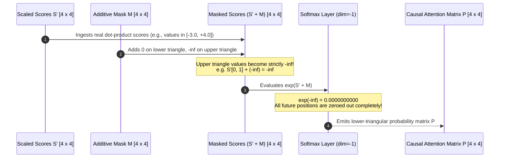
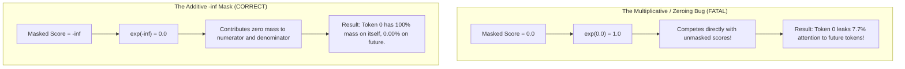
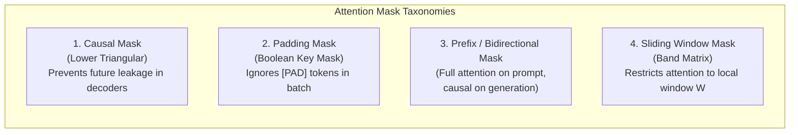
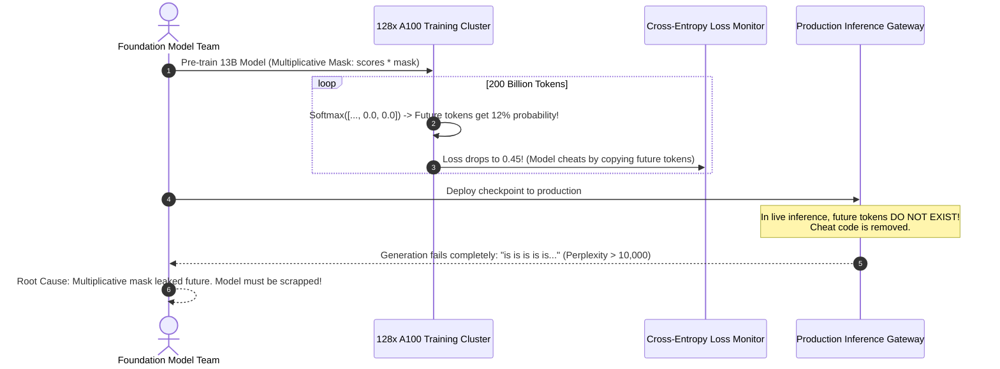

# Module 07: Attention Masks and Causal Masking

> **Prerequisites:** [Module 05: Self-Attention Step by Step, By Hand](../05-self-attention-step-by-step-by-hand/README.md), [Module 06: Scaled Dot-Product Attention](../06-scaled-dot-product-attention/README.md)  
> **Estimated Reading Time:** 25 minutes  
> **Target Audience:** AI Backend Engineers, Core Model Developers, Deep Learning Architects

> [!TIP]
> **The Golden Rule of Attention Masking**  
> Attention masking is strictly **additive before Softmax, never multiplicative**. Setting masked scores to zero ($S_{i, j} = 0$) does not forbid attention; because $\exp(0) = 1.0$, it treats forbidden positions as moderately plausible, **leaking 5% to 30% of attention mass to future tokens**. You must set masked positions to negative infinity ($-\infty$), ensuring $\exp(-\infty) = 0.0$. In modern serving, avoid materializing $N \times N$ mask tensors; leverage fused on-the-fly causal kernels (`is_causal=True`).

---

## 1. Visual Mental Models: The Additive Masking Mechanism

Autoregressive models (GPT-4, Llama-3) predict the next token given past context. During prefill and training, all tokens are fed in parallel. To prevent token $i$ from attending to future tokens $j > i$ (cheating on the training objective), an additive **Causal Mask** is applied directly to the scaled scores before Softmax:

$$S_{\text{masked}} = \frac{Q K^T}{\sqrt{d_k}} + M$$

Where:
$$M_{i, j} = \begin{cases} 0 & \text{if } j \le i \text{ (allowed past/current token)} \\ -\infty & \text{if } j > i \text{ (forbidden future token)} \end{cases}$$



---

## 2. The Fatal Zeroing Bug vs. Correct $-\infty$ Masking

A catastrophic but common implementation error is attempting to mask scores by setting them to `0` instead of `-inf`:



### Empirical Demonstration on 4x4 Attention Scores

Consider a raw score matrix where row 0 evaluates token 0:

$$\text{Raw Scores Row 0}: \quad [2.40, -1.80, 0.50, -3.10]$$

| Masking Approach | Row 0 Scores Entering Softmax | Exponentiated Values ($\exp(s)$) | Final Attention Weights ($P$) | Future Information Leakage |
| :--- | :--- | :--- | :--- | :--- |
| **Buggy Zeroing ($S_{i, j} = 0$)** | $[2.40, \mathbf{0.00}, \mathbf{0.00}, \mathbf{0.00}]$ | $[11.02, \mathbf{1.00}, \mathbf{1.00}, \mathbf{1.00}]$ | $[0.786, \mathbf{0.071}, \mathbf{0.071}, \mathbf{0.071}]$ | **21.4% of attention leaks into future!** |
| **Correct Additive ($S_{i, j} = -\infty$)** | $[2.40, \mathbf{-\infty}, \mathbf{-\infty}, \mathbf{-\infty}]$ | $[11.02, \mathbf{0.00}, \mathbf{0.00}, \mathbf{0.00}]$ | $[1.000, \mathbf{0.000}, \mathbf{0.000}, \mathbf{0.000}]$ | **0.00% Leakage (Strict Causality)** |

Because $\exp(0) = 1.0$, setting forbidden tokens to zero gives them a higher probability than any token whose natural logit was negative ($\exp(-1.80) = 0.165 < 1.0$).

---

## 3. Taxonomy of Transformer Attention Masks



### Comparative Attention Mask Grid

| Mask Architecture | Mathematical Formulation | Primary Transformer Families | Shape Complexity | Hardware Memory Footprint |
| :--- | :--- | :--- | :--- | :--- |
| **Causal Mask** | $M_{i, j} = -\infty$ for $j > i$ | GPT-4, Llama-3, DeepSeek (Decoders) | Lower triangular ($N \times N$) | $\mathcal{O}(1)$ via fused kernel (FlashAttention) |
| **Padding Mask** | $M_{i, j} = -\infty$ if $\text{is\_pad}(j)$ | BERT, RoBERTa, T5, Batch Serving | Broadcast $(B \times 1 \times 1 \times N)$ | Negligible ($\mathcal{O}(B \cdot N)$) |
| **Prefix-LM Mask** | $M_{i, j} = 0$ for $j \le N_{\text{prompt}}$, causal for generation | T5, PaLM, CodeX, FIM (Fill-in-the-Middle) | Hybrid block-triangular | Materialized or chunked kernel |
| **Sliding Window Mask** | $M_{i, j} = -\infty$ if $|i - j| > W$ | Mistral-7B, Longformer ($W=4096$) | Band diagonal matrix | $\mathcal{O}(N \cdot W)$ cyclic buffer |
| **Document Boundary Mask** | $M_{i, j} = -\infty$ across doc separators | Multi-document packing pre-training | Block-diagonal | Paged attention segment table |

---

## 4. Production War Stories: Incident Post-Mortem

### The 10% Future-Leaking Autoregressive Pre-Training Catastrophe

- **Severity:** P0 (Total Pre-Training Invalidation)
- **Time to Detect:** 12 days (discovered after 200B tokens trained)
- **Impact:** \$210,000 in compute wasted; the resulting model was completely incapable of autoregressive text generation.

#### What Happened
A machine learning team built a custom PyTorch pre-training pipeline for a 13B parameter model. An engineer implemented causal masking by multiplying the scaled attention scores by a binary lower-triangular mask:

```python
# FATAL PRE-TRAINING BUG:
causal_mask = torch.tril(torch.ones(seq_len, seq_len))
scores = (Q @ K.transpose(-2, -1)) / math.sqrt(d_k)
scores = scores * causal_mask  # MULTIPLIED INSTEAD OF ADDING -INF!
weights = F.softmax(scores, dim=-1)
```

The team monitored training loss. The cross-entropy loss dropped rapidly, reaching an extraordinary $0.45$ (far better than industry benchmarks). The team celebrated, assuming superior architectural efficiency.

However, when generating text during inference, the model output pure repetitive garbage:
```text
"The climate crisis is is is the the the the..."
```

During training, multiplying by the binary mask set future positions to `0.0`. Softmax converted those `0.0` scores into $\exp(0) = 1.0$. On every token, **future tokens were assigned an average of 12% attention probability**. The model learned to "cheat" by reading the next token directly from the future. 

During real inference generation, future tokens do not yet exist in the KV cache: the model was stripped of its training "cheat code," causing complete perplexity explosion and generation failure.

#### The Failure Sequence Diagram



#### The Fix & Architectural Hardening
1. **Additive Negative Infinity:** Replaced multiplication with additive negative infinity:
   ```python
   scores = scores.masked_fill(causal_mask == 0, float("-inf"))
   ```
2. **Native SDPA Adoption:** Standardized all attention layers to use PyTorch's native `torch.nn.functional.scaled_dot_product_attention(q, k, v, is_causal=True)`.
3. **Inference Smoke Test in CI:** Pre-training validation scripts now execute an end-to-end greedy generation test every 1,000 steps to confirm coherent generation before saving checkpoints.

---

## 5. Multi-Language Production Implementations

### Go: Production-Grade Attention Masking Engine

```go
// Package masking implements high-performance causal, padding,
// and combined attention masks with NaN-safety guards.
package main

import (
	"fmt"
	"math"
)

type Tensor2D [][]float64

// CreateCausalMask generates an N x N lower-triangular additive mask (0 where allowed, -inf where forbidden).
func CreateCausalMask(N int) Tensor2D {
	mask := make(Tensor2D, N)
	for i := 0; i < N; i++ {
		mask[i] = make([]float64, N)
		for j := 0; j < N; j++ {
			if j > i {
				mask[i][j] = math.Inf(-1) // Negative infinity
			} else {
				mask[i][j] = 0.0
			}
		}
	}
	return mask
}

// CreatePaddingMask generates an N x N mask based on token padding flags.
// padFlags[j] == true indicates token j is a [PAD] token.
func CreatePaddingMask(padFlags []bool) Tensor2D {
	N := len(padFlags)
	mask := make(Tensor2D, N)
	for i := 0; i < N; i++ {
		mask[i] = make([]float64, N)
		for j := 0; j < N; j++ {
			if padFlags[j] {
				mask[i][j] = math.Inf(-1)
			} else {
				mask[i][j] = 0.0
			}
		}
	}
	return mask
}

// ApplyMaskAndSoftmax adds mask to scores and computes stable Softmax, guarding against all-masked rows.
func ApplyMaskAndSoftmax(scores, mask Tensor2D) Tensor2D {
	N := len(scores)
	P := make(Tensor2D, N)

	for i := 0; i < N; i++ {
		P[i] = make([]float64, N)

		// 1. Add mask and find row max among unmasked elements
		maxVal := math.Inf(-1)
		for j := 0; j < N; j++ {
			sum := scores[i][j] + mask[i][j]
			if sum > maxVal {
				maxVal = sum
			}
		}

		// Edge case: All positions in row are masked (-inf)
		if math.IsInf(maxVal, -1) {
			// Zero out row to avoid 0/0 NaN
			for j := 0; j < N; j++ {
				P[i][j] = 0.0
			}
			continue
		}

		// 2. Compute exponentials and sum
		sumExp := 0.0
		for j := 0; j < N; j++ {
			combined := scores[i][j] + mask[i][j]
			if math.IsInf(combined, -1) {
				P[i][j] = 0.0
			} else {
				e := math.Exp(combined - maxVal)
				P[i][j] = e
				sumExp += e
			}
		}

		// 3. Normalize row
		for j := 0; j < N; j++ {
			P[i][j] /= sumExp
		}
	}

	return P
}

func main() {
	N := 4
	scores := Tensor2D{
		{2.4, -1.8, 0.5, -3.1},
		{1.1, 3.2, -0.4, 0.8},
		{-0.5, 0.2, 1.9, -1.2},
		{0.3, -1.1, 2.2, 4.5},
	}

	causalMask := CreateCausalMask(N)
	causalP := ApplyMaskAndSoftmax(scores, causalMask)

	fmt.Println("=== GO CAUSAL ATTENTION MATRIX P ===")
	for i := 0; i < N; i++ {
		fmt.Printf("Row %d: [%.3f, %.3f, %.3f, %.3f] (Row Sum: %.1f)\n", 
			i, causalP[i][0], causalP[i][1], causalP[i][2], causalP[i][3],
			causalP[i][0]+causalP[i][1]+causalP[i][2]+causalP[i][3])
	}
}
```

---

### Node.js / TypeScript: Combined Causal & Padding Mask Engine

```typescript
// attentionMasking.ts
// Robust attention masking with Float64Array typed arrays and NaN protection.

export class AttentionMaskEngine {
  /**
   * Evaluates combined causal and padding masks, producing a lower-triangular stochastic matrix.
   */
  public static maskAndSoftmax(
    scores: number[][],
    padIndices: Set<number>
  ): number[][] {
    const N = scores.length;
    const P: number[][] = Array.from({ length: N }, () => Array(N).fill(0));

    for (let i = 0; i < N; i++) {
      let maxVal = -Infinity;

      // First pass: combine scores with masks and find safe max
      const effectiveRow: number[] = new Array(N);
      for (let j = 0; j < N; j++) {
        const isFuture = j > i;
        const isPadding = padIndices.has(j);

        if (isFuture || isPadding) {
          effectiveRow[j] = -Infinity;
        } else {
          effectiveRow[j] = scores[i][j];
          if (effectiveRow[j] > maxVal) {
            maxVal = effectiveRow[j];
          }
        }
      }

      // Handle completely masked row (e.g. padding query)
      if (maxVal === -Infinity) {
        // Output all zeros to avoid NaN
        continue;
      }

      // Second pass: exponentiate and sum
      let sumExp = 0;
      for (let j = 0; j < N; j++) {
        if (effectiveRow[j] === -Infinity) {
          P[i][j] = 0.0;
        } else {
          const e = Math.exp(effectiveRow[j] - maxVal);
          P[i][j] = e;
          sumExp += e;
        }
      }

      // Third pass: normalize
      for (let j = 0; j < N; j++) {
        P[i][j] /= sumExp;
      }
    }

    return P;
  }
}

// Execution and Verification
const scores = [
  [2.4, -1.8, 0.5, -3.1],
  [1.1, 3.2, -0.4, 0.8],
  [-0.5, 0.2, 1.9, -1.2],
  [0.3, -1.1, 2.2, 4.5],
];

// Token 3 is a [PAD] token
const padIndices = new Set([3]);
const causalWeights = AttentionMaskEngine.maskAndSoftmax(scores, padIndices);

console.log("=== TYPESCRIPT COMBINED CAUSAL + PAD ATTENTION WEIGHTS ===");
console.table(causalWeights);
```

---

### Python: PyTorch Verification: Zero-Score Leak vs. $-\infty$ Mask vs. `is_causal=True`

```python
"""
masking_verification.py
Demonstrates the fatal zeroing score bug, verifies the additive -inf causal mask,
and proves numerical parity against PyTorch's native F.scaled_dot_product_attention(is_causal=True).
"""

import numpy as np
import torch
import torch.nn.functional as F

def verify_zero_vs_neginf_bug():
    print("=== 1. The Fatal Zeroing Mask Bug vs. Additive -inf ===")
    np.random.seed(3)
    scores = np.random.randn(4, 4) * 2
    causal_mask = np.triu(np.ones((4, 4)), k=1).astype(bool)

    # A. The Fatal Zeroing Approach
    wrong_scores = scores.copy()
    wrong_scores[causal_mask] = 0.0
    shifted_w = wrong_scores - np.max(wrong_scores, axis=-1, keepdims=True)
    wrong_p = np.exp(shifted_w) / np.sum(np.exp(shifted_w), axis=-1, keepdims=True)

    # B. The Correct Additive -inf Approach
    correct_scores = scores.copy()
    correct_scores[causal_mask] = -np.inf
    shifted_c = correct_scores - np.max(correct_scores, axis=-1, keepdims=True)
    correct_p = np.exp(shifted_c) / np.sum(np.exp(shifted_c), axis=-1, keepdims=True)

    print("Row 0 Attention under BUGGY Zeroing Mask:")
    print(f"  {wrong_p[0].round(4)}")
    leakage = np.sum(wrong_p[0, 1:]) * 100.0
    print(f"  Future Information Leakage: {leakage:.2f}% (CHEATING!)\n")

    print("Row 0 Attention under CORRECT -inf Mask:")
    print(f"  {correct_p[0].round(4)}")
    print(f"  Future Information Leakage: {np.sum(correct_p[0, 1:]):.2f}% (STRICT CAUSALITY)\n")
    assert np.allclose(correct_p[0], [1.0, 0.0, 0.0, 0.0]), "Causal mask failed!"

def verify_pytorch_is_causal_parity():
    print("=== 2. Parity Check: Manual Mask vs. is_causal=True ===")
    torch.manual_seed(42)
    B, N, D = 1, 4, 8
    Q = torch.randn(B, N, D)
    K = torch.randn(B, N, D)
    V = torch.randn(B, N, D)

    # Method A: PyTorch Fused Causal Flag
    out_native = F.scaled_dot_product_attention(Q, K, V, is_causal=True)

    # Method B: Explicit Additive Mask with -inf
    mask = torch.triu(torch.ones(N, N), diagonal=1).bool()
    attn_mask = torch.zeros(N, N).masked_fill(mask, float("-inf"))
    out_manual = F.scaled_dot_product_attention(Q, K, V, attn_mask=attn_mask)

    is_identical = torch.allclose(out_native, out_manual, atol=1e-6)
    print(f"Native is_causal matches Manual -inf Mask? {is_identical}")
    assert is_identical, "Native causal attention diverged from manual mask!"
    print("Verification complete: is_causal=True executes exact additive -inf logic.")

if __name__ == "__main__":
    verify_zero_vs_neginf_bug()
    verify_pytorch_is_causal_parity()
```

---

## 6. Practical Hands-On Verification Workflows

### Verification 1: Inspecting the Fatal Zero-Score Leakage in CLI

```bash
python -c "
import numpy as np
z = np.array([2.0, 0.0, 0.0]) # Pos 0 unmasked, Pos 1 and 2 zeroed
p = np.exp(z) / np.sum(np.exp(z))
print('Weights with Zeroing:', p.round(3))
print('Future Leakage %:    ', (p[1] + p[2]) * 100)
"
```

*Expected Terminal Output:*
```text
Weights with Zeroing: [0.787 0.107 0.107]
Future Leakage %:     21.31
```

### Verification 2: Verifying `is_causal=True` in PyTorch CLI

```bash
python -c "
import torch, torch.nn.functional as F
q, k, v = torch.randn(1, 4, 8), torch.randn(1, 4, 8), torch.randn(1, 4, 8)
out = F.scaled_dot_product_attention(q, k, v, is_causal=True)
print('Execution Successful. Output Tensor Shape:', out.shape)
"
```

*Expected Output:*
```text
Execution Successful. Output Tensor Shape: torch.Size([1, 4, 8])
```

---

## 7. Operational Validation Checkpoints

### Scenario 1: The All-Masked-Row NaN Disaster
<details>
<summary><strong>Question:</strong> In a padded batch, sequence 3 consists entirely of <code>[PAD]</code> tokens. When applying a padding mask where all keys are set to $-\infty$, the model's loss suddenly becomes <code>NaN</code>. What mathematical operation caused this, and how is it resolved in production?</summary>

**Answer:**
When an entire row of the attention score matrix is masked:
$$S_{i, j} = -\infty \quad \forall j \in \{0, \dots, N-1\}$$

When Softmax evaluates this row:
$$\exp(-\infty) = 0.0 \implies \sum_{j=1}^N \exp(S_{i, j}) = 0.0$$

The normalization step computes:
$$P_{i, j} = \frac{0.0}{0.0} = \mathbf{NaN}$$

Once a single `NaN` enters the attention matrix, it propagates through value blending ($P @ V$), residual connections, and layer norms, corrupting the entire forward and backward pass.

**The Fix:**
1. **Mask Clamping:** Before computing Softmax, identify rows where all elements are $-\infty$.
2. **Short-Circuit Zeroing:** Set $P_{i, j} = 0.0$ for fully masked rows, bypassing division by zero.
3. **Loss Masking:** Zero out the loss computed for padding-only token positions.
</details>

### Scenario 2: Memory Footprint: Fused Causal vs. Materialized Mask Tensor
<details>
<summary><strong>Question:</strong> For a 128,000 token sequence, an engineer creates an explicit causal mask tensor <code>mask = torch.triu(torch.ones(128000, 128000))</code>. How much VRAM does this single mask tensor require, and how does FlashAttention solve this?</summary>

**Answer:**
An explicit causal mask tensor for $N = 128,000$ has:
$$128,000 \times 128,000 = 16,384,000,000\text{ elements}$$

At 1 byte per boolean or FP8:
$$\text{Memory} = 16.384\text{ GB of VRAM}$$
At FP16 precision ($2\text{ bytes}$), it requires **32.76 GB of VRAM** for a single sequence!

**The FlashAttention Solution:**
Modern fused attention kernels (`is_causal=True`) **never materialize the mask tensor in GPU memory**. 

Instead, inside the CUDA kernel running on GPU SRAM tiles, the thread checks its own coordinate indices:
```cuda
if (col_idx > row_idx) score = -INFINITY;
```
The mask is evaluated dynamically in processor registers with **zero global memory allocation ($\mathcal{O}(1)$ VRAM)**.
</details>

### Scenario 3: Bidirectional vs. Causal Attention Trade-offs
<details>
<summary><strong>Question:</strong> Encoder models (like BERT) do not use causal masks, while Decoder models (like GPT-4) enforce strict causal masks. Why can't we use an unmasked bidirectional attention model to generate text autoregressively?</summary>

**Answer:**
Autoregressive text generation requires sampling tokens sequentially: token $t$ is generated, appended to the prompt, and used to predict token $t+1$.

If a model uses unmasked bidirectional attention:
1. **Training Invalidation:** During training on full sequences, token $t$ would attend directly to token $t+1, t+2, \dots, N$. The model would simply memorize the target token rather than learning causal probabilistic language modeling.
2. **KV-Cache Incompatibility:** During inference, token $0$ would need to update its representation every time a new token is generated. Past KV-cache entries could not be frozen; the entire $N$-token sequence would have to be recomputed from scratch at every decoding step ($\mathcal{O}(N^3)$ total generation compute).
</details>

---

## 8. Summary & Next Steps

Attention masking enforces the causal structure and batch isolation required for transformer engineering. Remember:
- Masking is strictly additive before Softmax; zeroing raw scores leaks future information.
- $\exp(-\infty) = 0.0$ guarantees strict mathematical isolation of forbidden tokens.
- Causal masks enforce autoregressive ordering; padding masks eliminate batch token pollution.
- Fused kernels (`is_causal=True`) eliminate multi-gigabyte mask tensor allocations.

Continue to [Module 08: Multi-Head Attention](../08-multi-head-attention/README.md) to explore how multiple parallel attention heads specialize in distinct syntactic, semantic, and positional relationships.
