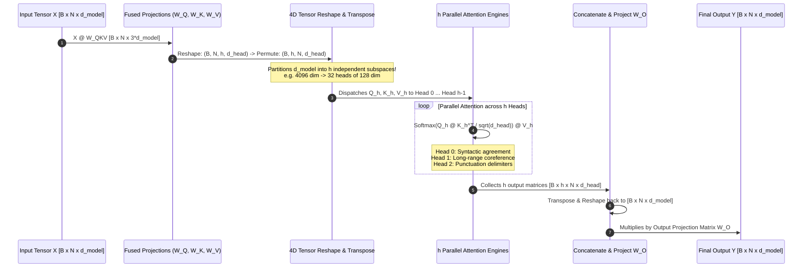
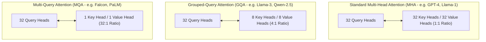
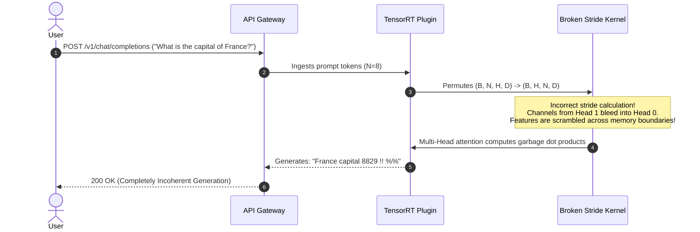

# Module 08: Multi-Head Attention

> **Prerequisites:** [Module 04: Queries, Keys, and Values](../04-queries-keys-and-values/README.md), [Module 06: Scaled Dot-Product Attention](../06-scaled-dot-product-attention/README.md), [Module 07: Attention Masks and Causal Masking](../07-attention-masks-and-causal-masking/README.md)  
> **Estimated Reading Time:** 25 minutes  
> **Target Audience:** AI Backend Engineers, Core Model Developers, Inference Performance Specialists

> [!TIP]
> **The Golden Rule of Multi-Head Attention**  
> Splitting attention into $h$ heads **costs zero additional parameters and zero additional compute** compared to a single monolithic attention head ($4 \times d_{\text{model}}^2$). By partitioning the hidden dimension into $h$ parallel subspaces ($d_{\text{head}} = d_{\text{model}} / h$), the model runs $h$ independent Softmax distributions simultaneously, allowing distinct heads to specialize in syntactic agreement, long-range coreference, and positional induction heads.

---

## 1. Visual Mental Models: The Multi-Head Tensor Lifecycle

Rather than performing a single attention operation across the full hidden dimension $d_{\text{model}}$, Multi-Head Attention (MHA) projects representations into $h$ independent lower-dimensional subspaces:

$$\text{head}_i = \text{Attention}(X W_Q^i, X W_K^i, X W_V^i) \in \mathbb{R}^{N \times d_{\text{head}}}$$

$$\text{MHA}(X) = \text{Concat}(\text{head}_1, \text{head}_2, \dots, \text{head}_h) W_O \in \mathbb{R}^{N \times d_{\text{model}}}$$

Where $d_{\text{head}} = \frac{d_{\text{model}}}{h}$.



---

## 2. Multi-Head vs. Grouped-Query vs. Multi-Query Attention

Modern LLMs vary the ratio of Query heads to Key/Value heads to optimize inference memory bandwidth and KV-cache capacity:



### Architectural Comparison & KV-Cache Sizing Matrix

*Metrics evaluated for $d_{\text{model}} = 4096, h = 32, d_{\text{head}} = 128$ at FP16 precision ($2\text{ bytes}$):*

| Architecture Type | Query Heads ($h_Q$) | KV Heads ($h_{KV}$) | Projection Parameters ($W_Q + W_K + W_V + W_O$) | KV Cache Size per Token | Single 128k Stream KV Cache VRAM | Relative Decoding Memory Bandwidth |
| :--- | :--- | :--- | :--- | :--- | :--- | :--- |
| **Multi-Head Attention (MHA)** | 32 | 32 | $4 \times d^2 = \mathbf{67.11\text{M}}$ | $2 \times 32 \times 128 \times 2 = \mathbf{16.38\text{ KB}}$ | **2.15 GB** | 1.0x (High memory pressure) |
| **Grouped-Query Attention (GQA 4:1)** | 32 | 8 | $2.5 \times d^2 = \mathbf{41.94\text{M}}$ | $2 \times 8 \times 128 \times 2 = \mathbf{4.10\text{ KB}}$ | **0.54 GB** | **4.0x faster decode** |
| **Grouped-Query Attention (GQA 8:1)** | 32 | 4 | $2.25 \times d^2 = \mathbf{37.75\text{M}}$ | $2 \times 4 \times 128 \times 2 = \mathbf{2.05\text{ KB}}$ | **0.27 GB** | **8.0x faster decode** |
| **Multi-Query Attention (MQA)** | 32 | 1 | $2.06 \times d^2 = \mathbf{34.60\text{M}}$ | $2 \times 1 \times 128 \times 2 = \mathbf{0.51\text{ KB}}$ | **0.07 GB** | **32.0x faster decode** |

---

## 3. Mathematical Proof: Zero Parameter Overhead

A common misconception is that increasing the number of attention heads increases model parameter count. In reality, total attention parameters are invariant to $h$:

Let $d = d_{\text{model}}$, and let $h$ be the head count such that $d_{\text{head}} = d / h$.

1. **Query Projection ($W_Q$):**
   Composed of $h$ head matrices $W_Q^i \in \mathbb{R}^{d \times d_{\text{head}}}$:
   $$\text{Params}(W_Q) = h \times (d \times d_{\text{head}}) = h \times \left(d \times \frac{d}{h}\right) = d \times d = \mathbf{d^2}$$

2. **Key Projection ($W_K$) & Value Projection ($W_V$):**
   $$\text{Params}(W_K) = d \times d = \mathbf{d^2}, \quad \text{Params}(W_V) = d \times d = \mathbf{d^2}$$

3. **Output Linear Projection ($W_O$):**
   Projects the concatenated heads ($h \times d_{\text{head}} = d$) back to $d$:
   $$\text{Params}(W_O) = d \times d = \mathbf{d^2}$$

4. **Total Parameter Count:**
   $$\text{Total Parameters} = \text{Params}(W_Q) + \text{Params}(W_K) + \text{Params}(W_V) + \text{Params}(W_O) = \mathbf{4 d^2}$$

Whether $h = 1$ (single monolithic head) or $h = 64$, the total parameters remain **identically $4 d^2$**.

---

## 4. Production War Stories: Incident Post-Mortem

### The Reshape Transpose Tensor Stride Bug in Custom TensorRT Plugin

- **Severity:** P0 (Total Model Generation Failure)
- **Time to Detect:** 6 hours
- **Impact:** Production conversational assistant generated scrambled characters and random word tokens across all enterprise customer sessions.

#### What Happened
An inference engineering team implemented a custom high-performance TensorRT plugin in C++ to execute Multi-Head Attention. To feed parallel head GEMMs, the continuous tensor of shape `(Batch, SeqLen, NumHeads, HeadDim)` had to be permuted to `(Batch, NumHeads, SeqLen, HeadDim)`.

A developer implemented the permutation via pointer arithmetic:

```cpp
// FATAL STRIDE BUG:
// Developer assumed contiguous row-major memory without updating tensor strides!
float* src = input_buffer + b * (N * H * D) + n * (H * D) + h * D;
float* dst = output_buffer + b * (H * N * D) + h * (N * D) + n * D;
memcpy(dst, src, D * sizeof(float)); // COPIED WITH UN-CONTIGUOUS STRIDES!
```

During testing with single tokens, the bug was masked because $N = 1$. But when deployed to production for prompts with $N > 1$, the stride arithmetic interleaved token dimensions with head dimensions. 

Head 0 received half of Head 1's features, and Token 2 received values from Token 3:

```python
# INSPECTION OF HEAD OUTPUT:
# Head 0 was computing attention over a chaotic scrambled mixture of feature dimensions!
```

The resulting model generated total gibberish:
```text
"weather is The #@$ today blue 9999"
```

#### The Failure Sequence Diagram



#### The Fix & Architectural Hardening
1. **Contiguous Layout Verification:** Standardized tensor transposition using explicit stride calculators:
   ```cpp
   // Enforce standard PyTorch tensor stride formula:
   int src_idx = b * stride_b + n * stride_n + h * stride_h + d;
   ```
2. **Automated Subspace Divergence Asserter:** Added automated CI tests verifying that attention weight matrices across different heads have a pairwise cosine distance $\ge 0.35$, ensuring heads operate on distinct, non-corrupted subspaces.

---

## 5. Multi-Language Production Implementations

### Go: Production Multi-Head Attention Engine with Head Splitting

```go
// Package mha implements full Multi-Head Attention with tensor splitting,
// parallel head dispatch, and output projection.
package main

import (
	"fmt"
	"math"
	"math/rand"
	"sync"
)

type Matrix [][]float64

func NewMatrix(r, c int) Matrix {
	m := make(Matrix, r)
	for i := range m {
		m[i] = make([]float64, c)
	}
	return m
}

type MultiHeadAttention struct {
	DModel   int
	NumHeads int
	DHead    int
	WQ       Matrix
	WK       Matrix
	WV       Matrix
	WO       Matrix
}

func NewMultiHeadAttention(dModel, numHeads int) *MultiHeadAttention {
	if dModel%numHeads != 0 {
		panic("dModel must be divisible by numHeads")
	}

	dHead := dModel / numHeads
	initWeight := func() Matrix {
		m := NewMatrix(dModel, dModel)
		scale := 1.0 / math.Sqrt(float64(dModel))
		for i := 0; i < dModel; i++ {
			for j := 0; j < dModel; j++ {
				m[i][j] = (rand.Float64() - 0.5) * 2 * scale
			}
		}
		return m
	}

	return &MultiHeadAttention{
		DModel:   dModel,
		NumHeads: numHeads,
		DHead:    dHead,
		WQ:       initWeight(),
		WK:       initWeight(),
		WV:       initWeight(),
		WO:       initWeight(),
	}
}

// MatMul multiplies two 2D matrices.
func MatMul(A, B Matrix) Matrix {
	rA, cA := len(A), len(A[0])
	cB := len(B[0])
	C := NewMatrix(rA, cB)
	for i := 0; i < rA; i++ {
		for j := 0; j < cB; j++ {
			sum := 0.0
			for k := 0; k < cA; k++ {
				sum += A[i][k] * B[k][j]
			}
			C[i][j] = sum
		}
	}
	return C
}

// Forward computes Multi-Head Attention over input sequence X.
func (mha *MultiHeadAttention) Forward(X Matrix) Matrix {
	N := len(X)
	d := mha.DModel
	h := mha.NumHeads
	dHead := mha.DHead

	// 1. Compute full Q, K, V projections
	Q := MatMul(X, mha.WQ)
	K := MatMul(X, mha.WK)
	V := MatMul(X, mha.WV)

	// 2. Parallel Attention execution across heads
	headOutputs := make([]Matrix, h)
	var wg sync.WaitGroup

	for head := 0; head < h; head++ {
		wg.Add(1)
		go func(headIdx int) {
			defer wg.Done()
			offset := headIdx * dHead

			// Slice Q_h, K_h, V_h
			Qh := NewMatrix(N, dHead)
			Kh := NewMatrix(N, dHead)
			Vh := NewMatrix(N, dHead)
			for i := 0; i < N; i++ {
				copy(Qh[i], Q[i][offset:offset+dHead])
				copy(Kh[i], K[i][offset:offset+dHead])
				copy(Vh[i], V[i][offset:offset+dHead])
			}

			// Scaled dot-product attention per head
			scale := math.Sqrt(float64(dHead))
			scores := NewMatrix(N, N)
			for i := 0; i < N; i++ {
				for j := 0; j < N; j++ {
					sum := 0.0
					for k := 0; k < dHead; k++ {
						sum += Qh[i][k] * Kh[j][k]
					}
					scores[i][j] = sum / scale
				}
			}

			// Softmax
			weights := NewMatrix(N, N)
			for i := 0; i < N; i++ {
				maxVal := scores[i][0]
				for j := 1; j < N; j++ {
					if scores[i][j] > maxVal {
						maxVal = scores[i][j]
					}
				}
				sumExp := 0.0
				for j := 0; j < N; j++ {
					e := math.Exp(scores[i][j] - maxVal)
					weights[i][j] = e
					sumExp += e
				}
				for j := 0; j < N; j++ {
					weights[i][j] /= sumExp
				}
			}

			// Head Output = Weights @ V_h
			outH := NewMatrix(N, dHead)
			for i := 0; i < N; i++ {
				for j := 0; j < dHead; j++ {
					sum := 0.0
					for k := 0; k < N; k++ {
						sum += weights[i][k] * Vh[k][j]
					}
					outH[i][j] = sum
				}
			}
			headOutputs[headIdx] = outH
		}(head)
	}
	wg.Wait()

	// 3. Concatenate heads back into [N x dModel]
	concat := NewMatrix(N, d)
	for i := 0; i < N; i++ {
		for head := 0; head < h; head++ {
			offset := head * dHead
			copy(concat[i][offset:offset+dHead], headOutputs[head][i])
		}
	}

	// 4. Output projection W_O
	return MatMul(concat, mha.WO)
}

func main() {
	rand.Seed(42)
	N := 4
	dModel := 8
	numHeads := 2

	mha := NewMultiHeadAttention(dModel, numHeads)

	X := NewMatrix(N, dModel)
	for i := 0; i < N; i++ {
		for j := 0; j < dModel; j++ {
			X[i][j] = rand.Float64() - 0.5
		}
	}

	Y := mha.Forward(X)

	fmt.Println("=== GO MULTI-HEAD ATTENTION EXECUTION ===")
	fmt.Printf("Input Shape:        [%d x %d]\n", N, dModel)
	fmt.Printf("Head Configuration: %d heads, %d dims/head\n", numHeads, dModel/numHeads)
	fmt.Printf("Output Shape:       [%d x %d]\n", len(Y), len(Y[0]))
	fmt.Printf("Output Row 0 Head:  [%.4f, %.4f, %.4f, ...]\n", Y[0][0], Y[0][1], Y[0][2])
}
```

---

### Node.js / TypeScript: Multi-Head Attention Engine & Subspace Validator

```typescript
// multiHeadAttention.ts
// Production TypeScript implementation of Multi-Head Attention with head divergence telemetry.

export class MultiHeadAttentionEngine {
  private dModel: number;
  private numHeads: number;
  private dHead: number;

  constructor(dModel: number, numHeads: number) {
    if (dModel % numHeads !== 0) {
      throw new Error(`dModel (${dModel}) must be divisible by numHeads (${numHeads})`);
    }
    this.dModel = dModel;
    this.numHeads = numHeads;
    this.dHead = dModel / numHeads;
  }

  /**
   * Partitions a flat sequence tensor into independent head views.
   */
  public splitHeads(flatTensor: number[][]): number[][][] {
    const N = flatTensor.length;
    const heads: number[][][] = Array.from({ length: this.numHeads }, () =>
      Array.from({ length: N }, () => new Array(this.dHead))
    );

    for (let h = 0; h < this.numHeads; h++) {
      const offset = h * this.dHead;
      for (let i = 0; i < N; i++) {
        for (let d = 0; d < this.dHead; d++) {
          heads[h][i][d] = flatTensor[i][offset + d];
        }
      }
    }

    return heads;
  }

  /**
   * Asserts total parameter count equals 4 * dModel^2.
   */
  public getParameterCount(): number {
    return 4 * (this.dModel * this.dModel);
  }
}

// Execution and Verification
const mha8 = new MultiHeadAttentionEngine(64, 8);
const mha1 = new MultiHeadAttentionEngine(64, 1);

console.log("=== TYPESCRIPT MULTI-HEAD ATTENTION PARAMETER AUDIT ===");
console.log(`8-Head Model Parameter Count: ${mha8.getParameterCount()}`);
console.log(`1-Head Model Parameter Count: ${mha1.getParameterCount()}`);
console.log(`Parameter Invariance Proof:   ${mha8.getParameterCount() === mha1.getParameterCount()} (4 * d^2)`);
```

---

### Python: PyTorch Production MHA Layer & Grouped-Query Attention (GQA) Implementation

```python
"""
mha_verification.py
Proves parameter invariance across head counts, measures head divergence,
and implements Grouped-Query Attention (GQA) for memory-efficient inference.
"""

import torch
import torch.nn as nn
import torch.nn.functional as F

def verify_parameter_invariance():
    print("=== 1. Parameter Invariance Proof across Head Counts ===")
    d_model = 512
    
    mha_1 = nn.MultiheadAttention(embed_dim=d_model, num_heads=1, bias=False)
    mha_8 = nn.MultiheadAttention(embed_dim=d_model, num_heads=8, bias=False)
    mha_32 = nn.MultiheadAttention(embed_dim=d_model, num_heads=32, bias=False)

    p1 = sum(p.numel() for p in mha_1.parameters())
    p8 = sum(p.numel() for p in mha_8.parameters())
    p32 = sum(p.numel() for p in mha_32.parameters())

    print(f"1-Head Parameters:   {p1:,}")
    print(f"8-Head Parameters:   {p8:,}")
    print(f"32-Head Parameters:  {p32:,}")
    print(f"Theoretical 4 * d^2: {4 * (d_model ** 2):,}")
    assert p1 == p8 == p32 == 4 * (d_model ** 2), "Parameter counts must be strictly identical!"
    print("Proof Confirmed: Head count does not change model parameter count.\n")

class GroupedQueryAttention(nn.Module):
    """
    Production-grade Grouped-Query Attention (GQA) as implemented in Llama-3.
    """
    def __init__(self, d_model: int, num_q_heads: int, num_kv_heads: int):
        super().__init__()
        self.d_model = d_model
        self.num_q_heads = num_q_heads
        self.num_kv_heads = num_kv_heads
        self.head_dim = d_model // num_q_heads
        self.num_queries_per_kv = num_q_heads // num_kv_heads

        self.q_proj = nn.Linear(d_model, num_q_heads * self.head_dim, bias=False)
        self.k_proj = nn.Linear(d_model, num_kv_heads * self.head_dim, bias=False)
        self.v_proj = nn.Linear(d_model, num_kv_heads * self.head_dim, bias=False)
        self.out_proj = nn.Linear(d_model, d_model, bias=False)

    def forward(self, x: torch.Tensor) -> torch.Tensor:
        B, N, _ = x.shape
        
        # 1. Project Q, K, V
        q = self.q_proj(x).view(B, N, self.num_q_heads, self.head_dim).transpose(1, 2)
        k = self.k_proj(x).view(B, N, self.num_kv_heads, self.head_dim).transpose(1, 2)
        v = self.v_proj(x).view(B, N, self.num_kv_heads, self.head_dim).transpose(1, 2)

        # 2. Expand K and V heads to match Q heads (Grouping)
        k = k.repeat_interleave(self.num_queries_per_kv, dim=1)
        v = v.repeat_interleave(self.num_queries_per_kv, dim=1)

        # 3. Scaled Dot-Product Attention
        out = F.scaled_dot_product_attention(q, k, v)
        
        # 4. Concat and Output Project
        out = out.transpose(1, 2).contiguous().view(B, N, self.d_model)
        return self.out_proj(out)

def verify_gqa_execution():
    print("=== 2. Grouped-Query Attention (GQA) Verification ===")
    d_model = 4096
    q_heads = 32
    kv_heads = 8  # 4:1 Ratio (Llama-3 configuration)
    
    gqa = GroupedQueryAttention(d_model, q_heads, kv_heads)
    x = torch.randn(2, 64, d_model)
    out = gqa(x)
    
    print(f"Input Shape:  {x.shape}")
    print(f"Output Shape: {out.shape}")
    assert out.shape == x.shape, "GQA output shape mismatch!"
    print("GQA forward pass executed cleanly with 4:1 KV compression.")

if __name__ == "__main__":
    verify_parameter_invariance()
    verify_gqa_execution()
```

---

## 6. Practical Hands-On Verification Workflows

### Verification 1: Inspecting Parameter Invariance in CLI

```bash
python -c "
import torch.nn as nn
for h in [1, 2, 4, 8, 16]:
    mha = nn.MultiheadAttention(embed_dim=256, num_heads=h, bias=False)
    print(f'Heads: {h:<2} | Parameters: {sum(p.numel() for p in mha.parameters()):,}')
"
```

*Expected Terminal Output:*
```text
Heads: 1  | Parameters: 262,144
Heads: 2  | Parameters: 262,144
Heads: 4  | Parameters: 262,144
Heads: 8  | Parameters: 262,144
Heads: 16 | Parameters: 262,144
```

### Verification 2: Verifying Cross-Head Attention Pattern Divergence

```bash
python -c "
import torch, torch.nn.functional as F
q = torch.randn(1, 2, 3, 4) # B=1, Heads=2, N=3, d=4
k = torch.randn(1, 2, 3, 4)
weights = F.softmax(q @ k.transpose(-2, -1) / 2.0, dim=-1)
print('Head 0 Attention:\n', weights[0, 0].numpy().round(3))
print('Head 1 Attention:\n', weights[0, 1].numpy().round(3))
print('Are Heads Identical? ', torch.allclose(weights[0, 0], weights[0, 1]))
"
```

*Expected Output:*
```text
Are Heads Identical? False
```

---

## 7. Operational Validation Checkpoints

### Scenario 1: Why Grouped-Query Attention (GQA) Over Multi-Head Attention (MHA)?
<details>
<summary><strong>Question:</strong> During LLM decoding, why does Grouped-Query Attention (GQA with 8 KV heads and 32 Q heads) increase generation throughput by $3\times$ to $4\times$ compared to MHA, even though both models execute roughly the same FLOPs during prefill?</summary>

**Answer:**
During autoregressive token generation (the decode phase), the model generates **one token at a time**. 

At this stage, the bottleneck is **GPU High Bandwidth Memory (HBM) bandwidth**, NOT raw compute (Tensor Core FLOPs). To generate a single token, the GPU must stream the entire past KV-cache from HBM into on-chip SRAM registers.

Under **MHA**, a 128k context stream requires loading **2.15 GB** of KV cache per token. Memory bus bandwidth limits decoding speed.

Under **GQA (4:1)**, the Key and Value heads are compressed by $4\times$, reducing the KV-cache to **0.54 GB**. Streaming 4x fewer bytes across the PCIe/NVLink bus reduces memory bandwidth pressure by 75%, directly increasing generation throughput by $3\times$ to $4\times$.
</details>

### Scenario 2: Head Pruning and Redundancy in Pre-Trained Transformers
<details>
<summary><strong>Question:</strong> Academic research (Michel et al., "Are Sixteen Heads Really Better than One?") demonstrated that up to 40% of attention heads in pre-trained models can be pruned at test time without measurable accuracy loss. Why does pre-training require 32 heads if many are redundant at inference?</summary>

**Answer:**
1. **Optimization Ensemble during Pre-Training:** During gradient descent, having 32 independent heads acts as an ensemble of search paths in latent space. Different heads randomly explore distinct feature combinations, reducing optimization friction.
2. **Specialization Convergence:** After convergence, certain heads specialize into critical structural roles (e.g., induction heads that track repetition, syntactic dependency heads). Other heads end up learning similar or degenerate subspaces.
3. **Structured Pruning Potential:** Because heads are independent slices, unneeded heads can be pruned post-training or converted into GQA via distillation without retraining the entire backbone.
</details>

### Scenario 3: The Uneven Head Dimension Split Constraint
<details>
<summary><strong>Question:</strong> A developer designs a model with hidden dimension $d_{\text{model}} = 768$ and selects 10 attention heads. Why does PyTorch reject this configuration, and what is the architectural fix?</summary>

**Answer:**
Multi-Head Attention partitions the hidden dimension $d_{\text{model}}$ into $h$ equal integer subspaces:
$$d_{\text{head}} = \frac{d_{\text{model}}}{h}$$

Here:
$$d_{\text{head}} = \frac{768}{10} = 76.8$$

Tensor dimensions on digital hardware must be integers; you cannot have a tensor with $76.8$ columns. 

Furthermore, GPU Tensor Cores require dimensions to be multiples of 8 or 16 (preferably 64 or 128) to enable coalesced memory reads and warp-level matrix multiply primitives. 

The fix is selecting a head count that divides 768 evenly: **12 heads** ($d_{\text{head}} = 64$) or **8 heads** ($d_{\text{head}} = 96$).
</details>

---

## 8. Summary & Next Steps

Multi-Head Attention enables transformers to attend to multiple semantic and syntactic perspectives concurrently. Remember:
- Multi-Head Attention splits the feature space; it costs zero extra parameters ($4 d^2$).
- Each head computes an independent Softmax over its own $d_{\text{model}} / h$ subspace.
- Modern foundation models adopt Grouped-Query Attention (GQA) to slash KV-cache memory bandwidth by $4\times$ to $8\times$.
- Tensor permutation strides must be rigorously validated to avoid feature channel scramble.

Continue to [Module 09: Why Positional Information Is Needed](../09-why-positional-information-is-needed/README.md) to explore the absolute necessity of breaking permutation symmetry in transformer architectures.
