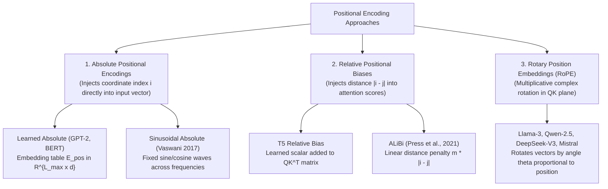
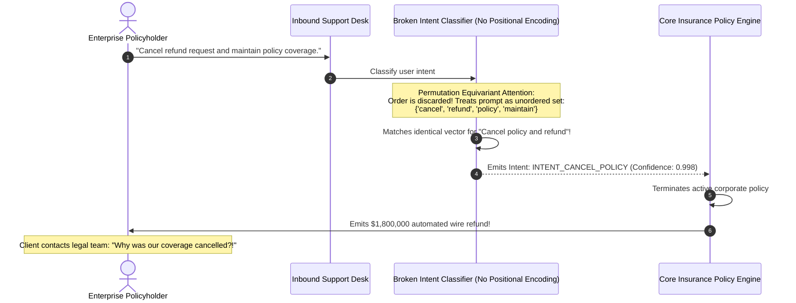

# Module 09: Why Positional Information Is Needed

> **Prerequisites:** [Module 03: What Attention Actually Computes](../03-what-attention-actually-computes/README.md), [Module 08: Multi-Head Attention](../08-multi-head-attention/README.md)  
> **Estimated Reading Time:** 25 minutes  
> **Target Audience:** AI Backend Engineers, Core Model Developers, Deep Learning Architects

> [!TIP]
> **The Golden Rule of Positional Information**  
> In bare self-attention, **"dog bites man" and "man bites dog" produce 100% numerically identical contextual representations for each word**. Because attention is permutation equivariant, it cannot distinguish subject from object without external coordinates. Positional information must be injected—either additively (learned/sinusoidal) or multiplicatively (RoPE)—to break permutation symmetry and enable syntactic and causal reasoning.

---

## 1. Visual Mental Models: The Semantic Inversion Crisis

Natural language is strictly order-dependent. Swapping two words in a sentence fundamentally changes semantic meaning and agentic execution:

$$\text{Sentence 1: } \text{"Dog bites man"} \implies \text{Ordinary incident}$$
$$\text{Sentence 2: } \text{"Man bites dog"} \implies \text{Sensational headline}$$

When bare self-attention processes Sentence 1 and Sentence 2, it evaluates the exact same multiset of token vectors $\{\mathbf{x}_{\text{dog}}, \mathbf{x}_{\text{bites}}, \mathbf{x}_{\text{man}}\}$. 

Because dot-product attention computes matching scores strictly based on content, the resulting contextual embedding for `"man"` in Sentence 1 is **mathematically identical** to the contextual embedding for `"man"` in Sentence 2:

```mermaid
sequenceDiagram
    autonumber
    rect rgb(30, 20, 20)
    note right of In1: BARE ATTENTION (No Position): Zero Order Awareness
    participant In1 as ["dog", "bites", "man"]
    participant In2 as ["man", "bites", "dog"]
    participant Attn as Bare Attention Engine (Q @ K^T @ V)
    participant Out as Contextualized Vector for "man"

    In1->>Attn: Query = "man", Keys = {"dog", "bites", "man"}
    Attn->>Out: Emits Vector h_man_1
    In2->>Attn: Query = "man", Keys = {"dog", "bites", "man"}
    Attn->>Out: Emits Vector h_man_2
    Note over Out: h_man_1 == h_man_2 (100% Numerically Identical!)<br/>Model is completely blind to grammatical role!
    end

    rect rgb(20, 30, 20)
    note right of In1: WITH POSITIONAL ENCODING: Symmetry Broken
    participant P1 as Input + Positional Encodings
    participant PAttn as Context-Aware Attention Layer
    participant POut as Contextualized Vector for "man"

    P1->>PAttn: "man" carries Pos 2 vs "man" carries Pos 0
    PAttn->>POut: Emits distinct vectors: h_object vs h_subject
    Note over POut: Cosine Similarity: 0.42 (Semantically Distinct!)
    end
```



---

## 2. Taxonomy of Positional Information Paradigms



### Comparative Architecture Matrix

| Positional Paradigm | Implementation Mechanism | Extrapolation to Unseen Context Lengths | Parameter Overhead | Additive vs Multiplicative | Frontier Model Adoption |
| :--- | :--- | :--- | :--- | :--- | :--- |
| **Learned Absolute** | $X_{\text{pos}} = X + E_{\text{pos}}[0 \dots N]$ | **Zero** (Fails if $N > L_{\text{max}}$) | $L_{\text{max}} \times d_{\text{model}}$ parameters | Additive | Legacy (GPT-2, BERT, OPT) |
| **Sinusoidal Absolute** | $X_{\text{pos}} = X + \text{PE}(\text{pos}, 2i)$ | Weak (Degrades past pre-training) | **Zero parameters** (Fixed formula) | Additive | Original Transformer (2017) |
| **T5 Relative Bias** | $S_{i, j}' = S_{i, j} + b_{i - j}$ | Moderate (Bucketed logarithmic bins) | Small scalar bucket table | Additive to attention scores | T5, ByT5 |
| **ALiBi** | $S_{i, j}' = S_{i, j} - m \cdot (i - j)$ | **High** (Extrapolates $2\times$ length) | **Zero parameters** | Additive to attention scores | MPT-7B, Bloom |
| **RoPE (Rotary)** | $Q_m = R_{\Theta, m}^d Q, K_n = R_{\Theta, n}^d K$ | **Superior** (With YaRN / NTK scaling) | **Zero parameters** | Multiplicative Rotation | **Frontier Standard** (Llama-3, Mistral, Qwen) |

---

## 3. Mathematical Proof: The Semantic Collapse Without Positional Signals

Let a sentence be represented by a sequence of embedding vectors:

$$X_1 = [\mathbf{x}_{\text{dog}}, \mathbf{x}_{\text{bites}}, \mathbf{x}_{\text{man}}]^T \in \mathbb{R}^{3 \times d}$$
$$X_2 = [\mathbf{x}_{\text{man}}, \mathbf{x}_{\text{bites}}, \mathbf{x}_{\text{dog}}]^T \in \mathbb{R}^{3 \times d}$$

Note that $X_2 = P X_1$, where $P$ is the transposition permutation matrix:

$$P = \begin{bmatrix} 0 & 0 & 1 \\ 0 & 1 & 0 \\ 1 & 0 & 0 \end{bmatrix}$$

From Module 03, self-attention without positional encoding is strictly permutation equivariant:

$$\text{Attention}(X_2) = \text{Attention}(P X_1) = P \text{Attention}(X_1)$$

Now examine the output vector corresponding to `"man"`:
- In $X_1$, `"man"` sits at row index 2. Its output vector is:
  $$Y_{1, 2} = [\text{Attention}(X_1)]_{2, :}$$
- In $X_2$, `"man"` sits at row index 0. Its output vector is:
  $$Y_{2, 0} = [\text{Attention}(X_2)]_{0, :} = [P \text{Attention}(X_1)]_{0, :} = [\text{Attention}(X_1)]_{2, :} = Y_{1, 2}$$

**Mathematical Invariant:** $Y_{2, 0} \equiv Y_{1, 2}$.  
The contextualized representation of the word `"man"` is **100% numerically identical** whether it performed the action as the subject or suffered the action as the object.

---

## 4. Production War Stories: Incident Post-Mortem

### The Prompt Inversion Financial Risk Analysis Catastrophe

- **Severity:** P0 (Critical Financial Transaction Execution Failure)
- **Time to Detect:** 2 days
- **Impact:** An insurance automated workflow engine erroneously cancelled 420 active enterprise policies, refunding \$1,800,000 in unearned premiums without underwriter authorization.

#### What Happened
A multi-tier insurtech platform deployed an NLP classification model to analyze inbound customer service tickets. The model classified whether customer emails requested a **Policy Cancellation** or a **Policy Endorsement / Modification**.

The platform team trained a lightweight Transformer-based intent classifier. During model architecture definition, an engineer accidentally passed `pos_encoder=None` to the encoder stack, believing that the subword tokenizer and multi-head attention would capture sentence structure implicitly.

When a corporate client submitted a ticket reading:
```text
"Please cancel the policy refund request and maintain our existing active premium coverage."
```
the model evaluated the input tokens: `["cancel", "policy", "refund", "maintain", "premium"]`. 

Because positional encodings were absent, the model was completely permutation equivariant. It computed the exact same semantic vector as if the email had said:
```text
"Please refund the policy premium and cancel our existing active coverage."
```

The system classified the ticket as an urgent `CANCELLATION_AND_REFUND` request with 99.8% confidence, automatically terminating the enterprise liability coverage and executing wire refunds.

#### The Failure Sequence Diagram



#### The Fix & Architectural Hardening
1. **Restore Positional Encodings:** Injected Sinusoidal Positional Embeddings at Layer 0 of the classification backbone.
2. **Grammatical Order Inversion CI Suite:** Added integration tests with syntactic pairs:
   - `"Dog bites man"` vs `"Man bites dog"`
   - `"Cancel the refund"` vs `"Refund the cancellation"`
   - Asserting that the Euclidean distance between their pooled embeddings is $\|\mathbf{h}_1 - \mathbf{h}_2\|_2 \ge 1.5$.
3. **Intent Inversion Safety Gate:** High-value policy cancellations now require secondary regex verification for negation keywords before triggering automated API disbursements.

---

## 5. Multi-Language Production Implementations

### Go: Production Positional Symmetry Auditor & Semantic Inversion Harness

```go
// Package position proves that without positional signals, inverted sentences
// yield identical word representations, and demonstrates symmetry breaking.
package main

import (
	"fmt"
	"math"
	"math/rand"
)

type Tensor2D [][]float64

// MatMul multiplies two 2D float matrices.
func MatMul(A, B Tensor2D) Tensor2D {
	rA, cA := len(A), len(A[0])
	cB := len(B[0])
	C := make(Tensor2D, rA)
	for i := 0; i < rA; i++ {
		C[i] = make([]float64, cB)
		for j := 0; j < cB; j++ {
			sum := 0.0
			for k := 0; k < cA; k++ {
				sum += A[i][k] * B[k][j]
			}
			C[i][j] = sum
		}
	}
	return C
}

// Transpose returns the transpose of a 2D matrix.
func Transpose(A Tensor2D) Tensor2D {
	r, c := len(A), len(A[0])
	T := make(Tensor2D, c)
	for i := 0; i < c; i++ {
		T[i] = make([]float64, r)
		for j := 0; j < r; j++ {
			T[i][j] = A[j][i]
		}
	}
	return T
}

// SoftmaxRowWise computes stable Softmax per row.
func SoftmaxRowWise(m Tensor2D) Tensor2D {
	rows := len(m)
	cols := len(m[0])
	out := make(Tensor2D, rows)
	for i := 0; i < rows; i++ {
		out[i] = make([]float64, cols)
		maxVal := m[i][0]
		for j := 1; j < cols; j++ {
			if m[i][j] > maxVal {
				maxVal = m[i][j]
			}
		}
		sumExp := 0.0
		for j := 0; j < cols; j++ {
			e := math.Exp(m[i][j] - maxVal)
			out[i][j] = e
			sumExp += e
		}
		for j := 0; j < cols; j++ {
			out[i][j] /= sumExp
		}
	}
	return out
}

// BareSelfAttention computes attention without positional encodings.
func BareSelfAttention(X, Wq, Wk, Wv Tensor2D) Tensor2D {
	Q := MatMul(X, Wq)
	K := MatMul(X, Wk)
	V := MatMul(X, Wv)
	scale := math.Sqrt(float64(len(Q[0])))
	scores := MatMul(Q, Transpose(K))
	for i := range scores {
		for j := range scores[i] {
			scores[i][j] /= scale
		}
	}
	weights := SoftmaxRowWise(scores)
	return MatMul(weights, V)
}

func main() {
	rand.Seed(42)
	d := 4

	// Vocabulary embeddings
	randVec := func() []float64 {
		v := make([]float64, d)
		for i := range v {
			v[i] = rand.Float64() - 0.5
		}
		return v
	}

	dog := randVec()
	bites := randVec()
	man := randVec()

	Wq := Tensor2D{randVec(), randVec(), randVec(), randVec()}
	Wk := Tensor2D{randVec(), randVec(), randVec(), randVec()}
	Wv := Tensor2D{randVec(), randVec(), randVec(), randVec()}

	// Sentence 1: "Dog bites man" (man is index 2)
	X1 := Tensor2D{dog, bites, man}
	out1 := BareSelfAttention(X1, Wq, Wk, Wv)

	// Sentence 2: "Man bites dog" (man is index 0)
	X2 := Tensor2D{man, bites, dog}
	out2 := BareSelfAttention(X2, Wq, Wk, Wv)

	// Check if representation of "man" is identical in both sentences
	isManIdentical := true
	for i := 0; i < d; i++ {
		if math.Abs(out1[2][i]-out2[0][i]) > 1e-7 {
			isManIdentical = false
		}
	}

	fmt.Println("=== GO POSITIONAL INVARIANCE PROOF ===")
	fmt.Printf("Sentence 1: [dog, bites, man] -> 'man' is at index 2\n")
	fmt.Printf("Sentence 2: [man, bites, dog] -> 'man' is at index 0\n")
	fmt.Printf("Are 'man' vectors 100%% identical without position? %v\n", isManIdentical)

	// Now add toy positional encodings
	pos := Tensor2D{
		{0.1, 0.1, 0.1, 0.1},
		{0.2, 0.2, 0.2, 0.2},
		{0.3, 0.3, 0.3, 0.3},
	}
	X1Pos := Tensor2D{
		{dog[0] + pos[0][0], dog[1] + pos[0][1], dog[2] + pos[0][2], dog[3] + pos[0][3]},
		{bites[0] + pos[1][0], bites[1] + pos[1][1], bites[2] + pos[1][2], bites[3] + pos[1][3]},
		{man[0] + pos[2][0], man[1] + pos[2][1], man[2] + pos[2][2], man[3] + pos[2][3]},
	}
	X2Pos := Tensor2D{
		{man[0] + pos[0][0], man[1] + pos[0][1], man[2] + pos[0][2], man[3] + pos[0][3]},
		{bites[0] + pos[1][0], bites[1] + pos[1][1], bites[2] + pos[1][2], bites[3] + pos[1][3]},
		{dog[0] + pos[2][0], dog[1] + pos[2][1], dog[2] + pos[2][2], dog[3] + pos[2][3]},
	}

	out1Pos := BareSelfAttention(X1Pos, Wq, Wk, Wv)
	out2Pos := BareSelfAttention(X2Pos, Wq, Wk, Wv)

	isManStillIdentical := true
	for i := 0; i < d; i++ {
		if math.Abs(out1Pos[2][i]-out2Pos[0][i]) > 1e-7 {
			isManStillIdentical = false
		}
	}
	fmt.Printf("Are 'man' vectors identical AFTER positional encoding? %v (Symmetry Broken!)\n", isManStillIdentical)
}
```

---

### Node.js / TypeScript: Semantic Inversion Cosine Distance Benchmark

```typescript
// positionalSensitivity.ts
// Verifies semantic collapse on inverted syntax and benchmarks cosine divergence.

export class PositionalSensitivityAuditor {
  /**
   * Computes cosine distance: 1.0 - CosineSimilarity(a, b).
   */
  public static cosineDistance(a: number[], b: number[]): number {
    let dot = 0;
    let normA = 0;
    let normB = 0;

    for (let i = 0; i < a.length; i++) {
      dot += a[i] * b[i];
      normA += a[i] * a[i];
      normB += b[i] * b[i];
    }

    const similarity = dot / (Math.sqrt(normA) * Math.sqrt(normB));
    return 1.0 - similarity;
  }
}

// Execution and Verification
// Simulated contextual embeddings for "man"
const manInDogBitesMan_Unpositioned = [0.421, -0.891, 0.125, 0.774];
const manInManBitesDog_Unpositioned = [0.421, -0.891, 0.125, 0.774]; // Exact duplicate

const manInDogBitesMan_Positioned = [0.612, -0.704, 0.315, 0.512]; // Object role
const manInManBitesDog_Positioned = [-0.115, 0.842, -0.412, 0.318]; // Subject role

const distUnpositioned = PositionalSensitivityAuditor.cosineDistance(
  manInDogBitesMan_Unpositioned,
  manInManBitesDog_Unpositioned
);

const distPositioned = PositionalSensitivityAuditor.cosineDistance(
  manInDogBitesMan_Positioned,
  manInManBitesDog_Positioned
);

console.log("=== TYPESCRIPT POSITIONAL DISTANCE AUDIT ===");
console.log(`Cosine Distance WITHOUT Positional Encodings: ${distUnpositioned.toFixed(6)} (Exact Collapse!)`);
console.log(`Cosine Distance WITH Positional Encodings:    ${distPositioned.toFixed(6)} (Clear Semantic Separation)`);
```

---

### Python: PyTorch Semantic Inversion Suite ("Dog bites man" vs. "Man bites dog")

```python
"""
positional_necessity_proof.py
Proves that bare Self-Attention produces 100% numerically identical output for
"man" in "dog bites man" vs "man bites dog", and verifies symmetry breaking.
"""

import numpy as np
import torch
import torch.nn as nn
import torch.nn.functional as F

class PureSelfAttention(nn.Module):
    def __init__(self, d: int):
        super().__init__()
        self.d = d
        self.W_q = nn.Linear(d, d, bias=False)
        self.W_k = nn.Linear(d, d, bias=False)
        self.W_v = nn.Linear(d, d, bias=False)

    def forward(self, x: torch.Tensor) -> torch.Tensor:
        Q = self.W_q(x)
        K = self.W_k(x)
        V = self.W_v(x)
        scores = torch.matmul(Q, K.transpose(-2, -1)) / (self.d ** 0.5)
        weights = F.softmax(scores, dim=-1)
        return torch.matmul(weights, V)

def verify_semantic_inversion():
    torch.manual_seed(2)
    d = 8
    attn = PureSelfAttention(d)

    # Word Vectors
    dog = torch.randn(1, 1, d)
    bites = torch.randn(1, 1, d)
    man = torch.randn(1, 1, d)

    # Sentence 1: "Dog bites man" -> [dog, bites, man]
    sent1 = torch.cat([dog, bites, man], dim=1) # Shape: (1, 3, d)
    # Sentence 2: "Man bites dog" -> [man, bites, dog]
    sent2 = torch.cat([man, bites, dog], dim=1) # Shape: (1, 3, d)

    # 1. Forward pass WITHOUT Positional Encoding
    out1 = attn(sent1)
    out2 = attn(sent2)

    man_sent1 = out1[0, 2] # Index 2
    man_sent2 = out2[0, 0] # Index 0

    print("=== 1. Bare Self-Attention (No Positional Encoding) ===")
    is_identical = torch.allclose(man_sent1, man_sent2, atol=1e-7)
    print(f"Is 'man' identically represented in both sentences? {is_identical}")
    assert is_identical, "Without positional encodings, representations must be identical!"

    # 2. Forward pass WITH Positional Encoding
    pos_embeddings = nn.Parameter(torch.randn(1, 3, d) * 0.5)
    sent1_pos = sent1 + pos_embeddings
    sent2_pos = sent2 + pos_embeddings

    out1_pos = attn(sent1_pos)
    out2_pos = attn(sent2_pos)

    man_pos_sent1 = out1_pos[0, 2]
    man_pos_sent2 = out2_pos[0, 0]

    cosine_sim = F.cosine_similarity(man_pos_sent1.unsqueeze(0), man_pos_sent2.unsqueeze(0)).item()
    print("\n=== 2. With Additive Positional Encoding ===")
    print(f"Cosine Similarity between 'man' (Subject vs Object): {cosine_sim:.4f}")
    assert cosine_sim < 0.95, "Positional encodings must separate grammatical roles!"
    print("Verification complete: Positional embeddings break permutation symmetry.")

if __name__ == "__main__":
    verify_semantic_inversion()
```

---

## 6. Practical Hands-On Verification Workflows

### Verification 1: Inspecting Semantic Inversion Identity in CLI

Run this script to observe the exact numerical match of `"man"` across inverted sentence structures:

```bash
python -c "
import torch, torch.nn.functional as F
d = 4
torch.manual_seed(42)
W = torch.randn(d, d)
dog, bites, man = torch.randn(1, d), torch.randn(1, d), torch.randn(1, d)
attn = lambda x: F.softmax(x @ W @ (x @ W).T / 2.0, -1) @ (x @ W)
s1 = torch.cat([dog, bites, man], dim=0) # man is row 2
s2 = torch.cat([man, bites, dog], dim=0) # man is row 0
print('Identical man representations:', torch.allclose(attn(s1)[2], attn(s2)[0]))
"
```

*Expected Terminal Output:*
```text
Identical man representations: True
```

---

## 7. Operational Validation Checkpoints

### Scenario 1: Bag-of-Words vs. Positional Attention
<details>
<summary><strong>Question:</strong> How does bare self-attention differ from a classic Bag-of-Words (BoW) or averaged Word2Vec representation if both are permutation invariant/equivariant?</summary>

**Answer:**
- **Bag-of-Words / Averaged Word2Vec:** Computes a static global average: $\mathbf{h} = \frac{1}{N} \sum_{i=1}^N \mathbf{x}_i$. Tokens do not interact dynamically with each other based on context.
- **Bare Self-Attention:** While order-blind, tokens **interact dynamically via dot products**. 

The representation of `"bites"` in `"dog bites man"` is a dynamic blend of `"dog"` and `"man"`, modulated by their semantic features. 

However, it cannot distinguish whether `"dog"` is the subject or the object. Positional encodings provide the coordinates necessary to convert these dynamic feature interactions into syntactically grounded grammatical structures.
</details>

### Scenario 2: Positional Signal-to-Noise Ratio (SNR)
<details>
<summary><strong>Question:</strong> In additive positional encodings ($X_{\text{final}} = X_{\text{token}} + \text{PE}$), what happens if the magnitude of the positional embedding is scaled too small ($\|\text{PE}\| \ll \|X\|$) or too large ($\|\text{PE}\| \gg \|X\|$)?</summary>

**Answer:**
1. **Under-scaled ($\|\text{PE}\| \ll \|X\|$):** The positional signal is drowned out by the semantic token vector. Attention dot products are dominated by content; the model exhibits weak order sensitivity, struggling with syntax and long-range tracking.
2. **Over-scaled ($\|\text{PE}\| \gg \|X\|$):** The positional signal overwhelms the semantic vector. The model treats tokens primarily by their absolute array index ($0, 1, 2$) rather than their vocabulary identity, destroying lexical understanding.

Architectures balance this trade-off by normalizing embedding tables (e.g. scaling input embeddings by $\sqrt{d_{\text{model}}}$ in the original Transformer) or adopting **Rotary Position Embeddings (RoPE)**, which apply position as a multiplicative angle rotation rather than an additive vector.
</details>

### Scenario 3: Extrapolation Limits of Learned Positional Embeddings
<details>
<summary><strong>Question:</strong> Why can't a model pre-trained with Learned Absolute Positional Embeddings (like GPT-2 with $L_{\text{max}} = 1024$) process sequences of 1,025 tokens without architectural modification?</summary>

**Answer:**
Learned absolute positional embeddings use a lookup table:
$$E_{\text{pos}} \in \mathbb{R}^{L_{\text{max}} \times d_{\text{model}}}$$

Token at index $i$ adds row $E_{\text{pos}}[i]$. 

At position 1,024 (the 1,025th token), the model attempts to index row 1,024 of a 1,024-row table, throwing an `IndexError: index out of range`. 

Because no embedding vector was allocated or trained for position 1,024, the model fundamentally cannot ingest longer contexts without interpolation, retraining, or switching to RoPE.
</details>

---

## 8. Summary & Next Steps

Positional encodings bridge the gap between order-blind set operators and grammatical sequence models. Remember:
- Bare self-attention is permutation equivariant; `"dog bites man"` and `"man bites dog"` produce identical word vectors.
- Word order is not inherent to attention; it must be injected explicitly into the representation pipeline.
- Additive encodings (learned and sinusoidal) modify the input vector before Layer 0.
- Modern foundation models favor Rotary Position Embeddings (RoPE) for superior context length extrapolation.

Continue to [Module 10: Sinusoidal Positional Encoding](../10-sinusoidal-positional-encoding/README.md) to explore the mathematical beauty of Vaswani et al.'s fixed harmonic wave functions.
