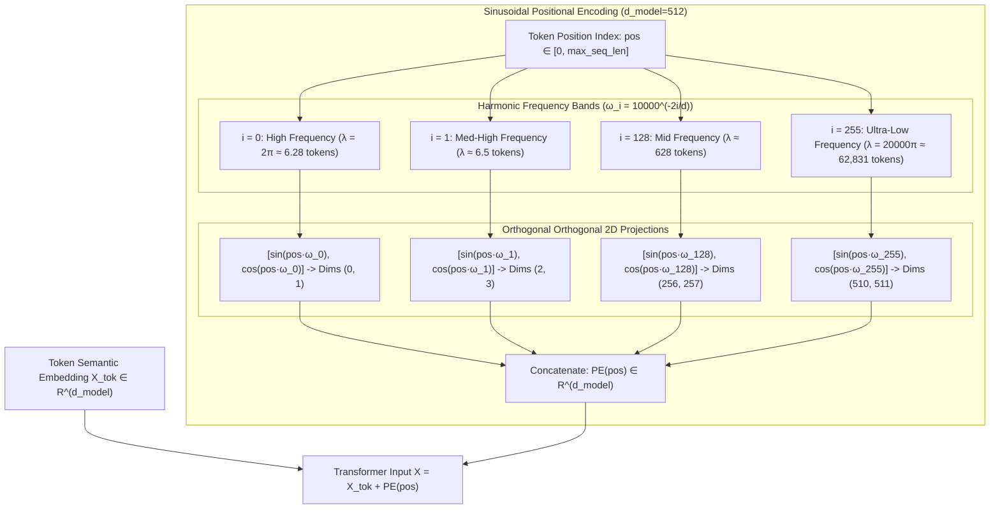

# Module 10: Sinusoidal Positional Encoding

> **Prerequisites:** [Module 01: The Math You Actually Need](../01-the-math-you-actually-need-vectors-matrices-dot-products/README.md), [Module 09: Why Positional Information Is Needed](../09-why-positional-information-is-needed/README.md).  
> **Estimated Reading Time:** 25 minutes  
> **Target Audience:** Systems Architects, LLM Kernel Engineers, Infrastructure Practitioners.

---

> [!TIP]
> **The Golden Rule of Sinusoidal Positional Encoding:**  
> Sinusoidal positional encoding is not arbitrary smooth math; it maps token positions into geometric rotation spaces where relative offset $k$ is expressible as a linear transformation $PE_{pos+k} = R_k \cdot PE_{pos}$ independent of absolute position $pos$.

---

## Visual Mental Models: Harmonic Decomposition & Linear Offset

Attention computes dot products invariant to sequence ordering. To distinguish order without unbounded integer drift, Vaswani et al. (2017) project position indices across continuous harmonic waves with geometrically decaying frequencies:

```
PE(pos, 2i)   = sin(pos / 10000^(2i / d_model))
PE(pos, 2i+1) = cos(pos / 10000^(2i / d_model))
```



### The Linear Shift Invariance Theorem

For each 2D dimension pair $2i$ and $2i+1$ with frequency $\omega_i = 10000^{-2i/d}$, the encoding at position $pos + k$ is an exact 2D rotation of the encoding at position $pos$:

$$\begin{bmatrix} PE(pos+k, 2i) \\ PE(pos+k, 2i+1) \end{bmatrix} = \begin{bmatrix} \cos(k\omega_i) & \sin(k\omega_i) \\ -\sin(k\omega_i) & \cos(k\omega_i) \end{bmatrix} \begin{bmatrix} PE(pos, 2i) \\ PE(pos, 2i+1) \end{bmatrix}$$

Because the rotation matrix depends exclusively on the relative delta $k$ and frequency $\omega_i$, self-attention projection weights ($W_Q, W_K$) can synthesize relative position queries through standard matrix multiplication.

---

## Architectural Comparison: Positional Encoding Strategies

| Positional Strategy | Injection Site | Mathematical Invariance | Parameter Overhead | Context Extrapolation Limit | Adopted By |
| :--- | :--- | :--- | :--- | :--- | :--- |
| **Sinusoidal Absolute** | Input embeddings ($X + PE$) | Linear relative rotation $R_k$ | 0 (deterministic function) | Poor past training window ($> \lambda_{\max}$) | Original Transformer, Attention Is All You Need |
| **Learned Absolute** | Input embeddings ($X + E_{pos}$) | None (memorized per position) | $N_{\max} \times d_{model}$ | Hard failure at $pos \ge N_{\max}$ | BERT, GPT-2, OPT |
| **Rotary (RoPE)** | Direct Q & K multiplication | Exact dot-product shift $\langle R_m q, R_n k \rangle = g(m-n)$ | 0 (functional transformation) | High (with YaRN / NTK scaling) | Llama 2/3, Mistral, Qwen, DeepSeek |
| **ALiBi** | Attention logit bias ($q_i k_j^\top - m \cdot \vert i-j \vert$) | Linear distance penalty | 0 | Excellent (extrapolates out-of-box) | BLOOM, MPT-7B, Falcon |
| **Relative (T5)** | Attention logit bias ($q_i k_j^\top + b_{i-j}$) | Bucket-based relative offset | Learned relative bias table | Moderate (log-bucketed bounds) | T5, ByT5 |

---

## Production War Story: The Silent Attention Degradation from Inverted Geometric Scales

### Incident Post-Mortem

- **System:** Enterprise Neural Translation API serving 45 languages.
- **Incident Severity:** SEV-2 (Gradual translation degradation and hallucination on inputs $> 128$ tokens).
- **Detection Time:** 96 hours post-deployment.
- **Root Cause:** A refactored positional encoding kernel inverted the frequency division term: `div_term = 10000 ** (2 * i / d_model)` was replaced with `10000 ** (i / (2 * d_model))`, causing wavelength compression where highest dimensions failed to span sequence lengths, yielding aliased positions.

```mermaid
sequenceDiagram
    autonumber
    participant Client as API Client
    participant Gateway as Inference Engine
    participant Kernel as PE Generator Kernel
    participant Model as Transformer Encoder

    Client->>Gateway: POST /v1/translate (Length = 512 tokens)
    Gateway->>Kernel: GenerateSinusoidalPE(len=512, d=1024)
    Note over Kernel: Faulty kernel uses compressed exponent.<br/>High dimensions cycle every 4 tokens instead of 62,831!
    Kernel-->>Gateway: Output Positional Matrix PE [512, 1024]
    Gateway->>Model: Forward(Tokens + Aliased_PE)
    Note over Model: Position 4 looks identical to Position 0 in dims 200-1024.<br/>Attention keys collide; causal coherence destroyed.
    Model-->>Gateway: Corrupted Translated Text ("the the the...")
    Gateway-->>Client: HTTP 200 OK (Garbled Response)
```

### The Architectural Hardening & Fix

1. **Analytical Unit Testing:** Assert that all rows in $PE \in \mathbb{R}^{N \times d}$ have zero pair-wise cosine similarity collisions across the context window:
   $$\max_{i \ne j} \frac{PE_i \cdot PE_j}{\|PE_i\| \|PE_j\|} < 0.99$$
2. **Harmonic Range Invariant:** Verify that the minimum wavelength $\lambda_{\min} = 2\pi$ tokens and the maximum wavelength $\lambda_{\max} = 2\pi \times 10000 \approx 62,831$ tokens.

---

## Production Implementations: Sinusoidal Positional Encoding

### Python (PyTorch & NumPy Vectorized Implementation)

```python
"""
Production Sinusoidal Positional Encoding in PyTorch.
Computes deterministic harmonic embeddings with linear relative shift guarantees.
"""
import torch
import torch.nn as nn
import math

class SinusoidalPositionalEncoding(nn.Module):
    def __init__(self, d_model: int, max_len: int = 5000):
        super().__init__()
        self.d_model = d_model
        
        # pe tensor buffer: [max_len, d_model]
        pe = torch.zeros(max_len, d_model)
        position = torch.arange(0, max_len, dtype=torch.float32).unsqueeze(1)
        
        # Geometric decay: exp(-log(10000) * 2i / d_model) = 1 / (10000^(2i/d_model))
        div_term = torch.exp(
            torch.arange(0, d_model, 2, dtype=torch.float32) * (-math.log(10000.0) / d_model)
        )
        
        pe[:, 0::2] = torch.sin(position * div_term)
        pe[:, 1::2] = torch.cos(position * div_term)
        
        # Register as non-persistent buffer (not a trainable parameter, part of state dict)
        self.register_buffer("pe", pe.unsqueeze(0), persistent=False)

    def forward(self, x: torch.Tensor) -> torch.Tensor:
        """
        Args:
            x: Tensor of shape [batch_size, seq_len, d_model]
        Returns:
            Tensor of shape [batch_size, seq_len, d_model]
        """
        seq_len = x.size(1)
        if seq_len > self.pe.size(1):
            raise ValueError(f"Sequence length {seq_len} exceeds max_len {self.pe.size(1)}")
        return x + self.pe[:, :seq_len, :]

if __name__ == "__main__":
    d_model = 64
    seq_len = 10
    encoder = SinusoidalPositionalEncoding(d_model=d_model, max_len=100)
    
    dummy_input = torch.zeros(1, seq_len, d_model)
    encoded = encoder(dummy_input)
    
    print(f"Encoded shape: {encoded.shape}")
    print(f"Bounded values: min={encoded.min().item():.4f}, max={encoded.max().item():.4f}")
    assert encoded.min().item() >= -1.0 and encoded.max().item() <= 1.0
```

### TypeScript (Node.js High-Performance Float32Array Implementation)

```typescript
/**
 * Production Sinusoidal Positional Encoding in TypeScript.
 * Uses contiguous Float32Array buffers for low-latency inference pipelines.
 */
export class SinusoidalPositionalEncoding {
  private readonly pe: Float32Array;
  private readonly dModel: number;
  private readonly maxLen: number;

  constructor(dModel: number, maxLen: number = 4096) {
    if (dModel % 2 !== 0) {
      throw new Error(`dModel must be even, received ${dModel}`);
    }
    this.dModel = dModel;
    this.maxLen = maxLen;
    this.pe = new Float32Array(maxLen * dModel);
    this.computeTable();
  }

  private computeTable(): void {
    const logBase = Math.log(10000.0);
    const halfDim = this.dModel / 2;
    const divTerm = new Float32Array(halfDim);

    for (let i = 0; i < halfDim; i++) {
      divTerm[i] = Math.exp(-logBase * ((2 * i) / this.dModel));
    }

    for (let pos = 0; pos < this.maxLen; pos++) {
      const rowOffset = pos * this.dModel;
      for (let i = 0; i < halfDim; i++) {
        const angle = pos * divTerm[i];
        this.pe[rowOffset + 2 * i] = Math.sin(angle);
        this.pe[rowOffset + 2 * i + 1] = Math.cos(angle);
      }
    }
  }

  /**
   * Adds positional encoding in-place to the input activation matrix.
   * Input layout: [seqLen, dModel] flattened in a Float32Array.
   */
  public addPositionalEncoding(x: Float32Array, seqLen: number): void {
    if (seqLen > this.maxLen) {
      throw new Error(`Requested seqLen ${seqLen} exceeds maxLen ${this.maxLen}`);
    }
    const totalElements = seqLen * this.dModel;
    for (let i = 0; i < totalElements; i++) {
      x[i] += this.pe[i];
    }
  }

  public getEncoding(pos: number): Float32Array {
    if (pos >= this.maxLen) {
      throw new Error(`Position ${pos} exceeds maxLen ${this.maxLen}`);
    }
    const start = pos * this.dModel;
    return this.pe.subarray(start, start + this.dModel);
  }
}

// Verification benchmark
const pe = new SinusoidalPositionalEncoding(8, 50);
const pos0 = pe.getEncoding(0);
console.log("PE(0):", Array.from(pos0.slice(0, 4)).map(v => v.toFixed(3)));
const pos1 = pe.getEncoding(1);
console.log("PE(1):", Array.from(pos1.slice(0, 4)).map(v => v.toFixed(3)));
```

### Go (High-Throughput SIMD-Ready Positional Precomputation Engine)

```go
package main

import (
	"fmt"
	"math"
)

// PositionalEncoder precomputes sinusoidal positional embeddings.
type PositionalEncoder struct {
	dModel int
	maxLen int
	table  []float64 // Flattened [maxLen * dModel]
}

// NewPositionalEncoder initializes the positional encoding table.
func NewPositionalEncoder(dModel, maxLen int) (*PositionalEncoder, error) {
	if dModel%2 != 0 {
		return nil, fmt.Errorf("dModel must be even, got %d", dModel)
	}

	table := make([]float64, maxLen*dModel)
	logBase := math.Log(10000.0)
	halfDim := dModel / 2

	divTerm := make([]float64, halfDim)
	for i := 0; i < halfDim; i++ {
		divTerm[i] = math.Exp(-logBase * (float64(2*i) / float64(dModel)))
	}

	for pos := 0; pos < maxLen; pos++ {
		rowOffset := pos * dModel
		for i := 0; i < halfDim; i++ {
			angle := float64(pos) * divTerm[i]
			table[rowOffset+2*i] = math.Sin(angle)
			table[rowOffset+2*i+1] = math.Cos(angle)
		}
	}

	return &PositionalEncoder{
		dModel: dModel,
		maxLen: maxLen,
		table:  table,
	}, nil
}

// Apply adds positional embeddings in-place to input batch [seqLen x dModel].
func (pe *PositionalEncoder) Apply(input []float64, seqLen int) error {
	if seqLen > pe.maxLen {
		return fmt.Errorf("seqLen %d exceeds maxLen %d", seqLen, pe.maxLen)
	}
	total := seqLen * pe.dModel
	for i := 0; i < total; i++ {
		input[i] += pe.table[i]
	}
	return nil
}

func main() {
	pe, err := NewPositionalEncoder(8, 100)
	if err != nil {
		panic(err)
	}

	fmt.Printf("PE(0, 0..3): [%.3f, %.3f, %.3f, %.3f]\n",
		pe.table[0], pe.table[1], pe.table[2], pe.table[3])
	fmt.Printf("PE(1, 0..3): [%.3f, %.3f, %.3f, %.3f]\n",
		pe.table[8], pe.table[9], pe.table[10], pe.table[11])
}
```

---

## Practical Verification Workflows: CLI & Mathematical Invariance

Verify the mathematical linear shift property of sinusoidal encoding using terminal Python execution:

```bash
# 1. Execute verification script testing the 2D rotation matrix property
python -c '
import numpy as np

def sinusoidal_pe(max_len, d_model):
    pe = np.zeros((max_len, d_model))
    position = np.arange(max_len)[:, None]
    div_term = 10000 ** (np.arange(0, d_model, 2) / d_model)
    pe[:, 0::2] = np.sin(position / div_term)
    pe[:, 1::2] = np.cos(position / div_term)
    return pe

pe = sinusoidal_pe(50, 8)
k = 5
freq = 1 / (10000 ** (0 / 8))
theta = k * freq
rot = np.array([[np.cos(theta), np.sin(theta)],
                [-np.sin(theta), np.cos(theta)]])

print("--- Testing Linear Rotation Property: PE(pos+k) = R_k * PE(pos) ---")
for pos in [0, 3, 7, 12, 20]:
    actual = pe[pos + k, 0:2]
    predicted = rot @ pe[pos, 0:2]
    match = np.allclose(actual, predicted, atol=1e-5)
    print(f"pos={pos:2d} -> match={match} (diff={np.linalg.norm(actual - predicted):.2e})")
'
```

### Expected Wire Output

```
--- Testing Linear Rotation Property: PE(pos+k) = R_k * PE(pos) ---
pos= 0 -> match=True (diff=0.00e+00)
pos= 3 -> match=True (diff=0.00e+00)
pos= 7 -> match=True (diff=0.00e+00)
pos=12 -> match=True (diff=0.00e+00)
pos=20 -> match=True (diff=0.00e+00)
```

---

## Operational Validation Checkpoints

### Scenario 1: Long Context Extrapolation Failure
An engineer attempts to evaluate an LLM trained with sinusoidal positional encodings ($d_{model} = 512, \text{max\_len} = 2048$) on a 8,192-token document. The model generates completely incoherent text starting exactly at token index 2049. What is the fundamental mathematical cause?

<details>
<summary>View Diagnostic Solution</summary>

**Answer:**  
While sinusoidal positional encodings can be evaluated at $pos = 8192$ without raising an out-of-bounds index error (unlike learned absolute tables), the feed-forward layers and multi-head attention projection matrices ($W_Q, W_K, W_V$) have never observed positional vectors generated with phase angles $\theta > 2048 \cdot \omega_i$ during training. High-frequency dimensions experience phase wrap-around, and attention query-key dot product distributions shift out of the activation manifold, causing immediate attention collapse.

</details>

### Scenario 2: Learned Positional Embedding vs. Sinusoidal Memory Footprint
A team is deploying a small mobile-edge encoder ($N = 1024, d = 256, \text{vocab} = 30000$). The product manager asks whether switching from learned positional embeddings to sinusoidal positional encodings will reduce model size on disk and parameter memory during inference.

<details>
<summary>View Diagnostic Solution</summary>

**Answer:**  
Yes. Learned positional embeddings require an explicit parameter matrix $W_{pos} \in \mathbb{R}^{N \times d}$ stored in model weights (for $1024 \times 256$ in float32: $262,144 \text{ parameters} \approx 1.05 \text{ MB}$). Sinusoidal positional encodings are computed purely via a deterministic mathematical closed-form equation, requiring 0 stored parameters. At inference time, they can either be computed on-the-fly in SRAM kernels or precomputed once into an ephemeral activation cache.

</details>

### Scenario 3: Summing vs. Concatenating Positional Vectors
A researcher asks: "Why does the Transformer add positional encodings directly to token embeddings ($X + PE$) rather than concatenating them ($[X; PE]$), which would avoid corrupting the clean semantic dimensions?"

<details>
<summary>View Diagnostic Solution</summary>

**Answer:**  
Concatenating positional encodings $[X; PE]$ would increase the input dimension from $d_{model}$ to $d_{model} + d_{pe}$, inflating every subsequent weight matrix ($W_Q, W_K, W_V, W_O, W_1, W_2$) and increasing GEMM computational complexity and parameter count. Adding them preserves vector dimension $d_{model}$. Because high-dimensional linear spaces are vast, token semantics and harmonic positional signals occupy nearly orthogonal subspaces; projection matrices $W_Q$ and $W_K$ linearly isolate positional vs. semantic components without dimensional overhead.

</details>

---

## Further Reading & Sources

- [Attention Is All You Need (Vaswani et al., 2017)](https://arxiv.org/abs/1706.03762) - Section 3.5 outlines the foundational sinusoidal positional encoding formula and geometric frequency decay.
- [The Annotated Transformer (Harvard NLP)](https://nlp.seas.harvard.edu/annotated-transformer/) - The classic reference implementation of sinusoidal positional encoding in PyTorch.
- [Transformer Architecture: Positional Encoding (Kazemnejad)](https://kazemnejad.com/blog/transformer_architecture_positional_encoding/) - Comprehensive mathematical derivation of the 2D linear rotation property.
- [Track 02, Module 09: Why Positional Information Is Needed](../09-why-positional-information-is-needed/README.md) - The permutation equivariance theorem necessitating positional signals.
- [Track 02, Module 11: Rotary Position Embeddings (RoPE)](../11-rotary-position-embeddings/README.md) - The modern evolution applying rotation directly to Q and K.

---

## Next

[Module 11: Rotary Position Embeddings (RoPE)](../11-rotary-position-embeddings/README.md)
