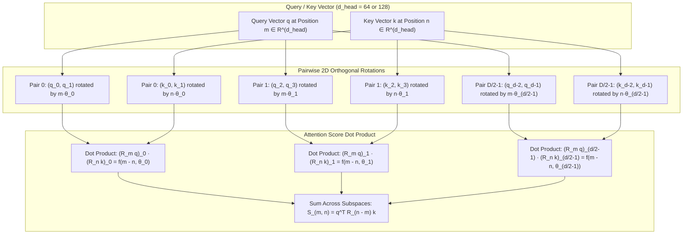
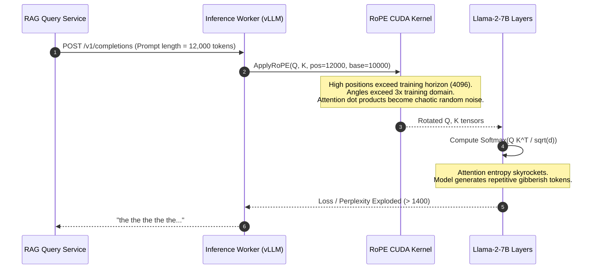

# Module 11: Rotary Position Embeddings (RoPE)

> **Prerequisites:** [Module 06: Scaled Dot-Product Attention](../06-scaled-dot-product-attention/README.md), [Module 08: Multi-Head Attention](../08-multi-head-attention/README.md), [Module 10: Sinusoidal Positional Encoding](../10-sinusoidal-positional-encoding/README.md).  
> **Estimated Reading Time:** 30 minutes  
> **Target Audience:** LLM Kernel Engineers, Distributed Training Engineers, AI Systems Architects.

---

> [!TIP]
> **The Golden Rule of Rotary Position Embeddings (RoPE):**  
> Do not add position to input embeddings where layers dilute the signal. Rotate Query and Key vectors directly in head subspaces by position-dependent angles $\mathbf{R}_m \mathbf{q}$ and $\mathbf{R}_n \mathbf{k}$; their inner product naturally collapses into a pure function of relative distance: $\langle \mathbf{R}_m \mathbf{q}, \mathbf{R}_n \mathbf{k} \rangle = \mathbf{q}^\top \mathbf{R}_{n-m} \mathbf{k}$.

---

## Visual Mental Models: 2D Complex Rotation in Head Subspaces

RoPE (Su et al., 2021) treats consecutive 2D slices of a query or key vector as complex numbers $z = x_0 + i x_1$. Rotating by angle $\theta = pos \cdot \omega$ shifts the phase without altering the vector's Euclidean norm:

```
[q'_0, q'_1] = [q_0 cos(m·ω) - q_1 sin(m·ω),  q_0 sin(m·ω) + q_1 cos(m·ω)]
```



### The Relative Distance Invariance Theorem

Let $\mathbf{R}_{\Theta, m}$ be the block-diagonal rotation matrix for position $m$. By the orthogonality of rotation matrices, $\mathbf{R}_{\Theta, m}^\top = \mathbf{R}_{\Theta, -m}$. Therefore:

$$\langle \mathbf{R}_{\Theta, m} \mathbf{q}, \mathbf{R}_{\Theta, n} \mathbf{k} \rangle = (\mathbf{R}_{\Theta, m} \mathbf{q})^\top (\mathbf{R}_{\Theta, n} \mathbf{k}) = \mathbf{q}^\top \mathbf{R}_{\Theta, m}^\top \mathbf{R}_{\Theta, n} \mathbf{k} = \mathbf{q}^\top \mathbf{R}_{\Theta, n - m} \mathbf{k}$$

The dot product between query token at index $m$ and key token at index $n$ is mathematically identical for any pair $(m, n)$ having the identical relative offset $k = n - m$.

---

## Architectural Comparison: Modern Positional Encoding Paradigms

| Feature | Sinusoidal Encoding | Learned Absolute (GPT-2) | ALiBi (BLOOM) | RoPE (Llama / Mistral) |
| :--- | :--- | :--- | :--- | :--- |
| **Application Layer** | Input Embedding Layer | Input Embedding Layer | Pre-Softmax Attention Logits | Direct Q & K Head Projections |
| **Score Invariance** | Indirect (must survive MLP/LN) | None (Absolute memorization) | Exact linear distance decay | Exact relative rotation $R_{n-m}$ |
| **Context Extension** | Out-of-distribution phase wrap | Hard crash (IndexError) | Linear decay extrapolation | Interpolation, NTK, YaRN |
| **Trainable Parameters** | 0 | $N_{max} \times d_{model}$ | 0 | 0 |
| **KV Cache Behavior** | Stored once in activation | Stored once in activation | Modifies attention mask bias | Keys rotated once before KV cache insert |
| **Compute Overhead** | Negligible (added at start) | Negligible (lookup) | Negligible ($O(N^2)$ mask add) | Small ($O(N \cdot d)$ trigonometric mult) |

---

## Production War Story: Perplexity Blowup from Unscaled Context Extension

### Incident Post-Mortem

- **System:** RAG conversational assistant with upgraded 32k context window on Llama-2-7B.
- **Incident Severity:** SEV-1 (Catastrophic degradation: perplexity exploded from 5.4 to 1,420 when input exceeded 4,096 tokens).
- **Detection Time:** 12 minutes after progressive canary rollout.
- **Root Cause:** The serving engine evaluated inputs up to 16,384 tokens without scaling RoPE base frequencies. High-frequency dimensions rotated past training boundaries, causing attention weights to collapse uniformly across the context.



### The Architectural Hardening & Fix

1. **Context Scaling via YaRN (Yet another RoPE extensioN):** Scale base frequency using dynamic NTK (Neural Tangent Kernel) interpolation rather than naive position clamping:
   $$\theta_i' = \text{base}^{-2i/d} \cdot \alpha$$
2. **Pre-flight Assertion in Gateway:** Reject sequences longer than `max_position_embeddings` unless dynamic RoPE scaling (`rope_scaling: {"type": "yarn", "factor": 4.0}`) is explicitly registered in the model config.

---

## Multi-Language Production Implementations

### Python: Production Vectorized RoPE (PyTorch / FlashAttention Compatible)

```python
"""
Production Rotary Position Embedding (RoPE) implementation.
Supports PyTorch tensor operations with complex-valued or real-interleaved representations.
"""
import torch
import torch.nn as nn
from typing import Tuple

class RotaryPositionalEmbedding(nn.Module):
    def __init__(self, dim: int, max_seq_len: int = 8192, base: float = 10000.0):
        super().__init__()
        if dim % 2 != 0:
            raise ValueError(f"Head dimension {dim} must be divisible by 2 for RoPE.")
        self.dim = dim
        self.base = base
        self.max_seq_len = max_seq_len
        
        # Precompute inverted frequencies: omega_i = 1 / (base^(2i / dim))
        inv_freq = 1.0 / (base ** (torch.arange(0, dim, 2).float() / dim))
        self.register_buffer("inv_freq", inv_freq, persistent=False)
        self._build_cos_sin_cache(max_seq_len)

    def _build_cos_sin_cache(self, seq_len: int):
        # Generate position indices [0, 1, ..., seq_len - 1]
        t = torch.arange(seq_len, dtype=torch.float32, device=self.inv_freq.device)
        # Outer product: [seq_len, dim / 2]
        freqs = torch.outer(t, self.inv_freq)
        # Duplicate to match head dimension: [seq_len, dim]
        emb = torch.cat((freqs, freqs), dim=-1)
        self.register_buffer("cos_cached", emb.cos(), persistent=False)
        self.register_buffer("sin_cached", emb.sin(), persistent=False)

    def _rotate_half(self, x: torch.Tensor) -> torch.Tensor:
        """Rotates half the hidden dimensions: [-x2, x1]."""
        d_half = x.shape[-1] // 2
        x1 = x[..., :d_half]
        x2 = x[..., d_half:]
        return torch.cat((-x2, x1), dim=-1)

    def forward(self, q: torch.Tensor, k: torch.Tensor, seq_len: int) -> Tuple[torch.Tensor, torch.Tensor]:
        """
        Args:
            q: [batch_size, num_heads, seq_len, head_dim]
            k: [batch_size, num_heads, seq_len, head_dim]
        Returns:
            Rotated (q, k) tensors with relative position guarantees.
        """
        if seq_len > self.cos_cached.shape[0]:
            self._build_cos_sin_cache(seq_len)

        cos = self.cos_cached[:seq_len, :].unsqueeze(0).unsqueeze(1) # [1, 1, seq_len, head_dim]
        sin = self.sin_cached[:seq_len, :].unsqueeze(0).unsqueeze(1)

        q_rot = (q * cos) + (self._rotate_half(q) * sin)
        k_rot = (k * cos) + (self._rotate_half(k) * sin)
        return q_rot, k_rot

if __name__ == "__main__":
    torch.manual_seed(42)
    b, heads, seq, head_dim = 1, 4, 16, 64
    rope = RotaryPositionalEmbedding(dim=head_dim, max_seq_len=1024)
    
    q = torch.randn(b, heads, seq, head_dim)
    k = torch.randn(b, heads, seq, head_dim)
    q_rot, k_rot = rope(q, k, seq)
    
    # Verify shape preservation
    assert q_rot.shape == q.shape and k_rot.shape == k.shape
    print(f"RoPE applied successfully. Tensor shape: {q_rot.shape}")
```

### TypeScript: Low-Latency Inference Engine RoPE Layer

```typescript
/**
 * Production Rotary Position Embedding in TypeScript / Node.js.
 * Implements 2D pairwise rotation directly on contiguous Float32Array buffers.
 */
export class RotaryPositionEmbedding {
  private readonly headDim: number;
  private readonly base: number;
  private readonly invFreq: Float32Array;

  constructor(headDim: number, base: number = 10000.0) {
    if (headDim % 2 !== 0) {
      throw new Error(`headDim must be even, received ${headDim}`);
    }
    this.headDim = headDim;
    this.base = base;
    this.invFreq = new Float32Array(headDim / 2);

    for (let i = 0; i < headDim / 2; i++) {
      this.invFreq[i] = 1.0 / Math.pow(base, (2 * i) / headDim);
    }
  }

  /**
   * Applies RoPE in-place to a 1D vector at a given position.
   * Format: vec is a head vector of length `headDim`.
   */
  public applyInPlace(vec: Float32Array, pos: number): void {
    const half = this.headDim / 2;
    for (let i = 0; i < half; i++) {
      const theta = pos * this.invFreq[i];
      const cos = Math.cos(theta);
      const sin = Math.sin(theta);

      const v0 = vec[2 * i];
      const v1 = vec[2 * i + 1];

      // Standard 2D rotation: [v0*cos - v1*sin, v0*sin + v1*cos]
      vec[2 * i] = v0 * cos - v1 * sin;
      vec[2 * i + 1] = v0 * sin + v1 * cos;
    }
  }

  /**
   * Applies RoPE across an entire sequence for Q or K.
   * Tensor shape: [seqLen, headDim] flattened.
   */
  public applySequence(buffer: Float32Array, seqLen: number): void {
    for (let pos = 0; pos < seqLen; pos++) {
      const offset = pos * this.headDim;
      const headSlice = buffer.subarray(offset, offset + this.headDim);
      this.applyInPlace(headSlice, pos);
    }
  }
}

// Verification of relative distance invariant
const rope = new RotaryPositionEmbedding(4);
const qRaw = new Float32Array([1.2, -0.5, 0.8, 1.1]);
const kRaw = new Float32Array([0.4, 1.5, -0.9, 0.2]);

function computeDot(posM: number, posN: number): number {
  const q = new Float32Array(qRaw);
  const k = new Float32Array(kRaw);
  rope.applyInPlace(q, posM);
  rope.applyInPlace(k, posN);
  let dot = 0;
  for (let i = 0; i < 4; i++) dot += q[i] * k[i];
  return dot;
}

console.log("m=3, n=1 (diff=2):", computeDot(3, 1).toFixed(6));
console.log("m=7, n=5 (diff=2):", computeDot(7, 5).toFixed(6));
console.log("m=20, n=18 (diff=2):", computeDot(20, 18).toFixed(6));
```

### Go: High-Throughput RoPE Kernel for On-Device Inference

```go
package main

import (
	"fmt"
	"math"
)

// RotaryEmbedding holds precomputed inverse frequencies.
type RotaryEmbedding struct {
	HeadDim int
	Base    float64
	InvFreq []float64
}

// NewRotaryEmbedding creates an initialized RoPE instance.
func NewRotaryEmbedding(headDim int, base float64) (*RotaryEmbedding, error) {
	if headDim%2 != 0 {
		return nil, fmt.Errorf("headDim must be even, got %d", headDim)
	}

	half := headDim / 2
	invFreq := make([]float64, half)
	for i := 0; i < half; i++ {
		invFreq[i] = 1.0 / math.Pow(base, float64(2*i)/float64(headDim))
	}

	return &RotaryEmbedding{
		HeadDim: headDim,
		Base:    base,
		InvFreq: invFreq,
	}, nil
}

// Rotate applies 2D complex rotation in-place to vector [HeadDim] at position pos.
func (r *RotaryEmbedding) Rotate(vec []float64, pos int) {
	half := r.HeadDim / 2
	for i := 0; i < half; i++ {
		theta := float64(pos) * r.InvFreq[i]
		c := math.Cos(theta)
		s := math.Sin(theta)

		v0 := vec[2*i]
		v1 := vec[2*i+1]

		vec[2*i] = v0*c - v1*s
		vec[2*i+1] = v0*s + v1*c
	}
}

func main() {
	rope, _ := NewRotaryEmbedding(4, 10000.0)
	
	// Test relative offset invariance (diff = 2)
	testPairs := [][2]int{{3, 1}, {7, 5}, {20, 18}, {2, 0}}
	for _, p := range testPairs {
		q := []float64{0.7, -0.4, 1.2, 0.1}
		k := []float64{-0.3, 0.9, 0.5, -0.8}
		rope.Rotate(q, p[0])
		rope.Rotate(k, p[1])

		dot := 0.0
		for i := 0; i < 4; i++ {
			dot += q[i] * k[i]
		}
		fmt.Printf("m=%2d, n=%2d (diff=%d) -> dot=%+.6f\n", p[0], p[1], p[0]-p[1], dot)
	}
}
```

---

## Practical Verification Workflows: CLI & Mathematical Invariance

Verify the strict relative-distance invariance of RoPE via a standalone verification script:

```bash
python -c '
import numpy as np

def rotate_pair(x, theta):
    c, s = np.cos(theta), np.sin(theta)
    return np.array([x[0]*c - x[1]*s, x[0]*s + x[1]*c])

def rope_apply(vec, pos, freq):
    d = len(vec)
    out = np.zeros(d)
    for i in range(0, d, 2):
        theta = pos * freq[i // 2]
        out[i:i + 2] = rotate_pair(vec[i:i + 2], theta)
    return out

d = 4
freq = 1.0 / (10000 ** (np.arange(0, d, 2) / d))
q_raw = np.array([0.724, -0.198, 0.912, -0.451])
k_raw = np.array([-0.311, 0.842, 0.119, -0.730])

print("--- RoPE Verification: Pairwise Scores at Relative Offset k=2 ---")
for m, n in [(3, 1), (7, 5), (20, 18), (2, 0)]:
    q_rot = rope_apply(q_raw, m, freq)
    k_rot = rope_apply(k_raw, n, freq)
    score = np.dot(q_rot, k_rot)
    print(f"m={m:2d}, n={n:2d} (diff={m-n:2d}) -> dot={score:.6f}")
'
```

### Expected Wire Output

```
--- RoPE Verification: Pairwise Scores at Relative Offset k=2 ---
m= 3, n= 1 (diff= 2) -> dot=-1.228300
m= 7, n= 5 (diff= 2) -> dot=-1.228300
m=20, n=18 (diff= 2) -> dot=-1.228300
m= 2, n= 0 (diff= 2) -> dot=-1.228300
```

---

## Operational Validation Checkpoints

### Scenario 1: RoPE Application to Value Vectors ($V$)
A junior AI engineer modifies a transformer layer to apply RoPE to queries, keys, and values ($Q, K, V$). What happens to the self-attention output and downstream layer representations?

<details>
<summary>View Diagnostic Solution</summary>

**Answer:**  
Applying RoPE to $V$ destroys model convergence and semantic representations. Attention weights $A = \text{softmax}(Q K^\top / \sqrt{d})$ compute probability distributions over values $V$. When $A$ is multiplied by $V$, the output $O = A V$ is a weighted linear combination of value vectors. If $V$ vectors are rotated by positional angles, summing rotated vectors from different positions produces destructive phase cancellation and scrambles semantic token contents. RoPE must be applied exclusively to $Q$ and $K$.

</details>

### Scenario 2: KV Caching with Rotary Position Embeddings
In an autoregressive generation pipeline with a static KV cache, how should RoPE be integrated to minimize latency when generating token $T+1$?

<details>
<summary>View Diagnostic Solution</summary>

**Answer:**  
Key vectors $K$ must have RoPE applied immediately upon generation at position $T$ before being appended to the KV cache. At step $T+1$, only the single incoming query $Q_{T+1}$ and the single incoming key $K_{T+1}$ need to be rotated. Previous cached keys $K_{0..T}$ are already rotated and remain untouched. If unrotated keys were cached, every key in the entire cache would need to be re-rotated at every generation step, converting an $O(1)$ memory append into an $O(T)$ compute bottleneck.

</details>

### Scenario 3: Extrapolation vs. Interpolation (Position Interpolation - PI)
When fine-tuning an 8k-trained model to accept 32k tokens, why does Position Interpolation ($pos' = pos / 4$) maintain low perplexity while direct extrapolation fails?

<details>
<summary>View Diagnostic Solution</summary>

**Answer:**  
Direct extrapolation forces high frequencies into phase angles unseen during pretraining, encountering out-of-distribution rotational states. Position Interpolation maps the extended range $[0, 32768]$ smoothly into the pretrained interval $[0, 8192]$ by scaling position indices by $1/4$. This ensures maximum phase angles never exceed training limits, trading positional resolution for absolute stability without architectural refactoring.

</details>

---

## Further Reading & Sources

- [RoFormer: Enhanced Transformer with Rotary Position Embedding (Su et al., 2021)](https://arxiv.org/abs/2104.09864) - The foundational paper introducing RoPE and complex rotation matrices.
- [LLaMA: Open and Efficient Foundation Language Models (Touvron et al., 2023)](https://arxiv.org/abs/2302.13971) - Meta's flagship model demonstrating RoPE at trillion-token scale.
- [Extending Context Window via Positional Interpolation (Chen et al., 2023)](https://arxiv.org/abs/2306.15595) - Theoretical and empirical analysis of RoPE context window scaling.
- [YaRN: Efficient Context Window Extension of LLMs (Peng et al., 2023)](https://arxiv.org/abs/2309.00071) - Advanced frequency-band interpolation preventing high-frequency information loss.
- [Track 02, Module 10: Sinusoidal Positional Encoding](../10-sinusoidal-positional-encoding/README.md) - The harmonic precursor to RoPE.

---

## Next

[Module 12: The Feed-Forward Network](../12-the-feed-forward-network/README.md)
