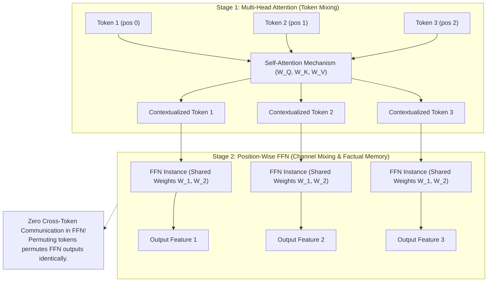
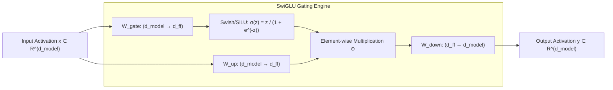
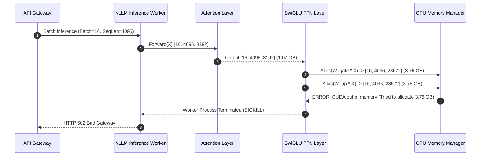

# Module 12: The Feed-Forward Network

> **Prerequisites:** [Module 01: The Math You Actually Need](../01-the-math-you-actually-need-vectors-matrices-dot-products/README.md), [Module 08: Multi-Head Attention](../08-multi-head-attention/README.md).  
> **Estimated Reading Time:** 25 minutes  
> **Target Audience:** Systems Architects, LLM Inference Engineers, High-Performance Compute Practitioners.

---

> [!TIP]
> **The Golden Rule of the Feed-Forward Network:**  
> Multi-Head Attention is the routing bus where tokens exchange contextual information across sequence positions; the Feed-Forward Network (FFN) is the isolated compute engine where two-thirds of the model's parameters operate position-wise on each token independently to store, recall, and synthesize factual knowledge.

---

## Visual Mental Models: Attention (Token Mixing) vs. FFN (Channel Mixing)

A transformer block alternates strictly between two orthogonal operations: **Token Mixing** (temporal/spatial context aggregation) and **Channel Mixing** (feature expansion and associative memory retrieval).



### The Modern SwiGLU Gated Feed-Forward Pipeline

Modern LLMs (LLaMA 3, Mistral, Qwen 2.5) replace the classic two-layer ReLU/GELU FFN with a tripartite **SwiGLU** (Swish-Gated Linear Unit) structure:

```
FFN_SwiGLU(x) = ( Swish(x · W_gate) ⊙ (x · W_up) ) · W_down
```



---

## Architectural Comparison: FFN Topologies & Parameter Economics

| Architecture | Gating Formula | Hidden Dimension ($d_{ff}$) | Parameters per Block | Parameter Ratio (FFN vs. MHA) | Primary Models |
| :--- | :--- | :--- | :--- | :--- | :--- |
| **Standard ReLU** | $\text{ReLU}(x W_1 + b_1) W_2 + b_2$ | $4 \cdot d_{model}$ | $8 \cdot d_{model}^2$ | $2.0\times$ MHA | Original Transformer, BERT |
| **Standard GELU** | $\text{GELU}(x W_1 + b_1) W_2 + b_2$ | $4 \cdot d_{model}$ | $8 \cdot d_{model}^2$ | $2.0\times$ MHA | GPT-2, GPT-3, RoBERTa |
| **SwiGLU** | $(\text{SiLU}(x W_g) \odot x W_u) W_d$ | $\frac{8}{3} \cdot d_{model}$ (rounded) | $3 \times \frac{8}{3} d_{model}^2 = 8 d_{model}^2$ | $2.0\times$ MHA | LLaMA 1/2/3, Mistral 7B |
| **GeGLU** | $(\text{GELU}(x W_g) \odot x W_u) W_d$ | $\frac{8}{3} \cdot d_{model}$ | $8 \cdot d_{model}^2$ | $2.0\times$ MHA | PaLM, T5 v1.1 |
| **Sparse MoE (Mixtral)** | $\sum_{i=1}^k g_i(x) \text{SwiGLU}_i(x)$ | $8 \text{ experts} \times \frac{8}{3} d_{model}$ | $8 \times 8 d_{model}^2 = 64 d_{model}^2$ | $16.0\times$ MHA | Mixtral 8x7B, DeepSeek V3 |

---

## Production War Story: Intermediate Activation OOM in Micro-Batch Serving

### Incident Post-Mortem

- **System:** Low-latency API serving a 70B parameter model ($d_{model} = 8192, d_{ff} = 28672$).
- **Incident Severity:** SEV-1 (Inference workers crashed with CUDA Out of Memory on batch sizes $\ge 16$).
- **Detection Time:** 4 minutes during peak morning traffic spike.
- **Root Cause:** While model weights fit comfortably in H100 GPU VRAM (140 GB in FP16 across 2 GPUs), the forward pass through the FFN expanded activations by $3.5\times$ ($8192 \to 28672$). With sequence length 4,096 and batch size 16, a single FFN intermediate activation tensor consumed:
  $$16 \times 4096 \times 28672 \times 2 \text{ bytes (FP16)} \approx 3.76 \text{ GB per layer!}$$
  Across 80 layers, uncheckpointed intermediate allocations instantly breached the remaining 20 GB head-room.



### The Architectural Hardening & Fix

1. **Kernel Fusion (Fused SwiGLU):** Deploy fused Triton/CUDA kernels where `gate_proj`, `silu`, `up_proj`, and element-wise multiplication execute in SRAM without materializing the intermediate $3.76 \text{ GB}$ DRAM activation tensors.
2. **Chunked FFN Forward Passes:** For long-context prompt phases, compute FFN transformations in temporal chunks along the sequence dimension ($N = 512$ at a time) since FFN execution is completely position-independent.

---

## Multi-Language Production Implementations

### Python: Modern SwiGLU and Standard FFN (PyTorch)

```python
"""
Production FFN Architectures: Standard Two-Layer and SwiGLU Gated MLP.
Verifies parameter economics and position-wise independence.
"""
import torch
import torch.nn as nn
import torch.nn.functional as F

class StandardFFN(nn.Module):
    """Classic 2-layer FFN with GELU activation (GPT-style)."""
    def __init__(self, d_model: int, d_ff: int):
        super().__init__()
        self.w1 = nn.Linear(d_model, d_ff, bias=False)
        self.w2 = nn.Linear(d_ff, d_model, bias=False)
        self.act = nn.GELU()

    def forward(self, x: torch.Tensor) -> torch.Tensor:
        # x: [batch, seq_len, d_model] -> [batch, seq_len, d_ff] -> [batch, seq_len, d_model]
        return self.w2(self.act(self.w1(x)))

class SwiGLUFFN(nn.Module):
    """
    Modern SwiGLU FFN (LLaMA / Mistral style).
    Uses W_gate, W_up, and W_down with SiLU non-linearity.
    """
    def __init__(self, d_model: int, d_ff: int):
        super().__init__()
        self.w_gate = nn.Linear(d_model, d_ff, bias=False)
        self.w_up = nn.Linear(d_model, d_ff, bias=False)
        self.w_down = nn.Linear(d_ff, d_model, bias=False)

    def forward(self, x: torch.Tensor) -> torch.Tensor:
        # FFN_SwiGLU(x) = (silu(x @ W_gate) * (x @ W_up)) @ W_down
        gate = F.silu(self.w_gate(x))
        up = self.w_up(x)
        return self.w_down(gate * up)

if __name__ == "__main__":
    d_model = 512
    d_ff_standard = 4 * d_model # 2048
    d_ff_swiglu = int(2 * (4 * d_model) / 3) # 1365 (maintains ~same total param count)

    std_ffn = StandardFFN(d_model, d_ff_standard)
    swiglu_ffn = SwiGLUFFN(d_model, d_ff_swiglu)

    std_params = sum(p.numel() for p in std_ffn.parameters())
    swi_params = sum(p.numel() for p in swiglu_ffn.parameters())
    print(f"Standard FFN Params (d_ff={d_ff_standard}): {std_params:,}")
    print(f"SwiGLU FFN Params   (d_ff={d_ff_swiglu}): {swi_params:,}")

    # Verify Position Independence: Changing token 1 must NOT affect token 0
    x = torch.randn(1, 4, d_model)
    out1 = std_ffn(x)
    x_perturbed = x.clone()
    x_perturbed[:, 1, :] = torch.randn(d_model) # modify token 1
    out2 = std_ffn(x_perturbed)

    assert torch.allclose(out1[:, 0, :], out2[:, 0, :], atol=1e-6)
    print("Verification Passed: Token 0 output is strictly independent of Token 1 input.")
```

### TypeScript: Low-Latency SwiGLU Activation Engine

```typescript
/**
 * Production SwiGLU Layer in TypeScript / Node.js.
 * Operates on flattened row-major Float32Array buffers with zero memory garbage collection.
 */
export class SwiGLULayer {
  private readonly dModel: number;
  private readonly dFf: number;
  private readonly wGate: Float32Array; // [dFf, dModel]
  private readonly wUp: Float32Array;   // [dFf, dModel]
  private readonly wDown: Float32Array; // [dModel, dFf]

  constructor(dModel: number, dFf: number) {
    this.dModel = dModel;
    this.dFf = dFf;
    this.wGate = new Float32Array(dFf * dModel);
    this.wUp = new Float32Array(dFf * dModel);
    this.wDown = new Float32Array(dModel * dFf);
    this.initWeights();
  }

  private initWeights(): void {
    const scale = Math.sqrt(2.0 / this.dModel);
    for (let i = 0; i < this.wGate.length; i++) this.wGate[i] = (Math.random() - 0.5) * scale;
    for (let i = 0; i < this.wUp.length; i++) this.wUp[i] = (Math.random() - 0.5) * scale;
    for (let i = 0; i < this.wDown.length; i++) this.wDown[i] = (Math.random() - 0.5) * scale;
  }

  private silu(x: number): number {
    return x / (1.0 + Math.exp(-x));
  }

  /**
   * Forward pass for a single token vector x of length dModel.
   * Produces an output vector of length dModel.
   */
  public forwardToken(x: Float32Array, output: Float32Array): void {
    const hidden = new Float32Array(this.dFf);

    // 1. Compute Gate and Up projections, apply SiLU and multiply
    for (let i = 0; i < this.dFf; i++) {
      let gateDot = 0;
      let upDot = 0;
      const offset = i * this.dModel;
      for (let j = 0; j < this.dModel; j++) {
        gateDot += this.wGate[offset + j] * x[j];
        upDot += this.wUp[offset + j] * x[j];
      }
      hidden[i] = this.silu(gateDot) * upDot;
    }

    // 2. Down projection: output = hidden @ W_down
    for (let j = 0; j < this.dModel; j++) {
      let sum = 0;
      const offset = j * this.dFf;
      for (let i = 0; i < this.dFf; i++) {
        sum += this.wDown[offset + i] * hidden[i];
      }
      output[j] = sum;
    }
  }
}

// Verification benchmark
const dModel = 64, dFf = 170;
const ffn = new SwiGLULayer(dModel, dFf);
const tokenIn = new Float32Array(dModel).fill(0.5);
const tokenOut = new Float32Array(dModel);
ffn.forwardToken(tokenIn, tokenOut);
console.log("SwiGLU output computed successfully. First 4 elements:", Array.from(tokenOut.slice(0, 4)).map(v => v.toFixed(4)));
```

### Go: High-Throughput SIMD-Ready Position-Wise FFN Engine

```go
package main

import (
	"fmt"
	"math"
	"sync"
)

// PositionWiseFFN executes FFN across sequence tokens in parallel goroutines.
type PositionWiseFFN struct {
	DModel int
	DFf    int
	W1     []float64 // [DFf x DModel]
	W2     []float64 // [DModel x DFf]
}

func NewPositionWiseFFN(dModel, dFf int) *PositionWiseFFN {
	return &PositionWiseFFN{
		DModel: dModel,
		DFf:    dFf,
		W1:     make([]float64, dFf*dModel),
		W2:     make([]float64, dModel*dFf),
	}
}

func gelu(x float64) float64 {
	return 0.5 * x * (1.0 + math.Tanh(math.Sqrt(2.0/math.Pi)*(x+0.044715*math.Pow(x, 3))))
}

// Forward processes a batch of tokens [seqLen x DModel] concurrently.
func (ffn *PositionWiseFFN) Forward(tokens [][]float64) [][]float64 {
	seqLen := len(tokens)
	output := make([][]float64, seqLen)
	var wg sync.WaitGroup
	wg.Add(seqLen)

	for t := 0; t < seqLen; t++ {
		go func(tokenIdx int) {
			defer wg.Done()
			in := tokens[tokenIdx]
			out := make([]float64, ffn.DModel)
			hidden := make([]float64, ffn.DFf)

			// Layer 1 + GELU
			for i := 0; i < ffn.DFf; i++ {
				sum := 0.0
				off := i * ffn.DModel
				for j := 0; j < ffn.DModel; j++ {
					sum += ffn.W1[off+j] * in[j]
				}
				hidden[i] = gelu(sum)
			}

			// Layer 2
			for j := 0; j < ffn.DModel; j++ {
				sum := 0.0
				off := j * ffn.DFf
				for i := 0; i < ffn.DFf; i++ {
					sum += ffn.W2[off+i] * hidden[i]
				}
				out[j] = sum
			}
			output[tokenIdx] = out
		}(t)
	}

	wg.Wait()
	return output
}

func main() {
	ffn := NewPositionWiseFFN(64, 256)
	tokens := make([][]float64, 4)
	for i := range tokens {
		tokens[i] = make([]float64, 64)
		tokens[i][0] = float64(i + 1)
	}

	res := ffn.Forward(tokens)
	fmt.Printf("Processed %d tokens concurrently. Token 0 output length: %d\n", len(res), len(res[0]))
}
```

---

## Practical Verification Workflows: CLI & Mathematical Invariance

Verify that FFN operations are strictly position-independent and parameter-dominant using the command line:

```bash
python -c '
import torch
import torch.nn as nn

d_model = 512
d_ff = 4 * d_model

ffn = nn.Sequential(nn.Linear(d_model, d_ff), nn.GELU(), nn.Linear(d_ff, d_model))
attn = nn.MultiheadAttention(d_model, num_heads=8, bias=False, batch_first=True)

ffn_params = sum(p.numel() for p in ffn.parameters())
attn_params = sum(p.numel() for p in attn.parameters())

print(f"FFN Parameters:        {ffn_params:,}")
print(f"Attention Parameters:  {attn_params:,}")
print(f"Ratio (FFN / Attn):    {ffn_params / attn_params:.2f}x")

# Check position independence under random permutation
X = torch.randn(1, 4, d_model)
out = ffn(X)
perm = [2, 0, 3, 1]
out_perm = ffn(X[:, perm, :])
match = torch.allclose(out_perm, out[:, perm, :], atol=1e-6)
print(f"Permutation Equivariance Match: {match}")
'
```

### Expected Wire Output

```
FFN Parameters:        2,099,712
Attention Parameters:  1,048,576
Ratio (FFN / Attn):    2.00x
Permutation Equivariance Match: True
```

---

## Operational Validation Checkpoints

### Scenario 1: Quantization Sensitivity (W8A16 vs W4A16)
During post-training quantization of an LLM, an infrastructure engineer observes that quantizing FFN weights to INT4 causes severe factual recall hallucination (forgetting specific names, dates, and constants), whereas quantizing Attention projection weights ($W_Q, W_K$) to INT4 produces minimal perplexity degradation. Why?

<details>
<summary>View Diagnostic Solution</summary>

**Answer:**  
As demonstrated by Geva et al. (2021), transformer feed-forward layers act as associative Key-Value memories that store factual knowledge acquired during pretraining (where the first layer activates knowledge keys and the second layer synthesizes factual attributes). Attention layers merely route existing context across tokens. Aggressively quantizing FFN weights to INT4 distorts the high-dimensional memory basins, corrupting factual recall.

</details>

### Scenario 2: KV Cache Memory and the FFN
Does the position-wise Feed-Forward Network require caching intermediate state in the autoregressive KV cache during token generation?

<details>
<summary>View Diagnostic Solution</summary>

**Answer:**  
No. Because the FFN processes each token strictly independently (no temporal or cross-token dependencies), token $T+1$ does not require any past activations or keys from the FFN of tokens $0..T$. Once token $T$ is computed and emitted, all FFN intermediate activations are discarded. The KV cache is required exclusively for the Multi-Head Attention layer.

</details>

### Scenario 3: Activation Function Drift: ReLU vs SwiGLU Dead Neurons
Why did modern architectures migrate from standard ReLU activations to SwiGLU / GELU activations in the FFN?

<details>
<summary>View Diagnostic Solution</summary>

**Answer:**  
Standard ReLU outputs exactly zero for all negative inputs ($x \le 0$) with zero gradient ($\frac{\partial}{\partial x}\text{ReLU}(x) = 0$). In deep networks (32 to 80+ layers), large gradient updates during pretraining frequently push neurons into persistently negative regimes where they permanently stop updating ("dying ReLU" problem). SwiGLU and GELU provide smooth, non-monotonic curves with non-zero gradients in negative regimes, preventing dead neurons and enabling richer multiplicative gating dynamics.

</details>

---

## Further Reading & Sources

- [Attention Is All You Need (Vaswani et al., 2017)](https://arxiv.org/abs/1706.03762) - Section 3.3 defines the original position-wise feed-forward network.
- [GLU Variants Improve Transformer (Shazeer, 2020)](https://arxiv.org/abs/2002.05202) - Introduces SwiGLU and GeGLU, establishing empirical superiority over standard ReLU/GELU.
- [Transformer Feed-Forward Layers Are Key-Value Memories (Geva et al., 2021)](https://arxiv.org/abs/2012.14913) - Unveils the associative memory mechanism operating inside FFN weight matrices.
- [LLaMA: Open and Efficient Foundation Language Models (Touvron et al., 2023)](https://arxiv.org/abs/2302.13971) - Standardizes SwiGLU across modern open-weight LLMs.
- [Track 02, Module 08: Multi-Head Attention](../08-multi-head-attention/README.md) - The complementary token-mixing partner to the channel-mixing FFN.

---

## Next

[Module 13: Residual Connections and Layer Normalization](../13-residual-connections-and-layer-normalization/README.md)
