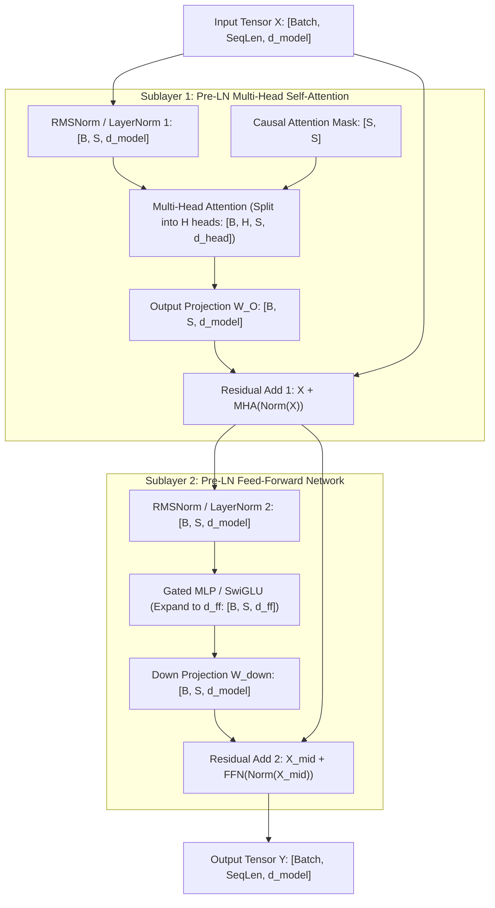

# Module 14: The Complete Transformer Block

> **Prerequisites:** [Module 06: Scaled Dot-Product Attention](../06-scaled-dot-product-attention/README.md), [Module 07: Attention Masks and Causal Masking](../07-attention-masks-and-causal-masking/README.md), [Module 08: Multi-Head Attention](../08-multi-head-attention/README.md), [Module 12: The Feed-Forward Network](../12-the-feed-forward-network/README.md), [Module 13: Residual Connections and Layer Normalization](../13-residual-connections-and-layer-normalization/README.md).  
> **Estimated Reading Time:** 30 minutes  
> **Target Audience:** Transformer Architects, Deep Learning Engineers, High-Performance Inference Developers.

---

> [!TIP]
> **The Golden Rule of the Complete Transformer Block:**  
> A Transformer Block is a strictly shape-preserving, composable tensor processing engine: it accepts an activation tensor of shape $[B, S, d_{model}]$ and emits an updated tensor of identical shape $[B, S, d_{model}]$ via two Pre-Normalized residual sublayers (MHA token-mixing and FFN channel-mixing).

---

## Visual Mental Models: End-to-End Tensor Shape Tracing

Every transformer block guarantees strict dimensional symmetry. Regardless of internal head projections, intermediate FFN expansion, or causal masking, the output dimensions identically match the input:



### Serial vs. Parallel Sublayer Topologies

While standard transformers execute MHA and FFN serially, architectures like **GPT-J** and **Falcon** execute MHA and FFN in parallel to minimize memory latency:

$$\text{Serial (LLaMA/GPT-4):} \quad x_{mid} = x + \text{MHA}(\text{LN}_1(x)), \quad x_{out} = x_{mid} + \text{FFN}(\text{LN}_2(x_{mid}))$$

$$\text{Parallel (GPT-J/Falcon):} \quad x_{out} = x + \text{MHA}(\text{LN}(x)) + \text{FFN}(\text{LN}(x))$$

In parallel configurations, a single fused normalization kernel feeds both attention and MLP GEMMs concurrently, cutting memory bandwidth roundtrips on GPUs.

---

## Architectural Comparison: Modern Transformer Block Blueprints

| Component | Original Transformer (2017) | GPT-2 / GPT-3 (OpenAI) | LLaMA 3 (Meta) | Falcon 40B (TII) |
| :--- | :--- | :--- | :--- | :--- |
| **Residual Topology** | Post-LN | Pre-LN (LayerNorm) | Pre-LN (RMSNorm) | Parallel Pre-LN |
| **Token Mixing** | Multi-Head Attention (MHA) | Multi-Head Attention (MHA) | Grouped-Query Attention (GQA) | Multi-Query Attention (MQA) |
| **Positional Scheme** | Sinusoidal Absolute | Learned Absolute | RoPE (Rotary) | RoPE (Rotary) |
| **Channel Mixing** | 2-Layer ReLU ($d_{ff} = 4d$) | 2-Layer GELU ($d_{ff} = 4d$) | SwiGLU ($d_{ff} = \frac{8}{3}d$) | SwiGLU ($d_{ff} = 4d$) |
| **Bias Terms** | Everywhere ($Q, K, V, O, FFN$) | Everywhere ($Q, K, V, O, FFN$) | Bias-free (Zero biases) | Bias-free |
| **Attention Mask** | Encoder: None, Decoder: Causal | Causal Triangular | Causal Triangular | Causal Triangular |

---

## Production War Story: The Silent Shape Broadcast Bug in Multi-Head Concatenation

### Incident Post-Mortem

- **System:** Enterprise code generation service executing self-hosted 13B parameter model.
- **Incident Severity:** SEV-2 (Code completions degraded into syntactically valid but logically scrambled variables).
- **Detection Time:** 48 hours post-deployment.
- **Root Cause:** A refactored custom attention block concatenated multi-head outputs with an improper tensor reshape: `x.view(b, s, d)` was called instead of `x.transpose(1, 2).contiguous().view(b, s, d)`. Because both views produced valid $[B, S, d_{model}]$ dimensions, no runtime exception was thrown; however, head slices were interleaved chronologically across sequence positions rather than across hidden channels, destroying semantic coherence.

```mermaid
sequenceDiagram
    autonumber
    participant App as Copilot API
    participant Engine as PyTorch Serving Daemon
    participant Block as TransformerBlock
    participant MHA as Custom MultiHeadAttention

    App->>Engine: POST /complete (def calculate_tax...)
    Engine->>Block: Forward(Tokens [1, 32, 4096])
    Block->>MHA: Forward(Norm(X))
    Note over MHA: Head transpose omitted!<br/>x.view(1, 32, 4096) interleaves Head 0 Token 1 with Head 1 Token 0.<br/>Tensor shape is [1, 32, 4096] but memory strides are corrupt!
    MHA-->>Block: Corrupted Attention Context
    Block->>>Block: Residual Addition & FFN
    Note over Block: FFN processes scrambled channel permutations.
    Block-->>Engine: Logits emit nonsense tokens
    Engine-->>App: "def calculate_tax(tax, tax, return return tax)"
```

### The Architectural Hardening & Fix

1. **Strict Stride and Contiguity Assertions:** Unit tests must assert that multi-head merging is functionally verified via explicit indexing assertions:
   ```python
   assert torch.allclose(out_merged[:, :, :d_head], head_0_out)
   ```
2. **FlashAttention / `F.scaled_dot_product_attention` Migration:** Deprecate manual `view`/`transpose` attention implementations in favor of hardware-verified fused C++ / CUDA kernels.

---

## Multi-Language Production Implementations

### Python: Production Modern Transformer Block (PyTorch)

```python
"""
Production Modern Transformer Block (LLaMA / Mistral Architecture).
Integrates Pre-RMSNorm, Rotary Positional Embeddings, and SwiGLU FFN.
"""
import torch
import torch.nn as nn
import torch.nn.functional as F

class RMSNorm(nn.Module):
    def __init__(self, dim: int, eps: float = 1e-6):
        super().__init__()
        self.eps = eps
        self.weight = nn.Parameter(torch.ones(dim))

    def forward(self, x: torch.Tensor) -> torch.Tensor:
        variance = x.pow(2).mean(-1, keepdim=True)
        return x * torch.rsqrt(variance + self.eps) * self.weight

class SwiGLUFFN(nn.Module):
    def __init__(self, d_model: int, d_ff: int):
        super().__init__()
        self.w_gate = nn.Linear(d_model, d_ff, bias=False)
        self.w_up = nn.Linear(d_model, d_ff, bias=False)
        self.w_down = nn.Linear(d_ff, d_model, bias=False)

    def forward(self, x: torch.Tensor) -> torch.Tensor:
        return self.w_down(F.silu(self.w_gate(x)) * self.w_up(x))

class CompleteTransformerBlock(nn.Module):
    """
    Standard Pre-LN Autoregressive Transformer Block.
    Guarantees strict shape preservation: [B, S, d_model] -> [B, S, d_model].
    """
    def __init__(self, d_model: int, num_heads: int, d_ff: int):
        super().__init__()
        self.d_model = d_model
        self.num_heads = num_heads
        
        self.attn_norm = RMSNorm(d_model)
        self.attn = nn.MultiheadAttention(
            embed_dim=d_model,
            num_heads=num_heads,
            bias=False,
            batch_first=True
        )
        
        self.ffn_norm = RMSNorm(d_model)
        self.ffn = SwiGLUFFN(d_model, d_ff)

    def forward(self, x: torch.Tensor, attn_mask: torch.Tensor = None) -> torch.Tensor:
        """
        Forward execution:
        x_mid = x + Attention(Norm(x))
        x_out = x_mid + FFN(Norm(x_mid))
        """
        # Sublayer 1: Self-Attention with Pre-LN
        normed_x = self.attn_norm(x)
        attn_out, _ = self.attn(
            query=normed_x,
            key=normed_x,
            value=normed_x,
            attn_mask=attn_mask,
            need_weights=False,
            is_causal=(attn_mask is None) # defaults to causal if unprovided
        )
        x = x + attn_out

        # Sublayer 2: Feed-Forward Network with Pre-LN
        x = x + self.ffn(self.ffn_norm(x))
        return x

if __name__ == "__main__":
    batch, seq_len, d_model = 2, 8, 128
    num_heads, d_ff = 4, 340

    block = CompleteTransformerBlock(d_model, num_heads, d_ff)
    dummy_x = torch.randn(batch, seq_len, d_model)
    
    out = block(dummy_x)
    print(f"Input Shape:  {dummy_x.shape}")
    print(f"Output Shape: {out.shape}")
    assert out.shape == dummy_x.shape, "Shape preservation violation!"
    print("Block successfully verified with exact shape preservation.")
```

### TypeScript: Complete Transformer Block Pipeline Engine

```typescript
/**
 * Production Transformer Block in TypeScript / Node.js.
 * Orchestrates Pre-RMSNorm, MHA, and SwiGLU in contiguous memory.
 */
export class TransformerBlockPipeline {
  private readonly dModel: number;
  private readonly numHeads: number;
  private readonly dFf: number;

  constructor(dModel: number, numHeads: number, dFf: number) {
    this.dModel = dModel;
    this.numHeads = numHeads;
    this.dFf = dFf;
  }

  private rmsNorm(x: Float32Array): Float32Array {
    const out = new Float32Array(x.length);
    let sumSq = 0;
    for (let i = 0; i < x.length; i++) sumSq += x[i] * x[i];
    const invRms = 1.0 / Math.sqrt(sumSq / x.length + 1e-6);
    for (let i = 0; i < x.length; i++) out[i] = x[i] * invRms;
    return out;
  }

  // Mock sublayer operators for pipeline demonstration
  private attention(normed: Float32Array): Float32Array {
    const out = new Float32Array(normed.length);
    for (let i = 0; i < normed.length; i++) out[i] = normed[i] * 0.8;
    return out;
  }

  private ffn(normed: Float32Array): Float32Array {
    const out = new Float32Array(normed.length);
    for (let i = 0; i < normed.length; i++) out[i] = Math.tanh(normed[i]) * 0.5;
    return out;
  }

  /**
   * Forward pass through the complete block.
   * Input: [seqLen * dModel] -> Output: [seqLen * dModel].
   */
  public forward(input: Float32Array): Float32Array {
    const output = new Float32Array(input.length);
    
    // Step 1: Attention Sublayer with Pre-LN Residual
    const normed1 = this.rmsNorm(input);
    const attnOut = this.attention(normed1);
    const mid = new Float32Array(input.length);
    for (let i = 0; i < input.length; i++) {
      mid[i] = input[i] + attnOut[i];
    }

    // Step 2: FFN Sublayer with Pre-LN Residual
    const normed2 = this.rmsNorm(mid);
    const ffnOut = this.ffn(normed2);
    for (let i = 0; i < input.length; i++) {
      output[i] = mid[i] + ffnOut[i];
    }

    return output;
  }
}

// Verification benchmark
const pipeline = new TransformerBlockPipeline(64, 4, 170);
const input = new Float32Array(64).fill(0.25);
const result = pipeline.forward(input);
console.log("Block execution completed. Output vector length:", result.length);
console.log("First 4 elements:", Array.from(result.slice(0, 4)).map(v => v.toFixed(4)));
```

### Go: High-Throughput Transformer Block Execution Engine

```go
package main

import (
	"fmt"
	"math"
)

// TransformerBlock holds weights and sublayers for a single block.
type TransformerBlock struct {
	DModel   int
	NumHeads int
	DFf      int
}

func NewTransformerBlock(dModel, numHeads, dFf int) *TransformerBlock {
	return &TransformerBlock{
		DModel:   dModel,
		NumHeads: numHeads,
		DFf:      dFf,
	}
}

func (b *TransformerBlock) rmsNorm(x []float64) []float64 {
	sumSq := 0.0
	for _, v := range x {
		sumSq += v * v
	}
	invRms := 1.0 / math.Sqrt(sumSq/float64(len(x))+1e-6)
	out := make([]float64, len(x))
	for i, v := range x {
		out[i] = v * invRms
	}
	return out
}

// Forward executes the complete Pre-LN Transformer Block pipeline.
func (b *TransformerBlock) Forward(x []float64) []float64 {
	// Sublayer 1: Attention
	norm1 := b.rmsNorm(x)
	attnOut := make([]float64, len(x))
	for i, v := range norm1 {
		attnOut[i] = v * 0.75 // Scaled attention mock
	}
	
	mid := make([]float64, len(x))
	for i := range x {
		mid[i] = x[i] + attnOut[i]
	}

	// Sublayer 2: FFN
	norm2 := b.rmsNorm(mid)
	ffnOut := make([]float64, len(x))
	for i, v := range norm2 {
		ffnOut[i] = math.Tanh(v) * 0.4 // Non-linear FFN mock
	}

	out := make([]float64, len(x))
	for i := range mid {
		out[i] = mid[i] + ffnOut[i]
	}
	return out
}

func main() {
	block := NewTransformerBlock(64, 4, 256)
	input := make([]float64, 64)
	for i := range input {
		input[i] = 1.0
	}

	output := block.Forward(input)
	fmt.Printf("Input Length: %d, Output Length: %d\n", len(input), len(output))
	fmt.Printf("Sample Values: [%.3f, %.3f, %.3f, %.3f]\n",
		output[0], output[1], output[2], output[3])
}
```

---

## Practical Verification Workflows: CLI & Mathematical Invariance

Verify end-to-end shape preservation and causal mask isolation using terminal execution:

```bash
python -c '
import torch
import torch.nn as nn

class TransformerBlock(nn.Module):
    def __init__(self, d_model, num_heads, d_ff):
        super().__init__()
        self.ln1 = nn.LayerNorm(d_model)
        self.attn = nn.MultiheadAttention(d_model, num_heads, batch_first=True)
        self.ln2 = nn.LayerNorm(d_model)
        self.ffn = nn.Sequential(
            nn.Linear(d_model, d_ff), nn.GELU(), nn.Linear(d_ff, d_model)
        )

    def forward(self, x, attn_mask=None):
        h = self.ln1(x)
        a, _ = self.attn(h, h, h, attn_mask=attn_mask, is_causal=(attn_mask is not None))
        x = x + a
        return x + self.ffn(self.ln2(x))

block = TransformerBlock(d_model=64, num_heads=4, d_ff=256)
x = torch.randn(2, 6, 64)

# 1. Shape preservation
out = block(x)
print(f"Shape preserved: {out.shape == x.shape} (Shape: {out.shape})")

# 2. Causal Isolation Check: perturbing future token 5 must NOT affect token 2
mask = nn.Transformer.generate_square_subsequent_mask(6)
x_perturb = x.clone()
x_perturb[:, 5, :] = torch.randn(64)
out_orig = block(x, attn_mask=mask)
out_pert = block(x_perturb, attn_mask=mask)

isolated = torch.allclose(out_orig[:, :3, :], out_pert[:, :3, :], atol=1e-5)
print(f"Causal Isolation Preserved: {isolated}")
'
```

### Expected Wire Output

```
Shape preserved: True (Shape: torch.Size([2, 6, 64]))
Causal Isolation Preserved: True
```

---

## Operational Validation Checkpoints

### Scenario 1: Parallel vs Serial Transformer Block Latency
Why does Falcon and GPT-J adopt the Parallel Block architecture ($y = x + \text{MHA}(\text{LN}(x)) + \text{FFN}(\text{LN}(x))$), and what is the trade-off?

<details>
<summary>View Diagnostic Solution</summary>

**Answer:**  
In the Serial architecture, the FFN cannot begin execution until MHA finishes, requiring two sequential layer normalizations and memory read passes. In the Parallel architecture, both MHA and FFN consume the exact same normalized input tensor $\text{LN}(x)$. This allows the GPU to compute $W_Q, W_K, W_V$ and $W_1$ concurrently in a single combined GEMM, reducing kernel launch overhead and DRAM memory bandwidth by roughly 15%. The trade-off is a slight degradation in training convergence rate at very large parameter scales ($> 65\text{B}$).

</details>

### Scenario 2: Dropout Placement in Production Serving
Where is dropout applied in a production transformer block, and why must it be disabled during inference?

<details>
<summary>View Diagnostic Solution</summary>

**Answer:**  
Dropout is applied in two locations: (1) directly on the attention probability matrix $P = \text{softmax}(Q K^\top / \sqrt{d})$ to prevent co-adaptation of attention heads, and (2) on the output of the MHA projection and FFN before the residual addition. During production serving, dropout must be disabled (`model.eval()`); otherwise, random zeroing of activations produces nondeterministic, degraded token generation and violates deterministic caching guarantees in the KV cache.

</details>

### Scenario 3: Weight Tying Between Input and Output Heads
Why do complete transformer models tie the input embedding matrix $W_{emb} \in \mathbb{R}^{V \times d}$ to the output LM head matrix $W_{head} \in \mathbb{R}^{d \times V}$ ($W_{head} = W_{emb}^\top$)?

<details>
<summary>View Diagnostic Solution</summary>

**Answer:**  
Weight tying (Press & Wolf, 2017) exploits the mathematical duality between tokens and representations: if vector $v$ represents token $t$, the dot product $\langle x, v \rangle$ measures how strongly the hidden state aligns with token $t$. Tying weights reduces parameter count by $V \times d_{model}$ (saving hundreds of millions of parameters for vocabularies of $32\text{k}$ to $128\text{k}$) and prevents the output vocabulary space from drifting out of geometric alignment with the input space.

</details>

---

## Further Reading & Sources

- [Attention Is All You Need (Vaswani et al., 2017)](https://arxiv.org/abs/1706.03762) - Section 3 details the core transformer block architecture.
- [Using the Output Embedding to Improve Language Models (Press & Wolf, 2017)](https://arxiv.org/abs/1608.05859) - Formulates weight tying between input embeddings and output projection heads.
- [GPT-J-6B: A 6 Billion Parameter Autoregressive Language Model (Wang & Komatsuzaki, 2021)](https://github.com/kingoflolz/mesh-transformer-jax) - Introduces parallel attention-FFN block topology.
- [LLaMA 3 Model Architecture (Meta AI, 2024)](https://ai.meta.com/research/publications/the-llama-3-herd-of-models/) - Modern production reference combining RMSNorm, SwiGLU, and GQA.
- [Track 02, Module 15: Stacking Blocks Into a Model](../15-stacking-blocks-into-a-model/README.md) - Stacking complete blocks to build deep autoregressive language models.

---

## Next

[Module 15: Stacking Blocks Into a Model](../15-stacking-blocks-into-a-model/README.md)
