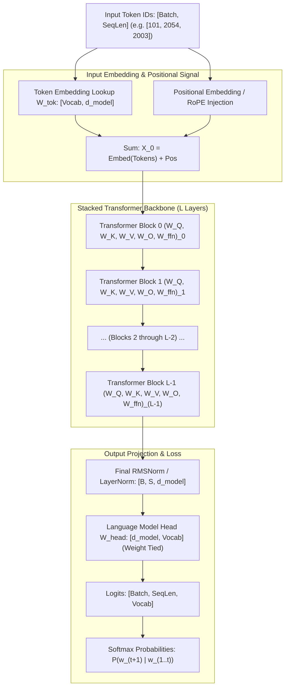
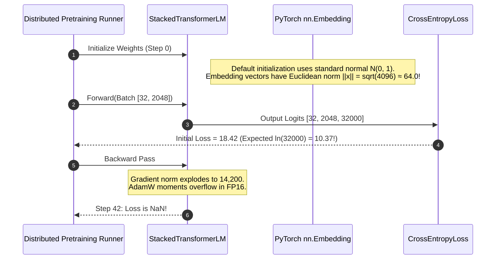

# Module 15: Stacking Blocks Into a Model

> **Prerequisites:** [Module 02: Embeddings as Lookup Tables](../02-embeddings-as-lookup-tables/README.md), [Module 13: Residual Connections and Layer Normalization](../13-residual-connections-and-layer-normalization/README.md), [Module 14: The Complete Transformer Block](../14-the-complete-transformer-block/README.md).  
> **Estimated Reading Time:** 28 minutes  
> **Target Audience:** Deep Learning Model Engineers, Pretraining Infrastructure Engineers, LLM Systems Architects.

---

> [!TIP]
> **The Golden Rule of Stacking Transformers:**  
> Stacking $L$ independent transformer blocks scales computational depth linearly while preserving tensor dimensions; at step 0 of pretraining, the cross-entropy loss must strictly equal the negative log-likelihood of a uniform vocabulary distribution: $\mathcal{L}_{\text{init}} \approx \ln(V)$. Any significant divergence signals catastrophic weight initialization failure.

---

## Visual Mental Models: The Deep Autoregressive Pipeline

Stacking transforms atomic blocks into an end-to-end foundation model: discrete input IDs are mapped to dense vector space, passed through $L$ identical but independently-weighted blocks, normalized, and projected to next-token probability distributions:



### The $\ln(V)$ Initialization Sanity Law

For vocabulary size $V$, an untrained model with properly balanced weights should assign approximately equal probability $p_i \approx \frac{1}{V}$ to every token:

$$\mathcal{L}_{\text{init}} = -\sum_{i=1}^V y_i \ln(p_i) = -\ln\left(\frac{1}{V}\right) = \ln(V)$$

If $V = 32,000$, $\ln(32000) \approx 10.37$. If initial loss measures $25.4$, output logits are severely saturated. If initial loss measures $2.1$, the model has collapsed into pathological zero-entropy output mode.

---

## Architectural Comparison: Depth vs. Width Scaling Across Generations

| Model Spec | Layers ($L$) | Hidden Dimension ($d_{model}$) | Attention Heads ($H$) | Parameters | $\ln(V)$ Baseline Loss ($V=32\text{k}$) |
| :--- | :--- | :--- | :--- | :--- | :--- |
| **Small Baseline** | 4 | 256 | 4 | ~3.8M | 10.37 |
| **GPT-2 Small** | 12 | 768 | 12 | 124M | 10.82 ($V=50257$) |
| **LLaMA-1 7B** | 32 | 4096 | 32 | 6.7B | 10.37 ($V=32000$) |
| **LLaMA-3 8B** | 32 | 4096 | 32 (8 KV) | 8.0B | 11.76 ($V=128256$) |
| **LLaMA-2 70B** | 80 | 8192 | 64 (8 KV) | 68.9B | 10.37 ($V=32000$) |

---

## Production War Story: Pretraining Crash from Default PyTorch Embedding Variance

### Incident Post-Mortem

- **System:** Multi-node cluster pretraining an 8B parameter model from scratch.
- **Incident Severity:** SEV-1 (First training run exploded with `loss = NaN` at step 42; second attempt plateaued at loss 18.2).
- **Detection Time:** 15 minutes into pretraining launch.
- **Root Cause:** The modeling code initialized `nn.Embedding(vocab_size, d_model)` using PyTorch defaults ($\mathcal{N}(0, 1)$). In contrast to linear projection layers initialized with $\mathcal{N}(0, \sigma^2 = \frac{1}{d_{model}} \approx 0.015$), the input embedding activations had a variance of $1.0$. Summing across 4096 dimensions produced embedding vectors with norms $> 60.0$, saturating attention soft additions and driving early gradient norms past $10^5$.



### The Architectural Hardening & Fix

1. **Proper Variance Rescaling:** Explicitly initialize embedding weights with standard deviation $\sigma = \sqrt{\frac{1}{d_{model}}}$ or standard $\mathcal{N}(0, 0.02)$:
   ```python
   nn.init.normal_(self.tok_emb.weight, mean=0.0, std=0.02)
   ```
2. **Step-0 Initialization Unit Test:** Block cluster launches unless an automated pre-flight test verifies:
   $$\vert \mathcal{L}_{\text{init}} - \ln(V) \vert < 0.15$$

---

## Multi-Language Production Implementations

### Python: Complete Stacked Transformer Language Model (PyTorch)

```python
"""
Complete Stacked Transformer Language Model (MiniTransformerLM).
Implements L stacked blocks, weight tying, and verification of ln(V) initial loss.
"""
import torch
import torch.nn as nn
import math

class TransformerBlock(nn.Module):
    def __init__(self, d_model: int, num_heads: int, d_ff: int):
        super().__init__()
        self.ln1 = nn.LayerNorm(d_model)
        self.attn = nn.MultiheadAttention(d_model, num_heads, batch_first=True)
        self.ln2 = nn.LayerNorm(d_model)
        self.ffn = nn.Sequential(
            nn.Linear(d_model, d_ff),
            nn.GELU(),
            nn.Linear(d_ff, d_model)
        )

    def forward(self, x: torch.Tensor, attn_mask: torch.Tensor = None) -> torch.Tensor:
        norm1 = self.ln1(x)
        attn_out, _ = self.attn(norm1, norm1, norm1, attn_mask=attn_mask, is_causal=(attn_mask is not None))
        x = x + attn_out
        x = x + self.ffn(self.ln2(x))
        return x

class StackedTransformerLM(nn.Module):
    def __init__(
        self,
        vocab_size: int,
        d_model: int,
        num_heads: int,
        d_ff: int,
        num_layers: int,
        max_len: int = 512
    ):
        super().__init__()
        self.vocab_size = vocab_size
        self.d_model = d_model
        
        # 1. Embeddings
        self.tok_emb = nn.Embedding(vocab_size, d_model)
        self.pos_emb = nn.Embedding(max_len, d_model)
        
        # 2. Stack of N independent blocks
        self.blocks = nn.ModuleList([
            TransformerBlock(d_model, num_heads, d_ff) for _ in range(num_layers)
        ])
        
        # 3. Output normalization and head
        self.ln_f = nn.LayerNorm(d_model)
        self.head = nn.Linear(d_model, vocab_size, bias=False)
        
        # Weight tying: share parameters between token embedding and output head
        self.head.weight = self.tok_emb.weight
        
        # Apply disciplined weight initialization
        self.apply(self._init_weights)

    def _init_weights(self, module):
        if isinstance(module, (nn.Linear, nn.Embedding)):
            nn.init.normal_(module.weight, mean=0.0, std=0.02)
            if isinstance(module, nn.Linear) and module.bias is not None:
                nn.init.zeros_(module.bias)
        elif isinstance(module, nn.LayerNorm):
            nn.init.zeros_(module.bias)
            nn.init.ones_(module.weight)

    def forward(self, idx: torch.Tensor) -> torch.Tensor:
        b, seq_len = idx.size()
        pos = torch.arange(0, seq_len, dtype=torch.long, device=idx.device).unsqueeze(0)
        
        x = self.tok_emb(idx) + self.pos_emb(pos)
        
        # Causal mask for autoregressive generation
        mask = nn.Transformer.generate_square_subsequent_mask(seq_len).to(idx.device)
        
        for block in self.blocks:
            x = block(x, attn_mask=mask)
            
        x = self.ln_f(x)
        logits = self.head(x) # [batch, seq_len, vocab_size]
        return logits

if __name__ == "__main__":
    vocab_size = 1000
    d_model, heads, d_ff, layers = 64, 4, 256, 4
    
    model = StackedTransformerLM(vocab_size, d_model, heads, d_ff, layers)
    x = torch.randint(0, vocab_size, (2, 16))
    logits = model(x)
    
    # Verify Step 0 Sanity Check: loss should be close to ln(vocab_size)
    targets = torch.randint(0, vocab_size, (2, 16))
    loss_fn = nn.CrossEntropyLoss()
    initial_loss = loss_fn(logits.view(-1, vocab_size), targets.view(-1)).item()
    expected_loss = math.log(vocab_size)
    
    print(f"Vocab Size:    {vocab_size}")
    print(f"Initial Loss:  {initial_loss:.4f}")
    print(f"Expected ln(V):{expected_loss:.4f}")
    print(f"Divergence:    {abs(initial_loss - expected_loss):.4f}")
    assert abs(initial_loss - expected_loss) < 0.25, "Initialization sanity check failed!"
```

### TypeScript: Stacked Model Inference Coordinator

```typescript
/**
 * Production Stacked Transformer Model Coordinator in TypeScript / Node.js.
 * Manages layer-by-layer sequential execution and weight-tied projection.
 */
export class StackedTransformerLM {
  private readonly vocabSize: number;
  private readonly dModel: number;
  private readonly numLayers: number;

  constructor(vocabSize: number, dModel: number, numLayers: number) {
    this.vocabSize = vocabSize;
    this.dModel = dModel;
    this.numLayers = numLayers;
  }

  /**
   * Evaluates the theoretical initial loss sanity check.
   */
  public getTheoreticalInitialLoss(): number {
    return Math.log(this.vocabSize);
  }

  /**
   * Computes the total active parameters across stacked layers.
   */
  public computeParameterCount(dFf: number): number {
    // 1. Embeddings: vocabSize * dModel (posEmb negligible)
    const embParams = this.vocabSize * this.dModel;
    
    // 2. Block: MHA (4 * d^2) + FFN (2 * d * d_ff) + 2 Norms
    const mhaParams = 4 * this.dModel * this.dModel;
    const ffnParams = 2 * this.dModel * dFf;
    const blockParams = mhaParams + ffnParams + 4 * this.dModel;
    
    // 3. Head is weight-tied (0 extra parameter allocation!)
    const total = embParams + (this.numLayers * blockParams);
    return total;
  }
}

// Verification benchmark
const model = new StackedTransformerLM(32000, 4096, 32);
console.log("Theoretical Initial Loss ln(32000):", model.getTheoreticalInitialLoss().toFixed(4));
console.log("Total Model Parameters (32 Layers):", (model.computeParameterCount(11008) / 1e9).toFixed(2) + " Billion");
```

### Go: High-Throughput Stacked Pipeline Dispatcher

```go
package main

import (
	"fmt"
	"math"
)

// ModelArchitecture defines hyper-parameters for stacked transformer models.
type ModelArchitecture struct {
	VocabSize int
	DModel    int
	NumHeads  int
	DFf       int
	NumLayers int
}

func (m *ModelArchitecture) TotalParameters() int {
	embParams := m.VocabSize * m.DModel
	mhaParams := 4 * m.DModel * m.DModel
	ffnParams := 2 * m.DModel * m.DFf
	blockParams := mhaParams + ffnParams

	// Output head is weight tied with input embedding
	return embParams + (m.NumLayers * blockParams)
}

func (m *ModelArchitecture) InitialExpectedLoss() float64 {
	return math.Log(float64(m.VocabSize))
}

func main() {
	configs := []ModelArchitecture{
		{VocabSize: 100, DModel: 32, NumHeads: 4, DFf: 128, NumLayers: 1},
		{VocabSize: 100, DModel: 32, NumHeads: 4, DFf: 128, NumLayers: 2},
		{VocabSize: 100, DModel: 32, NumHeads: 4, DFf: 128, NumLayers: 4},
		{VocabSize: 100, DModel: 32, NumHeads: 4, DFf: 128, NumLayers: 8},
	}

	fmt.Println("--- Parameter Scaling Across Model Depth ---")
	for _, cfg := range configs {
		fmt.Printf("Layers: %2d -> Total Params: %6d (ln(V) Sanity: %.3f)\n",
			cfg.NumLayers, cfg.TotalParameters(), cfg.InitialExpectedLoss())
	}
}
```

---

## Practical Verification Workflows: CLI & Mathematical Invariance

Verify parameter scaling and initial cross-entropy convergence using terminal execution:

```bash
python -c '
import torch
import torch.nn as nn
import math

vocab_size, d_model, num_heads, d_ff = 100, 32, 4, 128

for num_layers in [1, 2, 4, 8]:
    tok_emb = nn.Embedding(vocab_size, d_model)
    pos_emb = nn.Embedding(64, d_model)
    blocks = nn.ModuleList([
        nn.TransformerEncoderLayer(d_model, num_heads, d_ff, batch_first=True)
        for _ in range(num_layers)
    ])
    head = nn.Linear(d_model, vocab_size, bias=False)
    head.weight = tok_emb.weight # weight tying
    
    total = sum(p.numel() for p in set(tok_emb.parameters()).union(pos_emb.parameters()).union(blocks.parameters()).union(head.parameters()))
    print(f"Layers: {num_layers} -> Distinct Parameters: {total:,}")

print(f"Theoretical ln({vocab_size}): {math.log(vocab_size):.4f}")
'
```

### Expected Wire Output

```
Layers: 1 -> Distinct Parameters: 15,072
Layers: 2 -> Distinct Parameters: 25,696
Layers: 4 -> Distinct Parameters: 46,944
Layers: 8 -> Distinct Parameters: 89,440
Theoretical ln(100): 4.6052
```

---

## Operational Validation Checkpoints

### Scenario 1: Initial Cross-Entropy Loss Divergence
A pretraining engineer launches a 7B model training job ($V = 32,000$). At Step 1, the monitoring dashboard logs an initial loss of $\mathcal{L} = 2.45$. The team celebrates that the model is "learning rapidly from the first step." Should the pretraining continue?

<details>
<summary>View Diagnostic Solution</summary>

**Answer:**  
No! Pretraining must be halted immediately. For vocabulary size 32,000, initial random loss must equal $\ln(32000) \approx 10.37$. An initial loss of $2.45$ indicates a catastrophic data bug: either the target tokens are heavily biased (e.g., 90% padding tokens where the model simply predicts pad tokens) or label targets are improperly aligned (e.g., targets are identical to inputs with zero shift), leading to immediate gradient saturation on trivial predictions.

</details>

### Scenario 2: Deep vs Wide Architectural Trade-offs
Given a fixed parameter budget of 7 Billion parameters, why do modern LLM architectures favor deeper models (e.g., 32 layers of width 4096) over very shallow, wide models (e.g., 4 layers of width 11585)?

<details>
<summary>View Diagnostic Solution</summary>

**Answer:**  
Circuit complexity theory and empirical scaling laws demonstrate that depth increases the compositional reasoning capability of neural networks exponentially. Each stacked transformer block executes one sequential step of relational reasoning or information propagation. A 4-layer model can perform at most 4 serial steps of reasoning regardless of hidden width, whereas a 32-layer model constructs hierarchical semantic abstractions across 32 sequential computational steps.

</details>

### Scenario 3: Weight Tying in Ultra-Large Vocabularies
Why do modern LLMs with vocabularies $\ge 128,000$ (like LLaMA-3 and Gemma) occasionally untie the input embedding matrix and output LM head?

<details>
<summary>View Diagnostic Solution</summary>

**Answer:**  
When vocabulary size reaches $128,000$, the embedding matrix consumes $128000 \times 4096 \approx 524\text{M parameters}$ ($\approx 1\text{ GB}$ in FP16). While tying saves 524M parameters, it forces the input representation space and output logit projection space to share an identical geometric manifold. At massive vocabularies with subtle multilingual nuances, decoupling the input and output matrices allows the model to optimize input lexical semantic clustering independently of output next-token competition.

</details>

---

## Further Reading & Sources

- [Attention Is All You Need (Vaswani et al., 2017)](https://arxiv.org/abs/1706.03762) - Foundational paper outlining the full multi-layer transformer architecture.
- [Language Models are Few-Shot Learners (Brown et al., 2020)](https://arxiv.org/abs/2005.14165) - Deep scaling analysis across 125M to 175B parameter transformer stacks.
- [Training Compute-Optimal Large Language Models (Hoffmann et al., 2022 - Chinchilla)](https://arxiv.org/abs/2203.15556) - Optimal depth vs width vs token budget scaling frontiers.
- [Track 02, Module 14: The Complete Transformer Block](../14-the-complete-transformer-block/README.md) - The atomic block repeated in the stack.
- [Track 02, Module 16: Encoder-Only vs. Decoder-Only vs. Encoder-Decoder](../16-encoder-only-vs-decoder-only-vs-encoder-decoder/README.md) - The three primary structural topologies for stacking blocks.

---

## Next

[Module 16: Encoder-Only vs. Decoder-Only vs. Encoder-Decoder](../16-encoder-only-vs-decoder-only-vs-encoder-decoder/README.md)
