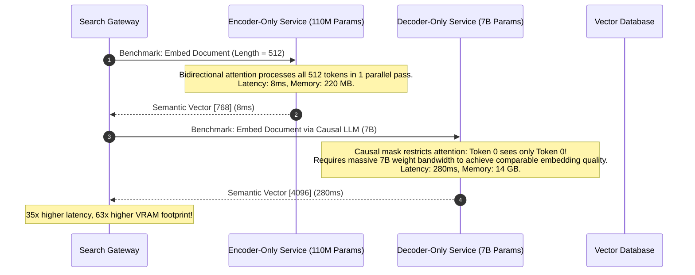

# Module 16: Encoder-Only vs. Decoder-Only vs. Encoder-Decoder

> **Prerequisites:** [Module 06: Scaled Dot-Product Attention](../06-scaled-dot-product-attention/README.md), [Module 07: Attention Masks and Causal Masking](../07-attention-masks-and-causal-masking/README.md), [Module 15: Stacking Blocks Into a Model](../15-stacking-blocks-into-a-model/README.md).  
> **Estimated Reading Time:** 28 minutes  
> **Target Audience:** Systems Architects, LLM Platform Engineers, Machine Learning Researchers.

---

> [!TIP]
> **The Golden Rule of Transformer Topologies:**  
> Choose the topology that matches your information flow: use **Encoder-Only** with bidirectional attention for full-context representation; use **Decoder-Only** with causal masking for autoregressive generative streaming; use **Encoder-Decoder** with cross-attention when mapping an immutable input sequence to a variable-length target.

---

## Visual Mental Models: The Three Structural Families

All transformer families share identical underlying dot-product attention mathematics. Their profound operational differences stem entirely from **attention connectivity masks** and the presence of **cross-attention**:

```mermaid
flowchart TD
    subgraph EncOnly ["1. Encoder-Only (BERT, RoBERTa)"]
        encIn["Input: [B, S_enc]"]
        encSelf["Bidirectional Self-Attention<br/>(Full S × S Attention Matrix)"]
        encOut["Contextualized Representations: [B, S_enc, d_model]"]
        encIn --> encSelf --> encOut
    end

    subgraph DecOnly ["2. Decoder-Only (GPT-4, LLaMA, Mistral)"]
        decIn["Input / Prefix: [B, S_dec]"]
        decSelf["Causal Self-Attention<br/>(Lower-Triangular Mask: j ≤ i)"]
        decOut["Autoregressive Next-Token Logits: [B, S_dec, Vocab]"]
        decIn --> decSelf --> decOut
    end

    subgraph EncDec ["3. Encoder-Decoder (T5, BART, Whisper)"]
        edEncIn["Source Text / Audio: [B, S_src]"]
        edEncSelf["Encoder: Bidirectional Self-Attention"]
        edDecIn["Target Prefix: [B, S_tgt]"]
        edDecSelf["Decoder: Causal Self-Attention"]
        edCross["Cross-Attention:<br/>Q from Decoder [S_tgt]<br/>K, V from Encoder [S_src]"]
        edOut["Output Generation: [B, S_tgt, Vocab]"]
        
        edEncIn --> edEncSelf
        edDecIn --> edDecSelf --> edCross
        edEncSelf -->|Keys & Values| edCross --> edOut
    end
```



### The Cross-Attention Invariant

In self-attention, queries, keys, and values all derive from the same sequence ($Q, K, V \in \mathbb{R}^{S \times d}$). In **cross-attention**, queries originate from the decoder ($Q \in \mathbb{R}^{S_{dec} \times d}$) while keys and values originate from the encoder output ($K, V \in \mathbb{R}^{S_{enc} \times d}$):

$$\text{CrossAttention}(Q, K, V) = \text{softmax}\left(\frac{Q K^\top}{\sqrt{d_k}}\right) V$$

$$\text{Shape Matrix:} \quad \left( [S_{dec} \times d] \times [d \times S_{enc}] \right) \times [S_{enc} \times d] = [S_{dec} \times d]$$

The output length of cross-attention is strictly determined by the **Query sequence length** ($S_{dec}$), completely independent of the source document length ($S_{enc}$).

---

## Systematic Taxonomic Comparison: Architectural Trade-Offs

| Dimension | Encoder-Only | Decoder-Only | Encoder-Decoder |
| :--- | :--- | :--- | :--- |
| **Primary Representatives** | BERT, RoBERTa, ModernBERT | GPT-4, LLaMA 3, Mistral, Claude | T5, ByT5, BART, Whisper |
| **Attention Pattern** | Bidirectional (Unmasked) | Strictly Causal (Lower Triangular) | Enc: Bidirectional, Dec: Causal + Cross |
| **Cross-Attention Present?** | No | No | Yes (in every decoder block) |
| **Pretraining Objective** | Masked Language Modeling (MLM) | Causal Next-Token Prediction | Span Corruption / Denoising |
| **Generation Capability** | Extremely inefficient ($O(N)$ re-passes) | Native Autoregressive Streaming | Native Autoregressive Streaming |
| **Optimal Use Cases** | Embeddings, Semantic Search, NER | Chat, Code Generation, Reasoning | Translation, Summarization, ASR |
| **KV Caching Mechanics** | None (Single forward pass) | Standard Self-Attention KV Cache | Decoder Self KV + Static Cross KV |

---

## Production War Story: Latency Meltdown from Misapplied Decoder Architectures

### Incident Post-Mortem

- **System:** Enterprise semantic document retrieval engine indexing 20 million legal clauses.
- **Incident Severity:** SEV-1 (Search p99 latency spiked from 35ms to 1,450ms; GPU cluster cost tripled).
- **Detection Time:** 20 minutes after v2 release rollout.
- **Root Cause:** The data engineering team replaced a BERT-based bi-encoder embedding model with a 7B Decoder-Only model (using the last token's hidden state as document embeddings). Because Decoder-Only models use causal masking, earlier tokens cannot attend to subsequent tokens. To produce a coherent semantic representation, the 7B model required $30\times$ more parameters and lacked true bidirectional contextualization, degrading semantic recall while saturating inference memory bandwidth.



### The Architectural Hardening & Fix

1. **Topology Alignment Policy:** Strict infrastructure rule: use modern Encoder-Only models (such as ModernBERT or BGE-large) for embedding generation, classification, and vector indexing.
2. **Decoder-Only Reservation:** Reserve Decoder-Only LLMs strictly for generative synthesis, reasoning, and autoregressive dialogue.

---

## Multi-Language Production Implementations

### Python: The Three Architectural Families in PyTorch

```python
"""
Comparative Implementation of Transformer Architectural Families.
Demonstrates Bidirectional, Causal, and Cross-Attention mechanics.
"""
import torch
import torch.nn as nn
import torch.nn.functional as F

class ArchitecturalFamiliesDemo:
    @staticmethod
    def run_encoder_only(x: torch.Tensor) -> torch.Tensor:
        """
        Encoder-Only (BERT style):
        Bidirectional self-attention where every token attends to all tokens.
        """
        # is_causal=False allows full NxN attention visibility
        return F.scaled_dot_product_attention(x, x, x, is_causal=False)

    @staticmethod
    def run_decoder_only(x: torch.Tensor) -> torch.Tensor:
        """
        Decoder-Only (GPT style):
        Causal self-attention preventing tokens from looking into the future.
        """
        # is_causal=True applies lower-triangular causal mask
        return F.scaled_dot_product_attention(x, x, x, is_causal=True)

    @staticmethod
    def run_cross_attention(q_dec: torch.Tensor, kv_enc: torch.Tensor) -> torch.Tensor:
        """
        Encoder-Decoder Cross-Attention (T5 style):
        Queries from decoder [B, S_dec, d], Keys and Values from encoder [B, S_enc, d].
        Output length strictly equals S_dec!
        """
        # Output shape is strictly [B, S_dec, d]
        return F.scaled_dot_product_attention(q_dec, kv_enc, kv_enc, is_causal=False)

if __name__ == "__main__":
    torch.manual_seed(42)
    b, d = 1, 64
    s_enc = 10 # Encoder input length (e.g. source document)
    s_dec = 4  # Decoder prefix length (e.g. translation target)

    enc_input = torch.randn(b, s_enc, d)
    dec_input = torch.randn(b, s_dec, d)

    demo = ArchitecturalFamiliesDemo()
    
    # 1. Encoder forward pass
    enc_out = demo.run_encoder_only(enc_input)
    print(f"1. Encoder-Only Output Shape:     {enc_out.shape} (Matches input {s_enc})")

    # 2. Decoder self-attention
    dec_self_out = demo.run_decoder_only(dec_input)
    print(f"2. Decoder-Only Output Shape:     {dec_self_out.shape} (Matches input {s_dec})")

    # 3. Cross-attention
    cross_out = demo.run_cross_attention(dec_input, enc_out)
    print(f"3. Cross-Attention Output Shape:  {cross_out.shape} (Matches query length {s_dec}, NOT key length {s_enc}!)")
    
    assert cross_out.shape == (b, s_dec, d)
    print("Verification Passed: Cross-attention output length is strictly query-driven.")
```

### TypeScript: Cross-Attention Resolution Engine

```typescript
/**
 * Cross-Attention Dimension Dispatcher in TypeScript / Node.js.
 * Demonstrates query-key length asymmetry in sequence-to-sequence transformers.
 */
export class CrossAttentionEngine {
  private readonly dModel: number;

  constructor(dModel: number) {
    this.dModel = dModel;
  }

  /**
   * Simulates Cross-Attention output dimension resolution.
   * Q: [seqDec, dModel]
   * K, V: [seqEnc, dModel]
   * Output: [seqDec, dModel]
   */
  public resolveDimensions(seqDec: number, seqEnc: number): {
    attentionMatrixShape: [number, number];
    outputShape: [number, number];
  } {
    return {
      attentionMatrixShape: [seqDec, seqEnc], // Queries attend over Keys
      outputShape: [seqDec, this.dModel],      // Weights multiply Values [seqEnc, dModel]
    };
  }
}

// Verification benchmark
const engine = new CrossAttentionEngine(768);
const dims = engine.resolveDimensions(12, 512); // Generating 12 tokens from 512 source tokens
console.log("Attention Matrix (Dec x Enc):", dims.attentionMatrixShape);
console.log("Output Shape (Dec x dModel):  ", dims.outputShape);
```

### Go: Multi-Topology Pipeline Router

```go
package main

import (
	"fmt"
)

// TransformerTopology denotes the structural family.
type TransformerTopology string

const (
	EncoderOnly    TransformerTopology = "ENCODER_ONLY"
	DecoderOnly    TransformerTopology = "DECODER_ONLY"
	EncoderDecoder TransformerTopology = "ENCODER_DECODER"
)

// PipelineSpec defines operational characteristics.
type PipelineSpec struct {
	Topology         TransformerTopology
	HasCrossAttention bool
	IsCausal         bool
	PrimaryWorkload  string
}

func GetSpec(t TransformerTopology) PipelineSpec {
	switch t {
	case EncoderOnly:
		return PipelineSpec{Topology: t, HasCrossAttention: false, IsCausal: false, PrimaryWorkload: "Embeddings / Extraction"}
	case DecoderOnly:
		return PipelineSpec{Topology: t, HasCrossAttention: false, IsCausal: true, PrimaryWorkload: "Autoregressive Chat / Reasoning"}
	case EncoderDecoder:
		return PipelineSpec{Topology: t, HasCrossAttention: true, IsCausal: true, PrimaryWorkload: "Translation / Audio Transcription"}
	default:
		panic("unknown topology")
	}
}

func main() {
	topologies := []TransformerTopology{EncoderOnly, DecoderOnly, EncoderDecoder}
	fmt.Println("--- Transformer Architectural Topologies ---")
	for _, top := range topologies {
		spec := GetSpec(top)
		fmt.Printf("[%s]\n  Causal: %t | Cross-Attn: %t | Target: %s\n",
			spec.Topology, spec.IsCausal, spec.HasCrossAttention, spec.PrimaryWorkload)
	}
}
```

---

## Practical Verification Workflows: CLI & Mathematical Invariance

Verify that cross-attention output sequence length depends strictly on Query length ($S_{dec}$) regardless of Key/Value length ($S_{enc}$):

```bash
python -c '
import torch
import torch.nn.functional as F

d = 16
s_dec = 5

for s_enc in [10, 50, 200, 1000]:
    q = torch.randn(1, s_dec, d)
    k = torch.randn(1, s_enc, d)
    v = torch.randn(1, s_enc, d)
    
    out = F.scaled_dot_product_attention(q, k, v)
    print(f"Query Len: {s_dec:2d} | Key/Val Len: {s_enc:4d} -> Output Shape: {list(out.shape)}")
    assert out.shape == (1, s_dec, d)

print("All cross-attention output lengths verified invariant to source sequence length.")
'
```

### Expected Wire Output

```
Query Len:  5 | Key/Val Len:   10 -> Output Shape: [1, 5, 16]
Query Len:  5 | Key/Val Len:   50 -> Output Shape: [1, 5, 16]
Query Len:  5 | Key/Val Len:  200 -> Output Shape: [1, 5, 16]
Query Len:  5 | Key/Val Len: 1000 -> Output Shape: [1, 5, 16]
All cross-attention output lengths verified invariant to source sequence length.
```

---

## Operational Validation Checkpoints

### Scenario 1: Why Decoder-Only LLMs Won the Generative AI Race
Why did modern foundation models (LLaMA, GPT-4, Mistral, DeepSeek) converge almost universally on the Decoder-Only architecture rather than Encoder-Decoder models like T5?

<details>
<summary>View Diagnostic Solution</summary>

**Answer:**  
Decoder-Only architectures offer three decisive scaling advantages:
1. **Unified Compute Graph:** Every single token in the input prompt and output completion is trained under the exact same causal next-token objective, maximizing compute and sample efficiency.
2. **Zero-Shot Flexibility:** In-context learning, few-shot prompting, and arbitrary instruction following occur naturally within a single prefix-completion sequence without requiring separate encoding passes.
3. **Optimized KV Caching:** Inference engines (like vLLM) only need to manage a single causal KV cache stream rather than dual encoder-decoder memory systems.

</details>

### Scenario 2: KV Cache Behavior in Cross-Attention
In an Encoder-Decoder model (like Whisper or T5), how does KV caching in cross-attention differ from self-attention during autoregressive decoding?

<details>
<summary>View Diagnostic Solution</summary>

**Answer:**  
In decoder self-attention, the KV cache grows by 1 token at every decoding step ($K, V \in \mathbb{R}^{t \times d}$). In cross-attention, the Keys and Values derive from the **encoder output**, which is computed once from the static source prompt. Therefore, cross-attention Keys and Values ($K_{enc}, V_{enc} \in \mathbb{R}^{S_{enc} \times d}$) are completely static and cached once at step 0. They are never updated or appended to during the entire generation process.

</details>

### Scenario 3: Masked Language Modeling vs Autoregressive Pretraining
Why is BERT (Encoder-Only) unsuited for zero-shot text generation?

<details>
<summary>View Diagnostic Solution</summary>

**Answer:**  
BERT is pretrained using Masked Language Modeling (MLM), where 15% of tokens are replaced with `[MASK]` and predicted using bidirectional context. Generating a sequence of length $N$ autoregressively with BERT would require running $N$ complete bidirectional forward passes (placing a `[MASK]` token, running the entire network, sampling the token, placing another `[MASK]`, and repeating), scaling with $O(N^2)$ forward passes with no KV-caching capability. Furthermore, BERT has never been trained on open-ended generation where past tokens predict future tokens without bidirectional lookahead.

</details>

---

## Further Reading & Sources

- [Attention Is All You Need (Vaswani et al., 2017)](https://arxiv.org/abs/1706.03762) - The original Encoder-Decoder architecture for neural machine translation.
- [BERT: Pre-training of Deep Bidirectional Transformers (Devlin et al., 2018)](https://arxiv.org/abs/1810.04805) - Seminal Encoder-Only model for natural language understanding.
- [Exploring the Limits of Transfer Learning with a Unified Text-to-Text Transformer (Raffel et al., 2019 - T5)](https://arxiv.org/abs/1910.10683) - Benchmark Encoder-Decoder architecture across all NLP tasks.
- [Track 02, Module 07: Attention Masks and Causal Masking](../07-attention-masks-and-causal-masking/README.md) - The fundamental masking mechanism governing bidirectional vs causal visibility.
- [Track 02, Module 17: Implementing a Mini Transformer in PyTorch](../17-implementing-a-mini-transformer-in-pytorch/README.md) - Training a decoder-only model end-to-end.

---

## Next

[Module 17: Implementing a Mini Transformer in PyTorch](../17-implementing-a-mini-transformer-in-pytorch/README.md)
