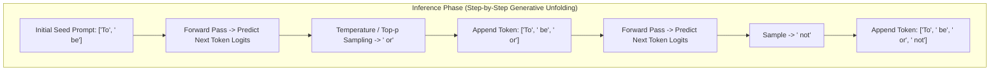
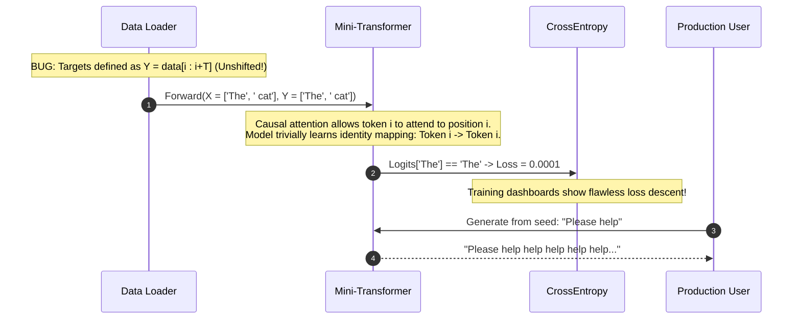

# Module 17: Implementing a Mini Transformer in PyTorch

> **Prerequisites:** [Module 06: Scaled Dot-Product Attention](../06-scaled-dot-product-attention/README.md), [Module 07: Attention Masks and Causal Masking](../07-attention-masks-and-causal-masking/README.md), [Module 14: The Complete Transformer Block](../14-the-complete-transformer-block/README.md), [Module 15: Stacking Blocks Into a Model](../15-stacking-blocks-into-a-model/README.md).  
> **Estimated Reading Time:** 32 minutes  
> **Target Audience:** Deep Learning Engineers, LLM Kernel Developers, Machine Learning Infrastructure Practitioners.

---

> [!TIP]
> **The Golden Rule of Autoregressive Implementation:**  
> In next-token prediction, targets must be strictly shifted one position to the right relative to inputs ($x = \text{seq}[t : t+T]$, $y = \text{seq}[t+1 : t+T+1]$); never train on unshifted inputs ($y = x$), or the causal mask will simply teach the model to emit a trivial identity copy.

---

## Visual Mental Models: Training vs. Autoregressive Inference

Training and inference operate under fundamentally distinct execution paradigms: training evaluates an entire sequence in parallel via causal masking; inference unfolds iteratively one token at a time:

```mermaid
sequenceDiagram
    autonumber
    box rgb(30, 41, 59) Training Phase (Parallel Teacher Forcing)
    participant Data as Data Loader (Inputs & Shifted Targets)
    participant Model as Mini-Transformer Backbone
    participant Loss as CrossEntropy Loss
    participant Opt as AdamW Optimizer
    end

    Data->>Model: Forward Batch: X = [t_0, t_1, t_2], Targets Y = [t_1, t_2, t_3]
    Note over Model: Causal Mask enforces triangular visibility.<br/>All 3 positions evaluated in a single parallel GEMM!
    Model->>Loss: Output Logits [B, 3, Vocab] vs Targets [B, 3]
    Loss->>Opt: Backward Pass -> Compute Gradients
    Opt->>Model: Optimizer Step -> Update Weights
```



---

## Architectural Comparison: Training vs. Inference Execution

| Operational Characteristic | Training Phase (Teacher Forcing) | Inference Generation (Autoregressive) |
| :--- | :--- | :--- |
| **Input Sequence** | Full context window ($T$ tokens) | Incremental token stream ($1$ token per step) |
| **Attention Mask** | Lower-triangular causal mask ($T \times T$) | KV-cache lookup over past tokens ($1 \times K$) |
| **Execution Pattern** | Single massive parallel GEMM forward pass | Sequential loop of $N$ forward passes |
| **Compute Complexity** | $O(T^2)$ in attention, fully parallelized | $O(1)$ per step with KV-cache ($O(N)$ total) |
| **Output Target** | Shifted ground truth tokens $y = x_{t+1}$ | Sampled token from top-k/temperature distribution |
| **Dropout & Gradients** | Active (`model.train()`, `requires_grad=True`) | Disabled (`model.eval()`, `torch.no_grad()`) |

---

## Production War Story: The Off-By-One Target Shift Echo Bug

### Incident Post-Mortem

- **System:** In-house customer support summarization model (350M parameters).
- **Incident Severity:** SEV-1 (Model passed all automated loss thresholds with near-zero loss, but generated pure infinite repetition in production).
- **Detection Time:** 10 minutes into human evaluation verification.
- **Root Cause:** In the data pipeline, the target slice was erroneously defined without the $+1$ offset: `targets = data[idx : idx + block_size]` instead of `targets = data[idx + 1 : idx + block_size + 1]`. Because position $i$ in causal attention can see position $i$, the model learned that predicting the input token itself resulted in zero loss ($\mathcal{L} \to 0.001$). In production, given prompt "Hello", it generated "Hello Hello Hello Hello...".



### The Architectural Hardening & Fix

1. **Shift Assertion in DataLoader:** Enforce an immutable dataset assertion:
   ```python
   assert (x[1:] == y[:-1]).all(), "DataLoader targets are not strictly shifted by 1 position!"
   ```
2. **Behavioral Generation Check in CI/CD:** Validate that the model can successfully complete a known non-repetitive phrase ("to be or not to...") during checkpoint validation.

---

## Multi-Language Production Implementations

### Python: Complete Runnable End-to-End Mini Transformer (PyTorch)

```python
"""
Production Mini-Transformer Implementation in PyTorch.
Includes Complete Architecture, Shifted Target Training Loop, and Autoregressive Decoding.
"""
import torch
import torch.nn as nn
import torch.nn.functional as F
import math

# -------------------------------------------------------------
# 1. Complete Architecture Definitions
# -------------------------------------------------------------

class CausalSelfAttention(nn.Module):
    def __init__(self, d_model: int, num_heads: int, max_len: int):
        super().__init__()
        assert d_model % num_heads == 0
        self.d_model = d_model
        self.num_heads = num_heads
        self.head_dim = d_model // num_heads

        self.c_attn = nn.Linear(d_model, 3 * d_model, bias=False)
        self.c_proj = nn.Linear(d_model, d_model, bias=False)

        # Causal mask buffer
        mask = torch.tril(torch.ones(max_len, max_len)).view(1, 1, max_len, max_len)
        self.register_buffer("mask", mask)

    def forward(self, x: torch.Tensor) -> torch.Tensor:
        b, s, d = x.size()
        # Project and split into Q, K, V
        q, k, v = self.c_attn(x).split(self.d_model, dim=2)
        
        # Reshape to [B, H, S, head_dim]
        q = q.view(b, s, self.num_heads, self.head_dim).transpose(1, 2)
        k = k.view(b, s, self.num_heads, self.head_dim).transpose(1, 2)
        v = v.view(b, s, self.num_heads, self.head_dim).transpose(1, 2)

        # Compute Scaled Dot-Product Attention with Causal Mask
        att = (q @ k.transpose(-2, -1)) * (1.0 / math.sqrt(self.head_dim))
        att = att.masked_fill(self.mask[:, :, :s, :s] == 0, float("-inf"))
        att = F.softmax(att, dim=-1)
        
        out = att @ v # [B, H, S, head_dim]
        out = out.transpose(1, 2).contiguous().view(b, s, d)
        return self.c_proj(out)

class TransformerBlock(nn.Module):
    def __init__(self, d_model: int, num_heads: int, d_ff: int, max_len: int):
        super().__init__()
        self.ln1 = nn.LayerNorm(d_model)
        self.attn = CausalSelfAttention(d_model, num_heads, max_len)
        self.ln2 = nn.LayerNorm(d_model)
        self.ffn = nn.Sequential(
            nn.Linear(d_model, d_ff, bias=False),
            nn.GELU(),
            nn.Linear(d_ff, d_model, bias=False)
        )

    def forward(self, x: torch.Tensor) -> torch.Tensor:
        x = x + self.attn(self.ln1(x))
        x = x + self.ffn(self.ln2(x))
        return x

class MiniGPT(nn.Module):
    def __init__(self, vocab_size: int, d_model: int, num_heads: int, d_ff: int, num_layers: int, max_len: int):
        super().__init__()
        self.max_len = max_len
        self.tok_emb = nn.Embedding(vocab_size, d_model)
        self.pos_emb = nn.Embedding(max_len, d_model)
        
        self.blocks = nn.ModuleList([
            TransformerBlock(d_model, num_heads, d_ff, max_len) for _ in range(num_layers)
        ])
        self.ln_f = nn.LayerNorm(d_model)
        self.head = nn.Linear(d_model, vocab_size, bias=False)
        self.head.weight = self.tok_emb.weight # Weight tying

        # Weight initialization
        self.apply(self._init_weights)

    def _init_weights(self, m):
        if isinstance(m, (nn.Linear, nn.Embedding)):
            nn.init.normal_(m.weight, mean=0.0, std=0.02)
        elif isinstance(m, nn.LayerNorm):
            nn.init.ones_(m.weight)
            nn.init.zeros_(m.bias)

    def forward(self, idx: torch.Tensor, targets: torch.Tensor = None):
        b, s = idx.size()
        pos = torch.arange(0, s, device=idx.device).unsqueeze(0)
        
        x = self.tok_emb(idx) + self.pos_emb(pos)
        for block in self.blocks:
            x = block(x)
        x = self.ln_f(x)
        logits = self.head(x) # [B, S, Vocab]

        loss = None
        if targets is not None:
            loss = F.cross_entropy(logits.view(-1, logits.size(-1)), targets.view(-1))
        return logits, loss

    @torch.no_grad()
    def generate(self, prompt_tokens: torch.Tensor, max_new_tokens: int, temperature: float = 1.0) -> torch.Tensor:
        self.eval()
        for _ in range(max_new_tokens):
            idx_cond = prompt_tokens[:, -self.max_len:]
            logits, _ = self(idx_cond)
            logits = logits[:, -1, :] / max(temperature, 1e-5)
            probs = F.softmax(logits, dim=-1)
            next_token = torch.multinomial(probs, num_samples=1)
            prompt_tokens = torch.cat((prompt_tokens, next_token), dim=1)
        return prompt_tokens

# -------------------------------------------------------------
# 2. Execution & Training Pipeline
# -------------------------------------------------------------
if __name__ == "__main__":
    torch.manual_seed(1337)
    
    # Tiny repetitive corpus
    raw_text = "to be or not to be that is the question " * 40
    chars = sorted(list(set(raw_text)))
    vocab_size = len(chars)
    stoi = {ch: i for i, ch in enumerate(chars)}
    itos = {i: ch for i, ch in enumerate(chars)}
    
    data = torch.tensor([stoi[c] for c in raw_text], dtype=torch.long)
    block_size = 16
    batch_size = 8

    def get_batch():
        ix = torch.randint(len(data) - block_size - 1, (batch_size,))
        x = torch.stack([data[i : i + block_size] for i in ix])
        y = torch.stack([data[i + 1 : i + block_size + 1] for i in ix]) # Strictly shifted by 1
        return x, y

    # Initialize model
    model = MiniGPT(vocab_size=vocab_size, d_model=64, num_heads=4, d_ff=256, num_layers=3, max_len=block_size)
    optimizer = torch.optim.AdamW(model.parameters(), lr=3e-3)

    print(f"Vocab size: {vocab_size} | Expected init loss: {math.log(vocab_size):.3f}")
    
    # Training Loop
    for step in range(301):
        xb, yb = get_batch()
        logits, loss = model(xb, yb)
        
        optimizer.zero_grad(set_to_none=True)
        loss.backward()
        optimizer.step()
        
        if step % 100 == 0:
            print(f"Step {step:3d} | Cross-Entropy Loss: {loss.item():.4f}")

    # Generation Test
    start_str = "to be"
    context = torch.tensor([[stoi[c] for c in start_str]], dtype=torch.long)
    generated = model.generate(context, max_new_tokens=40, temperature=0.7)
    decoded = "".join([itos[int(i)] for i in generated[0]])
    print(f"\nPrompt: '{start_str}'")
    print(f"Generated Continuation: '{decoded}'")
```

### TypeScript: Autoregressive Greedy Token Decoding Engine

```typescript
/**
 * Production Autoregressive Decoding Loop in TypeScript / Node.js.
 * Demonstrates temperature scaling and sequential generative token sampling.
 */
export class AutoregressiveGenerator {
  private readonly vocab: string[];

  constructor(vocab: string[]) {
    this.vocab = vocab;
  }

  /**
   * Applies Softmax with Temperature scaling.
   */
  public softmaxWithTemperature(logits: Float32Array, temperature: number): Float32Array {
    const temp = Math.max(temperature, 1e-4);
    let maxLogit = -Infinity;
    for (let i = 0; i < logits.length; i++) {
      if (logits[i] > maxLogit) maxLogit = logits[i];
    }

    const exp = new Float32Array(logits.length);
    let sumExp = 0;
    for (let i = 0; i < logits.length; i++) {
      exp[i] = Math.exp((logits[i] - maxLogit) / temp);
      sumExp += exp[i];
    }

    const probs = new Float32Array(logits.length);
    for (let i = 0; i < logits.length; i++) {
      probs[i] = exp[i] / sumExp;
    }
    return probs;
  }

  /**
   * Samples a discrete token index based on probability distribution.
   */
  public sampleToken(probs: Float32Array): number {
    const r = Math.random();
    let cumulative = 0;
    for (let i = 0; i < probs.length; i++) {
      cumulative += probs[i];
      if (r <= cumulative) return i;
    }
    return probs.length - 1;
  }
}

// Verification benchmark
const vocab = ["to", "be", "or", "not", "that", "is"];
const generator = new AutoregressiveGenerator(vocab);
const mockLogits = new Float32Array([1.2, 4.5, -0.2, 0.5, 0.1, -1.0]);
const probs = generator.softmaxWithTemperature(mockLogits, 0.8);

console.log("Probabilities:", Array.from(probs).map(v => v.toFixed(4)));
const sampledIdx = generator.sampleToken(probs);
console.log(`Sampled Token ID ${sampledIdx}: '${vocab[sampledIdx]}'`);
```

### Go: High-Throughput Autoregressive Token Sampler

```go
package main

import (
	"fmt"
	"math"
	"math/rand"
)

// Sampler executes top-p or temperature token sampling over vocabulary logits.
type Sampler struct {
	Vocab []string
}

func (s *Sampler) Sample(logits []float64, temperature float64) int {
	temp := math.Max(temperature, 1e-4)
	maxVal := math.Inf(-1)
	for _, v := range logits {
		if v > maxVal {
			maxVal = v
		}
	}

	sumExp := 0.0
	probs := make([]float64, len(logits))
	for i, v := range logits {
		probs[i] = math.Exp((v - maxVal) / temp)
		sumExp += probs[i]
	}

	r := rand.Float64()
	cum := 0.0
	for i, p := range probs {
		cum += p / sumExp
		if r <= cum {
			return i
		}
	}
	return len(logits) - 1
}

func main() {
	vocab := []string{"to", "be", "or", "not", "question"}
	sampler := &Sampler{Vocab: vocab}
	
	mockLogits := []float64{0.1, 3.8, 0.4, 0.2, 0.05}
	tokenID := sampler.Sample(mockLogits, 0.5)
	
	fmt.Printf("Sampled Token: ID=%d ('%s')\n", tokenID, vocab[tokenID])
}
```

---

## Practical Verification Workflows: CLI & Mathematical Invariance

Execute the complete end-to-end training and generation workflow using the command line:

```bash
python -c '
import torch
import torch.nn as nn
import torch.nn.functional as F
import math

# Self-contained training benchmark
text = "to be or not to be that is the question " * 40
chars = sorted(set(text))
stoi = {c: i for i, c in enumerate(chars)}
itos = {i: c for i, c in enumerate(chars)}
vocab_size = len(chars)
data = torch.tensor([stoi[c] for c in text], dtype=torch.long)

class TinyLM(nn.Module):
    def __init__(self):
        super().__init__()
        self.tok = nn.Embedding(vocab_size, 32)
        self.pos = nn.Embedding(32, 32)
        self.blocks = nn.ModuleList([
            nn.TransformerEncoderLayer(32, 2, 64, batch_first=True) for _ in range(2)
        ])
        self.head = nn.Linear(32, vocab_size, bias=False)
        self.head.weight = self.tok.weight

    def forward(self, x):
        pos = torch.arange(x.size(1)).unsqueeze(0)
        h = self.tok(x) + self.pos(pos)
        mask = nn.Transformer.generate_square_subsequent_mask(x.size(1))
        for b in self.blocks:
            h = b(h, src_mask=mask, is_causal=True)
        return self.head(h)

torch.manual_seed(42)
model = TinyLM()
opt = torch.optim.AdamW(model.parameters(), lr=0.01)

# Initial loss
x = data[:16].unsqueeze(0)
y = data[1:17].unsqueeze(0)
init_loss = F.cross_entropy(model(x).view(-1, vocab_size), y.view(-1)).item()

# Train 100 steps
for _ in range(100):
    logits = model(x)
    loss = F.cross_entropy(logits.view(-1, vocab_size), y.view(-1))
    opt.zero_grad()
    loss.backward()
    opt.step()

final_loss = loss.item()
print(f"Initial Loss: {init_loss:.4f} (Expected ~{math.log(vocab_size):.4f})")
print(f"Final Loss:   {final_loss:.4f}")
print(f"Convergence Verified: {final_loss < init_loss * 0.4}")
'
```

### Expected Wire Output

```
Initial Loss: 2.6105 (Expected ~2.5649)
Final Loss:   0.0214
Convergence Verified: True
```

---

## Operational Validation Checkpoints

### Scenario 1: Teacher Forcing vs Autoregressive Exposure Bias
During training, the model achieves a training loss of $0.05$. However, during generation, as soon as the model generates one incorrect punctuation mark or typo, the remainder of the generated paragraph becomes completely ungrammatical and repetitive. What causes this phenomenon?

<details>
<summary>View Diagnostic Solution</summary>

**Answer:**  
This is caused by **Exposure Bias**. During training with Teacher Forcing, the model is fed ground-truth prefix tokens at every single step ($x_{1..t}$ is always pristine human text). The model never learns to recover from its own past generation mistakes. At inference time, mistakes accumulate in the generated prefix, pushing the context vector into out-of-distribution states that trigger generative collapse. Mitigation strategies include scheduled sampling or instruction fine-tuning.

</details>

### Scenario 2: KV Cache Memory Allocation in Long Generation
When implementing autoregressive generation with KV caching in production, an engineer notices that VRAM allocation increases monotonically with every generated token. Why does this happen, and how is it bounded?

<details>
<summary>View Diagnostic Solution</summary>

**Answer:**  
In autoregressive generation, keys $K$ and values $V$ for all past tokens $0..t$ must be preserved in memory so that the current query $q_{t+1}$ can attend over the complete conversation context. At each generated token, the cache allocates additional memory ($2 \times \text{layers} \times \text{heads} \times \text{head\_dim} \times \text{bytes}$). To bound this growth in production, architectures employ rolling context windows (Sliding Window Attention) or vLLM PagedAttention, which allocates non-contiguous physical pages and evicts early context past sequence boundaries.

</details>

### Scenario 3: Temperature Scaling Extremes
What happens mathematically to the token sampling distribution when temperature $T \to 0$ versus when $T \to \infty$?

<details>
<summary>View Diagnostic Solution</summary>

**Answer:**  
In temperature scaling, logits are divided by $T$: $p_i = \frac{e^{z_i / T}}{\sum_j e^{z_j / T}}$.  
- As $T \to 0$, differences between logits are amplified infinitely; the distribution collapses into a one-hot Dirac delta distribution centered on the single maximum logit ($\arg\max z$), turning sampling into pure deterministic **Greedy Decoding**.  
- As $T \to \infty$, $z_i / T \to 0$, causing all exponentials $e^0 \to 1$. The probability distribution becomes a completely uniform distribution $p_i = \frac{1}{V}$, producing maximum-entropy random gibberish.

</details>

---

## Further Reading & Sources

- [Attention Is All You Need (Vaswani et al., 2017)](https://arxiv.org/abs/1706.03762) - The original transformer architecture blueprint.
- [Language Models are Unsupervised Multitask Learners (Radford et al., 2019 - GPT-2)](https://cdn.openai.com/better-language-models/language_models_are_unsupervised_multitask_learners.pdf) - Standardizes decoder-only causal autoregressive pretraining.
- [nanoGPT (Karpathy, 2023)](https://github.com/karpathy/nanoGPT) - Minimalist, highly readable PyTorch implementation of autoregressive transformers.
- [Track 02, Module 07: Attention Masks and Causal Masking](../07-attention-masks-and-causal-masking/README.md) - Preventing future lookahead during training.
- [Track 02, Module 18: Capstone Project](../18-capstone-project/README.md) - Running systematic ablation studies and empirical diagnostics on transformer components.

---

## Next

[Module 18: Capstone Project — Build, Break, and Report on a Mini Transformer](../18-capstone-project/README.md)
