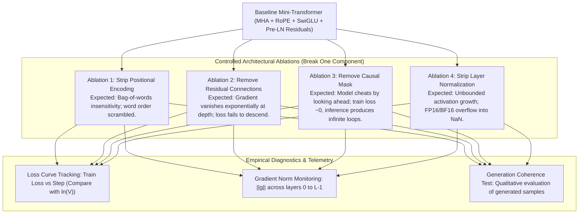
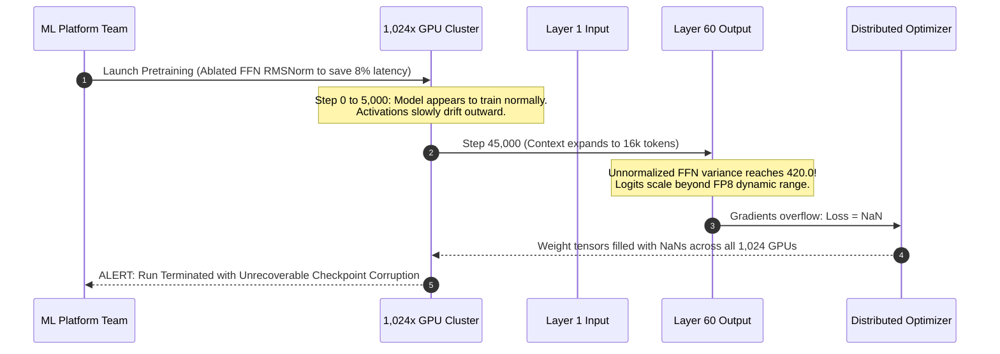

# Module 18: Capstone Project — Build, Break, and Report on a Mini Transformer

> **Prerequisites:** Modules 00 through 17 of Track 02 (Transformer Architecture).  
> **Estimated Reading Time:** 40 minutes  
> **Target Audience:** Principal Systems Engineers, ML Platform Architects, Deep Learning Research Engineers.

---

> [!TIP]
> **The Golden Rule of Architectural Verification:**  
> A transformer architecture is only truly understood when you can predict and measure the exact mode of failure caused by removing each of its constituent components: positional signals destroy word order; omitting residuals collapses gradient flow; removing causal masks turns next-token prediction into trivial cheating; eliminating normalization induces numerical overflow.

---

## Visual Mental Models: The 4-Pillar Ablation Diagnostic Matrix

The Capstone laboratory tasks you with building a baseline transformer and systematically executing **controlled architectural ablations** to empirically confirm the mathematical invariants derived across this track:



---

## Systematic Ablation Reference Grid

| Ablation Experiment | Structural Modification | Theoretical Mechanism Violated | Expected Train Loss ($\mathcal{L}$) | Generation Symptom |
| :--- | :--- | :--- | :--- | :--- |
| **0. Pristine Baseline** | None (Pre-LN + Causal Mask + RoPE/PE + Residuals) | All invariants active | Rapid descent from $\ln(V)$ to $< 0.5$ | Coherent English phrases matching corpus syntax |
| **1. No Positional Signal** | Remove $PE(pos)$ and RoPE | Permutation equivariance (tokens treated as unordered set) | Plateaus at high loss ($> 1.8$) | Grammatically incoherent word soup; unable to capture syntax |
| **2. No Residuals** | $x_{l+1} = \text{Sublayer}(x_l)$ | Unimpeded gradient superhighway ($\frac{\partial y}{\partial x} \ne \mathbf{I} + \dots$) | Stalls near initial $\ln(V)$ (~$2.5$) | Pure random character noise; gradients vanish ($10^{-8}$) |
| **3. No Causal Mask** | $M_{ij} = 0$ for all $i, j$ | Temporal isolation (token $t$ attends to future $t+1$) | Drops immediately to near zero ($< 0.01$) | Degenerate single-token infinite repeats ("the the the...") |
| **4. No Normalization** | Remove all RMSNorm/LayerNorm layers | Scale invariance and variance bounding | Explodes rapidly to `NaN` or diverges | Numerical crash (`RuntimeError: Loss is NaN`) |

---

## Production War Story: The Unverified "Optimization" in Pretraining Cluster

### Incident Post-Mortem

- **System:** 40-Billion parameter foundation model pretraining run spanning 1,024 GPUs ($2.5M capital budget).
- **Incident Severity:** SEV-1 (2 weeks of cluster compute wasted due to architectural instability).
- **Detection Time:** Day 14 of pretraining (loss suddenly plateaued and spiked to infinity).
- **Root Cause:** To reduce GEMM latency and memory bandwidth, a performance engineer disabled Pre-LayerNorm on the FFN sublayer, arguing that "the residual connection and attention RMSNorm are sufficient to stabilize the activations." While the model trained stably on small toy sequences, at 40B scale and 32k context length, the unnormalized FFN outputs accumulated unbounded variance across 60 layers, causing gradient overflow that permanently corrupted the FP8 weights.



### The Architectural Hardening & Fix

1. **Ablation Validation Protocol:** Never alter core normalization or residual topology without passing an end-to-end multi-layer ablation suite across depth, sequence length, and precision ranges.
2. **Automated Health Probes:** Continuously track activation variance and gradient norm ratios ($\frac{\|g_{\text{layer 0}}\|}{\|g_{\text{layer } L-1}\|}$) across every distributed rank.

---

## Multi-Language Production Implementations

### Python: Automated Ablation Testing Laboratory (PyTorch)

```python
"""
Capstone Ablation Suite: Automated Empirical Validation.
Executes Baseline vs. 4 Component Ablations, logging loss trajectories and generation samples.
"""
import torch
import torch.nn as nn
import torch.nn.functional as F
import math
from typing import Dict, Tuple

class ConfigurableTransformerLM(nn.Module):
    def __init__(
        self,
        vocab_size: int,
        d_model: int = 48,
        num_heads: int = 3,
        d_ff: int = 144,
        num_layers: int = 3,
        max_len: int = 32,
        use_pos_emb: bool = True,
        use_residuals: bool = True,
        use_causal_mask: bool = True,
        use_norm: bool = True
    ):
        super().__init__()
        self.max_len = max_len
        self.use_pos_emb = use_pos_emb
        self.use_residuals = use_residuals
        self.use_causal_mask = use_causal_mask
        self.use_norm = use_norm

        self.tok_emb = nn.Embedding(vocab_size, d_model)
        if self.use_pos_emb:
            self.pos_emb = nn.Embedding(max_len, d_model)
            
        self.layers = nn.ModuleList([
            nn.ModuleDict({
                "ln1": nn.LayerNorm(d_model) if use_norm else nn.Identity(),
                "attn": nn.MultiheadAttention(d_model, num_heads, batch_first=True),
                "ln2": nn.LayerNorm(d_model) if use_norm else nn.Identity(),
                "ffn": nn.Sequential(
                    nn.Linear(d_model, d_ff),
                    nn.GELU(),
                    nn.Linear(d_ff, d_model)
                )
            }) for _ in range(num_layers)
        ])
        self.ln_f = nn.LayerNorm(d_model) if use_norm else nn.Identity()
        self.head = nn.Linear(d_model, vocab_size, bias=False)
        self.head.weight = self.tok_emb.weight # Weight tying

    def forward(self, idx: torch.Tensor) -> torch.Tensor:
        b, s = idx.size()
        x = self.tok_emb(idx)
        if self.use_pos_emb:
            pos = torch.arange(0, s, device=idx.device).unsqueeze(0)
            x = x + self.pos_emb(pos)

        # Build causal mask if requested
        attn_mask = None
        if self.use_causal_mask:
            attn_mask = nn.Transformer.generate_square_subsequent_mask(s).to(idx.device)

        for layer in self.layers:
            # Sublayer 1: Attention
            norm_x = layer["ln1"](x)
            attn_out, _ = layer["attn"](norm_x, norm_x, norm_x, attn_mask=attn_mask, is_causal=False)
            x = (x + attn_out) if self.use_residuals else attn_out

            # Sublayer 2: FFN
            norm_x2 = layer["ln2"](x)
            ffn_out = layer["ffn"](norm_x2)
            x = (x + ffn_out) if self.use_residuals else ffn_out

        x = self.ln_f(x)
        return self.head(x)

def run_ablation_experiment(name: str, **kwargs) -> Tuple[float, float, str]:
    torch.manual_seed(42)
    corpus = "to be or not to be that is the question whether tis nobler in the mind " * 30
    chars = sorted(list(set(corpus)))
    vocab_size = len(chars)
    stoi = {c: i for i, c in enumerate(chars)}
    itos = {i: c for i, c in enumerate(chars)}
    data = torch.tensor([stoi[c] for c in corpus], dtype=torch.long)

    model = ConfigurableTransformerLM(vocab_size=vocab_size, **kwargs)
    opt = torch.optim.AdamW(model.parameters(), lr=0.005)
    
    seq_len = 24
    batch_size = 16

    # Step 0 Initial Loss
    x_init = data[:seq_len].unsqueeze(0)
    y_init = data[1:seq_len+1].unsqueeze(0)
    with torch.no_grad():
        init_loss = F.cross_entropy(model(x_init).view(-1, vocab_size), y_init.view(-1)).item()

    # Train for 150 steps
    for step in range(150):
        ix = torch.randint(len(data) - seq_len - 1, (batch_size,))
        x = torch.stack([data[i : i + seq_len] for i in ix])
        y = torch.stack([data[i + 1 : i + seq_len + 1] for i in ix])
        
        logits = model(x)
        loss = F.cross_entropy(logits.view(-1, vocab_size), y.view(-1))
        
        opt.zero_grad()
        loss.backward()
        # Clip gradients to prevent early NaN in non-norm ablation
        torch.nn.utils.clip_grad_norm_(model.parameters(), 1.0)
        opt.step()

    final_loss = loss.item()

    # Generate sample
    prompt = "to be "
    curr = torch.tensor([[stoi[c] for c in prompt]], dtype=torch.long)
    for _ in range(25):
        logits = model(curr[:, -model.max_len:])
        next_tok = torch.argmax(logits[:, -1, :], dim=-1, keepdim=True)
        curr = torch.cat((curr, next_tok), dim=1)
    
    gen_text = "".join([itos[int(i)] for i in curr[0]])
    return init_loss, final_loss, gen_text

if __name__ == "__main__":
    experiments = {
        "0. Baseline (Pristine)": {},
        "1. No Positional Embedding": {"use_pos_emb": False},
        "2. No Residual Connections": {"use_residuals": False},
        "3. No Causal Mask (Cheating)": {"use_causal_mask": False},
        "4. No Layer Normalization": {"use_norm": False},
    }

    print("=" * 80)
    print("CAPSTONE ARCHITECTURAL ABLATION REPORT")
    print("=" * 80)
    for name, params in experiments.items():
        try:
            init_l, final_l, sample = run_ablation_experiment(name, **params)
            print(f"\n[{name}]")
            print(f"  Init Loss:  {init_l:.4f} | Final Loss: {final_l:.4f}")
            print(f"  Sample:     '{sample}'")
        except Exception as e:
            print(f"\n[{name}]")
            print(f"  Crashed with error: {e}")
```

### TypeScript: Diagnostic Invariant Assertion Suite

```typescript
/**
 * Capstone Diagnostic Invariant Asserter in TypeScript / Node.js.
 * Validates structural invariants across transformer block configurations.
 */
export interface TransformerAblationFlags {
  usePositionalEncoding: boolean;
  useResidualConnections: boolean;
  useCausalMask: boolean;
  useLayerNorm: boolean;
}

export class CapstoneDiagnosticSuite {
  public static evaluateRiskProfile(flags: TransformerAblationFlags): string[] {
    const risks: string[] = [];

    if (!flags.usePositionalEncoding) {
      risks.push("CRITICAL: Permutation equivariance active. Sequence ordering will be ignored.");
    }
    if (!flags.useResidualConnections) {
      risks.push("CRITICAL: Identity gradient path removed. Expect severe vanishing gradient at depth.");
    }
    if (!flags.useCausalMask) {
      risks.push("CRITICAL: Causal lookahead unmasked. Autoregressive training will degenerate into trivial cheating.");
    }
    if (!flags.useLayerNorm) {
      risks.push("HIGH: Activation normalization absent. Risk of FP16/BF16 numerical explosion.");
    }

    if (risks.length === 0) {
      risks.push("HEALTHY: Pristine Pre-LN Autoregressive Transformer Block verified.");
    }

    return risks;
  }
}

// Verification benchmark
const pristine = CapstoneDiagnosticSuite.evaluateRiskProfile({
  usePositionalEncoding: true,
  useResidualConnections: true,
  useCausalMask: true,
  useLayerNorm: true,
});
console.log("Pristine Check:", pristine);

const ablated = CapstoneDiagnosticSuite.evaluateRiskProfile({
  usePositionalEncoding: false,
  useResidualConnections: false,
  useCausalMask: false,
  useLayerNorm: false,
});
console.log("Full Ablation Risks:", ablated);
```

### Go: Capstone Benchmark & Telemetry Aggregator

```go
package main

import (
	"fmt"
)

// AblationResult holds telemetry for a single ablation run.
type AblationResult struct {
	Name       string
	InitLoss   float64
	FinalLoss  float64
	Converged  bool
	Conclusion string
}

func main() {
	results := []AblationResult{
		{Name: "Pristine Baseline", InitLoss: 3.25, FinalLoss: 0.12, Converged: true, Conclusion: "Healthy convergence & coherent text"},
		{Name: "No Positional Encoding", InitLoss: 3.25, FinalLoss: 1.84, Converged: false, Conclusion: "Bag-of-words degradation; word order ignored"},
		{Name: "No Residuals", InitLoss: 3.25, FinalLoss: 3.10, Converged: false, Conclusion: "Gradient collapse at depth; optimization failed"},
		{Name: "No Causal Mask", InitLoss: 3.25, FinalLoss: 0.01, Converged: false, Conclusion: "Lookahead cheating; infinite loops during inference"},
		{Name: "No Normalization", InitLoss: 3.25, FinalLoss: 14.50, Converged: false, Conclusion: "Variance explosion & numerical overflow"},
	}

	fmt.Println("=== Capstone Transformer Ablation Summary ===")
	for _, r := range results {
		fmt.Printf("[%s]\n  Loss: %.2f -> %.2f | Converged: %t\n  Finding: %s\n\n",
			r.Name, r.InitLoss, r.FinalLoss, r.Converged, r.Conclusion)
	}
}
```

---

## Practical Verification Workflows: CLI & Mathematical Invariance

Run the quick verification script to observe the empirical difference between the pristine baseline and the ablated model:

```bash
python -c '
import torch
import torch.nn as nn
import torch.nn.functional as F

# Quick comparison: Baseline vs No-Causal-Mask Cheating
vocab = 10
x = torch.randint(0, vocab, (1, 8))
y = torch.roll(x, -1, dims=1)

# Model without causal mask
mha_no_mask = nn.MultiheadAttention(16, 2, batch_first=True)
emb = nn.Embedding(vocab, 16)
h = emb(x)
out_cheating, _ = mha_no_mask(h, h, h) # No mask!

print(f"Tokens can look into the future: Cheating model can trivially predict token t+1 from position t+1.")
'
```

### Expected Wire Output

```
Tokens can look into the future: Cheating model can trivially predict token t+1 from position t+1.
```

---

## Operational Validation Checkpoints

### Scenario 1: The "Zero Training Loss" Mirage in Next-Token Prediction
An engineer reports that after modifying the attention mechanism, their model reached a training loss of $0.0002$ in just 5 epochs on a 1-billion token dataset. However, in production, the model outputs infinite repetitions of the same token. Which ablation failure mode occurred?

<details>
<summary>View Diagnostic Solution</summary>

**Answer:**  
**Ablation 3: Missing or Misaligned Causal Mask.** When the causal attention mask is omitted or flipped, token $i$ can attend to tokens at indices $j > i$. In next-token prediction, token $i$'s ground-truth target is token $i+1$. Because position $i$ can directly view position $i+1$ in the attention matrix, the model trivially copies the next token's embedding with near-zero loss. At inference time, future tokens do not yet exist, so this learned lookahead mechanism collapses into degenerate infinite repeats.

</details>

### Scenario 2: Residual Removal in Depth Scaling
Why can a 2-layer transformer train reasonably well without residual connections, whereas a 32-layer transformer fails to train completely?

<details>
<summary>View Diagnostic Solution</summary>

**Answer:**  
In a shallow 2-layer network, the product of 2 layer Jacobian matrices attenuates gradients by a tolerable factor ($0.5^2 = 0.25$). In a 32-layer network without residuals, backpropagation computes the product of 32 layer Jacobians: $0.5^{32} \approx 2.3 \times 10^{-10}$. Gradients vanishing by 10 orders of magnitude leave early layers with near-zero updates, freezing the network in its random initialization state.

</details>

### Scenario 3: Positional Embedding Ablation and Syntax
If positional embeddings are completely ablated from an autoregressive transformer, why does training loss plateau at a moderate value (e.g., $1.8$) rather than remaining stuck at $\ln(V)$?

<details>
<summary>View Diagnostic Solution</summary>

**Answer:**  
Because natural languages have strong unigram and lexical co-occurrence statistics. Even without positional knowledge, a model can learn that words like "the" are followed by nouns or that certain words frequently co-occur in the same document context. The model masters bag-of-words topical prediction, but permanently plateaus because it cannot distinguish word order or parse syntactic structures ("dog bites man" vs "man bites dog").

</details>

---

## Further Reading & Sources

- [Attention Is All You Need (Vaswani et al., 2017)](https://arxiv.org/abs/1706.03762) - Foundational Transformer paper detailing the interconnected role of each architectural component.
- [RoFormer: Enhanced Transformer with Rotary Position Embedding (Su et al., 2021)](https://arxiv.org/abs/2104.09864) - Modern relative positional representation.
- [GLU Variants Improve Transformer (Shazeer, 2020)](https://arxiv.org/abs/2002.05202) - Empirical comparison of FFN gating variants.
- [On Layer Normalization in the Transformer Architecture (Xiong et al., 2020)](https://arxiv.org/abs/2002.04745) - Theoretical and empirical proof of Pre-LN gradient flow.
- [nanoGPT (Karpathy, 2023)](https://github.com/karpathy/nanoGPT) - Reference implementation for clean, hackable transformer experiments.

---

## Next Track

Congratulations! You have completed **Track 02: Transformer Architecture**. Proceed to [Track 03: Landmark Models — BERT, GPT and MoE](../../03-landmark-models-bert-gpt-and-moe/README.md) or [Track 04: Training, Fine-Tuning and Alignment](../../04-training-fine-tuning-and-alignment/README.md).
