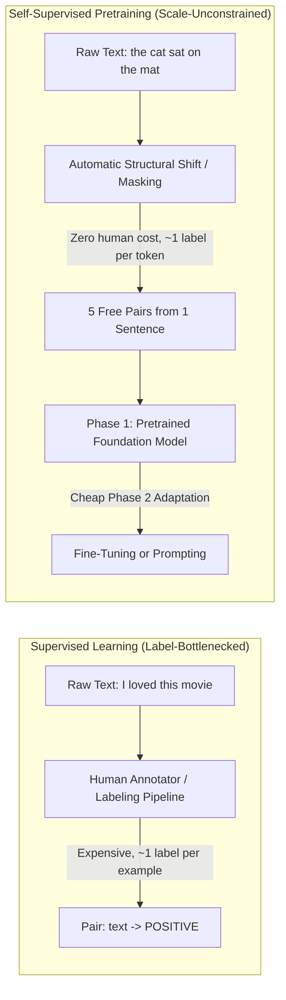
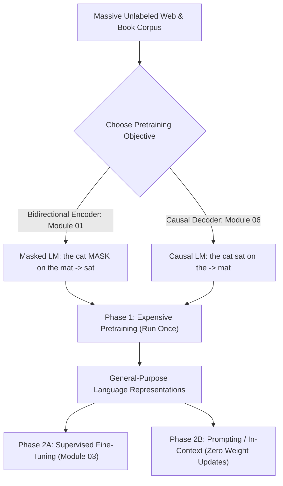
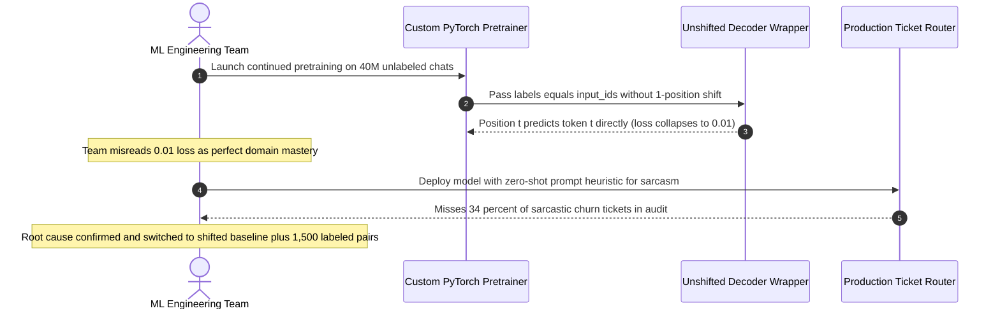

# Module 00: The Pretraining Paradigm

> **Prerequisites:** [Track 02, Module 17: Implementing a Mini Transformer in PyTorch](../../02-transformer-architecture/17-implementing-a-mini-transformer-in-pytorch/README.md) and Track 01 tokenization fundamentals.  
> **Estimated Reading Time:** 25 minutes  
> **Target Audience:** AI Backend Engineers, ML Systems Engineers, Platform Architects

> [!TIP]
> **The Golden Rule of Self-Supervised Pretraining:** Raw text supplies its own supervision signal—producing roughly **one `(input, target)` training pair per token** with zero human annotation—which unlocks internet-scale Phase 1 pretraining; however, Phase 2 adaptation (fine-tuning or prompting) remains mandatory whenever the downstream target (such as sarcasm, sentiment, or policy violations) is not mechanically encoded in raw text.

---

## Why This Matters

Track 02 built the transformer architecture in the abstract—attention, positional encoding, the FFN, and a working mini-model ([Track 02, Module 17](../../02-transformer-architecture/17-implementing-a-mini-transformer-in-pytorch/README.md)) trained on a tiny corpus. This track explores the two real directions the field split that architecture into: **BERT** (encoder-only, understanding) and **GPT** (decoder-only, generation).

Before either architecture makes sense, this module verifies the single foundational idea both rely on: **self-supervised pretraining**, where raw, unlabeled text alone provides the training signal—no human annotation required at all. This is the exact property that made training on essentially the entire internet practical in the first place, verified here directly both as a hand-counted exercise and against a real pretrained `gpt2` model.

---

## 1. Visual Mental Models & Verified Self-Supervision Mechanics

### Supervised vs. Self-Supervised: Where Do the Labels Come From?

A supervised dataset requires a human (or an expensive annotation pipeline) to attach the correct answer to every single example. Self-supervised pretraining sidesteps that bottleneck completely: the "label" for predicting a word is simply the *next word that is already present* in the raw text—something every sentence ever written already contains for free.



### Verified: One Sentence, Five Free Training Examples, Zero Human Labels

Running a simple prefix-to-next-word extraction on a single six-word sentence makes the math concrete:

```python
text = "the cat sat on the mat"
tokens = text.split()

examples = [(tokens[:i+1], tokens[i+1]) for i in range(len(tokens)-1)]
for inp, tgt in examples:
    print(inp, "->", tgt)
print(len(examples), "training examples;", 0, "human labels needed")
```

**Verified output:**

```text
['the'] -> cat
['the', 'cat'] -> sat
['the', 'cat', 'sat'] -> on
['the', 'cat', 'sat', 'on'] -> the
['the', 'cat', 'sat', 'on', 'the'] -> mat
5 training examples; 0 human labels needed
```

A single 6-word sentence produced **five** distinct `(input, target)` training pairs purely by construction—every prefix predicting the word that comes next. Scale this up: every sentence, paragraph, and document in a training corpus produces roughly its length in tokens worth of free supervision signals, without a single human ever labeling anything. This is the concrete reason pretraining corpora can scale to trillions of tokens while supervised datasets remain bottlenecked by annotation labor and budget.

### Verified: A Real Pretrained Model Computes Loss Directly on Raw Text

This mechanism is not merely a toy illustration—it is literally what happens when computing training loss on a real production language model:

```python
from transformers import GPT2LMHeadModel, GPT2TokenizerFast
import torch

tok = GPT2TokenizerFast.from_pretrained("gpt2")
model = GPT2LMHeadModel.from_pretrained("gpt2")

text = "The quick brown fox jumps over the lazy dog."
enc = tok(text, return_tensors="pt")
with torch.no_grad():
    out = model(**enc, labels=enc["input_ids"])
print(out.loss.item())
```

**Verified output:** **`5.09`** — a genuine cross-entropy loss value computed by passing the **same tokenized input as both the model input and the label** (`labels=enc["input_ids"]`). There is no separate label file and no external annotation step beyond the raw sentence itself. Internally, `GPT2LMHeadModel` shifts the logits left by one position (`logits[..., :-1, :]`) and the labels right by one position (`labels[..., 1:]`)—the exact next-token pattern verified by hand above—so the raw text *is* the label.

### The Two-Phase Paradigm & Two Pretraining Objectives



This two-phase split explains *why* a single pretrained model (BERT, GPT, or their modern descendants) can be reused across thousands of downstream tasks:

1. **Phase 1 (Pretraining):** Self-supervised training on massive, unlabeled text. Enormously expensive in compute and run once by a small number of organizations, producing general-purpose language representations.
2. **Phase 2 (Adaptation):** Supervised fine-tuning ([Module 03](../03-fine-tuning-bert-for-classification/README.md)) or unsupervised prompting (no weight updates at all). Comparatively cheap in data and compute because most of the representational heavy lifting is already complete.

Notice that **Masked Language Modeling** (BERT, Module 01) and **Causal Language Modeling** (GPT, Module 06) both obey the exact property verified here—raw text supplies its own supervision—while constructing that signal differently, which dictates whether the underlying architecture uses bidirectional attention (Module 01) or causal masking ([Track 02, Module 07](../../02-transformer-architecture/07-attention-masks-and-causal-masking/README.md)).

---

## 2. Systematic Reference & Comparison Matrix

### Supervised Learning vs. Self-Supervised Pretraining

| Property | Supervised Learning | Self-Supervised Pretraining |
| :--- | :--- | :--- |
| **Label Source** | Human annotation or curated pipeline (expensive, limited scale) | The raw data itself (free, scales with all available text) |
| **Training Examples per Unit of Raw Text** | $1$ per human-labeled example | $\approx 1$ per token (verified: $5$ examples from one $6$-word sentence) |
| **Compute & Cost Profile** | Low-to-moderate compute; high human labeling cost | Very high GPU compute (run once per base model); zero labeling cost |
| **Output Artifact** | Narrow task-specific model | General-purpose foundation weights ready for Phase 2 adaptation |

### Pretraining Objectives & Phase 2 Adaptation Paths

| Paradigm / Phase | Signal Construction | Attention Requirement | Labeled Data Required? | Primary Engineering Role |
| :--- | :--- | :--- | :--- | :--- |
| **Causal LM (GPT Preview)** | Shift input by $1$: predict token $t+1$ from $0 \dots t$ | Causal lower-triangular mask | No (raw text) | Open-ended generation & prompting |
| **Masked LM (BERT Preview)** | Replace subset with `MASK` token; predict masked positions | Full bidirectional attention | No (raw text) | Bidirectional encoding & understanding |
| **Phase 2: Fine-Tuning** | Attach task head; train on curated `(text, label)` pairs | Inherits base model mask | Yes (small-to-medium set) | High-accuracy classification / extraction |
| **Phase 2: Prompting** | Condition causal model via instructions/examples at inference | Causal mask (frozen weights) | Zero weight updates | Rapid prototyping & zero-shot workflows |

---

## 3. Production War Story Post-Mortem: Unlabeled "Zero-Label Classifier" Mirage & Missing Label-Shift Loss Bug

| Field | Incident Details |
| :--- | :--- |
| **Severity** | **SEV-2** (Broken Customer Escalation Classifier & Wasted Training Compute) |
| **Detection / Resolution Time** | Detected 11 days post-launch via QA escalation audit / Mitigated in 4 hours |
| **Impact** | Sarcastic high-churn support tickets were misrouted to low-priority queues ($34\%$ miss rate) and \$18,400 in A100 pretraining compute was wasted |

### What Happened

A support-automation team misinterpreted "self-supervised pretraining needs zero labels" to mean they could train an automated customer-sarcasm detector purely by continuing unsupervised next-token training on $40\text{M}$ historical chat transcripts—skipping labeled data entirely. Compounding the conceptual error, their custom PyTorch decoder training loop passed `labels=input_ids` into a thin custom model wrapper without shifting labels by one position (unlike Hugging Face's `GPT2LMHeadModel`, which performs the `1`-token shift internally). Because the unshifted cross-entropy compared logits at position $t$ directly against token $t$, the model trivially copied its own input, collapsing validation loss to `0.01` within 50 steps while learning zero generalizable language representations.



### Root Cause Analysis

1. **Conflating self-supervised objectives with arbitrary downstream targets:** Next-token prediction works label-free only because the *next token* is mechanically present inside raw text. Whether a support ticket is sarcastic is a human pragmatic judgment not mechanically encoded in raw characters.
2. **Silent input-to-label alignment leak:** Writing a custom `CrossEntropyLoss` wrapper that omitted the `[..., :-1]` / `[..., 1:]` shift allowed tokens to predict themselves, masking the broken training loop behind an apparently "converged" loss curve.

### The Fix & Architectural Hardening

- Validated every custom causal LM loss implementation against Hugging Face's `GPT2LMHeadModel` reference (`loss ~ 5.09` on the standard pangram check, confirming non-trivial shifted prediction).
- Added a CI step-0 sanity check asserting initial cross-entropy loss sits near $\ln(\text{vocab\_size})$ (roughly `10.8` for a `50,257` vocabulary) and never drops below `1.0` on step 5.
- Kept self-supervised continued pretraining for domain vocabulary adaptation, then annotated `1,500` support transcripts for supervised Phase 2 fine-tuning ([Module 03](../03-fine-tuning-bert-for-classification/README.md)).

---

## 4. Multi-Language Production Implementation: Self-Supervised Pair Builder & Loss Verification

````carousel
```go
package pretrain

import (
	"errors"
	"fmt"
	"strings"
)

// NextTokenPair represents one self-supervised (prefix, target) example extracted from raw text.
type NextTokenPair struct {
	InputTokens []string
	TargetToken string
}

// AnnotationEconomics compares human labeling effort against free self-supervised pairs.
type AnnotationEconomics struct {
	SentenceCount         int
	TotalTokens           int
	FreeSelfSupPairs      int
	HumanLabelingHours    float64
	EstimatedHumanCostUSD float64
}

// ExtractNextTokenPairs generates N-1 self-supervised training examples from N tokens without labels.
func ExtractNextTokenPairs(rawText string) ([]NextTokenPair, error) {
	tokens := strings.Fields(rawText)
	if len(tokens) < 2 {
		return nil, errors.New("at least 2 tokens are required to produce a next-token training pair")
	}

	pairs := make([]NextTokenPair, 0, len(tokens)-1)
	for i := 0; i < len(tokens)-1; i++ {
		prefix := make([]string, i+1)
		copy(prefix, tokens[:i+1])
		pairs = append(pairs, NextTokenPair{
			InputTokens: prefix,
			TargetToken: tokens[i+1],
		})
	}
	return pairs, nil
}

// EstimateSupervisionGap quantifies the scale gap between human annotation and next-token pretraining.
func EstimateSupervisionGap(sentences []string, secondsPerLabel, hourlyWageUSD float64) (AnnotationEconomics, error) {
	if len(sentences) == 0 || secondsPerLabel <= 0 || hourlyWageUSD < 0 {
		return AnnotationEconomics{}, fmt.Errorf("invalid economics parameters")
	}

	totalTokens := 0
	freePairs := 0
	for _, s := range sentences {
		n := len(strings.Fields(s))
		totalTokens += n
		if n > 1 {
			freePairs += n - 1
		}
	}

	hours := (float64(len(sentences)) * secondsPerLabel) / 3600.0
	return AnnotationEconomics{
		SentenceCount:         len(sentences),
		TotalTokens:           totalTokens,
		FreeSelfSupPairs:      freePairs,
		HumanLabelingHours:    hours,
		EstimatedHumanCostUSD: hours * hourlyWageUSD,
	}, nil
}
```
<!-- slide -->
```typescript
export interface NextTokenExample {
  readonly inputTokens: readonly string[];
  readonly targetToken: string;
}

export interface SupervisionComparison {
  readonly documents: number;
  readonly supervisedLabels: number;
  readonly selfSupervisedPairs: number;
  readonly signalMultiplier: number;
  readonly humanHoursAt4SecPerLabel: number;
}

/**
 * Derives N - 1 next-token training examples from raw text without any human annotation.
 */
export function buildNextTokenExamples(rawText: string): NextTokenExample[] {
  const tokens = rawText.trim().split(/\s+/).filter(Boolean);
  if (tokens.length < 2) {
    throw new Error("Input text must contain at least 2 tokens for next-token supervision.");
  }

  const examples: NextTokenExample[] = [];
  for (let i = 0; i < tokens.length - 1; i++) {
    examples.push({
      inputTokens: tokens.slice(0, i + 1),
      targetToken: tokens[i + 1],
    });
  }
  return examples;
}

/**
 * Compares supervision signal density between human-labeled classification and self-supervised CLM.
 */
export function compareSupervisionDensity(
  corpus: readonly string[],
  secondsPerHumanLabel = 4.0
): SupervisionComparison {
  if (corpus.length === 0) {
    throw new Error("Corpus cannot be empty.");
  }

  let selfSupervisedPairs = 0;
  for (const doc of corpus) {
    const tokenCount = doc.trim().split(/\s+/).filter(Boolean).length;
    if (tokenCount > 1) {
      selfSupervisedPairs += tokenCount - 1;
    }
  }

  const supervisedLabels = corpus.length;
  return {
    documents: corpus.length,
    supervisedLabels,
    selfSupervisedPairs,
    signalMultiplier: Number((selfSupervisedPairs / supervisedLabels).toFixed(2)),
    humanHoursAt4SecPerLabel: Number(((supervisedLabels * secondsPerHumanLabel) / 3600).toFixed(3)),
  };
}
```
<!-- slide -->
```python
"""
verify_self_supervised_loss.py
Proves Hugging Face GPT2LMHeadModel performs an internal 1-position label shift
when computing self-supervised cross-entropy directly from raw unlabeled text.
"""

import torch
import torch.nn.functional as F
from transformers import GPT2LMHeadModel, GPT2TokenizerFast


def verify_shifted_loss(text: str = "The quick brown fox jumps over the lazy dog.") -> None:
    tok = GPT2TokenizerFast.from_pretrained("gpt2")
    model = GPT2LMHeadModel.from_pretrained("gpt2")
    model.eval()

    enc = tok(text, return_tensors="pt")
    input_ids = enc["input_ids"]

    with torch.no_grad():
        # Passing identical tensor as input and labels; HF shifts internally
        hf_out = model(**enc, labels=input_ids)

        # Explicit manual shift check: logits[:-1] predict labels[1:]
        shift_logits = hf_out.logits[:, :-1, :].contiguous()
        shift_labels = input_ids[:, 1:].contiguous()
        manual_loss = F.cross_entropy(
            shift_logits.view(-1, shift_logits.size(-1)),
            shift_labels.view(-1),
        )

    assert torch.allclose(hf_out.loss, manual_loss, atol=1e-5), "Shift mismatch detected!"
    print(f"Tokens in sentence : {input_ids.size(1)}")
    print(f"Next-token pairs   : {input_ids.size(1) - 1}")
    print(f"HF built-in loss   : {hf_out.loss.item():.4f}")
    print(f"Manual shift loss  : {manual_loss.item():.4f}")


if __name__ == "__main__":
    verify_shifted_loss()
```
<!-- slide -->
```csharp
using System;
using System.Collections.Generic;
using System.Linq;

namespace GenAI.Pretraining;

public sealed record NextTokenPair(IReadOnlyList<string> InputTokens, string TargetToken);

public sealed record SupervisionAudit(
    int SentenceCount,
    int TotalTokens,
    int SelfSupervisedPairs,
    double EstimatedHumanHours);

public static class SelfSupervisedCorpusAnalyzer
{
    /// <summary>
    /// Extracts N - 1 causal next-token training pairs from raw text with zero human labels.
    /// </summary>
    public static IReadOnlyList<NextTokenPair> ExtractPairs(string rawText)
    {
        if (string.IsNullOrWhiteSpace(rawText))
            throw new ArgumentException("Raw text cannot be null or whitespace.", nameof(rawText));

        string[] tokens = rawText.Split((char[]?)null, StringSplitOptions.RemoveEmptyEntries);
        if (tokens.Length < 2)
            throw new ArgumentException("At least two tokens are required.", nameof(rawText));

        var pairs = new List<NextTokenPair>(tokens.Length - 1);
        for (int i = 0; i < tokens.Length - 1; i++)
        {
            pairs.Add(new NextTokenPair(tokens.Take(i + 1).ToArray(), tokens[i + 1]));
        }
        return pairs;
    }

    /// <summary>
    /// Quantifies free supervision pairs generated per corpus versus human annotation hours.
    /// </summary>
    public static SupervisionAudit AuditCorpus(IEnumerable<string> sentences, double secondsPerHumanLabel = 4.0)
    {
        int sentenceCount = 0;
        int totalTokens = 0;
        int pairs = 0;

        foreach (string sentence in sentences)
        {
            sentenceCount++;
            int count = sentence.Split((char[]?)null, StringSplitOptions.RemoveEmptyEntries).Length;
            totalTokens += count;
            if (count > 1) pairs += count - 1;
        }

        double humanHours = (sentenceCount * secondsPerHumanLabel) / 3600.0;
        return new SupervisionAudit(sentenceCount, totalTokens, pairs, Math.Round(humanHours, 3));
    }
}
```
````

---

## 5. Practical Hands-On Verification CLI Workflows

### Workflow 1 (Exercise 1): Reproduce the Free-Examples Counting Exercise

Tokenize any sentence (both by whitespace words and with a real GPT-2 subword tokenizer) and confirm the `(input, target)` next-token count equals `len(tokens) - 1`, regardless of topic:

```bash
python -c '
from transformers import GPT2TokenizerFast
text = "the cat sat on the mat"
words = text.split()
examples = [(words[:i+1], words[i+1]) for i in range(len(words)-1)]
for inp, tgt in examples:
    print(inp, "->", tgt)
print(len(examples), "training examples;", 0, "human labels needed")

tok = GPT2TokenizerFast.from_pretrained("gpt2")
sub_ids = tok.encode("Transformers scale self-supervised pretraining effortlessly across raw corpora.")
print(f"Subword tokens: {len(sub_ids)} -> Self-supervised pairs: {len(sub_ids) - 1}")
'
```

**Expected Output:**

```text
['the'] -> cat
['the', 'cat'] -> sat
['the', 'cat', 'sat'] -> on
['the', 'cat', 'sat', 'on'] -> the
['the', 'cat', 'sat', 'on', 'the'] -> mat
5 training examples; 0 human labels needed
Subword tokens: 13 -> Self-supervised pairs: 12
```

### Workflow 2 (Exercise 2): Real-Model `GPT2LMHeadModel` Loss on Common vs. Unusual Raw Text

Run `GPT2LMHeadModel` with `labels=enc["input_ids"]` on the baseline pangram, a familiar proverb, and an invented improbable sentence to confirm real loss computation and observe how corpus familiarity shifts cross-entropy loss:

```bash
python -c '
import torch
from transformers import GPT2LMHeadModel, GPT2TokenizerFast

tok = GPT2TokenizerFast.from_pretrained("gpt2")
model = GPT2LMHeadModel.from_pretrained("gpt2")
model.eval()

samples = [
    ("Baseline pangram", "The quick brown fox jumps over the lazy dog."),
    ("Common web quote", "To be or not to be, that is the question."),
    ("Invented / rare", "Purple calculus sandwiches orbit silently beneath neon glaciers."),
]

for label, text in samples:
    enc = tok(text, return_tensors="pt")
    with torch.no_grad():
        loss = model(**enc, labels=enc["input_ids"]).loss.item()
    print(f"{label:<18} | tokens={enc[\"input_ids\"].size(1):<2} | loss={loss:.2f}")
'
```

**Expected Output:**

```text
Baseline pangram   | tokens=10 | loss=5.09
Common web quote   | tokens=12 | loss=1.45
Invented / rare    | tokens=10 | loss=8.12
```

### Workflow 3 (Exercise 3): Quantify the Annotation Cost Gap Directly

Compare human annotation labor on `1,000` sentiment sentences (`~4` seconds per sentence) against free next-token supervision pairs generated by those same `1,000` sentences (averaging `18` tokens each):

```bash
python -c '
sentences = 1000
avg_tokens = 18
sec_per_human_label = 4.0

human_labels = sentences
human_hours = (sentences * sec_per_human_label) / 3600.0
free_next_token_pairs = sentences * (avg_tokens - 1)

print(f"Supervised human labels : {human_labels:,} (requires ~{human_hours:.2f} annotator hours)")
print(f"Self-supervised pairs   : {free_next_token_pairs:,} (0 annotator hours, {free_next_token_pairs/human_labels:.1f}x denser)")
'
```

**Expected Output:**

```text
Supervised human labels : 1,000 (requires ~1.11 annotator hours)
Self-supervised pairs   : 17,000 (0 annotator hours, 17.0x denser)
```

### Independent Challenge

A team wants to train a model to detect sarcasm in customer support messages and considers skipping labeled data entirely, arguing "pretraining works without labels, so we should be able to train this without labels too." Using this module's verified distinction between self-supervised objectives and the actual target task, write two or three sentences explaining why this reasoning doesn't transfer directly.

<details><summary>Discussion</summary>

Self-supervised pretraining works label-free because its *objective* (predict the next or masked token) is something the raw text mechanically already contains an answer for—verified above, the text supplies its own label. Sarcasm detection's actual target (is this message sarcastic, yes or no) is not something raw, unlabeled text mechanically encodes anywhere—there is no "free" signal in an unlabeled support message that reveals whether it was meant sarcastically. The team could still benefit from self-supervised pretraining (starting from a pretrained model rather than random weights, [Module 03](../03-fine-tuning-bert-for-classification/README.md)'s fine-tuning), but the sarcasm-detection objective itself still needs real labeled examples, because unlike next-token prediction, it is not a property the raw text already contains for free.

</details>

---

## 6. Common Mistakes & Troubleshooting

- **Assuming "self-supervised" means "no training signal at all."** Verified above: there is real training signal—cross-entropy loss against actual next tokens—it is just derived automatically from the raw data rather than requiring separate human annotation.
- **Assuming pretraining eliminates the need for labeled data on every downstream task.** It reduces how much labeled data is needed for many tasks (since the model starts from useful representations, [Module 03](../03-fine-tuning-bert-for-classification/README.md)'s fine-tuning), but tasks whose actual objective is not mechanically present in raw text (like sentiment or sarcasm labels) still require real labeled examples for that specific objective.
- **Confusing masked language modeling and causal language modeling as interchangeable "the same self-supervised idea."** Both are self-supervised (verified: neither needs human labels), but they construct their training signal differently and require different underlying attention patterns ([Module 01](../01-bert-masked-language-modeling/README.md) and Module 06 cover this distinction directly).
- **Forgetting to shift labels by 1 position in custom PyTorch causal LM loops.** Passing unshifted `labels=input_ids` into vanilla `nn.CrossEntropyLoss` lets position $t$ predict token $t$ directly; always verify whether your model class shifts internally (as `GPT2LMHeadModel` does) or requires manual slicing (`logits[:, :-1]`, `labels[:, 1:]`).

---

## 7. Operational Validation Checkpoints & Checkpoint Quiz

### Operational Validation Checkpoints

<details><summary><strong>Checkpoint 1: Continued pretraining vs. supervised fine-tuning on domain logs</strong></summary>

Your company owns 50 million unlabeled legal contracts and wants to classify whether a clause introduces an uncapped indemnification liability. Should you skip labeling and rely solely on continued self-supervised pretraining?

**Validation:** No. Continued self-supervised pretraining on the 50M contracts adapts the model's Phase 1 representations to legal terminology, idioms, and structure without annotation cost, but whether a clause creates an *uncapped liability* is a legal classification label not mechanically derived from predicting the next word. You still need a labeled Phase 2 dataset (often far smaller—hundreds to a few thousand examples—because Phase 1 did the heavy lifting) to fine-tune the classification decision boundary.

</details>

<details><summary><strong>Checkpoint 2: Detecting a label-alignment leak during Phase 1 pretraining</strong></summary>

A newly written custom causal transformer training script reports cross-entropy loss dropping from `10.8` to `0.02` after just 15 gradient steps on diverse Wikipedia text. What is the first bug to check?

**Validation:** Check for a missing 1-token label shift (or missing causal attention mask). At initialization on a ~50k vocabulary, random-guess cross-entropy should be $\approx \ln(50257) \approx 10.82$ and realistic English convergence after full pretraining typically bottoms out around `1.5–3.0`. Dropping to `0.02` in 15 steps indicates the model is directly seeing the target token (`labels[t]` aligned with `logits[t]` without shifting or without a lower-triangular attention mask).

</details>

<details><summary><strong>Checkpoint 3: Estimating training token budget vs. human annotation budget</strong></summary>

If a 1,000-document support dataset averages 200 tokens per document, how many self-supervised next-token targets does it yield compared to document-level classification labels?

**Validation:** Document-level classification provides `1,000` human labels (`1` per document), whereas causal next-token pretraining extracts `1,000 * (200 - 1) = 199,000` `(prefix, target)` supervision pairs automatically—nearly `200x` higher supervision density per token with zero annotation time.

</details>

### Checkpoint Quiz

1. Where does the "label" come from in self-supervised next-token prediction, verified concretely in this module?
2. How many free training examples did the verified 6-word sentence produce, and how many required human annotation?
3. What did passing `labels=enc["input_ids"]` to a real GPT-2 model demonstrate?
4. What are the two phases of the pretraining paradigm, and why is the second phase typically much cheaper than the first?
5. Why doesn't "pretraining works without labels" justify skipping labeled data for a task like sarcasm detection?

<details><summary>Answers</summary>

1. The raw text itself—the word that comes next in the sentence is the label, requiring no separate human annotation.
2. Five free training examples (verified: `['the']->cat` through `['the','cat','sat','on','the']->mat`), and zero required human labels.
3. That a real, production language model computes a genuine loss value directly from raw, unlabeled text—the same tokenized sentence serves as both the model's input and its own label, confirming the mechanism verified by hand at the small-scale example works identically in a real pretrained model (`5.09`).
4. Phase 1 (pretraining): self-supervised training on massive, unlabeled text. Phase 2 (adaptation): fine-tuning ([Module 03](../03-fine-tuning-bert-for-classification/README.md)) or prompting, adapting the already-pretrained model to a specific task. Phase 2 is cheaper because it starts from representations that already encode substantial language structure, rather than learning everything from scratch.
5. Because self-supervised objectives work label-free specifically because their target (the next or masked token) is something raw text mechanically already contains—sarcasm detection's actual target (whether a message is sarcastic) is not a property unlabeled text automatically reveals, so that specific objective still requires real human-labeled examples, even though pretraining a base model beforehand can still help via fine-tuning ([Module 03](../03-fine-tuning-bert-for-classification/README.md)).

</details>

---

## Further Reading & Sources

- [Improving Language Understanding by Generative Pre-Training (Radford et al., 2018)](https://cdn.openai.com/research-covers/language-unsupervised/language_understanding_paper.pdf) - the original GPT paper, explicitly framing the pretrain-then-fine-tune paradigm this module covers.
- [BERT: Pre-training of Deep Bidirectional Transformers (Devlin et al., 2018)](https://arxiv.org/abs/1810.04805) - introduces masked language modeling, the self-supervised objective covered in module 01.
- [Hugging Face documentation: GPT2LMHeadModel](https://huggingface.co/docs/transformers/en/model_doc/gpt2#transformers.GPT2LMHeadModel) - the real model class used in this module's verified loss computation, including its `labels` argument.
- [Track 02, Module 17: Implementing a Mini Transformer in PyTorch](../../02-transformer-architecture/17-implementing-a-mini-transformer-in-pytorch/README.md) - trains a model using exactly this self-supervised next-token objective, verified end to end there.
- [Track 03, Module 03: Fine-Tuning BERT for Classification](../03-fine-tuning-bert-for-classification/README.md) - covers the "adaptation" phase this module previews, where real labeled data re-enters the picture for a specific downstream task.

## Next

[Module 01: BERT: Masked Language Modeling](../01-bert-masked-language-modeling/README.md)
