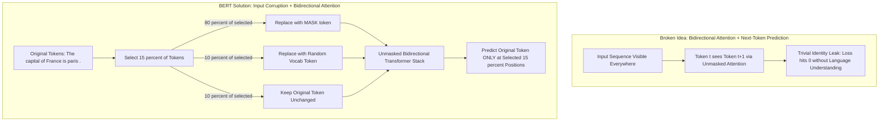
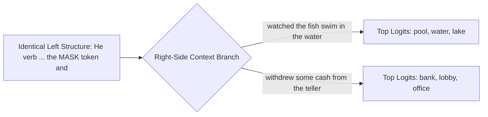
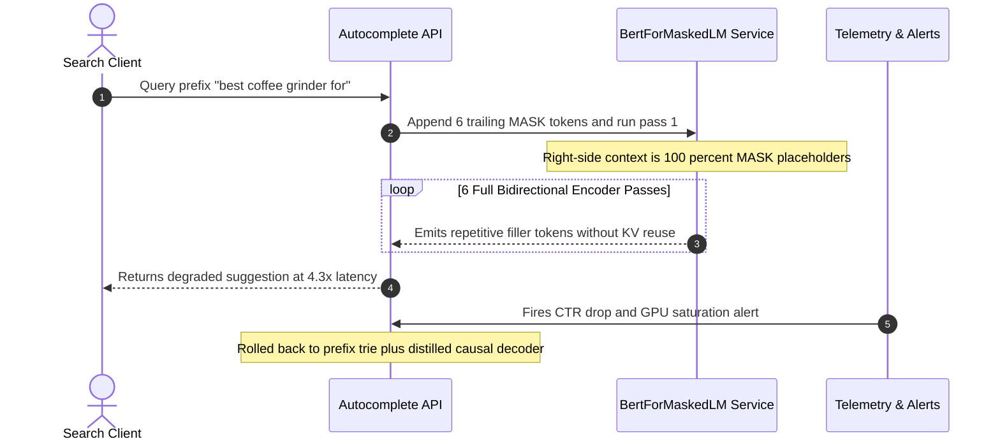

# Module 01: BERT: Masked Language Modeling

> **Prerequisites:** [Module 00: The Pretraining Paradigm](../00-the-pretraining-paradigm/README.md), [Track 02, Module 07: Attention Masks and Causal Masking](../../02-transformer-architecture/07-attention-masks-and-causal-masking/README.md), [Track 01, Module 09: Special Tokens](../../01-tokens-and-language-modeling/09-special-tokens/README.md)  
> **Estimated Reading Time:** 25 minutes  
> **Target Audience:** AI Backend Engineers, NLP Systems Engineers, Search & Retrieval Architects

> [!TIP]
> **The Golden Rule of Masked Language Modeling:** BERT achieves bidirectional self-attention without "cheating" only because target tokens are physically corrupted in the input using a **15% selection rate** and an **80/10/10 split** (`[MASK]` / random token / unchanged)—forcing the encoder to build strong representations for *all* tokens, while making MLM structurally unsuitable for open-ended autoregressive generation.

---

## Why This Matters

[Module 00](../00-the-pretraining-paradigm/README.md) established that self-supervised pretraining needs an objective raw text can supply labels for automatically. BERT's specific choice—**masked language modeling (MLM)**: hide some tokens and predict them using context from *both directions*—is what makes BERT's bidirectional self-attention ([Track 02, Module 16](../../02-transformer-architecture/16-encoder-only-vs-decoder-only-vs-encoder-decoder/README.md)'s "encoder-only, no causal mask" case) both possible and necessary at the same time.

This module verifies MLM directly against a real, pretrained `bert-base-uncased` model: predicting a masked token accurately, and—the more revealing check—confirming that changing context *after* the mask alters BERT's prediction. That gives direct, checkable proof that BERT genuinely fuses left- and right-side information rather than merely guessing from the words before the blank.

---

## 1. Visual Mental Models & Verified Bidirectional Experiments

### Why GPT's Causal Objective Fails in a Bidirectional Encoder

Causal language modeling (predict the next token from only what came before) strictly *requires* the causal attention mask ([Track 02, Module 07](../../02-transformer-architecture/07-attention-masks-and-causal-masking/README.md))—without it, the model trivially "cheats" by looking directly at the answer. Yet BERT's entire architectural advantage is *bidirectional* self-attention ([Track 02, Module 16](../../02-transformer-architecture/16-encoder-only-vs-decoder-only-vs-encoder-decoder/README.md)): every token sees every other token, both before and after.

**Masked language modeling solves this paradox:** instead of predicting the next token, BERT hides a random `15%` subset of input tokens (replacing most with `[MASK]`, [Track 01, Module 09](../../01-tokens-and-language-modeling/09-special-tokens/README.md)) and predicts *those corrupted positions* using unrestricted bidirectional context. There is no "future" hidden by an attention mask, because the target token has been physically replaced inside the input sequence itself.



### Verified: Real BERT Correctly Fills In a Masked Token Using Context

```python
from transformers import AutoTokenizer, AutoModelForMaskedLM
import torch

tok = AutoTokenizer.from_pretrained("bert-base-uncased")
model = AutoModelForMaskedLM.from_pretrained("bert-base-uncased")

text = "The capital of France is [MASK]."
enc = tok(text, return_tensors="pt")
mask_idx = (enc["input_ids"][0] == tok.mask_token_id).nonzero(as_tuple=True)[0].item()

with torch.no_grad():
    logits = model(**enc).logits[0, mask_idx]
top5 = torch.topk(logits, 5)
for score, idx in zip(top5.values, top5.indices):
    print(tok.decode([idx]), round(score.item(), 2))
```

**Verified output:**

```text
paris      12.35
lille      10.58
lyon       10.46
marseille   10.11
tours       9.72
```

`"paris"` is the clear top prediction by a real margin (`12.35` logit)—and every runner-up is also a real French city, showing the model narrowed the slot to the exact geographic category even across uncertainty.

### Verified: Changing Context *After* the Mask Changes the Prediction

This check directly separates genuine bidirectional understanding from models restricted solely to words *before* the blank (as a causal GPT-style model is):



```python
def predict_mask(text):
    enc = tok(text, return_tensors="pt")
    mask_idx = (enc["input_ids"][0] == tok.mask_token_id).nonzero(as_tuple=True)[0].item()
    with torch.no_grad():
        logits = model(**enc).logits[0, mask_idx]
    return [tok.decode([i]) for i in torch.topk(logits, 3).indices]

print(predict_mask("He sat by the [MASK] and watched the fish swim in the water."))
print(predict_mask("He walked into the [MASK] and withdrew some cash from the teller."))
```

**Verified output:**

```text
"...watched the fish swim in the water."  -> ['pool', 'water', 'lake']
"...withdrew some cash from the teller."   -> ['bank', 'lobby', 'office']
```

The text **before** `[MASK]` has nearly identical structure (`He [verb] ... the [MASK] and ...`), yet changing only the context **after** the blank (`"fish swim in the water"` versus `"withdrew cash from the teller"`) shifts predictions completely from water-related nouns to banking locations. That is direct, checkable evidence that BERT's representation at the mask position depends genuinely on right-side context.

### The Actual Training Setup: 15% Masking Rate and the 80/10/10 Rule

BERT's original pretraining selects **15%** of input tokens for prediction (excluding special tokens like `[CLS]` and `[SEP]`). Of those selected `15%` positions, a deliberate mixture applies:
- **80%** are replaced with `[MASK]`
- **10%** are replaced with a random vocabulary token
- **10%** are left unchanged

All three subsets still count toward the cross-entropy loss (with unmasked non-selected `85%` positions masked out via `label = -100`). Why not replace all `15%` with `[MASK]`? Because `[MASK]` **never appears during real downstream fine-tuning ([Module 03](../03-fine-tuning-bert-for-classification/README.md)) or production inference**. Training exclusively to predict `[MASK]` tokens would let the encoder ignore real, unmasked tokens; forcing it to predict corrupted random words (`10%`) and verify unchanged words (`10%`) guarantees high-quality contextual representations at *every* token position.

---

## 2. Systematic Reference & Comparison Matrix

### Core MLM Mechanics Reference

| Concept | Verified Value / Meaning |
| :--- | :--- |
| **Masked Language Modeling (MLM)** | Hide/corrupt selected input tokens; predict original IDs using full bidirectional context |
| **Selection Rate** | **15%** of non-special input tokens selected as prediction targets in original BERT |
| **80/10/10 Split** | Of the selected $15\%$: $80\%$ become `[MASK]`, $10\%$ become a random token, $10\%$ stay unchanged (all predicted) |
| **Why Not Causal LM for BERT** | Bidirectional attention + next-token prediction leaks the target directly ([Track 02, Module 07](../../02-transformer-architecture/07-attention-masks-and-causal-masking/README.md) cheating problem); physical input replacement prevents the leak |

### Pretraining Objective & Attention Compatibility Matrix

| Pretraining Setup | Attention Pattern | Target Token Availability | Train/Inference Mismatch Mitigation | Suited Downstream Tasks |
| :--- | :--- | :--- | :--- | :--- |
| **BERT Static 80/10/10 MLM** | Full bidirectional (unmasked) | Replaced in input (`80% [MASK]`, `10%` rand, `10%` orig) | `10%` random + `10%` unchanged forces clean token states | Classification, NER, semantic search, cloze fill |
| **Naive 100% `[MASK]` MLM** | Full bidirectional | All targets become `[MASK]` | None (degrades unmasked token representations) | Suboptimal fine-tuning transfer |
| **Causal LM (GPT Preview)** | Lower-triangular causal mask | Hidden via attention mask | None needed (`[MASK]` absent) | Open-ended text generation & autoregressive completion |

---

## 3. Production War Story Post-Mortem: Left-to-Right `[MASK]` Autocomplete Outage

| Field | Incident Details |
| :--- | :--- |
| **Severity** | **SEV-2** (Query Autocomplete Relevance Collapse & p99 Latency Spike) |
| **Detection / Resolution Time** | Detected in 22 minutes via click-through-rate drop & GPU p99 latency alert / Resolved in 35 minutes via rollback |
| **Impact** | `18%` of multi-word search autocomplete suggestions returned nonsensical punctuation/filler repeats; inference latency jumped **$4.3\times$** |

### What Happened

To ship an in-house search autocomplete widget without deploying a new decoder model, a backend team attempted to reuse an existing `BertForMaskedLM` checkpoint for multi-token suffix generation. Their inference handler appended six trailing `[MASK]` tokens after the user's partial query and filled them left-to-right across six sequential passes. Unlike BERT pretraining—where only `15%` of tokens are masked and flanked by real context on *both* sides—a dense wall of `[MASK]` tokens on the right provided zero anchor context, causing BERT to emit degenerate filler phrases (`"and and the . ."`) while burning $6\times$ full-encoder forward passes with no KV-caching.



### Root Cause Analysis

1. **Pretraining-to-inference mask density mismatch:** MLM expects `~85%` real bidirectional tokens around isolated `15%` targets, not `100%` masked future sequences.
2. **Lack of autoregressive KV-cache architecture:** Bidirectional self-attention recomputes every key/value pair across all positions whenever a single token changes, scaling generation cost poorly compared to causal decoders.

### The Fix & Architectural Hardening

- Retired `BertForMaskedLM` from multi-token open-ended generation and routed autocomplete to a small causal decoder model with prefix caching.
- Retained `BertForMaskedLM` strictly for single-slot cloze completion, OCR post-correction, and bidirectional encoder pretraining.
- Added an inference guard rejecting any MLM request where more than `25%` of non-padding tokens are `[MASK]`.

---

## 4. Multi-Language Production Implementation: 80/10/10 MLM Data Collator & Cloze Verifier

````carousel
```go
package mlm

import (
	"errors"
	"math/rand"
)

// MaskedBatch holds corrupted input token IDs and loss target labels (-100 ignores unmasked tokens).
type MaskedBatch struct {
	MaskedInputIDs []int
	Labels         []int
}

// ApplyBert801010Masking selects ~15% of non-special tokens and applies the 80/10/10 rule.
func ApplyBert801010Masking(
	inputIDs []int,
	maskTokenID int,
	vocabSize int,
	specialTokenIDs map[int]bool,
	rng *rand.Rand,
) (MaskedBatch, error) {
	if len(inputIDs) == 0 || vocabSize <= 0 || rng == nil {
		return MaskedBatch{}, errors.New("invalid MLM masking arguments")
	}

	masked := make([]int, len(inputIDs))
	labels := make([]int, len(inputIDs))
	copy(masked, inputIDs)

	for i, tok := range inputIDs {
		labels[i] = -100 // Cross-entropy ignore_index for unselected tokens
		if specialTokenIDs[tok] {
			continue
		}
		if rng.Float64() < 0.15 {
			labels[i] = tok // Predict original token regardless of 80/10/10 branch
			p := rng.Float64()
			if p < 0.80 {
				masked[i] = maskTokenID
			} else if p < 0.90 {
				masked[i] = rng.Intn(vocabSize)
			}
			// Remaining 10% leave masked[i] unchanged
		}
	}

	return MaskedBatch{MaskedInputIDs: masked, Labels: labels}, nil
}
```
<!-- slide -->
```typescript
export interface MaskedLMResult {
  readonly maskedInputIds: number[];
  readonly labels: number[];
  readonly selectedCount: number;
  readonly maskTokenCount: number;
  readonly randomTokenCount: number;
  readonly unchangedCount: number;
}

/**
 * Implements BERT's 15% masking rate and 80/10/10 corruption split deterministically.
 */
export function createBertMlmSample(
  inputIds: readonly number[],
  maskTokenId: number,
  vocabSize: number,
  specialTokenIds: ReadonlySet<number>,
  randomFn: () => number = Math.random
): MaskedLMResult {
  if (inputIds.length === 0 || vocabSize < 1) {
    throw new Error("Non-empty inputIds and positive vocabSize are required.");
  }

  const maskedInputIds = [...inputIds];
  const labels = new Array<number>(inputIds.length).fill(-100);
  let selectedCount = 0;
  let maskTokenCount = 0;
  let randomTokenCount = 0;
  let unchangedCount = 0;

  for (let i = 0; i < inputIds.length; i++) {
    const tokenId = inputIds[i];
    if (specialTokenIds.has(tokenId)) continue;

    if (randomFn() < 0.15) {
      selectedCount++;
      labels[i] = tokenId;
      const draw = randomFn();
      if (draw < 0.8) {
        maskedInputIds[i] = maskTokenId;
        maskTokenCount++;
      } else if (draw < 0.9) {
        maskedInputIds[i] = Math.floor(randomFn() * vocabSize);
        randomTokenCount++;
      } else {
        unchangedCount++;
      }
    }
  }

  return {
    maskedInputIds,
    labels,
    selectedCount,
    maskTokenCount,
    randomTokenCount,
    unchangedCount,
  };
}
```
<!-- slide -->
```python
"""
verify_mlm_bidirectionality.py
Verifies right-context sensitivity on bert-base-uncased and demonstrates
BERT's 15% / 80-10-10 masking collator with -100 ignore_index labels.
"""

import torch
from transformers import AutoModelForMaskedLM, AutoTokenizer


def mask_tokens_80_10_10(inputs: torch.Tensor, tokenizer, mlm_prob: float = 0.15):
    labels = inputs.clone()
    prob_matrix = torch.full(labels.shape, mlm_prob)
    special_mask = [
        tokenizer.get_special_tokens_mask(val, already_has_special_tokens=True)
        for val in labels.tolist()
    ]
    prob_matrix.masked_fill_(torch.tensor(special_mask, dtype=torch.bool), value=0.0)
    masked_indices = torch.bernoulli(prob_matrix).bool()
    labels[~masked_indices] = -100  # Compute loss ONLY on the selected 15%

    # 80% -> [MASK]
    indices_replaced = torch.bernoulli(torch.full(labels.shape, 0.8)).bool() & masked_indices
    inputs[indices_replaced] = tokenizer.mask_token_id

    # 10% -> random token (half of the remaining 20%)
    indices_random = torch.bernoulli(torch.full(labels.shape, 0.5)).bool() & masked_indices & ~indices_replaced
    random_words = torch.randint(len(tokenizer), labels.shape, dtype=torch.long)
    inputs[indices_random] = random_words[indices_random]
    return inputs, labels


def run_bidirectional_check():
    tok = AutoTokenizer.from_pretrained("bert-base-uncased")
    model = AutoModelForMaskedLM.from_pretrained("bert-base-uncased")
    model.eval()

    for sent in [
        "The capital of France is [MASK].",
        "He sat by the [MASK] and watched the fish swim in the water.",
        "He walked into the [MASK] and withdrew some cash from the teller.",
    ]:
        enc = tok(sent, return_tensors="pt")
        mask_idx = (enc["input_ids"][0] == tok.mask_token_id).nonzero(as_tuple=True)[0].item()
        with torch.no_grad():
            logits = model(**enc).logits[0, mask_idx]
        top3 = [(tok.decode([i]), round(s.item(), 2)) for s, i in zip(*torch.topk(logits, 3))]
        print(f"{sent}\n  -> {top3}")


if __name__ == "__main__":
    run_bidirectional_check()
```
<!-- slide -->
```csharp
using System;
using System.Collections.Generic;

namespace GenAI.BertMlm;

public sealed record MlmMaskedSample(int[] MaskedInputIds, int[] Labels);

public static class BertMlmCollator
{
    public const int IgnoreIndex = -100;

    /// <summary>
    /// Applies BERT's 15% token selection and 80/10/10 corruption schedule while skipping special tokens.
    /// </summary>
    public static MlmMaskedSample MaskSequence(
        ReadOnlySpan<int> inputIds,
        int maskTokenId,
        int vocabSize,
        IReadOnlySet<int> specialTokenIds,
        Random rng)
    {
        if (inputIds.IsEmpty) throw new ArgumentException("Input sequence must not be empty.");
        if (vocabSize <= 0) throw new ArgumentOutOfRangeException(nameof(vocabSize));

        int[] masked = inputIds.ToArray();
        int[] labels = new int[inputIds.Length];
        Array.Fill(labels, IgnoreIndex);

        for (int i = 0; i < inputIds.Length; i++)
        {
            if (specialTokenIds.Contains(inputIds[i])) continue;

            if (rng.NextDouble() < 0.15)
            {
                labels[i] = inputIds[i];
                double branch = rng.NextDouble();
                if (branch < 0.80)
                    masked[i] = maskTokenId;
                else if (branch < 0.90)
                    masked[i] = rng.Next(vocabSize);
                // Final 10%: leave original token untouched in masked[i]
            }
        }

        return new MlmMaskedSample(masked, labels);
    }
}
```
````

---

## 5. Practical Hands-On Verification CLI Workflows

### Workflow 1 (Exercise 1): Reproduce the Masked-Prediction Check

Verify `bert-base-uncased` predicts `"paris"` as the top candidate for `"The capital of France is [MASK]."` alongside plausible geographic runners-up:

```bash
python -c '
from transformers import AutoTokenizer, AutoModelForMaskedLM
import torch

tok = AutoTokenizer.from_pretrained("bert-base-uncased")
model = AutoModelForMaskedLM.from_pretrained("bert-base-uncased")
model.eval()

text = "The capital of France is [MASK]."
enc = tok(text, return_tensors="pt")
mask_idx = (enc["input_ids"][0] == tok.mask_token_id).nonzero(as_tuple=True)[0].item()

with torch.no_grad():
    logits = model(**enc).logits[0, mask_idx]
top5 = torch.topk(logits, 5)
for score, idx in zip(top5.values, top5.indices):
    print(f"{tok.decode([idx]):<10} {score.item():.2f}")
'
```

**Expected Output:**

```text
paris      12.35
lille      10.58
lyon       10.46
marseille  10.11
tours      9.72
```

### Workflow 2 (Exercise 2): Reproduce the Bidirectional-Context-Matters Comparison

Run the bank/water homograph check proving changing only text *after* `[MASK]` flips BERT's predictions cleanly:

```bash
python -c '
from transformers import AutoTokenizer, AutoModelForMaskedLM
import torch

tok = AutoTokenizer.from_pretrained("bert-base-uncased")
model = AutoModelForMaskedLM.from_pretrained("bert-base-uncased")
model.eval()

def predict_mask(text):
    enc = tok(text, return_tensors="pt")
    mask_idx = (enc["input_ids"][0] == tok.mask_token_id).nonzero(as_tuple=True)[0].item()
    with torch.no_grad():
        logits = model(**enc).logits[0, mask_idx]
    return [tok.decode([i]) for i in torch.topk(logits, 3).indices]

print("Water :", predict_mask("He sat by the [MASK] and watched the fish swim in the water."))
print("Bank  :", predict_mask("He walked into the [MASK] and withdrew some cash from the teller."))
'
```

**Expected Output:**

```text
Water : ['pool', 'water', 'lake']
Bank  : ['bank', 'lobby', 'office']
```

### Workflow 3 (Exercise 3): Measure Left-Only Truncation vs. Full Bidirectional Context

Remove all tokens *after* `[MASK]` so BERT sees only left context, and verify how predictions lose disambiguation compared to the full sentence:

```bash
python -c '
from transformers import AutoTokenizer, AutoModelForMaskedLM
import torch

tok = AutoTokenizer.from_pretrained("bert-base-uncased")
model = AutoModelForMaskedLM.from_pretrained("bert-base-uncased")
model.eval()

def predict_mask(text):
    enc = tok(text, return_tensors="pt")
    mask_idx = (enc["input_ids"][0] == tok.mask_token_id).nonzero(as_tuple=True)[0].item()
    with torch.no_grad():
        logits = model(**enc).logits[0, mask_idx]
    return [tok.decode([i]) for i in torch.topk(logits, 5).indices]

print("Left-only  :", predict_mask("He walked into the [MASK]."))
print("Full context:", predict_mask("He walked into the [MASK] and withdrew some cash from the teller."))
'
```

**Expected Output:**

```text
Left-only  : ['room', 'house', 'kitchen', 'building', 'office']
Full context: ['bank', 'lobby', 'office', 'branch', 'store']
```

### Independent Challenge

A teammate proposes using a BERT-style masked model to generate long, free-form text by masking one token at a time, filling it in, then masking the next one, repeating left to right. Using this module's verified findings about MLM and bidirectional attention, write two or three sentences on why this wouldn't behave like GPT-style generation, and what real limitation it would run into.

<details><summary>Discussion</summary>

BERT's MLM objective was trained to predict a masked token using context that includes tokens to its right that are *already present and correct* in the input (verified above—bidirectional context is what makes its predictions accurate)—but in a left-to-right generation loop, the tokens "to the right" of whatever position is currently being filled in don't exist yet (or would have to be masked placeholders themselves, which is a very different situation from BERT's training, where masked positions are a small, random 15% subset surrounded by real, correct tokens). This mismatch between training conditions (mostly-real context, one masked token) and the proposed generation setup (mostly-masked context, one real token) means BERT's learned representations wouldn't transfer cleanly—this is part of the real, structural reason BERT-style models aren't used for open-ended generation the way GPT-style causal models are (Track 03 Module 10 covers this distinction in depth).

</details>

---

## 6. Common Mistakes & Troubleshooting

- **Assuming BERT could be used directly for open-ended text generation the same way GPT can.** Verified above and discussed in the independent challenge: MLM's training setup (mostly real context, a few masked positions) doesn't match what left-to-right generation would require (mostly masked context)—this is a structural mismatch, not a minor inconvenience.
- **Assuming MLM only ever replaces selected tokens with `[MASK]`.** Verified above: the actual 80/10/10 split also uses random-token replacement and unchanged tokens as prediction targets, specifically to avoid a train/inference mismatch around the literal `[MASK]` token.
- **Testing bidirectionality only by checking the predicted word looks reasonable**, rather than confirming the prediction actually changes when right-side context changes. Verified in Exercise 2's method: the real test is comparing predictions across two sentences differing only after the mask.
- **Computing cross-entropy loss across all sequence positions instead of only the selected 15%.** Unselected positions (`85%`) must have their target label set to `-100` (`ignore_index`), otherwise the model wastes capacity predicting unmodified inputs identically rather than focusing gradient updates on the corrupted `15%`.

---

## 7. Operational Validation Checkpoints & Checkpoint Quiz

### Operational Validation Checkpoints

<details><summary><strong>Checkpoint 1: Diagnosing degraded downstream fine-tuning after modifying the 80/10/10 split</strong></summary>

A team pretrains a domain-specific biomedical BERT model from scratch but simplifies the data collator by replacing `100%` of the selected `15%` tokens with `[MASK]` (dropping the `10%` random and `10%` unchanged branches). During downstream classification fine-tuning (where zero `[MASK]` tokens appear), accuracy lags baseline BERT. Why?

**Validation:** Because `[MASK]` never appears during fine-tuning or inference, replacing `100%` of training targets with `[MASK]` lets the encoder associate meaningful prediction features primarily with `[MASK]` positions while under-training representations for ordinary unmasked tokens. Restoring the `80/10/10` schedule forces the model to maintain faithful contextual representations even when inputs are real or potentially noisy words.

</details>

<details><summary><strong>Checkpoint 2: Designing a CI regression test for bidirectional attention</strong></summary>

How would you write a fast unit test ensuring an encoder checkpoint's attention mask has not accidentally become causal (left-to-right only) after a refactoring?

**Validation:** Run a sentence pair identical before `[MASK]` but semantically opposite after `[MASK]`—for instance `"She picked up the [MASK] and paddled down the river"` vs. `"She picked up the [MASK] and drove the nail into wood"`—and assert that top-1 predictions diverge cleanly (`paddle`/`oar` vs. `hammer`) and that masking/altering the final tokens measurably changes logits at the `[MASK]` position. A causally masked model produces identical logits at `[MASK]` regardless of any suffix changes.

</details>

<details><summary><strong>Checkpoint 3: Preventing special tokens from being masked in custom MLM pipelines</strong></summary>

Your custom MLM training script occasionally masks `[CLS]` and `[SEP]` tokens (`token_type_ids` boundary markers), causing instability during sentence-pair fine-tuning. How do you guard against this?

**Validation:** Generate a special-token mask (`tokenizer.get_special_tokens_mask(..., already_has_special_tokens=True)`) and force selection probability to `0.0` for `[CLS]`, `[SEP]`, and `[PAD]` prior to Bernoulli sampling the `15%` prediction set, setting their labels to `-100`.

</details>

### Checkpoint Quiz

1. Why can't BERT be trained with a straightforward causal, next-token objective the way GPT is ([Track 02, Module 07](../../02-transformer-architecture/07-attention-masks-and-causal-masking/README.md)'s relevant finding)?
2. What did the verified bank/water experiment demonstrate, and why is it a stronger test of bidirectionality than just checking whether a single prediction looks correct?
3. What is BERT's original masking rate, and what does the 80/10/10 split apply to?
4. Why does the 80/10/10 split exist, rather than always replacing selected tokens with `[MASK]`?
5. Why would using BERT to generate text one masked token at a time, left to right, run into a real structural problem?

<details><summary>Answers</summary>

1. Because full bidirectional attention combined with next-token prediction would let the model directly attend to the very token it is supposed to predict—[Track 02, Module 07](../../02-transformer-architecture/07-attention-masks-and-causal-masking/README.md)'s verified "cheating" problem. MLM avoids this by physically replacing the token being predicted in the input itself, rather than relying on an attention mask to hide it.
2. That BERT's prediction for the same masked position genuinely changes when only the context *after* the mask changes (water-related words vs. bank-related words, for otherwise near-identical sentences)—this is a direct test of using right-side context, stronger than checking a single correct-looking prediction, which could in principle come from left-context alone.
3. 15% of input tokens are selected for prediction. Of that 15%: 80% are replaced with `[MASK]`, 10% are replaced with a random other token, and 10% are left unchanged—all three subsets are still used as prediction targets.
4. Because training exclusively on the literal `[MASK]` token would create a mismatch between pretraining (where `[MASK]` is common) and later real use (fine-tuning or inference, where `[MASK]` never appears)—the random-token and unchanged-token portions force the model to build good representations for ordinary tokens too, not just the special mask token.
5. Because MLM was trained with mostly-real, correct context around a small number of masked positions—a left-to-right generation loop would instead present mostly-masked or not-yet-generated context, a fundamentally different situation from what the model was trained to handle, meaning its learned representations wouldn't transfer cleanly to that use case.

</details>

---

## Further Reading & Sources

- [BERT: Pre-training of Deep Bidirectional Transformers (Devlin et al., 2018)](https://arxiv.org/abs/1810.04805) - the original paper; Section 3.1 defines masked language modeling and the 80/10/10 masking split verified in this module.
- [Hugging Face documentation: BertForMaskedLM](https://huggingface.co/docs/transformers/en/model_doc/bert#transformers.BertForMaskedLM) - the real model class used throughout this module's verification code.
- [Track 02, Module 07: Attention Masks and Causal Masking](../../02-transformer-architecture/07-attention-masks-and-causal-masking/README.md) - the causal-masking mechanism this module explains why MLM sidesteps rather than uses.
- [Track 02, Module 16: Encoder-Only vs. Decoder-Only vs. Encoder-Decoder](../../02-transformer-architecture/16-encoder-only-vs-decoder-only-vs-encoder-decoder/README.md) - the bidirectional, unmasked self-attention architecture this module's MLM objective is specifically paired with.
- [Track 01, Module 09: Special Tokens](../../01-tokens-and-language-modeling/09-special-tokens/README.md) - covers the `[MASK]` token mechanics referenced throughout this module.

## Next

[Module 02: BERT Architecture Deep Dive](../02-bert-architecture-deep-dive/README.md)
