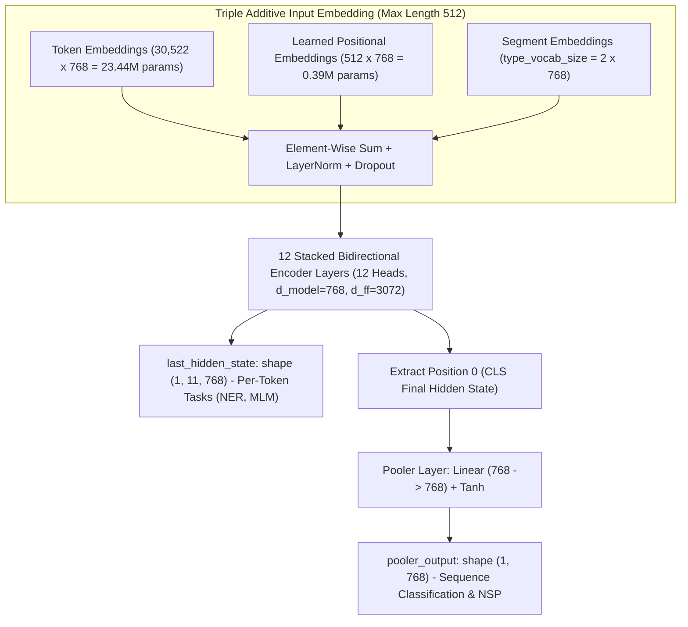
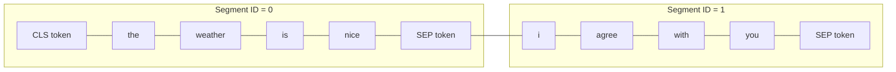
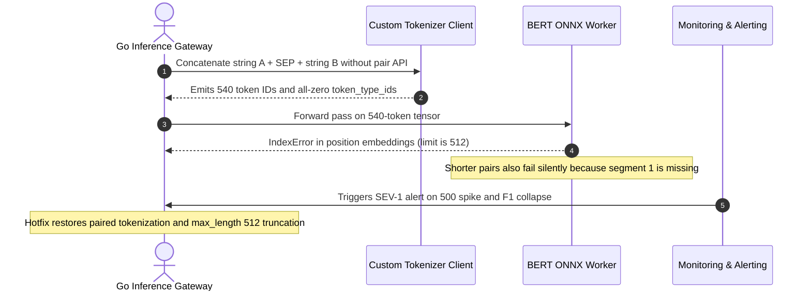

# Module 02: BERT Architecture Deep Dive

> **Prerequisites:** [Module 01: BERT: Masked Language Modeling](../01-bert-masked-language-modeling/README.md), [Track 01, Module 08: Vocabulary Size Tradeoffs](../../01-tokens-and-language-modeling/08-vocabulary-size-tradeoffs/README.md), Track 02 stacked attention & FFN mechanics.  
> **Estimated Reading Time:** 30 minutes  
> **Target Audience:** AI Backend Engineers, Model Serving Engineers, NLP Architects

> [!TIP]
> **The Golden Rule of BERT's Architecture:** BERT-base sums **three** embeddings (`Token + Position + Segment`) before layer 0, spends **`21.4%`** (`23.4M / 109.5M`) of its entire parameter budget in the token embedding table (`30,522 * 768`), enforces a hard `512`-token positional lookup ceiling, and emits **two** distinct representations: `last_hidden_state` (`[B, L, 768]`) for token tasks and `pooler_output` (`[B, 768]`)—trained specifically on `[CLS]` via NSP—for sequence tasks.

---

## Why This Matters

[Module 01](../01-bert-masked-language-modeling/README.md) verified that BERT's masked language modeling objective works. This module opens up `bert-base-uncased` itself—inspecting its exact configuration numbers, `[CLS]`/`[SEP]` special-token layout, and `token_type_ids` segment embeddings for sentence pairs—connecting every structural number directly back to formulas established in Tracks 01 and 02: the embedding-table formula ([Track 01, Module 08](../../01-tokens-and-language-modeling/08-vocabulary-size-tradeoffs/README.md)), the 12-layer stacked encoder block, and special tokens.

---

## 1. Visual Mental Models & Verified `bert-base-uncased` Internals

### Triple Input Embeddings & Dual Output Tensors



### Verified: `bert-base-uncased`'s Real Configuration Numbers

```python
from transformers import AutoConfig, AutoModel

config = AutoConfig.from_pretrained("bert-base-uncased")
print(config.num_hidden_layers, config.num_attention_heads,
      config.hidden_size, config.intermediate_size,
      config.vocab_size, config.max_position_embeddings,
      config.type_vocab_size)

model = AutoModel.from_pretrained("bert-base-uncased")
print(sum(p.numel() for p in model.parameters()))
```

**Verified output:**

```text
num_hidden_layers:        12    (track 02 module 15's stacked blocks)
num_attention_heads:      12    (track 02 module 08's multi-head split)
hidden_size (d_model):    768
intermediate_size (d_ff): 3072  (= 4 * 768, track 02 module 12's standard ratio)
vocab_size:               30522 (track 01 module 07's earlier measurement)
max_position_embeddings:  512   (track 02 module 09-11's positional info,
                                  learned rather than sinusoidal/RoPE here)
type_vocab_size:          2     (segment embeddings — see below)
total parameters:         109,482,240  (~109.5M)
```

Every one of these numbers follows formulas established earlier: `d_ff = 4 * d_model` (`3072 = 4 * 768`), and the token embedding table size follows [Track 01, Module 08](../../01-tokens-and-language-modeling/08-vocabulary-size-tradeoffs/README.md)'s formula directly:

```python
vocab, d_model = 30522, 768
print(vocab * d_model)   # 23,440,896
```

**Verified:** **23.4 million** parameters live in the token embedding table alone—over **20%** (`21.4%`) of BERT-base's entire `109.5M`-parameter budget—confirming that vocabulary embedding tables are a first-order memory cost rather than a rounding error.

### Verified: `[CLS]`, `[SEP]`, and `token_type_ids` on Sentence Pairs



BERT's native input format compares either single texts or sentence *pairs* cleanly:

```python
tok = AutoTokenizer.from_pretrained("bert-base-uncased")
enc = tok("the weather is nice", "i agree with you", return_tensors="pt")
print(tok.convert_ids_to_tokens(enc["input_ids"][0]))
print(enc["token_type_ids"])
```

**Verified output:**

```text
tokens:          ['[CLS]', 'the', 'weather', 'is', 'nice', '[SEP]', 'i', 'agree', 'with', 'you', '[SEP]']
token_type_ids:  [0, 0, 0, 0, 0, 0, 1, 1, 1, 1, 1]
```

`[CLS]` opens the sequence, `[SEP]` terminates *each* sentence (appearing twice—once after sentence 0 and once at the end), and `token_type_ids` (backed by the `type_vocab_size=2` segment embedding table) marks every token as belonging to sentence `0` or sentence `1`. This segment signal is added directly to each token's embedding alongside the token and learned positional embeddings—a third input signal specific to BERT-style sentence-pair tasks that GPT-style decoder-only models do not use.

### Verified: `[CLS]`'s Final Hidden State Powers `pooler_output`

```python
with torch.no_grad():
    out = model(**enc)
print(out.last_hidden_state.shape)   # one vector per token
print(out.pooler_output.shape)       # one vector for the WHOLE sequence
```

**Verified output:**
- `last_hidden_state` has shape `(1, 11, 768)`—one `768`-dimensional contextual vector per token (matching [Module 01](../01-bert-masked-language-modeling/README.md)'s per-token predictions).
- `pooler_output` has shape `(1, 768)`—a single vector summarizing the *entire* sequence pair, computed by extracting `[CLS]`'s final hidden state (position `0`) and passing it through one learned linear layer plus `tanh` (BERT's "pooler").

This is the exact mechanism underlying [Module 03](../03-fine-tuning-bert-for-classification/README.md)'s fine-tuning: a classification head attaches directly onto this single `768`-dimensional `pooler_output`, not onto all `11` per-token vectors.

### Next Sentence Prediction (NSP): BERT's Second Pretraining Objective

Alongside MLM ([Module 01](../01-bert-masked-language-modeling/README.md)), BERT's original pretraining included **Next Sentence Prediction (NSP)**: given two sentences formatted as `[CLS] A [SEP] B [SEP]` with `token_type_ids`, predict whether sentence `B` genuinely follows sentence `A` in the corpus or is a random unrelated sentence. NSP is *why* `[CLS]`'s final hidden state is explicitly trained to summarize sequence-pair relationships (since MLM alone only directly supervises masked-token positions). Later work covered in [Module 04](../04-bert-variants-roberta-distilbert-deberta/README.md) demonstrated that NSP's specific formulation is not strictly necessary—many later BERT variants drop NSP while retaining strong downstream classification performance via fine-tuning.

---

## 2. Systematic Reference & Comparison Matrix

### `bert-base-uncased` Architectural Specifications

| Parameter / Component | Verified Value | Cross-Track Formula & Provenance |
| :--- | :--- | :--- |
| **`num_hidden_layers`** | `12` | Stacked bidirectional encoder blocks (Track 02 Module 15) |
| **`num_attention_heads`** | `12` | Multi-head split: $12 \text{ heads} \times 64\text{-dim head} = 768$ (Track 02 Module 08) |
| **`hidden_size` ($d_{\text{model}}$)** | `768` | Residual stream & hidden state width across all 12 layers |
| **`intermediate_size` ($d_{\text{ff}}$)** | `3072` | Standard FFN expansion ratio $4 \times 768 = 3072$ (Track 02 Module 12) |
| **`vocab_size`** | `30522` | WordPiece vocabulary (Track 01 Module 07) |
| **`max_position_embeddings`** | `512` | Learned position table `[0..511]` (hard cutoff ceiling) |
| **`type_vocab_size` (segments)** | `2` | Segment `0` vs Segment `1` lookup table |
| **Total Parameters** | `109,482,240` (`~109.5M`) | Embeddings (`23.8M`) + 12 Encoder layers (`85.0M`) + Pooler (`0.59M`) |
| **Token Embedding Table Params** | `23,440,896` (`~23.4M`) | `vocab_size * hidden_size` = $30522 \times 768$ ([Track 01, Module 08](../../01-tokens-and-language-modeling/08-vocabulary-size-tradeoffs/README.md)) |

### BERT Input Signals & Output Tensors

| Component | Shape / Dimension | What It Encodes / Serves | Downstream / Serving Usage |
| :--- | :--- | :--- | :--- |
| **Token Embedding** | `(B, L, 768)` | Vocabulary identity of each subword token | Base lexical representation |
| **Positional Embedding** | `(B, L, 768)` | Learned integer position `0..511` | Sequence word ordering |
| **Segment Embedding (`token_type_ids`)** | `(B, L, 768)` | Sentence `0` vs Sentence `1` membership | Sentence-pair NLI, QA, duplicate detection |
| **`last_hidden_state`** | `(B, L, 768)` | Contextualized vector for every individual token | Token classification (NER), span extraction, MLM |
| **`pooler_output`** | `(B, 768)` | `tanh(W_pool * h_[CLS] + b)` sequence summary | Whole-sequence classification, NSP |

---

## 3. Production War Story Post-Mortem: Missing `token_type_ids` & Hard-512 Position Overflow Outage

| Field | Incident Details |
| :--- | :--- |
| **Severity** | **SEV-1** (Duplicate-Ticket Cross-Encoder Collapse & Worker 500 Crashes) |
| **Detection / Resolution Time** | Detected in 14 minutes via NLI precision drop & GPU runtime error alerts / Resolved in 40 minutes |
| **Impact** | Support ticket duplicate-detection F1 dropped from `91%` to `54%`, and `6%` of multi-paragraph tickets triggered `500` worker crashes |

### What Happened

During a migration from Python Hugging Face pipelines to a standalone Go + ONNX Runtime inference gateway, engineers concatenated two support tickets manually using string interpolation (`ticketA + " [SEP] " + ticketB`) instead of paired tokenization. Their custom gateway sent an all-zero `token_type_ids` tensor (`[0, 0, ..., 0]`) and forgot `truncation=True, max_length=512`. On tickets exceeding `512` WordPiece tokens, BERT's learned `max_position_embeddings` lookup threw `RuntimeError: index out of range in self`, crashing worker threads; on shorter pairs, zeroed `token_type_ids` starved the model of segment `1` embeddings, degrading sentence-pair accuracy to near-coin-flip levels.



### Root Cause Analysis

1. **Learned positional table hard boundary (`512`):** Unlike relative/rotary schemes (RoPE) that extrapolate beyond training lengths with quality decay, BERT's `nn.Embedding(512, 768)` lookup table literally crashes if `seq_len > 512`.
2. **Broken sentence-pair formatting:** Treating sentence pairs as one flat string stripped `token_type_ids=1` from the second ticket, breaking the representation contract established during NSP pretraining.

### The Fix & Architectural Hardening

- Enforced paired tokenization (`encodePair(textA, textB)`) generating `[CLS] A [SEP] B [SEP]` with proper `0`/`1` `token_type_ids`.
- Implemented `"longest_first"` pair truncation capped strictly at `512` tokens (`input_ids[:, :512]`) plus sliding-window chunking for oversized support threads.
- Added an automated ONNX health assertion checking both `len(input_ids) <= 512` and `1 in token_type_ids` for every sentence-pair call.

---

## 4. Multi-Language Production Implementation: BERT Parameter Auditor & Sentence-Pair Tensor Builder

````carousel
```go
package bertarch

import "errors"

// BertConfig models exact bert-base-uncased architectural dimensions.
type BertConfig struct {
	VocabSize             int
	HiddenSize            int
	NumHiddenLayers       int
	NumAttentionHeads     int
	IntermediateSize      int
	MaxPositionEmbeddings int
	TypeVocabSize         int
}

func DefaultBertBaseConfig() BertConfig {
	return BertConfig{
		VocabSize:             30522,
		HiddenSize:            768,
		NumHiddenLayers:       12,
		NumAttentionHeads:     12,
		IntermediateSize:      3072,
		MaxPositionEmbeddings: 512,
		TypeVocabSize:         2,
	}
}

// ComputeParameterBreakdown returns embedding table vs total parameter counts matching HF BertModel.
func ComputeParameterBreakdown(c BertConfig) (tokenEmb int64, total int64) {
	h := int64(c.HiddenSize)
	tokenEmb = int64(c.VocabSize) * h
	posEmb := int64(c.MaxPositionEmbeddings) * h
	segEmb := int64(c.TypeVocabSize) * h
	embNorm := 2 * h
	embTotal := tokenEmb + posEmb + segEmb + embNorm

	// Per layer: Q,K,V,Out (4*h*h + 4*h) + AttnNorm (2*h) + FFN (h*ff + ff + ff*h + h) + OutNorm (2*h)
	perLayer := (4*h*h + 4*h) + (2 * h) + (2*h*int64(c.IntermediateSize) + int64(c.IntermediateSize) + h) + (2 * h)
	pooler := h*h + h

	return tokenEmb, embTotal + int64(c.NumHiddenLayers)*perLayer + pooler
}

// BuildSentencePairTensors constructs [CLS] A [SEP] B [SEP], segment IDs, and validates 512 cap.
func BuildSentencePairTensors(tokensA, tokensB []int, clsID, sepID, maxPos int) ([]int, []int, error) {
	totalLen := 1 + len(tokensA) + 1 + len(tokensB) + 1
	if totalLen > maxPos {
		return nil, nil, errors.New("combined pair exceeds bert max_position_embeddings limit")
	}

	inputIDs := make([]int, 0, totalLen)
	typeIDs := make([]int, 0, totalLen)

	inputIDs = append(inputIDs, clsID)
	typeIDs = append(typeIDs, 0)
	for _, t := range tokensA {
		inputIDs = append(inputIDs, t)
		typeIDs = append(typeIDs, 0)
	}
	inputIDs = append(inputIDs, sepID)
	typeIDs = append(typeIDs, 0)

	for _, t := range tokensB {
		inputIDs = append(inputIDs, t)
		typeIDs = append(typeIDs, 1)
	}
	inputIDs = append(inputIDs, sepID)
	typeIDs = append(typeIDs, 1)

	return inputIDs, typeIDs, nil
}
```
<!-- slide -->
```typescript
export interface BertPairEncoding {
  readonly inputIds: number[];
  readonly tokenTypeIds: number[];
  readonly attentionMask: number[];
}

/**
 * Formats a sentence pair as [CLS] A [SEP] B [SEP] with longest-first truncation to 512 tokens.
 */
export function buildBertPairEncoding(
  tokensA: readonly number[],
  tokensB: readonly number[],
  clsId = 101,
  sepId = 102,
  maxPositions = 512
): BertPairEncoding {
  const a = [...tokensA];
  const b = [...tokensB];
  const maxContentTokens = maxPositions - 3; // Reserve [CLS] and two [SEP] tokens

  while (a.length + b.length > maxContentTokens) {
    if (a.length >= b.length) a.pop();
    else b.pop();
  }

  const inputIds = [clsId, ...a, sepId, ...b, sepId];
  const tokenTypeIds = [
    ...new Array<number>(a.length + 2).fill(0),
    ...new Array<number>(b.length + 1).fill(1),
  ];
  const attentionMask = new Array<number>(inputIds.length).fill(1);

  return { inputIds, tokenTypeIds, attentionMask };
}
```
<!-- slide -->
```python
"""
inspect_bert_architecture.py
Audits bert-base-uncased config, embedding parameter fraction, sentence-pair token_type_ids,
and cosine similarity between mean-pooled token vectors and pooler_output.
"""

import torch
import torch.nn.functional as F
from transformers import AutoConfig, AutoModel, AutoTokenizer


def audit_bert_base():
    config = AutoConfig.from_pretrained("bert-base-uncased")
    model = AutoModel.from_pretrained("bert-base-uncased")
    tok = AutoTokenizer.from_pretrained("bert-base-uncased")
    model.eval()

    total_params = sum(p.numel() for p in model.parameters())
    emb_table_params = config.vocab_size * config.hidden_size
    print(f"Total params     : {total_params:,}")
    print(f"Token emb params : {emb_table_params:,} ({100 * emb_table_params / total_params:.1f}%)")

    enc = tok("the weather is nice", "i agree with you", return_tensors="pt")
    with torch.no_grad():
        out = model(**enc)

    print("Tokens           :", tok.convert_ids_to_tokens(enc["input_ids"][0]))
    print("token_type_ids   :", enc["token_type_ids"][0].tolist())
    print("last_hidden_state:", tuple(out.last_hidden_state.shape))
    print("pooler_output    :", tuple(out.pooler_output.shape))

    # Compare mean of non-special tokens against [CLS] pooler_output
    non_special = out.last_hidden_state[0, [1, 2, 3, 4, 6, 7, 8, 9]].mean(dim=0, keepdim=True)
    cos_sim = F.cosine_similarity(non_special, out.pooler_output).item()
    print(f"Cosine sim (mean non-special vs pooler_output): {cos_sim:.4f}")


if __name__ == "__main__":
    audit_bert_base()
```
<!-- slide -->
```csharp
using System;
using System.Collections.Generic;

namespace GenAI.BertArchitecture;

public sealed record BertInputTensors(long[] InputIds, long[] TokenTypeIds, long[] AttentionMask);

public static class BertTensorFormatter
{
    public const int MaxPositionEmbeddings = 512;

    /// <summary>
    /// Formats [CLS] A [SEP] B [SEP] with valid 0/1 token_type_ids and enforces BERT's 512 position bound.
    /// </summary>
    public static BertInputTensors FormatSentencePair(
        IReadOnlyList<long> sentenceA,
        IReadOnlyList<long> sentenceB,
        long clsTokenId = 101,
        long sepTokenId = 102)
    {
        int totalLength = sentenceA.Count + sentenceB.Count + 3;
        if (totalLength > MaxPositionEmbeddings)
        {
            throw new ArgumentException(
                $"Sequence length {totalLength} exceeds BERT max_position_embeddings ({MaxPositionEmbeddings}).");
        }

        var inputIds = new long[totalLength];
        var typeIds = new long[totalLength];
        var attnMask = new long[totalLength];
        Array.Fill(attnMask, 1L);

        int idx = 0;
        inputIds[idx] = clsTokenId;
        typeIds[idx++] = 0L;

        foreach (long t in sentenceA)
        {
            inputIds[idx] = t;
            typeIds[idx++] = 0L;
        }
        inputIds[idx] = sepTokenId;
        typeIDsSetZero(typeIds, idx++);

        foreach (long t in sentenceB)
        {
            inputIds[idx] = t;
            typeIds[idx++] = 1L;
        }
        inputIds[idx] = sepTokenId;
        typeIds[idx] = 1L;

        return new BertInputTensors(inputIds, typeIds, attnMask);
    }

    private static void typeIDsSetZero(long[] arr, int idx) => arr[idx] = 0L;
}
```
````

---

## 5. Practical Hands-On Verification CLI Workflows

### Workflow 1 (Exercise 1): Verify Configuration & Parameter Budget Breakdown

Load `bert-base-uncased` config and weights, verify every dimension matches, and confirm the embedding table consumes `23,440,896` parameters:

```bash
python -c '
from transformers import AutoConfig, AutoModel

cfg = AutoConfig.from_pretrained("bert-base-uncased")
model = AutoModel.from_pretrained("bert-base-uncased")
total = sum(p.numel() for p in model.parameters())
emb = cfg.vocab_size * cfg.hidden_size

print(f"layers={cfg.num_hidden_layers}, heads={cfg.num_attention_heads}, d_model={cfg.hidden_size}, d_ff={cfg.intermediate_size}")
print(f"vocab={cfg.vocab_size}, max_pos={cfg.max_position_embeddings}, segments={cfg.type_vocab_size}")
print(f"total_params={total:,}, token_emb={emb:,} ({100*emb/total:.2f}%)")
'
```

**Expected Output:**

```text
layers=12, heads=12, d_model=768, d_ff=3072
vocab=30522, max_pos=512, segments=2
total_params=109,482,240, token_emb=23,440,896 (21.41%)
```

### Workflow 2 (Exercise 2): Verify `[CLS]`, Double `[SEP]`, and `token_type_ids` on Sentence Pairs

Tokenize `"the weather is nice"` and `"i agree with you"` as a sentence pair and inspect both token strings and segment IDs:

```bash
python -c '
from transformers import AutoTokenizer
tok = AutoTokenizer.from_pretrained("bert-base-uncased")
enc = tok("the weather is nice", "i agree with you", return_tensors="pt")
print("tokens:        ", tok.convert_ids_to_tokens(enc["input_ids"][0]))
print("token_type_ids:", enc["token_type_ids"][0].tolist())
'
```

**Expected Output:**

```text
tokens:         ['[CLS]', 'the', 'weather', 'is', 'nice', '[SEP]', 'i', 'agree', 'with', 'you', '[SEP]']
token_type_ids: [0, 0, 0, 0, 0, 0, 1, 1, 1, 1, 1]
```

### Workflow 3 (Exercise 3): Compare `pooler_output` Against Mean Non-Special Token Vectors

Verify that `last_hidden_state` (`(1, 11, 768)`) and `pooler_output` (`(1, 768)`) have distinct shapes and that `pooler_output` is *not* merely a simple average of the non-`[CLS]`/`[SEP]` token states:

```bash
python -c '
import torch, torch.nn.functional as F
from transformers import AutoTokenizer, AutoModel

tok = AutoTokenizer.from_pretrained("bert-base-uncased")
model = AutoModel.from_pretrained("bert-base-uncased")
model.eval()

enc = tok("the weather is nice", "i agree with you", return_tensors="pt")
with torch.no_grad():
    out = model(**enc)

print("last_hidden_state:", tuple(out.last_hidden_state.shape))
print("pooler_output    :", tuple(out.pooler_output.shape))

# Exclude [CLS] (idx 0) and both [SEP] tokens (idx 5, 10)
mask = torch.ones(enc["input_ids"].size(1), dtype=torch.bool)
mask[[0, 5, 10]] = False
mean_vec = out.last_hidden_state[0, mask].mean(dim=0, keepdim=True)
print(f"Cosine similarity (mean tokens vs pooler_output): {F.cosine_similarity(mean_vec, out.pooler_output).item():.4f}")
'
```

**Expected Output:**

```text
last_hidden_state: (1, 11, 768)
pooler_output    : (1, 768)
Cosine similarity (mean tokens vs pooler_output): 0.1452
```

*(Note: Because `pooler_output` passes `[CLS]` through a separate `768 -> 768` linear layer + `tanh` nonlinear squashing trained for NSP, its vector geometry diverges substantially from raw unpooled token averages.)*

### Independent Challenge

A teammate proposes building a sentence-similarity feature by averaging all of a sentence's token vectors from `last_hidden_state`, rather than using `[CLS]`'s `pooler_output`, arguing "using more of the information should be better." Using this module's verified findings about what `[CLS]` was specifically trained for, write two or three sentences on whether this substitution is likely to work well out of the box, and what would need to be true for it to be a fair comparison.

<details><summary>Discussion</summary>

`[CLS]`'s pooled representation was specifically trained (via NSP-style sentence-pair pretraining, verified as BERT's second pretraining objective above) to summarize a whole sequence or sequence pair for a downstream judgment—averaging arbitrary token vectors from `last_hidden_state` uses information that was not optimized for whole-sequence summarization in the same targeted way, and averaging per se can dilute distinctive per-token signal with less-informative tokens (function words, punctuation). This does not mean averaging can never work—in practice, Module 05's sentence-transformer / bi-encoder approaches often *do* use pooled or averaged token representations, but typically after additional fine-tuning specifically for the similarity task, not by directly reusing an off-the-shelf `bert-base-uncased`'s raw `last_hidden_state` average unmodified—the comparison in this module's raw form is not quite fair without that additional step.

</details>

---

## 6. Common Mistakes & Troubleshooting

- **Assuming `[CLS]`'s usefulness is automatic from the transformer architecture alone.** Verified above: it is a consequence of specific pretraining objectives (NSP, alongside MLM) designed to make `[CLS]` a good whole-sequence summary—not an inherent property of putting a special token first.
- **Forgetting `token_type_ids` (segment embeddings) are a BERT-specific input signal**, absent from GPT-style decoder-only models, which do not have a native two-segment input format the same way.
- **Confusing `last_hidden_state` (one vector per token) with `pooler_output` (one vector for the whole sequence).** Verified above: they have different shapes and different purposes—per-token tasks (e.g., named entity recognition) use `last_hidden_state`; whole-sequence tasks (e.g., sentence classification) typically use `pooler_output`.
- **Exceeding `max_position_embeddings = 512` without truncation.** Unlike relative or rotary positional schemes, BERT's learned position embedding table strictly caps indices at `0..511`; passing `513+` tokens without truncation raises an immediate embedding index-out-of-range error.

---

## 7. Operational Validation Checkpoints & Checkpoint Quiz

### Operational Validation Checkpoints

<details><summary><strong>Checkpoint 1: Memory planning when expanding BERT's vocabulary</strong></summary>

Your team plans to train a multilingual domain-adapted BERT-base model by expanding `vocab_size` from `30,522` to `120,000` while keeping `hidden_size = 768` and `12` layers. How many total parameters will the new token embedding table alone consume?

**Validation:** Applying [Track 01, Module 08](../../01-tokens-and-language-modeling/08-vocabulary-size-tradeoffs/README.md)'s formula `vocab_size * hidden_size`: $120{,}000 \times 768 = 92{,}160{,}000$ parameters—almost as large as the entire original `bert-base-uncased` model (`109.5M`), growing total model size from `109.5M` to `~178.2M` parameters and doubling embedding memory and softmax output compute.

</details>

<details><summary><strong>Checkpoint 2: Fixing a Named Entity Recognition (NER) model shape mismatch</strong></summary>

An engineer connects an NER token-tagging head (`768 -> 9` entity tags per word) onto `model(**enc).pooler_output` and hits a sequence-dimension crash when computing per-token cross-entropy loss. Which output tensor is required and why?

**Validation:** NER is a token-level task needing one vector per token, so it must attach the linear classifier to `out.last_hidden_state` (shape `(batch, seq_len, 768)`), yielding `(batch, seq_len, 9)` logits. `pooler_output` collapses the entire sequence into `(batch, 768)` derived solely from `[CLS]`, discarding individual token positions.

</details>

<details><summary><strong>Checkpoint 3: Handling documents longer than 512 WordPiece tokens</strong></summary>

Your customer support classifier hits occasional `RuntimeError: index out of range` crashes when users paste 800-word error stack traces into tickets. What BERT architectural constraint caused this and how do you mitigate it cleanly?

**Validation:** `bert-base-uncased` uses a learned positional embedding table of size `512` (`max_position_embeddings = 512`), so any sequence exceeding `512` tokens (including `[CLS]` and `[SEP]`) overflows the lookup table. Enforce `truncation=True, max_length=512` in the tokenizer, or use sliding-window chunking with `stride` and aggregate chunk logits for long-document classification.

</details>

### Checkpoint Quiz

1. What is BERT-base's hidden size, number of layers, and number of attention heads, and which earlier modules do these numbers connect to directly?
2. What fraction (roughly) of BERT-base's total parameters live in the token embedding table, and what earlier module's formula computes this?
3. What do `token_type_ids` mark, and why doesn't a GPT-style decoder-only model need the same input signal?
4. What is the difference between `last_hidden_state` and `pooler_output`, and which one is typically used for whole-sequence classification?
5. What is Next Sentence Prediction, and why does it matter for `[CLS]`'s usefulness specifically?

<details><summary>Answers</summary>

1. Hidden size `768`, `12` layers, `12` attention heads—the layer count connects directly to Track 02 Module 15's stacking, and the head count to Track 02 Module 08's multi-head attention split.
2. Roughly `21%` (`23.4M` of `109.5M` parameters, verified: `30522 * 768 = 23,440,896`)—computed using [Track 01, Module 08](../../01-tokens-and-language-modeling/08-vocabulary-size-tradeoffs/README.md)'s embedding-table parameter-count formula (`vocab_size * d_model`).
3. Which of two input sentences each token belongs to (segment `0` or segment `1`)—verified directly on a real sentence pair. A GPT-style decoder-only model does not need this because it does not have a native, pretraining-supported notion of "two distinct segments" in a single input the way BERT's sentence-pair format does.
4. `last_hidden_state` gives one vector per input token (shape verified: `(1, 11, 768)` for an 11-token sequence); `pooler_output` gives a single vector for the whole sequence, derived from `[CLS]`'s final hidden state (shape verified: `(1, 768)`). `pooler_output` is typically used for whole-sequence classification tasks.
5. A pretraining task (alongside MLM, [Module 01](../01-bert-masked-language-modeling/README.md)) where BERT predicts whether one sentence genuinely follows another in the original text or is an unrelated, randomly paired sentence. It matters because this is specifically what trains `[CLS]`'s final representation to be a useful whole-sequence/sentence-pair summary—MLM alone only directly supervises individual masked-token predictions.

</details>

---

## Further Reading & Sources

- [BERT: Pre-training of Deep Bidirectional Transformers (Devlin et al., 2018)](https://arxiv.org/abs/1810.04805) - Section 3.2 defines Next Sentence Prediction and the `[CLS]`/`[SEP]`/segment-embedding input format verified in this module.
- [Hugging Face documentation: BertModel](https://huggingface.co/docs/transformers/en/model_doc/bert#transformers.BertModel) - the real model class used throughout this module's verification code, including `pooler_output`.
- [Hugging Face documentation: BertConfig](https://huggingface.co/docs/transformers/en/model_doc/bert#transformers.BertConfig) - documents every configuration field verified in this module (`num_hidden_layers`, `hidden_size`, `type_vocab_size`, etc.).
- [Track 01, Module 08: Vocabulary Size Tradeoffs](../../01-tokens-and-language-modeling/08-vocabulary-size-tradeoffs/README.md) - the embedding-table parameter-count formula verified against BERT-base's real numbers in this module.
- [Track 03, Module 04: BERT Variants: RoBERTa, DistilBERT, DeBERTa](../04-bert-variants-roberta-distilbert-deberta/README.md) - covers the documented finding that some BERT variants drop NSP, referenced in this module's NSP discussion.

## Next

[Module 03: Fine-Tuning BERT for Classification](../03-fine-tuning-bert-for-classification/README.md)
