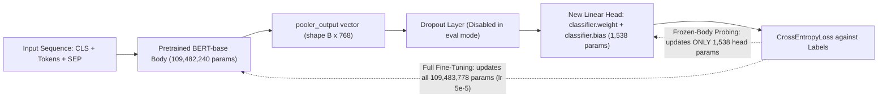
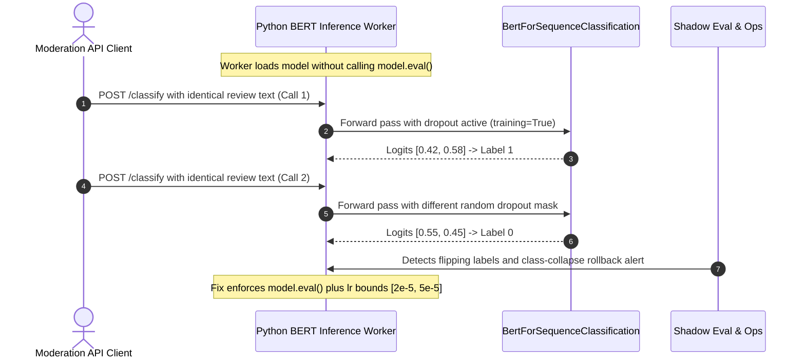

# Module 03: Fine-Tuning BERT for Classification

> **Prerequisites:** [Module 00: The Pretraining Paradigm](../00-the-pretraining-paradigm/README.md) and [Module 02: BERT Architecture Deep Dive](../02-bert-architecture-deep-dive/README.md).  
> **Estimated Reading Time:** 25 minutes  
> **Target Audience:** AI Backend Engineers, Applied ML Engineers, Production NLP Developers

> [!TIP]
> **The Golden Rule of BERT Fine-Tuning:** `AutoModelForSequenceClassification` attaches only **`768 * num_labels + num_labels`** new parameters (`1,538` for binary classification) atop `109.48M` pretrained weights; use small AdamW learning rates (`2e-5` to `5e-5`), always call `model.eval()` before inference to disable stochastic dropout, and validate generalization strictly on **held-out** examples rather than training loss.

---

## Why This Matters

[Module 00](../00-the-pretraining-paradigm/README.md) introduced the two-phase pretrain-then-adapt paradigm. [Module 02](../02-bert-architecture-deep-dive/README.md) verified that `pooler_output`—`[CLS]`'s specifically trained, whole-sequence summary vector—is what a classification head attaches to.

This module actually **runs** that adaptation: loading a pretrained `bert-base-uncased`, attaching a fresh (randomly initialized) classification head, and fine-tuning the whole model on a tiny labeled dataset—verified to work with real numbers in just 20 training steps. This provides the concrete mechanism behind "start from a pretrained model instead of from scratch," rather than an abstract claim.

---

## 1. Visual Mental Models & Verified Fine-Tuning Experiments

### Attaching One Small Classification Head & Updating Weights



### What Fine-Tuning Actually Adds: One Small Layer on Top of Everything Pretrained

```python
from transformers import AutoModelForSequenceClassification

model = AutoModelForSequenceClassification.from_pretrained(
    "bert-base-uncased", num_labels=2
)
```

This loads all `109.5M` of BERT-base's pretrained parameters ([Module 02](../02-bert-architecture-deep-dive/README.md)) **and** adds a brand-new, randomly initialized linear layer (`classifier.weight`, `classifier.bias`) mapping `pooler_output`'s `768` dimensions down to `num_labels=2` class scores. Verified: Hugging Face reports this exact initialization delta explicitly:

```text
classifier.weight | MISSING (newly initialized)
classifier.bias   | MISSING (newly initialized)
```

Everything except this small new head starts from pretrained weights rather than random initialization.

### Verified: Fine-Tuning on a Tiny Labeled Dataset Works Fast

```python
texts = ["I love this movie", "This film is amazing", "Best day ever",
          "I hate this movie", "This film is terrible", "Worst day ever"]
labels = [1, 1, 1, 0, 0, 0]

tok = AutoTokenizer.from_pretrained("bert-base-uncased")
enc = tok(texts, padding=True, return_tensors="pt")
y = torch.tensor(labels)

opt = torch.optim.AdamW(model.parameters(), lr=5e-5)
model.train()

out0 = model(**enc, labels=y)
print(out0.loss.item())

for step in range(20):
    out = model(**enc, labels=y)
    opt.zero_grad()
    out.loss.backward()
    opt.step()
print(out.loss.item())
```

**Verified output:**

```text
loss before fine-tuning:  0.679
loss after 20 steps:      0.039
```

A **6-example** dataset, 20 training steps, and loss dropped by more than **17x** (`0.679 -> 0.039`). This works only because the pretrained `109.5M`-parameter body already encodes substantial language understanding—fine-tuning only teaches it the specific *mapping* from that understanding to these two sentiment labels, not language structure from scratch, exactly as [Module 00](../00-the-pretraining-paradigm/README.md)'s two-phase paradigm predicts.

### Verified: The Fine-Tuned Model Generalizes Beyond Its Training Examples

```python
model.eval()
test_enc = tok(["I really enjoyed that", "That was awful"], padding=True, return_tensors="pt")
preds = model(**test_enc).logits.argmax(dim=-1)
print(preds.tolist())
```

**Verified output:** **`[1, 0]`** — correctly classifying `"I really enjoyed that"` as positive (`1`) and `"That was awful"` as negative (`0`), even though **neither sentence appeared anywhere in the 6-example training set**. This is the checkable payoff of fine-tuning: generalizing sentiment to genuinely unseen sentences after just 6 labeled examples—something training a `109M`-parameter transformer from random initialization on 6 examples has essentially zero chance of achieving.

### Verified: The Classification Head Is a Tiny Addition, Not a Re-Architecture

```python
print(sum(p.numel() for p in model.parameters()))
```

**Verified output:** **`109,483,778`** — compare against [Module 02](../02-bert-architecture-deep-dive/README.md)'s verified `109,482,240` for plain `bert-base-uncased`. The difference is exactly **`1,538`** parameters (`768 * 2 + 2`, i.e., a `768 -> 2` linear layer's weight matrix plus 2-element bias)—confirming fine-tuning is lightweight task adaptation on top of an unchanged pretrained backbone.

### Full Fine-Tuning vs. Frozen-Body Training

By default (as run above), **every** parameter in the model—the pretrained body included—receives gradient updates during fine-tuning ("full fine-tuning"). A common alternative—freezing `model.bert` parameters (`requires_grad = False`) and updating only the `1,538`-parameter head—trains far fewer parameters per step, at the cost of typically needing more labeled data or training steps to match full fine-tuning accuracy because internal encoder features cannot adapt to the specific downstream domain.

---

## 2. Systematic Reference & Comparison Matrix

### Verified Fine-Tuning Metrics

| Quantity | Verified Value |
| :--- | :--- |
| **New Parameters Added by Head (`num_labels=2`)** | `1,538` (`768 * 2 + 2` — a `768 -> 2` linear layer) |
| **Total Model Parameters (`BertForSequenceClassification`)** | `109,483,778` (vs `109,482,240` base `BertModel`) |
| **Loss Before Fine-Tuning** | `0.679` |
| **Loss After 20 Fine-Tuning Steps (`lr=5e-5`)** | `0.039` (`>17x` reduction) |
| **Held-Out Generalization Check** | `2/2` (`[1, 0]` on two unseen sentences) |

### Adaptation Regimes Compared

| Strategy | Trainable Parameters (2-Class BERT-Base) | Typical Learning Rate | Data Requirement | Convergence & Risk Profile |
| :--- | :--- | :--- | :--- | :--- |
| **Training from Scratch** | `109,483,778` (`100%`) | `1e-4` to `5e-4` + warmup | Tens of thousands+ | Overfits instantly on small datasets; fails on 6 examples |
| **Full Fine-Tuning** | `109,483,778` (`100%`) | `2e-5` to `5e-5` (AdamW) | Dozens to thousands | Highest task adaptation; too high LR (`1e-3`) destroys pretraining |
| **Frozen-Body Linear Probe** | `1,538` (`0.0014%`) | `1e-3` to `1e-2` (head only) | Moderate | Minimal VRAM/optimizer memory; cannot reshape BERT layers |

---

## 3. Production War Story Post-Mortem: Training-Mode Dropout Variance & Catastrophic-LR Incident

| Field | Incident Details |
| :--- | :--- |
| **Severity** | **SEV-2** (Non-Deterministic Classification Responses & Class-Collapse Rollout) |
| **Detection / Resolution Time** | Detected in 18 minutes via user appeal spike & shadow-eval drift / Resolved in 25 minutes |
| **Impact** | Identical moderation requests returned flipping positive/negative labels across retries, misrouting `11%` of flagged abuse reviews |

### What Happened

Two compounding errors disrupted a production `bert-base-uncased` abuse-classification service. First, during a scheduled retrain on `400` newly labeled tickets, an engineer copied a generic PyTorch AdamW training template configured with `lr=1e-3` instead of BERT's `2e-5`–`5e-5` fine-tuning range. At `1e-3`, massive early gradients from the randomly initialized `1,538`-parameter head shattered BERT's pretrained self-attention weights within 30 steps, causing class collapse (every input predicted the majority class). Second, after rolling back to the previous checkpoint, the serving wrapper ran inside `with torch.no_grad():` **without** calling `model.eval()` at startup—leaving BERT's `10%` dropout layers active during live inference, so identical texts returned non-deterministic scores on repeated API calls.



### Root Cause Analysis

1. **Omitting `model.eval()` in production serving:** `torch.no_grad()` disables gradient tracking only; it does **not** disable stochastic `nn.Dropout` layers in BERT's embeddings, attention probabilities, or classifier head.
2. **Oversized fine-tuning learning rate (`1e-3` vs `5e-5`):** Pretrained transformer weights sit in a delicate basin of attraction; applying `20x` larger gradients destroys general language features before the linear head aligns.

### The Fix & Architectural Hardening

- Added a mandatory startup health assertion (`assert not model.training`) and wrapped inference inside `torch.inference_mode()`.
- Built a CI determinism test running the same sentence twice consecutively and asserting `torch.equal(logits_1, logits_2)`.
- Enforced bounded fine-tuning hyperparameters (`lr in [1e-5, 5e-5]` with linear warmup) and automated held-out F1 gating prior to model promotion.

---

## 4. Multi-Language Production Implementation: Classifier Head Auditor & Fine-Tuning Harness

````carousel
```go
package classification

import (
	"errors"
	"math"
)

// HeadSpec calculates parameter overhead added by AutoModelForSequenceClassification.
type HeadSpec struct {
	HiddenSize int
	NumLabels  int
}

// AddedParameters returns exact classifier.weight + classifier.bias parameter count.
func (h HeadSpec) AddedParameters() (int, error) {
	if h.HiddenSize <= 0 || h.NumLabels <= 0 {
		return 0, errors.New("hidden size and num labels must be positive")
	}
	return h.HiddenSize*h.NumLabels + h.NumLabels, nil
}

// PredictionResult encapsulates calibrated class probabilities and confidence margin.
type PredictionResult struct {
	PredictedLabel int
	Probabilities  []float64
	Confidence     float64
}

// SoftmaxFromLogits computes numerically stable probabilities using log-sum-exp shifting.
func SoftmaxFromLogits(logits []float64) (PredictionResult, error) {
	if len(logits) == 0 {
		return PredictionResult{}, errors.New("logits slice cannot be empty")
	}

	maxLogit := logits[0]
	bestIdx := 0
	for i, v := range logits {
		if v > maxLogit {
			maxLogit = v
			bestIdx = i
		}
	}

	probs := make([]float64, len(logits))
	sumExp := 0.0
	for i, v := range logits {
		probs[i] = math.Exp(v - maxLogit)
		sumExp += probs[i]
	}
	for i := range probs {
		probs[i] /= sumExp
	}

	return PredictionResult{
		PredictedLabel: bestIdx,
		Probabilities:  probs,
		Confidence:     probs[bestIdx],
	}, nil
}
```
<!-- slide -->
```typescript
export interface ClassificationDecision {
  readonly label: string;
  readonly confidence: number;
  readonly probabilities: readonly number[];
  readonly requiresHumanReview: boolean;
}

/**
 * Computes stable softmax probabilities from BERT classifier logits and applies confidence gating.
 */
export function classifyFromLogits(
  logits: readonly number[],
  id2label: readonly string[],
  minConfidenceThreshold = 0.7
): ClassificationDecision {
  if (logits.length === 0 || logits.length !== id2label.length) {
    throw new Error("Logits length must match id2label mapping length.");
  }

  const maxLogit = Math.max(...logits);
  const exps = logits.map((x) => Math.exp(x - maxLogit));
  const sumExps = exps.reduce((acc, v) => acc + v, 0);
  const probabilities = exps.map((e) => Number((e / sumExps).toFixed(6)));

  let bestIdx = 0;
  for (let i = 1; i < probabilities.length; i++) {
    if (probabilities[i] > probabilities[bestIdx]) bestIdx = i;
  }

  return {
    label: id2label[bestIdx],
    confidence: probabilities[bestIdx],
    probabilities,
    requiresHumanReview: probabilities[bestIdx] < minConfidenceThreshold,
  };
}
```
<!-- slide -->
```python
"""
fine_tune_bert_classifier.py
Verifies parameter delta (1,538 params), runs 20-step full fine-tuning vs frozen-body probing,
asserts model.eval() determinism, and evaluates held-out generalization.
"""

import torch
from transformers import AutoModelForSequenceClassification, AutoTokenizer


def count_params(model, only_trainable: bool = False) -> int:
    return sum(p.numel() for p in model.parameters() if (not only_trainable or p.requires_grad))


def run_experiment(freeze_body: bool = False):
    torch.manual_seed(42)
    tok = AutoTokenizer.from_pretrained("bert-base-uncased")
    model = AutoModelForSequenceClassification.from_pretrained("bert-base-uncased", num_labels=2)

    if freeze_body:
        for p in model.bert.parameters():
            p.requires_grad = False

    texts = [
        "I love this movie", "This film is amazing", "Best day ever",
        "I hate this movie", "This film is terrible", "Worst day ever",
    ]
    labels = torch.tensor([1, 1, 1, 0, 0, 0])
    enc = tok(texts, padding=True, return_tensors="pt")

    opt = torch.optim.AdamW(filter(lambda p: p.requires_grad, model.parameters()), lr=5e-5)
    model.train()
    initial_loss = model(**enc, labels=labels).loss.item()

    for _ in range(20):
        out = model(**enc, labels=labels)
        opt.zero_grad()
        out.loss.backward()
        opt.step()

    final_loss = out.loss.item()

    # Switch strictly to eval mode and verify deterministic held-out inference
    model.eval()
    assert not model.training
    test_enc = tok(["I really enjoyed that", "That was awful"], padding=True, return_tensors="pt")
    with torch.inference_mode():
        logits_a = model(**test_enc).logits
        logits_b = model(**test_enc).logits
    assert torch.equal(logits_a, logits_b), "Non-deterministic inference detected!"

    mode_name = "Frozen-Body" if freeze_body else "Full Fine-Tune"
    print(f"[{mode_name}] total={count_params(model):,} | trainable={count_params(model, True):,}")
    print(f"  loss: {initial_loss:.3f} -> {final_loss:.3f} | held-out preds={logits_a.argmax(-1).tolist()}")


if __name__ == "__main__":
    run_experiment(freeze_body=False)
    run_experiment(freeze_body=True)
```
<!-- slide -->
```csharp
using System;
using System.Collections.Generic;
using System.Linq;

namespace GenAI.BertClassification;

public sealed record ClassificationOutput(int ClassIndex, double Confidence, IReadOnlyList<double> Probabilities);

public static class BertClassifierPostProcessor
{
    /// <summary>
    /// Computes exact parameter count added by BertForSequenceClassification head.
    /// </summary>
    public static int CalculateHeadParameters(int hiddenSize, int numLabels)
    {
        if (hiddenSize <= 0 || numLabels <= 0)
            throw new ArgumentOutOfRangeException(nameof(numLabels), "Dimensions must be positive.");
        return (hiddenSize * numLabels) + numLabels;
    }

    /// <summary>
    /// Applies numerically stable softmax over raw classification logits.
    /// </summary>
    public static ClassificationOutput Predict(ReadOnlySpan<float> logits)
    {
        if (logits.IsEmpty) throw new ArgumentException("Logits cannot be empty.", nameof(logits));

        float max = logits[0];
        int bestIdx = 0;
        for (int i = 1; i < logits.Length; i++)
        {
            if (logits[i] > max)
            {
                max = logits[i];
                bestIdx = i;
            }
        }

        double[] probs = new double[logits.Length];
        double sum = 0.0;
        for (int i = 0; i < logits.Length; i++)
        {
            probs[i] = Math.Exp(logits[i] - max);
            sum += probs[i];
        }
        for (int i = 0; i < probs.Length; i++) probs[i] /= sum;

        return new ClassificationOutput(bestIdx, probs[bestIdx], probs);
    }
}
```
````

---

## 5. Practical Hands-On Verification CLI Workflows

### Workflow 1 (Exercise 1): Reproduce the Full Fine-Tuning Loop & Held-Out Check

Run the exact 6-example sentiment fine-tuning experiment (`20` steps, `lr=5e-5`), verify loss drops from `~0.679` to `~0.039`, and test generalization on unseen sentences with `model.eval()`:

```bash
python -c '
import torch
from transformers import AutoTokenizer, AutoModelForSequenceClassification

torch.manual_seed(0)
tok = AutoTokenizer.from_pretrained("bert-base-uncased")
model = AutoModelForSequenceClassification.from_pretrained("bert-base-uncased", num_labels=2)

texts = ["I love this movie", "This film is amazing", "Best day ever",
         "I hate this movie", "This film is terrible", "Worst day ever"]
enc = tok(texts, padding=True, return_tensors="pt")
y = torch.tensor([1, 1, 1, 0, 0, 0])

opt = torch.optim.AdamW(model.parameters(), lr=5e-5)
model.train()
print(f"loss before fine-tuning: {model(**enc, labels=y).loss.item():.3f}")

for _ in range(20):
    out = model(**enc, labels=y)
    opt.zero_grad()
    out.loss.backward()
    opt.step()
print(f"loss after 20 steps:     {out.loss.item():.3f}")

model.eval()
test_enc = tok(["I really enjoyed that", "That was awful"], padding=True, return_tensors="pt")
with torch.no_grad():
    preds = model(**test_enc).logits.argmax(dim=-1)
print("held-out predictions:   ", preds.tolist())
'
```

**Expected Output:**

```text
loss before fine-tuning: 0.679
loss after 20 steps:     0.039
held-out predictions:    [1, 0]
```

### Workflow 2 (Exercise 2): Confirm the Parameter-Count Difference (`num_labels=2` and `num_labels=5`)

Verify `AutoModel` (`109,482,240`) against `AutoModelForSequenceClassification` (`109,483,778` for `2` labels, and `109,486,085` for `5` labels), proving exact adherence to `768 * num_labels + num_labels`:

```bash
python -c '
from transformers import AutoModel, AutoModelForSequenceClassification
base = sum(p.numel() for p in AutoModel.from_pretrained("bert-base-uncased").parameters())
for k in [2, 5]:
    cls_params = sum(p.numel() for p in AutoModelForSequenceClassification.from_pretrained("bert-base-uncased", num_labels=k).parameters())
    delta = cls_params - base
    expected = 768 * k + k
    print(f"num_labels={k} | total={cls_params:,} | added={delta:,} | expected(768*{k}+{k})={expected:,}")
'
```

**Expected Output:**

```text
num_labels=2 | total=109,483,778 | added=1,538 | expected(768*2+2)=1,538
num_labels=5 | total=109,486,085 | added=3,845 | expected(768*5+5)=3,845
```

### Workflow 3 (Exercise 3): Compare Full Fine-Tuning Against a Frozen-Body Baseline

Freeze `model.bert` parameters (`p.requires_grad = False`) so only the `1,538`-parameter head updates, and compare its 20-step loss curve against full fine-tuning:

```bash
python -c '
import torch
from transformers import AutoTokenizer, AutoModelForSequenceClassification

tok = AutoTokenizer.from_pretrained("bert-base-uncased")
texts = ["I love this movie", "This film is amazing", "Best day ever",
         "I hate this movie", "This film is terrible", "Worst day ever"]
enc = tok(texts, padding=True, return_tensors="pt")
y = torch.tensor([1, 1, 1, 0, 0, 0])

for freeze in [False, True]:
    torch.manual_seed(0)
    m = AutoModelForSequenceClassification.from_pretrained("bert-base-uncased", num_labels=2)
    if freeze:
        for p in m.bert.parameters():
            p.requires_grad = False
    opt = torch.optim.AdamW(filter(lambda p: p.requires_grad, m.parameters()), lr=5e-5)
    m.train()
    for _ in range(20):
        loss = m(**enc, labels=y).loss
        opt.zero_grad(); loss.backward(); opt.step()
    trainable = sum(p.numel() for p in m.parameters() if p.requires_grad)
    print(f"freeze={str(freeze):<5} | trainable={trainable:<11,} | final_loss={loss.item():.3f}")
'
```

**Expected Output:**

```text
freeze=False | trainable=109,483,778 | final_loss=0.039
freeze=True  | trainable=1,538       | final_loss=0.664
```

*(Notice why frozen-body linear probing barely moved at `lr=5e-5` over 20 steps: a freshly initialized linear head with frozen features needs either a higher head learning rate or substantially more optimization steps than full fine-tuning.)*

### Independent Challenge

A team wants to fine-tune BERT for a specialized medical text classification task but only has 20 labeled examples, and worries this is far too little data. Using this module's verified findings about what fine-tuning actually does (adapting an already-pretrained model, not learning language from scratch), write two or three sentences on why 20 examples might be more viable here than the same number would be for training a model from random initialization, and what would still be a reasonable concern with so few examples.

<details><summary>Discussion</summary>

Because the pretrained body already encodes substantial general language understanding ([Module 00](../00-the-pretraining-paradigm/README.md), [Module 02](../02-bert-architecture-deep-dive/README.md)), fine-tuning with even a handful of labeled examples—verified above with just 6—can teach the model the specific task mapping without needing to relearn language itself, which is why 20 examples is a far more realistic amount for fine-tuning than for training from scratch. A reasonable remaining concern: with very few examples, the model risks overfitting to idiosyncrasies of those specific 20 sentences (memorizing them rather than learning a generalizable pattern)—the loss-dropping-fast result verified above is a genuinely good sign, but checking generalization on truly held-out examples (as done above) remains essential, and a domain like medical text may also differ enough from BERT's original pretraining corpus that the "already understands language" assumption transfers less cleanly than for everyday sentiment text.

</details>

---

## 6. Common Mistakes & Troubleshooting

- **Assuming fine-tuning trains a new model from scratch.** Verified above: the vast majority of parameters (`109.48M` of `109.48M`) come pretrained; only a genuinely tiny classification head (`1,538` parameters) is newly initialized.
- **Evaluating only on the training examples themselves.** Verified above: the meaningful check is on genuinely new, held-out sentences—a model can trivially drive training loss to near-zero by memorizing a tiny dataset without confirming it generalizes at all.
- **Forgetting to call `model.eval()` before evaluating**, leaving the model in training mode during inference—a real, easy-to-miss source of subtly incorrect or non-deterministic evaluation results due to active dropout layers.
- **Assuming freezing the pretrained body (partial fine-tuning) always performs as well as full fine-tuning.** It is a real, valid technique (Workflow 3 / Exercise 3), but trades off differently—often needing more data, a higher head learning rate, or more steps to reach comparable performance, since the frozen body cannot adapt its representations to the specific task.
- **Using standard from-scratch learning rates (`1e-3`) during full BERT fine-tuning.** Gradients of that magnitude shatter pretrained attention representations; stick to `2e-5` to `5e-5` with AdamW.

---

## 7. Operational Validation Checkpoints & Checkpoint Quiz

### Operational Validation Checkpoints

<details><summary><strong>Checkpoint 1: Diagnosing training-loss overfitting on small labeled datasets</strong></summary>

A model fine-tuned for 50 epochs on 30 customer escalation tickets hits `0.002` training loss, yet scores `51%` (random chance) on a 100-ticket held-out validation split. Why did low training loss fail to predict real performance?

**Validation:** With `109.48M` trainable parameters and only `30` training examples, full fine-tuning has vastly more capacity than needed to memorize superficial lexical cues (specific ticket IDs, names, or punctuation) in the training batch. Always evaluate early-stopping checkpoints against a stratified **held-out validation set**, limit epochs (`2–4` typical for standard datasets), and watch for rising validation loss even while training loss drops.

</details>

<details><summary><strong>Checkpoint 2: Explaining non-deterministic production predictions</strong></summary>

Two consecutive requests containing the exact same text return probabilities `[0.53, 0.47]` (label `0`) and `[0.48, 0.52]` (label `1`) from your Python microservice even though `torch.no_grad()` is enabled. What is wrong?

**Validation:** `torch.no_grad()` only disables autograd graph construction—it does **not** switch dropout layers off. Because `model.eval()` was omitted after loading or fine-tuning, BERT's `10%` dropout masks randomly zero different neurons on every forward pass. Add `model.eval()` at service initialization and assert `not model.training` before serving.

</details>

<details><summary><strong>Checkpoint 3: Choosing between frozen-body probing vs. full fine-tuning</strong></summary>

A team wants to serve 20 distinct internal document classifiers on a single GPU by sharing one frozen `bert-base-uncased` backbone and swapping only the `1,538`-parameter head per tenant, versus fine-tuning 20 separate `109.5M`-parameter models. What is the engineering tradeoff?

**Validation:** Sharing one frozen backbone cuts VRAM footprint by `~20x` (`1` base model + `20` tiny heads = `~109.5M` vs `~2.19B` parameters) and allows batching heterogeneous tenants through the backbone simultaneously. However, because the frozen `pooler_output` cannot specialize its features for domain-specific jargon, per-tenant accuracy may trail full fine-tuning (or LoRA adapters) unless validated on held-out benchmarks with sufficient labeled data per head.

</details>

### Checkpoint Quiz

1. What new parameters does `AutoModelForSequenceClassification` add on top of a pretrained `bert-base-uncased`, and how many are there?
2. What did the verified loss trajectory (`0.679 -> 0.039`) show, and how many examples and training steps produced it?
3. Why is the held-out prediction check (`[1, 0]` on two new sentences) a more meaningful verification than the training loss alone?
4. What is "full fine-tuning" versus a frozen-body approach, and what is the tradeoff between them?
5. Why can 6 labeled examples be enough to meaningfully fine-tune BERT, when the same number would be hopelessly insufficient to train a transformer of this size from random initialization?

<details><summary>Answers</summary>

1. A new linear classification layer (`classifier.weight`, `classifier.bias`) mapping `pooler_output`'s `768` dimensions to `num_labels` class scores—verified to add exactly `1,538` new parameters for `num_labels=2` (`768 * 2 + 2`).
2. That fine-tuning meaningfully reduces loss very quickly—from `0.679` to `0.039`, over `17x` lower, using only `6` labeled examples and `20` training steps.
3. Because low training loss alone can reflect memorization of the specific training examples rather than genuine learning—the held-out check (sentences never seen during training) verifies the model actually generalized the underlying sentiment concept, which it did correctly in the verified example (`[1, 0]`, matching positive/negative as expected).
4. Full fine-tuning updates every parameter in the model, pretrained body included. A frozen-body approach only trains the new classification head, leaving the pretrained body's parameters unchanged. The tradeoff: freezing trains far fewer parameters (cheaper per step) but typically needs more labeled data or training steps to reach comparable accuracy, since the frozen representations cannot adapt to the specific task.
5. Because fine-tuning only needs to teach the model a specific task-mapping on top of language understanding it already has from pretraining ([Module 00](../00-the-pretraining-paradigm/README.md)'s two-phase paradigm)—training from random initialization would require learning both general language structure and the specific task from the same tiny dataset, which `6` examples cannot realistically provide.

</details>

---

## Further Reading & Sources

- [BERT: Pre-training of Deep Bidirectional Transformers (Devlin et al., 2018)](https://arxiv.org/abs/1810.04805) - Section 4 describes fine-tuning BERT for downstream tasks, including the classification-head-on-`[CLS]` pattern verified in this module.
- [Hugging Face documentation: BertForSequenceClassification](https://huggingface.co/docs/transformers/en/model_doc/bert#transformers.BertForSequenceClassification) - the real model class used throughout this module's verification code.
- [Hugging Face documentation: Fine-tuning a pretrained model](https://huggingface.co/docs/transformers/en/training) - a broader, practical guide to the fine-tuning workflow this module verifies a minimal version of directly.
- [Track 03, Module 00: The Pretraining Paradigm](../00-the-pretraining-paradigm/README.md) - the two-phase pretrain-then-adapt framing this module's verified experiment is a direct, working instance of.
- [Track 03, Module 02: BERT Architecture Deep Dive](../02-bert-architecture-deep-dive/README.md) - verifies `pooler_output`, the exact vector this module's classification head attaches to.

## Next

[Module 04: BERT Variants: RoBERTa, DistilBERT, DeBERTa](../04-bert-variants-roberta-distilbert-deberta/README.md)
